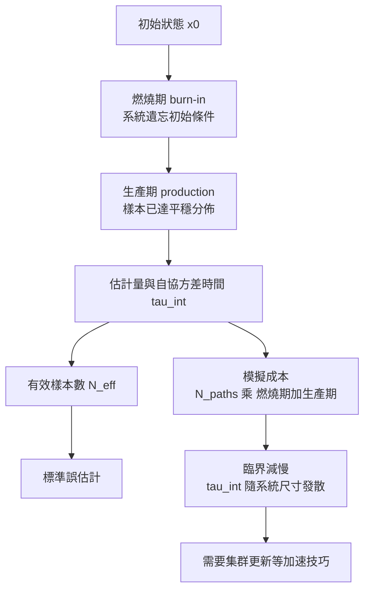
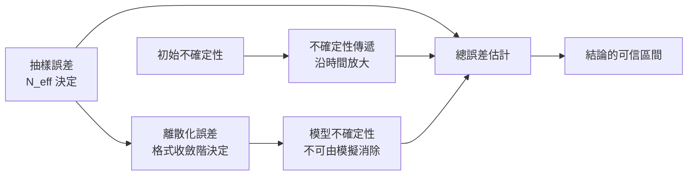

## 7.3　蒙地卡羅方法在隨機過程中的應用

[上一章：7.2　隨機微分方程的模擬](07.2-隨機微分方程的模擬.md) | [下一章：第8章　蒙地卡羅方法在物理中的應用](08.0-蒙地卡羅方法在物理中的應用.md)

## 學習目標

完成本節後，讀者應該能夠：

1. 說明在隨機過程上做蒙地卡羅估計時，估計量本身的**統計性質**與靜態情形有何不同，並引入自協方差時間（integrated autocorrelation time）的概念。
2. 正確地為路徑衍生的估計量計算有效樣本數與標準誤，而不是把序列相關的時間點當成獨立樣本。
3. 描述 Poisson 過程（抵達過程）的定義、性質，以及它與連續時間 Markov 鏈的關係。
4. 說明 stationary distribution 的概念與其存在條件，並解釋「burn-in」與「equilibration」在蒙地卡羅中的必要性。
5. 介紹 first-passage analysis（首次通過分析）的概念，說明它為何需要生存分析與累積分布（CDF）估計的技巧。
6. 說明不確定性如何沿時間傳遞（誤差傳播），以及為什麼相關性會讓誤差傳播公式必須加入相關長度因子。

## 7.3.1 靜態蒙地卡羅的假設在何處失效

[第4章](04.0-蒙地卡羅積分法.md) 的蒙地卡羅估計量

$$
\hat{\mu}_N = \frac{1}{N}\sum_{i=1}^{N} f(X_i)
$$


之所以能給出 $`O(N^{-1/2})`$ 的誤差率，完全依賴於 $`X_1,\dots,X_N`$ 的**獨立同分布**。在隨機過程中，若我們沿單一路徑取樣

$$
\hat{\mu}_T = \frac{1}{T}\int_0^T f(X_t)\,dt
$$


這些「樣本」 $`\{f(X_t)\}`$ 顯然不是獨立的：相鄰時刻的系統狀態幾乎相同。極端情形（擴散係數極小）下，整條路徑近乎常數，此時 $`\hat{\mu}_T`$ 的方差**趨於零**——估計「非常準」，但這是虛假的精度，因為我們只看了系統的一個實現。

這就是隨機過程蒙地卡羅統計的第一個核心問題：**序列相關性（serial correlation）**。

### 自協方差時間與有效樣本數

對平穩過程（stationary process），定義自協方差函數 $`C(\tau)=\mathrm{Cov}(f(X_t), f(X_{t+\tau}))`$ 與自相關函數 $`\rho(\tau)=C(\tau)/C(0)`$ 。**積分自協方差時間**（integrated autocorrelation time, IAT）為

$$
\tau_{\text{int}} = \frac{1}{2} + \int_0^\infty \rho(\tau)\,d\tau
$$


它度量「系統遺忘自己狀態」所需的時間尺度。於是，沿單一路徑時間平均的漸近方差不是 $`\sigma^2/T`$ ，而是

$$
\mathrm{Var}(\hat{\mu}_T) \approx \frac{2\tau_{\text{int}}\sigma^2}{T}
$$


其中 $`\sigma^2 = \mathrm{Var}(f(X_t))`$ 。**有效樣本數**因此是 $`N_{\text{eff}} = T/(2\tau_{\text{int}})`$ ，而非 $`T`$ 。

對照之下，若我們模擬 $`M`$ 條**彼此獨立**的路徑（每條長度 $`T`$ ），總體的等價有效樣本數是 $`M \cdot T/(2\tau_{\text{int}})`$ 。這解釋了為什麼實務上「多條短路徑」通常優於「一條長路徑」：前者能並行、後者受相關性拖累。

實務上 $`\tau_{\text{int}}`$ 用**連接自相關法（blocking / batch means）**估計：把時間序列切成 $`b`$ 個區塊，用區塊平均值的變數反推 $`\tau_{\text{int}}`$ 。

```python
import numpy as np

def blocking_autocorr_time(series):
    """以 batch means 法估計積分自協方差時間 tau_int（單位：樣本點）。"""
    x = np.asarray(series, dtype=float)
    n = x.size
    var = x.var(ddof=1)
    # 選擇區塊長度 b，使區塊數量足夠但每區塊仍含多個相依點
    b = max(1, int(np.sqrt(n)))
    nblocks = n // b
    bm = x[:nblocks * b].reshape(nblocks, b).mean(axis=1)
    # Var(batch mean) ≈ (2*tau_int/b) * var  => tau_int ≈ b * Var(bm) / (2 var)
    tau = b * bm.var(ddof=1) / (2.0 * var)
    return tau

def mc_time_average(paths, n_time, burn=100):
    """paths: (n_paths, n_time) 的樣本路徑矩陣。"""
    x = paths[:, burn:]
    n_paths, m = x.shape
    per_path_mean = x.mean(axis=1)
    est = per_path_mean.mean()
    # 有效樣本數：以路徑為單位（不同路徑獨立），路徑內用 tau_int 修正
    tau = blocking_autocorr_time(x[0])
    n_eff = n_paths * m / (2.0 * tau)
    se = per_path_mean.std(ddof=1) / np.sqrt(n_eff)
    return est, se, tau
```

這段程式碼的核心對應是：**「有效樣本數」是把路徑數與路徑長度、相關時間三者串起來的橋樑**。忽略 $`\tau_{\text{int}}`$ 而直接把 $`n_paths \times n_time`$ 當作樣本數，會嚴重低估誤差——這是隨機過程蒙地卡羅最常見的統計錯誤。

## 7.3.2 抵達過程與 Poisson 過程

許多物理與金融系統是由**事件**而非連續流量驅動的：光子撞擊探測器、粒子到達反應器、客戶訂單進入系統、保險理賠發生、電話來電。描述這類「事件在時間上到來」的模型是**抵達過程（arrival process）**。

**Poisson 過程** $`N(t)`$ 的定義是： $`N(0)=0`$ ，且對 $`0\le s<t`$ ，增量 $`N(t)-N(s)`$ 服從參數為 $`\lambda(t-s)`$ 的 Poisson 分佈（ $`\lambda`$ 為速率）。其導數過程是**指數分布的等待時間**（inter-arrival times），且各等待時間 iid。

Poisson 過程的關鍵性質：

- **無記憶性**： $`\Pr(N(t+h)-N(t)=k \mid N(t)=n) = \Pr(\text{Poisson}(\lambda h)=k)`$ ，與過去無關；
- **計數過程 $`N(t)`$ 本身是時間平均的強度**： $`N(t)/t \to \lambda`$ 幾乎必然；
- **過程獨立增量**：不同區間的計數獨立。

在連續時間 Markov 鏈的框架下，Poisson 過程是「單純事件率為 $`\lambda`$ 」的最小例子；更一般地，事件率依賴狀態時得到**非齊次 Poisson 過程**或 **Cox 過程**。

模擬 Poisson 過程有兩種標準方法：

1. **間距抽樣法**：抽 $`\tau_i \sim \text{Exp}(\lambda)`$ ，累加得到事件時刻。簡單但需要處理變數時間步長。
2. **最小事件法（ thinning / next-reaction）**：隨機化下一個事件時間，效率較高。

```python
import numpy as np

def poisson_arrivals(rate, T, rng):
    """以指數間隔抽樣產生 [0, T) 內的 Poisson 事件時刻。"""
    times = []
    t = 0.0
    while True:
        t += rng.exponential(1.0 / rate)
        if t >= T:
            break
        times.append(t)
    return np.array(times)

rng = np.random.default_rng(11)
for rate in (2.0, 5.0):
    ts = poisson_arrivals(rate, 1000.0, rng)
    print(f"rate={rate}: 事件數 = {len(ts)}, 實測速率 = {len(ts)/1000.0:.4f}")
```

這段程式對應 Poisson 過程的「等待時間是指數分佈」性質，以及計數過程的時間平均強度等於 $`\lambda`$ 的大數法則結論。

## 7.3.3 平穩分佈與燃燒期

如果隨機過程具有**平穩分佈**（stationary distribution） $`\pi`$ ，即滿足

$$
\pi(x) = \int \pi(y)\,K(y \to x)\,dy
$$


其中 $`K`$ 是轉移核，那麼蒙地卡羅模擬的長期平均便對應 $`\pi`$ 的統計量。但要達到平穩，需要「燃燒期」（burn-in）或「平衡期」（equilibration）——初期樣本受到初始條件影響，必須捨棄。

存在性並非自動：連續時間 Markov 鏈在**不可約（irreducible）**且**正遞歸（positive recurrent）**時有唯一的平穩分佈。對離散時間而言，若鏈是**不可約、aperiodic 且正遞歸**，則存在唯一的平穩分佈並且收斂到它。

值得注意的是，**燃燒期長度與自協方差時間是同一個現象的兩面**：系統遺忘初始狀態的時間約等於 $`\tau_{\text{int}}`$ 。這讓模擬成本可以直接估算：

$$
\text{總成本} \approx \underbrace{N_{\text{paths}}}_{\text{並行度}}\times \underbrace{(t_{\text{burn}} + t_{\text{prod}})}_{\text{每條路徑長度}}
$$


在統計力學中（例如 [8.1](08.1-物理模擬：熱力學與統計力學.md) 的 Ising 模型），臨界溫度附近會出現嚴重的**臨界減慢（critical slowing down）**： $`\tau_{\text{int}}`$ 隨格點尺寸 $`L`$ 以 $`\xi^z`$ （關聯長度 $`\xi`$ 指數、動力學臨界指數 $`z`$ ）發散。在二維 Ising 模型中 $`z \approx 2.17`$ ， $`\xi \sim |T-T_c|^{-\nu}`$ （ $`\nu=1`$ ），因此 $`\tau_{\text{int}} \sim |T-T_c|^{-2.17}`$ 。這意味著在臨界點附近，模擬所需的步數幾乎爆炸——這是統計力學蒙地卡羅最重要也最困難的實務問題，直接催生了集群（cluster）更新演算法等技術。

下圖說明平穩分佈、燃燒期與自協方差時間三者的關係，以及它們如何決定模擬成本。



這張圖表達的論點是：統計誤差與計算成本在本質上被同一個量 $`\tau_{\text{int}}`$ 綁定，因此效率優化不是「跑更多步」這麼單純。

## 7.3.4 首次通過分析

**首次通過時間**（first-passage time） $`\tau_A = \inf\{t \ge 0 : X_t \in A\}`$ 描述「系統第一次到達某個集合（或穿越某個門檻）所需的時間」。它是隨機過程中一大類重要量的核心：

- 化學反應：兩個分子首次相遇的時間 → 反應速率；
- 核物理：粒子首次衰變的時間 → 壽命；
- 金融：股價首次觸及障礙價位的時間 → 障礙期權；
- 隨機搜尋：首次找到全域最佳解的時間 → 優化算法的效率。

估計 $`\mathbb{E}[\tau_A]`$ 最直接的方法是模擬大量路徑，記錄首次通過時間；問題是**稀有事件**（例如很長的首次通過時間、或很小的穿越機率）會讓估計極不穩定。

此時需要累積分布函數的估計技巧：

- **Kaplan–Meier 估計**：處理右截斷資料（censored data）的非參數生存估計；
- **分位數回推法**：估計 $`\tau_A`$ 的某個分位數，再由分位數與分佈函數關係反推 $`\mathbb{E}[\tau_A]`$ ；
- **Poisson process 加速**：若首次通過可以用「次數過程」表示（例如 Poisson 過程的第一次事件），則事件之間有記憶性無關性，可用**重要性抽樣**（[第5章](05.0-變換抽樣法.md)）加速。

```python
import numpy as np

def first_passage_estimate(paths, barrier, above=True):
    """估計首次穿越門檻 barrier 的時間之平均與中位數。"""
    hits = []
    for path in paths:
        cond = (path >= barrier) if above else (path <= barrier)
        idx = np.argmax(cond) if cond.any() else -1
        hits.append(path[idx] if cond.any() else np.nan)
    hits = np.array(hits)
    finite = hits[~np.isnan(hits)]
    hit_rate = finite.size / hits.size
    # 未命中者的首次通過時間視為右截斷，不能直接當成無窮大丟棄
    return {
        "命中率": hit_rate,
        "平均首次通過時間": finite.mean() if finite.size else np.nan,
        "中位數": np.median(finite) if finite.size else np.nan,
    }
```

這段程式碼凸顯了首次通過分析的統計難點：**未命中的路徑提供的是右截斷資訊**，忽略它們會系統性低估首次通過時間。這與生存分析中處理 censoring 的方法完全一致。

## 7.3.5 不確定性沿時間的傳遞

在工程與金融中，我們常需要知道「模擬出的路徑族本身有多不確定」。若初始狀態 $`X_0`$ 帶有隨機性（例如由前一段模擬估計而來），這個不確定性會**沿時間傳播**。

線性化傳播公式為：若 $`X_t`$ 的方差為 $`v(t)`$ ，則在演化方程 $`dX = \mu(X)dt + \sigma(X)dW`$ 下，方差的演化近似遵循

$$
\frac{dv}{dt} = 2\,\mu'(X)\,v + \sigma^2(X)
$$


其解（線性情形 $`\mu' = m`$ ）為

$$
v(t) = v_0 e^{2mt} + \frac{\sigma^2}{2m}\left(e^{2mt}-1\right)
$$


這說明**變數的傳遞速率是指數型的**：在「平均漂移為正」的系統中，初始不確定性會被放大。這是為什麼在長期的金融模擬中，模型風險（初始校準與模型選擇的誤差）常常**大於**抽樣誤差。第 11 章的誤差分析與第 9.3 節的投資組合模擬都會回到這個主題。

下圖把本章的統計工具串成一條流程。



這張圖提醒讀者：蒙地卡羅模擬給出的信賴區間，只覆蓋了箭頭中「抽樣誤差」那一塊；把它誤當成完整的可信度，是實務中常見的過度信任。

## 本章要點

1. 隨機過程上的時間平均不是 iid 抽樣；自相關會讓有效樣本數遠小於觀測點數。
2. 積分自協方差時間 $`\tau_{\text{int}}`$ 是「記憶長度」的度量，估計量的漸近方差為 $`2\tau_{\text{int}}\sigma^2/T`$ 。
3. 「多條獨立短路徑」通常優於「一條長路徑」，因為前者有效樣本數更大且可完全並行。
4. Poisson 過程是典型的抵達過程，等待時間為指數分佈，具有無記憶性與獨立增量。
5. 平穩分佈需要不可約與正遞歸等條件；燃燒期長度與 $`\tau_{\text{int}}`$ 同量級。
6. 臨界減慢使 $`\tau_{\text{int}}`$ 發散，是統計力學蒙地卡羅的核心難題，催生集群更新等演算法。
7. 首次通過分析需要處理右截斷資料，稀有事件則需要生存分析與重要性抽樣。
8. 初始不確定性會隨時間被漂移指數放大，長期預測中模型風險常大於抽樣誤差。

## 延伸閱讀

- Gneiting, T. & Raftery, A. E. (2007). Strictly proper scoring rules, prediction, and estimation. *Journal of the American Statistical Association*, 102(477), 359–378.
- Newman, M. E. J. (1982). Monte Carlo Methods in Statistical Physics. Academic Press.（自協方差時間與阻塞分析的經典處理）
- Robert, C. P. & Casella, G. (2004). *Monte Carlo Statistical Methods*. Springer.
- Allen, L. J. S. (2003). *An Introduction to Stochastic Processes and to Monte Carlo Methods in Financial Applications*. Springer.
- [第11章：蒙地卡羅方法的誤差分析與改進](11.0-蒙地卡羅方法的誤差分析與改進.md)
