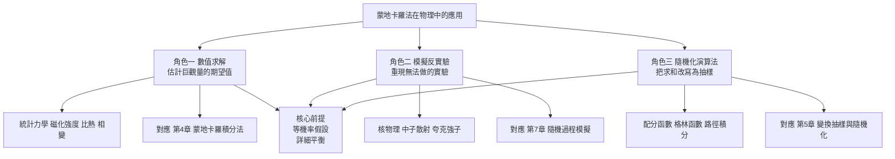

# 第8章　蒙地卡羅方法在物理中的應用

[上一章：第7章　隨機過程與模擬](07.0-隨機過程與模擬.md) | [下一章：8.1　物理模擬：熱力學與統計力學](08.1-物理模擬：熱力學與統計力學.md)

## 學習目標

完成本章後，讀者應該能夠：

1. 說明為什麼物理學是蒙地卡羅法最成功、也最「自然」的應用領域。
2. 理解統計力學的基本語言：微觀狀態、巨觀量、玻茲曼分佈、正則系綜。
3. 說明蒙地卡羅法在物理中扮演的三種角色：數值求解、模擬反實驗、以及**隨機化演算法**（把確定性求和轉成抽樣）。
4. 辨識統計力學蒙地卡羅與統計力學求和（statistical mechanics sums）之間的關係。
5. 概覽蒙地卡羅法在統計力學、粒子物理、量子化學、天文物理與生物物理中的代表性應用。
6. 理解物理應用對演算法提出的特殊要求：等機率假設的重要性、臨界減慢、符號問題、以及叢集更新等物理啟發的加速。
7. 說明本章之後三節的分工：8.1 建立統計力學框架，8.2 給出 Metropolis 演算法，8.3 處理量子系統。

## 8.0.1 為什麼物理是蒙地卡羅法的「第一現場」

回顧蒙地卡羅法的歷史（[第1章](01.0-引言：蒙地卡羅法的歷史與背景.md)）：1946 年 Ulam 與 von Neumann 在洛斯阿拉莫斯提出此法，最早的應用正是**核物理與統計力學**——計算中子擴散、計算液氦的狀態方程、計算多體系統的熱容。為什麼是物理？

答案有四個層次，而且彼此強化：

**（一）物理的問題天然就是「期望值」問題。** 巨觀量（例如壓力、磁化強度、比熱）都是大量微觀事件的統計平均。測量本身就是取平均的過程，所以「用抽樣來估計平均」在物理上不是近似，而是**與真實測量過程同構**。

**（二）物理提供了等機率假設。** 在經典統計力學中，微觀狀態 $`\{r_1,\dots,r_{3N}\}`$ 在相空間中均勻分佈（等機率假設），因此

$$
\langle A\rangle = \frac{1}{\Omega}\sum_{i} A(r_i) e^{-\beta E(r_i)}
$$

而「隨機選一個微觀狀態再測量 $`A`$ 」就給出同樣的期望。**這是蒙地卡羅法能直接用於物理的最根本理由**：蒙特卡羅的名字正是來自摩納哥的一個地名，而 Metropolis 演算法則是把「隨機選狀態」變成「有效率地選狀態」。

**（三）物理系統往往是「高維、但結構對稱」的。** 一個含 $`N`$ 個粒子的三維系統有 $`6N`$ 個自由度，直接積分不可能（維度災難）。但蒙地卡羅法的誤差率與維度無關，且物理系統的對稱性讓蒙地卡羅樣本特別有效。

**（四）物理需要「模擬反實驗」與「隨機化」的新工具。** 有些物理問題（如格點場論的配分函數）根本不該用蒙地卡羅法——那是重要性抽樣的領域。蒙地卡羅法在物理中催生了統計力學中的「隨機化演算法」，例如隨機化熱力力學（randomized thermodynamics, Parish & Broadbent 2005）用隨機化方法從零溫或高溫極限出發計算中間溫度的性質。

## 8.0.2 蒙地卡羅法在物理中的三種角色

下圖把蒙地卡羅法在物理中的用法分為三類，並指出每一類與本書前面章節的對應關係。

這張圖呼應本章的組織邏輯：8.1 建立「等機率假設 + 熱力學量」的框架，8.2 處理「如何在等機率假設下高效抽樣」的演算法問題，8.3 處理「量子系統無法直接使用等機率假設」時的理論修正。

## 8.0.3 各領域的應用地圖

### 統計力學

最經典的應用。給定 Hamiltonian $`H`$ 與溫度 $`T`$ ，估計配分函數 $`Z = \sum_i e^{-\beta H_i}`$ 與各種熱力學量的期望值。代表模型：Ising 模型（磁體）、Potts 模型、相變與臨界現象、液體與聚合物、蛋白質摺疊（[第15章](15.0-跨學科應用案例.md)）。

### 粒子物理與核物理

- **Lattice QCD（格點量子色動力學）**：把連續時空離散化到格點上，用蒙地卡羅法計算夸克偶素質量、强子質量、格點強耦合常數。1980 年代由 Wilson 開創，1990 年代之後成為粒子物理的標準工具。
- **蒙地卡羅方法計算核子-核散射截面**：這正是 1946 年 Los Alamos 的原始用途之一。

### 量子化學與材料科學

- **變分蒙地卡羅（variational Monte Carlo, VMC）**：用隨機波函數的期望值作為基態能量的上界（見 [8.3](08.3-1984年蒙地卡羅模擬量子系統.md)）。
- **擴散蒙地卡羅（Diffusion Monte Carlo, DMC）**：用投影技巧計算基態能量。
- **固體材料的有限溫性質**：Hubbard 模型的相變研究（其中著名的「負磁性問題」是蒙地卡羅史上最重要的難題之一）。

### 天文物理

- **N-body 模擬**：星系形成與演化、宇宙學結構形成（如 Millennium Simulation）。
- **N-body 本身是「決定論的」**（用 Newtonian 引力），但初始條件來自宇宙微波背景的隨機擾動，因此蒙地卡羅與多體方法交織。

### 生物物理

- 蛋白質摺疊的熱力學積分（[第15章](15.0-跨學科應用案例.md)）、序列設計、分子動力學的系綜取樣。

## 8.0.4 物理對演算法提出的四個特殊要求

蒙地卡羅法在物理中的成敗，取決於四個與純數學不同的要求。理解它們，就理解了為什麼統計力學催生了那麼多演算法。

**（一）等機率假設的可驗證性。** 在物理中，蒙地卡羅法的正確性建立在「微觀狀態等機率」之上。這個假設在平衡態有嚴格依據（等機率原理、Liouville 定理），但在非平衡態或玻璃態可能失效。演算法即使數值收斂，也可能收斂到錯誤的答案。

**（二）臨界減慢（critical slowing down）。** 在二階相變點附近，關聯長度發散，樣本的自協方差時間也發散，模擬成本急劇上升。物理學家因此發明了叢集更新（Swendsen–Wang, Wolff）、embedded cluster method 等加速演算法——這些都是「物理直覺驅動演算法設計」的典範。

**（三）符號問題（sign problem）。** 在費米子系統中，波函數為反對稱，量子力學期望值包含符號相消，使蒙地卡羅法退化為指數級複雜度。這是量子蒙地卡羅最根本的障礙（見 [8.3](08.3-1984年蒙地卡羅模擬量子系統.md)）。

**（四）尺度跨度巨大。** 從原子尺度（ $`10^{-10}`$ m）到星系尺度（ $`10^{20}`$ m），同一套演算法要同時處理多個數量級。這要求演算法必須**無量綱化（nondimensionalization）**並善用問題結構。

## 8.0.5 本章地圖

- **[8.1 物理模擬：熱力學與統計力學](08.1-物理模擬：熱力學與統計力學.md)**：建立統計力學的蒙地卡羅框架。微觀狀態與巨觀量的對應、玻茲曼分佈、等機率假設與正則系綜、等溫等壓系綜、Ising 模型示例（二維臨界溫度 $`T_c = 2/\ln(1+\sqrt2) \approx 2.269`$ ）、以及熱力學量的蒙地卡羅估計與自協方差時間。
- **[8.2 1953年 Metropolis 抽樣與粒子模擬](08.2-1953年Metropolis抽樣與粒子模擬.md)**：1953 年 Metropolis 等人的演算法原始細節，接受率 $`\min(1, e^{-\beta\Delta E})`$ 的推導、Metropolis–Hastings 1973 年的推廣、詳細平衡與平穩分佈的證明、與 Gibbs 取樣的關係、模擬退火的物理直覺、格林函數法。
- **[8.3 1984年蒙地卡羅模擬量子系統](08.3-1984年蒙地卡羅模擬量子系統.md)**：變分原理、費曼–卡爾托夫（Feynman–Kac）表示、路徑積分與蒙地卡羅、Parisi 在 1980 年代對自旋玻璃與 Ising 模型的工作、擴散蒙地卡羅與變分蒙地卡羅，以及費米子系統的符號問題與處理方式。

## 本章要點

1. 物理是蒙地卡羅法最成功的領域，因為巨觀量本質上是統計平均，而等機率假設提供了抽樣的合法性。
2. 蒙地卡羅法在物理中有三種角色：數值求解、模擬反實驗、以及隨機化演算法。
3. 統計力學的蒙地卡羅估計，本質是對配分函數加權的樣本求平均。
4. 物理對演算法有四個特殊要求：等機率假設的可驗證性、臨界減慢、符號問題、多尺度處理。
5. 統計力學催生了大量演算法（叢集更新、模擬退火、格林函數法），是「物理直覺驅動演算法」的寶庫。
6. 8.1 建立框架、8.2 給出演算法、8.3 推廣到量子，三者構成遞進關係。

## 延伸閱讀

- Newman, M. E. J. (1982). *Monte Carlo Methods in Statistical Physics*. Academic Press.
- Landau, D. P. & Binder, K. (2000). *Monte Carlo Methods in Statistical Physics*. Springer.
- Gould, H. & Tobochnik, J. (2021). *An Introduction to Computer Simulation Methods*. Addison-Wesley.
- [第7章：隨機過程與模擬](07.0-隨機過程與模擬.md)
- [第9章：蒙地卡羅方法在金融中的應用](09.0-蒙地卡羅方法在金融中的應用.md)
