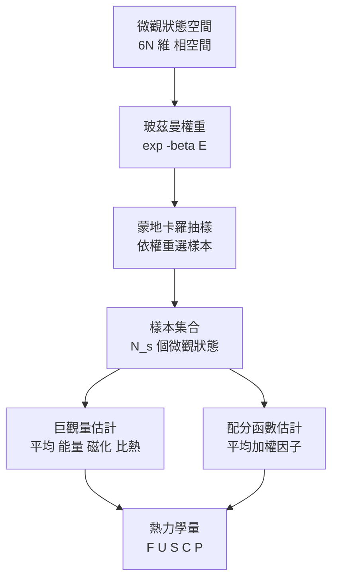
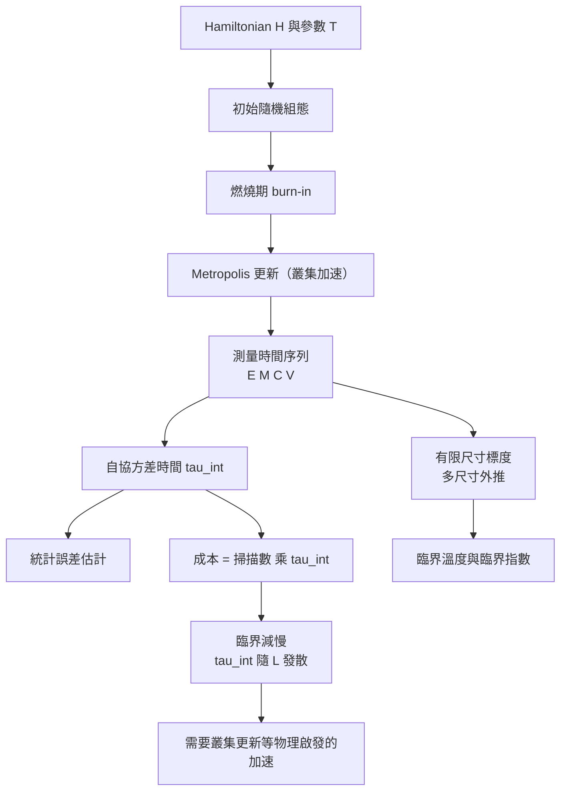

## 8.1　物理模擬：熱力學與統計力學

[上一章：第8章　蒙地卡羅方法在物理中的應用](08.0-蒙地卡羅方法在物理中的應用.md) | [下一章：8.2　1953年Metropolis抽樣與粒子模擬](08.2-1953年Metropolis抽樣與粒子模擬.md)

## 學習目標

完成本節後，讀者應該能夠：

1. 區分**微觀狀態**（microstate）與**巨觀量**（macrostate），並說明兩者之間是「多對少」的對應關係。
2. 推導玻茲曼分佈 $`p_i \propto e^{-\beta E_i}`$ ，並解釋其中每個因子的物理意義。
3. 說明等機率假設（equiprobability assumption）與正則系綜（canonical ensemble）的關係，並指出它在什麼條件下成立、什麼條件下可能失效。
4. 說明等溫等壓系綜（NPT）與正則系綜（NVT）的差異與各自的適用情境。
5. 以 Ising 模型為例，說明蒙地卡羅法如何估計熱力學量，並理解二維方格 Ising 模型的臨界溫度 $`T_c = 2/\ln(1+\sqrt{2})`$ 的意義。
6. 理解自協方差時間為什麼是統計力學蒙地卡羅的效率關鍵指標，以及臨界減慢的機制。
7. 說明有限尺寸效應（finite-size scaling）為什麼是統計力學模擬的必要工具。

## 8.1.1 從微觀到巨觀：統計力學的基本問題

考慮 $`N`$ 個粒子在容器中的系統。每個粒子的位置 $`r_i`$ 與速度 $`v_i`$ 構成一個**微觀狀態**

$$
\Gamma = \{(r_1,v_1,\dots,r_N,v_N)\}
$$


把 $`\Gamma`$ 寫成 $`3N`$ 個位置與 $`3N`$ 個速度，共 $`6N`$ 個連續維度。 $`N=10^{23}`$ 時， $`6N \approx 6\times10^{23}`$ 維——積分完全不可能。

而實驗測量的是**巨觀量**：壓力 $`P`$ 、體積 $`V`$ 、溫度 $`T`$ 、能量 $`E`$ 、熵 $`S`$ 、磁化強度 $`M`$ 。統計力學的核心命題是：

> 巨觀量在平衡態的期望值，等於以適當權重對所有微觀狀態求平均。

權重來自**玻茲曼分佈**。設系統能量為 $`E_i`$ （第 $`i`$ 個微觀狀態的能量），溫度為 $`T`$ ，則

$$
p_i = \frac{e^{-\beta E_i}}{Z}, \qquad \beta = \frac{1}{k_B T}, \qquad Z = \sum_i e^{-\beta E_i}
$$


$`Z`$ 是**配分函數**（partition function）， $`k_B`$ 是玻茲曼常數。每個因子的意義是：

- $`e^{-\beta E_i}`$ ：狀態 $`i`$ 的權重。能量越低權重越大（Boltzmann 的「能量優先」原理）；
- $`\beta`$ ：溫度的倒數，扮演「軟化係數」；高溫時 $`\beta \to 0`$ ，所有狀態權重趨於均等（ $`p_i \to 1/\Omega`$ ），這就是**等機率假設**在高溫極限的表現；
- $`Z`$ ：正規化因子。

對任意 $`A`$ （可观測量），熱力學期望為

$$
\langle A\rangle = \frac{\sum_i A_i e^{-\beta E_i}}{\sum_i e^{-\beta E_i}}
$$


注意分母是 $`Z`$ ，這使得**估計配分函數本身成為一個困難但必要的任務**（常以累加和的對數估計，即 free-energy difference 方法）。

下圖說明整個統計力學蒙地卡羅的邏輯鏈：從微觀狀態空間出發，經由權重取得代表性樣本，再聚合為巨觀量。



這張圖的核心論點是：蒙地卡羅法**迴避了配分函數的積分**，改用「抽樣 + 平均」來繞過它；配分函數只能間接地（以累加的方式）估計。

## 8.1.2 等機率假設與正則系綜

**正則系綜**（canonical ensemble, NVT）固定粒子數 $`N`$ 、體積 $`V`$ 、溫度 $`T`$ ，允許能量交換以維持溫度恆定。其核心假設是：

> 在平衡態，所有可及微觀狀態出現的機率相等。

這是「孤立系綜 + 熱浴」在遍歷（ergodic）假設下的結果，也是 Boltzmann 的統計詮釋。它的成立需要兩個條件：

1. **遍歷性（ergodicity）**：系統的動力學能夠在有限時間內探索整個能量殼層；
2. **熱平衡**：與環境交換能量後達到平衡。

值得注意的是，**經典蒙地卡羅法其實不依賴物理過程的動力學**。Metropolis 演算法（[8.2](08.2-1953年Metropolis抽樣與粒子模擬.md)）是「靜態」的：它直接從玻茲曼分佈抽樣，與真實的物理動力學無關。這是統計力學蒙地卡羅法的一個根本優點：**我們可以用任意方便的抽樣機制，得到正確的平衡分佈**——儘管這個機制的物理實作（如 1953 年原文用液態氫）可能非常笨拙。

在非平衡態（例如玻璃態、有驅動力的活性物質系統），遍歷性可能失效，此時「等機率假設」不適用，蒙地卡羅抽樣會收斂到錯誤的結果——因為它找到的是「動力學受限」的分佈而不是平衡分佈。這是理解物理蒙地卡羅失敗案例的關鍵。

## 8.1.3 等溫等壓系綜（NPT）

實驗上常測量的是**等溫等壓**條件下的性質（例如物性隨壓力變化）。在 NPT 系綜中，體積 $`V`$ 成為一個額外的座標，權重多了一個因子：

$$
p(V) \propto V^N e^{-\beta P V} \, \big[ Z_N(V)\big]
$$


其中 $`Z_N(V)`$ 是固定體積時的配分函數，蒙地卡羅抽樣時對 $`V`$ 的移動需要搭配 **Metropolis–Hastings 的比例接受**（因體積改變會改變 proposal 的對稱性）。NPT 模擬的優點是能給出**定壓下的密度波動**，這是判斷相變的關鍵判據之一。

## 8.1.4 Ising 模型：教科書級的示範

**Ising 模型**是統計力學蒙地卡羅最著名的示範系統。 $`N_s`$ 個自旋 $`s_i \in \{-1,+1\}`$ 排列在格點上（例如二維方格 $`L\times L`$ ），Hamiltonian 為

$$
H = -J \sum_{\langle i,j\rangle} s_i s_j - h \sum_i s_i
$$


其中 $`J>0`$ 為耦合常數（鐵磁）， $`h`$ 為外磁場， $`\sum_{\langle i,j\rangle}`$ 對每對最近鄰求和。

能量差（翻轉一個自旋時）是

$$
\Delta E = 2 s_i \left( J \sum_{j\in \mathrm{nn}(i)} s_j + h \right)
$$


這個簡單的式子讓 Metropolis 演算法極為高效：每次只翻一個自旋，只需知道 $`4`$ 個最近鄰（2D 方格）的值。

### 二維方格 Ising 模型的臨界溫度

這是一個有精確解析解的模型。Onsager（1944）求得二維方格 Ising 模型的臨界溫度為

$$
T_c = \frac{2J}{k_B \ln(1+\sqrt{2})} \approx \frac{2.269\,J}{k_B}
$$


這個值的重要性在於：**它是蒙地卡羅法在物理中最著名的驗證案例**。蒙地卡羅模擬不需要知道 $`T_c`$ ，卻能在 $`T_c`$ 附近觀測到比熱與磁化率的奇異行為，測得的臨界溫度與 Onsager 解析值吻合到小數點後數位，確立了蒙地卡羅法作為物理研究工具的地位。

臨界溫度處的普適性（universality）也很有意思：即使模型細節（格點形狀、耦合範圍）不同，只要維度與對稱性相同，臨界指數 $`\nu, \beta, \gamma`$ 都相同。

```python
import numpy as np

def ising_energy(spins, J=1.0, h=0.0, L=None):
    """二維方格 Ising 模型的總能量（週期邊界）。"""
    if L is None:
        L = spins.shape[0]
    total = 0.0
    for i in range(L):
        for j in range(L):
            total -= J * spins[i, j] * (spins[(i+1) % L, j] + spins[i, (j+1) % L])
    total -= h * spins.sum()
    return total

def metropolis_sweep(spins, rng, J=1.0, beta=0.4, h=0.0):
    """一次 Metropolis 掃描：嘗試翻轉所有自旋（順序隨機）。"""
    L = spins.shape[0]
    for idx in rng.permutation(L * L):
        i, j = divmod(idx, L)
        nb = (spins[(i+1) % L, j] + spins[(i-1) % L, j]
              + spins[i, (j+1) % L] + spins[i, (j-1) % L])
        dE = 2.0 * spins[i, j] * (J * nb + h)
        # 接受率 min(1, exp(-beta*dE))
        if dE <= 0 or rng.random() < np.exp(-beta * dE):
            spins[i, j] *= -1
    return spins

def run_ising(L=16, beta=0.44, n_sweeps=4000, n_meas=1000, rng=None):
    """執行 Ising 模擬，回傳磁化強度與能量的時間序列。"""
    rng = rng or np.random.default_rng(3)
    spins = rng.choice([-1, 1], size=(L, L))
    # 燃燒期：讓系統進入平穩分佈
    for _ in range(n_sweeps // 4):
        metropolis_sweep(spins, rng, beta=beta)
    mags, energies = [], []
    for _ in range(n_meas):
        metropolis_sweep(spins, rng, beta=beta)
        mags.append(spins.mean())
        energies.append(ising_energy(spins, L=L))
    return np.array(mags), np.array(energies)

rng = np.random.default_rng(3)
for beta in (0.20, 0.44, 0.60):
    m, e = run_ising(beta=beta, rng=rng)
    print(f"beta={beta:.2f}  <m>={m.mean():+.4f}  <E>={e.mean():+.3f}")
```

程式碼對應的理論是：**Metropolis 接受率 $`\min(1, e^{-\beta\Delta E})`$ **（下一節詳述）與**玻茲曼分佈**；磁化強度 $`m = \frac{1}{N_s}\sum_i s_i`$ 是序參量（order parameter），用來偵測相變。

## 8.1.5 熱力學量的蒙地卡羅估計

給定樣本 $`\{x_1,\dots,x_M\}`$ 依玻茲曼分佈抽樣，各種量的估計如下。

**內能**： $`\langle E\rangle = \frac{1}{M}\sum_m E(x_m)`$ 。

**比熱**：由能量波動給出（fluctuation–dissipation 定理）

$$
C_V = \frac{\langle E^2\rangle - \langle E\rangle^2}{k_B T^2}
$$


這說明：**比熱不需要額外抽樣，而是從能量的波動中「免費」得到**。這是統計力學蒙地卡羅的優雅之處。

**熵與自由能**： $`F = -k_B T \ln Z`$ 。因為 $`Z`$ 難以直接估計，通常用以下技巧：

- **累積和法（cumulative sum method）**：把 $`Z`$ 分解為高溫參考與低溫參考的乘積，累積中間點；
- **Bennett 接受比例法（BAR）**：用兩個溫度的模擬資料估計自由能差；
- **Wang–Landau 演算法**：在能量空間建立密度，漸漸降低接受率，可直接估計自由能。

### 自協方差時間：效率的關鍵指標

熱力學量的估計誤差（對單一軌跡的時間平均）為

$$
\sigma(\langle A\rangle) \approx \sqrt{\frac{2\tau_{\text{int}}(A)\,\mathrm{Var}(A)}{M}}
$$


其中 $`M`$ 是總掃描數、 $`\tau_{\text{int}}`$ 是 $`A`$ 的積分自協方差時間。**在 $`T_c`$ 附近， $`\tau_{\text{int}}`$ 急劇增大**——這就是臨界減慢。

在二維 Ising 模型中，臨界溫度處有

$$
\tau_{\text{int}} \sim \xi^{z} \sim L^{z\nu}
$$


其中 $`\xi`$ 是關聯長度、 $`z\approx 2.17`$ 是動力學臨界指數、 $`\nu=1`$ 是靜態臨界指數。因為 $`\xi \sim L`$ 在臨界點， $`\tau_{\text{int}} \sim L^{2.17}`$ ——**系統尺寸增大 10 倍，所需步數增加約 150 倍**。這解釋了為什麼二維 Ising 的蒙特卡羅研究需要叢集更新演算法，以及為什麼「臨界減慢」是統計力學蒙地卡羅最著名的實務難題。

## 8.1.6 有限尺寸效應與有限尺寸標度

模擬總是有限尺寸的 $`L`$ ，但我們想要的是無限系統的極限。**有限尺寸標度（finite-size scaling）**假設單一特徵標度長度 $`\xi(t)`$ （其中 $`t=(T-T_c)/T_c`$ ），則

$$
M(t,L) = L^{1/\nu}\,\mathcal{M}(tL^{1/\nu})
$$


這讓研究者能從多個尺寸的資料，外推臨界指數並檢驗普適性。實務上這是統計力學論文的標準流程。

下圖總結本節的統計力學蒙地卡羅工作流程與各個量的關係。



這張圖把 8.1 的技術串成一條完整流程，並指出效率問題的根源在 $`\tau_{\text{int}}`$ 而不在抽樣數本身——這正是 [8.2](08.2-1953年Metropolis抽樣與粒子模擬.md) 演算法設計的動機。

## 本章要點

1. 微觀狀態是高維（ $`6N`$ 維）的；巨觀量是統計平均；蒙地卡羅法用抽樣繞開積分。
2. 玻茲曼分佈 $`p_i \propto e^{-\beta E_i}`$ 給出微觀狀態的權重， $`Z`$ 為配分函數。
3. 等機率假設是高溫極限的表現，成立需要遍歷性；非平衡態可能失效，導致「收斂到錯誤答案」。
4. 蒙地卡羅抽樣是靜態的，不需要遵循真實物理動力學，只要平穩分佈正確即可。
5. NPT 系綜需要用 Metropolis–Hastings 處理體積改變造成的 proposal 不對稱。
6. 二維方格 Ising 模型的 $`T_c = 2J/(k_B\ln(1+\sqrt2)) \approx 2.269 J/k_B`$ ，是蒙地卡羅法最著名的物理驗證。
7. 比熱可由能量波動免費得到（fluctuation–dissipation 定理），但**配分函數與自由能**仍需特殊技巧（BAR、Wang–Landau）。
8. 誤差由 $`2\tau_{\text{int}}\mathrm{Var}/M`$ 決定；臨界減慢使 $`\tau_{\text{int}} \sim L^{z\nu}`$ 發散，是統計力學蒙地卡羅的核心難題。
9. 有限尺寸標度是多尺寸外推與普適性檢驗的標準工具。

## 延伸閱讀

- Pathria, R. K. & Beale, P. D. (2021). *Statistical Mechanics*. Academic Press.
- Newman, M. E. J. (1982). *Monte Carlo Methods in Statistical Physics*. Academic Press.
- Onsager, L. (1944). Crystal statistics. I. *Physical Review*, 60(12), 1177–1219.
- Landau, D. P. & Binder, K. (2000). *Monte Carlo Methods in Statistical Physics*. Springer.
- [8.2　1953年Metropolis抽樣與粒子模擬](08.2-1953年Metropolis抽樣與粒子模擬.md)
