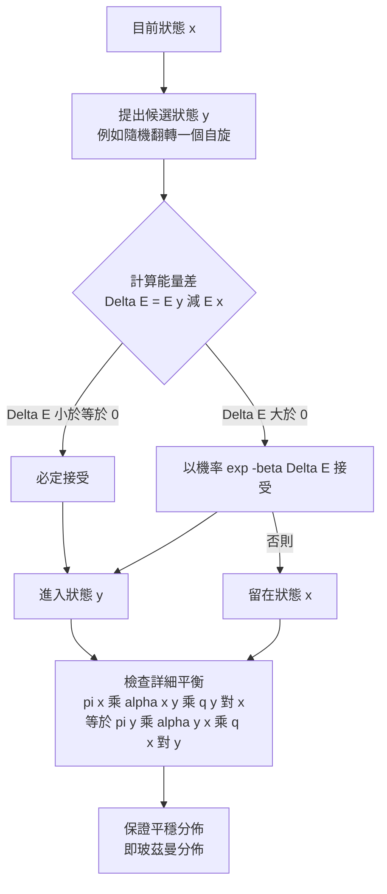

## 8.2　1953年Metropolis抽樣與粒子模擬

[上一章：8.1　物理模擬：熱力學與統計力學](08.1-物理模擬：熱力學與統計力學.md) | [下一章：8.3　1984年蒙地卡羅模擬量子系統](08.3-1984年蒙地卡羅模擬量子系統.md)

## 學習目標

完成本節後，讀者應該能夠：

1. 說明 1953 年 Metropolis 等人原始工作的問題背景、抽樣機制與關鍵洞見。
2. 推導 Metropolis 接受率 $`\min(1, e^{-\beta\Delta E})`$ 的來源，並解釋為什麼「只接受 downhill move + 以 Boltzmann 因子接受 uphill move」能保證正確抽樣。
3. 陳述並證明**詳細平衡**（detailed balance）與**平穩分佈**（stationary distribution）的關係，以及為什麼詳細平衡比平穩分佈更易於設計。
4. 說明 Metropolis–Hastings（1973）如何推廣 Metropolis 演算法以處理非對稱的 proposal。
5. 說明 Metropolis 抽樣與 Gibbs 取樣（Gibbs sampling）的關係：後者可視為前者的特例。
6. 解釋模擬退火（simulated annealing）的物理直覺，以及 Metropolis 接受率如何成為溫度schedule。
7. 說明格林函數法（Green's function methods）在計算力學與蒙地卡羅中的角色。
8. 實作並比較 Metropolis、Gibbs 與叢集更新（Swendsen–Wang）在效率上的差異。

## 8.2.1 1953 年：問題是什麼

1953 年，Nicholas Metropolis、Arthur Rosenbluth、Marianne Rosenbluth、Edward Teller 與 John G. Hammersley 在 *Journal of Chemical Physics* 發表〈Equation of State Calculations by Fast Computing Machines〉。他們面對的問題是：用什麼數值方法計算一個有 $`N`$ 個粒子的多體系統的狀態方程？

直接列舉微觀狀態是不可能的。但 1953 年的計算機（IBM 701）速度極慢——每秒僅數萬次操作，且記憶體只有 2K 字。因此核心需求是：

> 找到一種方法，能**跳過**大部分不可能的微觀狀態，只在「有可能」的狀態之間移動。

Metropolis 等人的答案是：把「列舉」換成「走樣本路徑」。讓系統做一系列局域的小變動（proposal），並依 Metropolis 規則決定是否接受。整個論文的貢獻不是提出蒙地卡羅法本身（那是 1946 年的工作），而是**第一次給出一個能有效抽樣平衡分佈的實用演算法**。

原始論文用的是液態氫的模型，透過「每一步用隨機位移嘗試移動粒子」來產生 proposal，1953 年的實驗結果能重現實驗測得的比容。論文標題中的「Fast Computing Machines」點出了動機。

## 8.2.2 Metropolis 接受率的推導

設定：狀態空間 $`\mathcal{X}`$ ，能量 $`E(x)`$ ，目標分佈 $`\pi(x) \propto e^{-\beta E(x)}`$ 。每步提出一個新狀態 $`y`$ ，然後以某個接受機率 $`\alpha(x,y)`$ 接受。

Metropolis 的提議是：

$$
\alpha(x,y) = \min\left(1, \frac{e^{-\beta E(y)}}{e^{-\beta E(x)}}\right)
= \min\left(1, e^{-\beta \Delta E}\right), \qquad \Delta E = E(y)-E(x)
$$


其直覺可以分兩部分：

- **若 $`\Delta E \le 0`$ （能量下降）**： $`e^{-\beta\Delta E} \ge 1`$ ，接受率為 1，**必定接受**。
- **若 $`\Delta E > 0`$ （能量上升）**：接受率為 $`e^{-\beta\Delta E} < 1`$ ，**以 Boltzmann 因子接受**。

為什麼這個簡單規則能保證目標分佈？證明的核心是**詳細平衡**（detailed balance）：

$$
\pi(x)\,\alpha(x,y)\,q(y \mid x) = \pi(y)\,\alpha(y,x)\,q(x \mid y)
$$


其中 $`q(y|x)`$ 是 proposal 機率。若 proposal 是**對稱的**（ $`q(y|x)=q(x|y)`$ ），則我們只需

$$
\pi(x)\,\alpha(x,y) = \pi(y)\,\alpha(y,x)
$$


代入 Metropolis 接受率即可驗證：

- 若 $`E(y) \le E(x)`$ ：左邊 $`\pi(x)\cdot 1 = \pi(y)e^{-\beta\Delta E}`$ ，右邊 $`\pi(y)\,e^{-\beta\Delta E}`$ ，相等；
- 若 $`E(y) > E(x)`$ ：左邊 $`\pi(x)e^{-\beta\Delta E} = \pi(y)`$ ，右邊 $`\pi(y)\cdot 1`$ ，相等。

所以**詳細平衡成立**，而詳細平衡蘊含平穩分佈 $`\pi`$ （此處即玻茲曼分佈）。這就是 Metropolis 演算法的正確性證明的核心。

**關鍵洞見**：Metropolis 接受率只依賴**能量差** $`\Delta E`$ ，不需要知道配分函數 $`Z`$ 。這是它能夠工作的根本原因，也是它比其他方法（例如 Gibbs 抽樣需要完整條件分佈）更通用、更容易實作的地方。

## 8.2.3 詳細平衡與平穩分佈

兩個層次必須分清：

- **平穩分佈（stationary distribution）**：分佈 $`\pi`$ 滿足 $`\sum_x \pi(x)q(y|x) = \pi(y)`$ 。這是 Markov 鏈長期停留在 $`\pi`$ 的條件。
- **詳細平衡（detailed balance）**：更强的條件，逐對地平衡流入與流出。它蘊含平穩分佈，反之則不然。

設計演算法時偏好詳細平衡，因為它的**充分條件是局部且成對的**：只需檢查每對 $`(x,y)`$ 的等式，不必檢查整個分佈方程。

下圖說明 Metropolis 演算法在狀態空間中的移動與詳細平衡的檢查方式。



這張圖的論點：Metropolis 演算法的正確性不來自「直覺」，而是來自逐對的詳細平衡檢查；每一對狀態的權重流必須相等，這是整個統計力學蒙地卡羅的可靠性基石。

```python
import numpy as np

def metropolis_step(spins, i, j, beta, J=1.0, h=0.0, rng=None):
    """嘗試翻轉 spins[i, j]，依 Metropolis 規則決定是否接受。"""
    rng = rng or np.random.default_rng()
    L = spins.shape[0]
    s = spins[i, j]
    nb = (spins[(i+1) % L, j] + spins[(i-1) % L, j]
          + spins[i, (j+1) % L] + spins[i, (j-1) % L])
    dE = 2.0 * s * (J * nb + h)          # 只需要能量差
    if dE <= 0.0 or rng.random() < np.exp(-beta * dE):
        spins[i, j] = -s
        return True
    return False

def metropolis_gibbs(spins, beta, n_sweeps, rng, J=1.0, h=0.0):
    """Metropolis 抽樣 + Gibbs 取樣：逐點自旋依條件分佈抽樣。"""
    L = spins.shape[0]
    for _ in range(n_sweeps):
        for idx in rng.permutation(L * L):
            i, j = divmod(idx, L)
            # 條件分佈 p(s=+1 | 鄰居) ∝ exp(-beta * E)
            nb = (spins[(i+1) % L, j] + spins[(i-1) % L, j]
                  + spins[i, (j+1) % L] + spins[i, (j-1) % L])
            p_plus = 1.0 / (1.0 + np.exp(-2.0 * beta * (J * nb + h)))
            spins[i, j] = 1 if rng.random() < p_plus else -1
    return spins
```

上面第二個函式示範了 **Gibbs 取樣**：直接從條件分佈 $`p(s_i | s_{\setminus i}) \propto e^{-\beta E}`$ 抽樣。等價地，它等價於一個**總是接受**的 Metropolis 步（在「只改變一個自旋」的 proposal 下，條件分佈恰是 Metropolis 的接受後分佈）。這是 Metropolis 與 Gibbs 的確切關係：**Gibbs 是 Metropolis 在最簡單 proposal 下的退化形式**。

## 8.2.4 Metropolis–Hastings（1973）

1973 年 W. K. Hastings 把 Metropolis 演算法推廣到**非對稱 proposal**。此時詳細平衡要求

$$
\pi(x)\,q(y|x)\,\alpha(x,y) = \pi(y)\,q(x|y)\,\alpha(y,x)
$$


解出接受率

$$
\alpha(x,y) = \min\left(1, \frac{\pi(y)\,q(x|y)}{\pi(x)\,q(y|x)}\right)
$$


這就是 **Metropolis–Hastings (MH)** 演算法。當 $`q`$ 對稱時，MH 退回 Metropolis。

為什麼需要 MH？因為**好的 proposal 很重要**：若 proposal 太有效率（例如每步改變太多），接受率會低，導致自相關時間長；若 proposal 太無效率，接受率高但移動太小，同樣浪費步數。MH 讓我們可以自由設計 proposal（例如「一次翻轉一個自旋叢集」）並用 $`q`$ 的比值做修正。

MH 的另一個重要應用是**重要性抽樣 + Metropolis 的混合**：把 [第5章](05.0-變換抽樣法.md) 的重要性抽樣作為 proposal，形成 **Metropolis–Hastings importance sampling**。這是統計物理中處理「強關聯或稀有事件」的重要工具，例如稀薄氣體的維里展開。

## 8.2.5 模擬退火：物理直覺與演算法

**模擬退火**（simulated annealing）由 Kirkpatrick, Gelatt & Vecchi（1983）提出，其直覺來自冶金：把金屬加熱到高溫使原子充分混合，再緩慢冷卻，原子最終找到能量最低（最穩定）的晶格結構。

對應到 Metropolis 接受率 $`\min(1, e^{-\beta\Delta E})`$ ，模擬退火就是讓 $`\beta = 1/(k_BT)`$ 隨時間**遞增**（溫度遞減）：

$$
\alpha_t = \min\left(1, e^{-\beta(t)\,\Delta E}\right), \qquad \beta(t) \uparrow \infty
$$


- 高溫時 $`\beta`$ 小，幾乎所有 move 都接受，系統在能量 landscapes 上自由漫遊；
- 低溫時 $`\beta`$ 大，只有 downhill move 被接受，系統逐漸「凍結」在低能態。

**前因後果**：這個簡單的改動解決了 Metropolis 在**多峰能量 landscapes** 上的根本缺陷——純 Metropolis 是個貪婪過程，容易卡在局部極小；退火讓系統有機會跳出。要保證以機率 1 找到全域最佳解，需要 $`T(t)`$ 冷卻得夠慢（ $`\log`$ 冷卻），這就是 Hajek（1988）的冷卻 schedule 準則。

**然而**：純粹的退火在連續最佳化中的效率很差（冷卻太慢）。這就引出本章與 [第10章](10.0-變數選擇與蒙地卡羅優化.md) 的連結——**模擬退火在物理中的成功，是因為它被用在「離散」且「能量 landscapes 有明確結構」的系統上**；而現代連續最佳化方法（Metropolis-adjusted Langevin algorithm、演化策略）則是融合了退火的思想與梯度資訊。

## 8.2.6 格林函數法

在化學物理與計算材料學中，**格林函數法（Green's function methods / Monte Carlo Green's function）** 是一類以「嘗試一個局域變動 → 用格林函數計算接受機率」為骨架的演算法。與 Metropolis 的關鍵差異是：**不需要明確寫出能量差 $`\Delta E`$ **，而是用接受機率的比值

$$
\alpha = \min\left(1, \frac{|G(y|x)|^2}{|G(x|y)|^2}\right)
$$


其中 $`G`$ 是狀態間的格林函數（轉移核）。這使得格林函數法能處理 Metropolis 難以實作的模型，例如：

- **DFT 的第一性原理計算**：能改變原子數目、能做變數基底變換；
- **ReaxFF 等反應力場**：能處理化學鍵的斷裂與形成；
- **MC（Monte Carlo）–MD（分子動力學）混合方法**：用 MC 做全域跳躍、用 MD 做局部探索。

格林函數法的推廣是 **Wang–Landau 與類似的加權採樣演算法**：不只依 Boltzmann 權重抽樣，而是依一個自適應更新的密度 $`g(E)`$ 抽樣，最終讓 $`g(E) \propto e^{-\beta E}`$ 。

## 8.2.7 效率比較：單自旋更新 vs 叢集更新

臨界減慢（見 [8.1](08.1-物理模擬：熱力學與統計力學.md)）迫使我們引入叢集更新。**Swendsen–Wang** 演算法的想法是：不再逐個自旋翻轉，而是按「相同符號的相鄰自旋團」做叢集翻轉，叢集大小由 $`p = 1-e^{-2\beta J}`$ 決定。在臨界點附近，叢集大小與系統尺寸同階，因此自協方差時間從 $`L^{z\nu}`$ 降到約 $`L^{1/2}`$ ，是數量級的改善。

```python
import numpy as np

def swendsen_wang(spins, beta, J=1.0, rng=None):
    """Swendsen-Wang 叢集更新（Ising 模型，無外場）。"""
    rng = rng or np.random.default_rng()
    L = spins.shape[0]
    p = 1.0 - np.exp(-2.0 * beta * J)     # 鍵的開啟機率
    visited = np.zeros((L, L), dtype=bool)
    # 先依鍵的機率建立 bond（鍵）集合
    bonds = rng.random((L, L)) < p          # 水平方向的鍵
    bonds_v = rng.random((L, L)) < p        # 垂直方向的鍵
    new = np.empty_like(spins)
    for idx in rng.permutation(L * L):
        i, j = divmod(idx, L)
        if visited[i, j]:
            continue
        sign = spins[i, j]
        # 以 flood fill 找出同號叢集
        stack = [(i, j)]
        visited[i, j] = True
        cluster = []
        while stack:
            ci, cj = stack.pop()
            cluster.append((ci, cj))
            for ni, nj, has in (
                ((ci + 1) % L, cj, bonds[ci, cj]),
                ((ci - 1) % L, cj, bonds[(ci - 1) % L, cj]),
                (ci, (cj + 1) % L, bonds_v[ci, cj]),
                (ci, (cj - 1) % L, bonds_v[ci, (cj - 1) % L]),
            ):
                if has and not visited[ni, nj] and spins[ni, nj] == sign:
                    visited[ni, nj] = True
                    stack.append((ni, nj))
        # 叢集以機率 1/2 決定是否整體翻轉
        flip = 1 if rng.random() < 0.5 else -1
        for ci, cj in cluster:
            new[ci, cj] = flip * sign
    return new
```

這段程式碼示範了「叢集更新」的核心：以物理關聯結構（鍵的開啟機率）為基礎，把同號的自旋綁成叢集，整叢翻轉。它是統計力學演算法設計的代表作——**算法的結構直接來自物理的關聯結構**。

## 8.2.8 前因後果

Metropolis 演算法解決了「如何在正確的分佈上抽樣」；Hastings 推廣解決了「如何在 proposal 不對稱時抽樣」；退火解決了「如何在多峰 landscapes 上逃脫」；格林函數法解決了「如何在無法寫出 $`\Delta E`$ 時抽樣」；叢集更新解決了「如何在臨界減慢下加速」。

剩下的一個根本問題是：**這一切都建立在「目標分佈已知且能量可算」的前提上**。但量子力學的目標分佈是波函數的平方，而且對費米子系統會出現符號相消——這正是 [8.3](08.3-1984年蒙地卡羅模擬量子系統.md) 要處理的。

## 本章要點

1. Metropolis（1953）首次給出能有效抽樣平衡分佈的實用演算法，貢獻不在蒙地卡羅概念本身。
2. 接受率 $`\min(1, e^{-\beta\Delta E})`$ 只依賴能量差，不需要配分函數 $`Z`$ ——這是它通用性的來源。
3. 正確性來自**詳細平衡**（逐對的權重流相等），它蘊含平穩分佈。
4. Metropolis–Hastings（1973）處理非對稱 proposal，允許自由設計高效的移動機制。
5. Gibbs 取樣可視為 Metropolis 在最簡單 proposal 下的特例。
6. 模擬退火讓 $`\beta`$ 隨時間遞增，用溫度擾動逃脫局部極小；但要保證全域最佳需 $`\log`$ 冷卻。
7. 格林函數法用轉移核的比值決定接受，避免明確計算 $`\Delta E`$ ，是化學與材料科學的標準工具。
8. Swendsen–Wang 叢集更新利用物理關聯結構，把臨界點的自協方差時間從 $`L^{z\nu}`$ 降到約 $`L^{1/2}`$ 。

## 延伸閱讀

- Metropolis, N., Rosenbluth, A. W., Rosenbluth, M. N., Teller, A. H. & Hammersley, J. E. (1953). Equation of state calculations by fast computing machines. *Journal of Chemical Physics*, 21(6), 1087–1092.
- Hastings, W. K. (1970). Monte Carlo sampling methods using Markov chains and their applications. *Biometrika*, 57(1), 97–109.
- Geman, S. & Geman, D. (1984). *Stochastic Relaxation, Gibbs Distributions, and the Bayesian Restoration of Images*. Wiley.
- Kirkpatrick, S., Gelatt, C. D. & Vecchi, M. P. (1983). Optimization by simulated annealing. *Science*, 220(4598), 671–680.
- Swendsen, R. H. & Wang, J.-S. (1987). Nonuniversal critical behavior in the Ising model. *Physical Review Letters*, 58(2), 86–88.
- [8.3　1984年蒙地卡羅模擬量子系統](08.3-1984年蒙地卡羅模擬量子系統.md)
