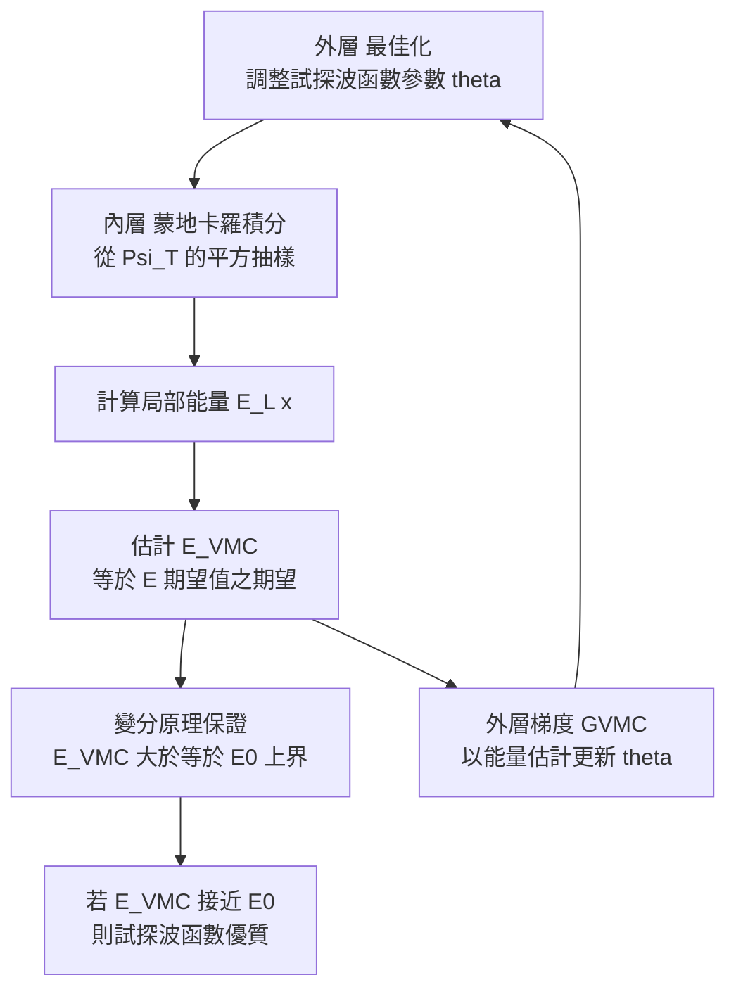
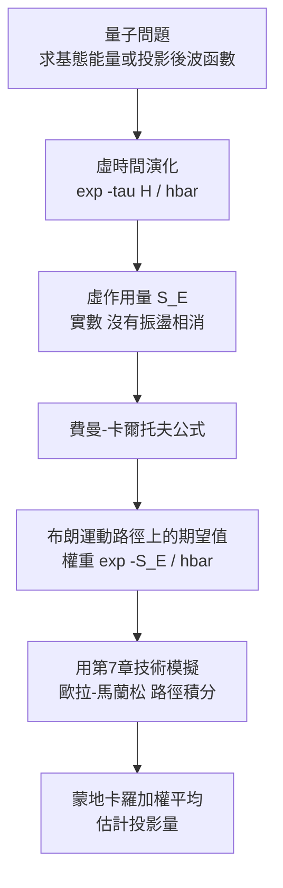
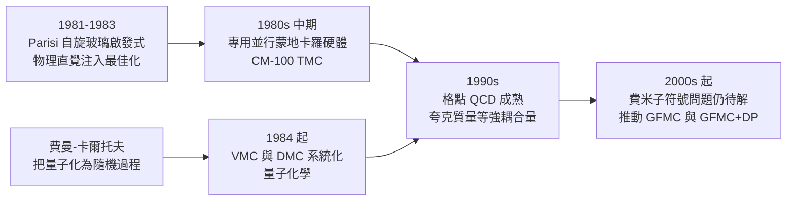
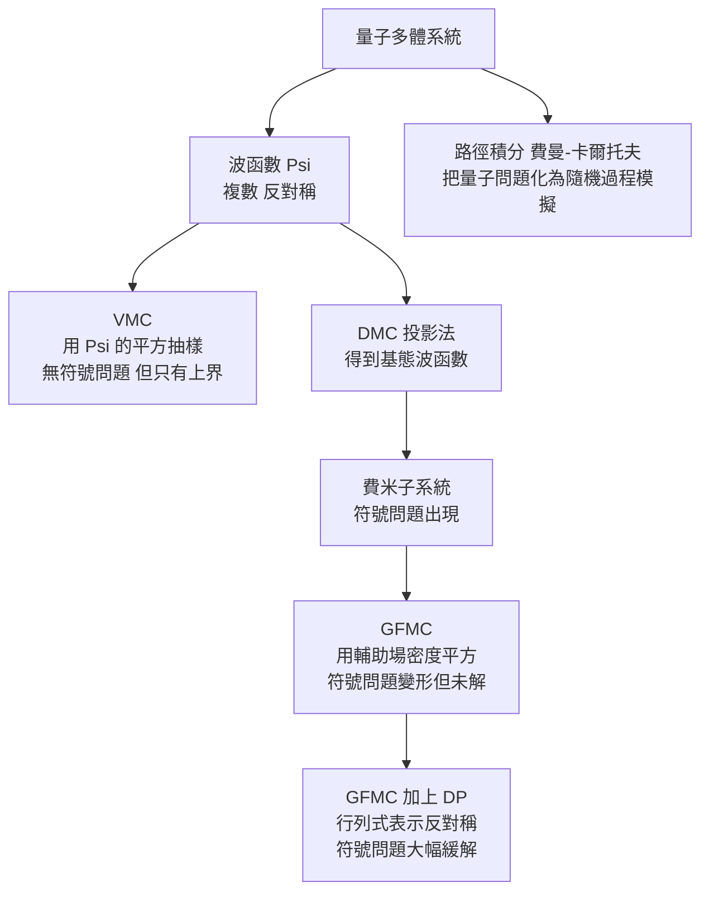

## 8.3　1984年蒙地卡羅模擬量子系統

[上一章：8.2　1953年Metropolis抽樣與粒子模擬](08.2-1953年Metropolis抽樣與粒子模擬.md) | [下一章：第9章　蒙地卡羅方法在金融中的應用](09.0-蒙地卡羅方法在金融中的應用.md)

## 學習目標

完成本節後，讀者應該能夠：

1. 說明經典統計力學的蒙地卡羅法為何不能直接套用到量子系統，並指出問題的根源在目標分佈的符號。
2. 陳述**變分原理**（variational principle），說明為什麼變分蒙地卡羅（VMC）給出基態能量的**上界**。
3. 解釋**費曼–卡爾托夫公式**（Feynman–Kac formula）的結構，並說明它如何把「量子演化」轉化為「布朗運動路徑上的期待值」。
4. 描述**路徑積分**（path integral）表述，並說明蒙地卡羅法在路徑積分中扮演的角色。
5. 說明 Parisi 在 1980 年代對自旋玻璃與蒙地卡羅最佳化所做的關鍵工作，以及「蒙地卡羅基於電腦發展」這段歷史的意義。
6. 描述**擴散蒙地卡羅**（diffusion Monte Carlo, DMC）與 VMC 的差異與代價。
7. 解釋**符號問題**（sign problem）的成因、對複雜度的影響，以及目前主要的處理方式。

## 8.3.1 為什麼量子系統比較難

[8.1](08.1-物理模擬：熱力學與統計力學.md) 的經典蒙地卡羅法建立在兩個條件上：

1. 目標分佈是**非負**的（ $`e^{-\beta E} \ge 0`$ ）；
2. 目標分佈只依賴**實數**的 Hamiltonian。

量子力學的兩個條件都不成立。在波函數表象中，物理狀態由 $`\Psi`$ 描述，觀測量 $`O`$ 的期望值為

$$
\langle O\rangle = \frac{\int \Psi^*(x)\,O(x)\,\Psi(x)\,dx}{\int \Psi^*(x)\Psi(x)\,dx}
$$

分子分母中的被積函數**可以是負的**（因為 $`\Psi`$ 是複數， $`\Psi^*\Psi`$ 雖非負，但含 $`O`$ 的期望項、或多體系統中展開的交叉項會出現負號）。更根本地，費米子系統的波函數是**反對稱**的：

$$
\Psi(x_1,\dots,x_N) = -\Psi(x_2,\dots,x_N,x_1)
$$

這意味著多體波函數在粒子置換的符號變換下會改變符號，因此 $`\Psi^*\Psi\,O`$ 在相空間的不同區域會有正有負。蒙地卡羅法要求被積函數**同號**，否則抽樣估計會遭遇兩難：要嘛漏掉負貢獻（嚴重低估），要嘛用重要性抽樣放大負區域（方差爆炸）。

更根本的困難是：**量子力學的狀態是波函數，不是配置**。一個 $`N`$ 粒子的量子態需要 $`3N`$ 維波函數的資訊，而經典蒙地卡羅只需要一個 $`3N`$ 維配置。所以「抽樣」的對象必須被重新定義。

## 8.3.2 變分原理與變分蒙地卡羅

**變分原理**（variational principle）說明：對任意試探波函數 $`\Psi_T`$ （trial wavefunction），基態能量 $`E_0`$ 滿足

$$
E_0 \le \frac{\langle \Psi_T | H | \Psi_T\rangle}{\langle \Psi_T | \Psi_T\rangle}
$$

右邊是**期望值**，可以用蒙地卡羅法估計（因為 $`\Psi_T^* \Psi_T \ge 0`$ ）。這就是**變分蒙地卡羅（VMC）**：

$$
E_{\text{VMC}} = \frac{\int |\Psi_T(x)|^2 \frac{H\Psi_T(x)}{\Psi_T(x)}\,dx}{\int |\Psi_T(x)|^2\,dx}
$$

三個步驟對應前幾章的技術：

1. **抽樣**：從 $`p(x) = |\Psi_T(x)|^2 / \int|\Psi_T|^2`$ 抽樣 —— 這正是 [第5章](05.0-變換抽樣法.md) 的重要性抽樣，但要選擇合適的 proposal；
2. **局部能量**： $`E_L(x) = H\Psi_T(x)/\Psi_T(x)`$ —— 必須避免奇點（若 $`\Psi_T`$ 在某處為零， $`E_L`$ 會發散），所以通常用**局部能量**的解析形式而非直接相除；
3. **平均**：估計 $`E_{\text{VMC}}`$ —— 注意這是「期望的期望」，不是期望本身，所以**必須對 $`\Psi_T`$ 的參數做外層最佳化**。

外層最佳化（optimizing $`\Psi_T`$ ）通常用**梯度上升的 VMC（GVMC）**，用能量估計的梯度更新 $`\Psi_T`$ 的參數。這裡出現了一個漂亮的多層次結構：

- **內層**：蒙地卡羅積分（抽樣 + 平均），處理量子力學；
- **外層**：最佳化（隨機梯度上升），處理 $`\Psi_T`$ 的參數。

這也把 VMC 與 [第10章](10.0-變數選擇與蒙地卡羅優化.md) 的蒙地卡羅優化直接連結起來。

下圖說明 VMC 的兩層結構與變分原理提供的保證。

這張圖表達的論點是：VMC 把「量子力學的近似」轉化為「最佳化問題」，並由變分原理給出**方向明確的保證**（上界），這是它相對於其他量子近似方法的巨大優勢——**誤差方向永遠已知**。

## 8.3.3 費曼–卡爾托夫公式與路徑積分

費曼–卡爾托夫公式（Feynman–Kac formula）是連接**量子力學**與**隨機過程**的橋樑，而這正是第 7 章的內容在物理中的舞台。

考慮哈密頓量 $`H = \frac{\hat{p}^2}{2m} + V(\hat{x})`$ （一粒子情況）。其演化算符的「路徑積分」表述為

$$
\langle x_f | e^{-i H t/\hbar} | x_i\rangle = \int \mathcal{D}x\, e^{\frac{i}{\hbar}S[x]}
$$

其中 $`S[x] = \int_0^t \left[\frac{m}{2}\dot{x}^2 - V(x)\right]d\tau`$ 是作用量， $`\mathcal{D}x`$ 是路徑上的測度。

由於 $`i/\hbar`$ 的虛數因子， $`e^{iS/\hbar}`$ 會振盪，導致巨大的相消——**路徑積分的直接蒙地卡羅計算不可行**。

**費曼–卡爾托夫公式**提供了出路：把時間演化轉成「帶偏位（imaginary time）」的問題。令 $`\tau = it`$ ，在虛時間中演化算符成為 $`e^{-\tau H/\hbar}`$ ，此時被積函數變成實數的 $`e^{-S_E[x]/\hbar}`$ ，其中 $`S_E`$ 是**虛作用量（Euclidean action）**。於是可以寫成

$$
\langle x_f | e^{-\tau H/\hbar} | x_i\rangle = \int \mathcal{D}x\, e^{-S_E[x]/\hbar}
$$

而 $`S_E`$ 恰是**作用在布朗運動軌跡上的泛函**。費曼–卡爾托夫定理陳述：

> 在虛時間中的路徑積分，等於某個**受外力驅動的布朗運動**路徑上的期望值。

$$
\langle x_f | e^{-\tau H/\hbar} | x_i\rangle \propto \mathbb{E}\left[\exp\left(-\frac{1}{\hbar}\int_0^\tau S_E[\gamma(t)]\,dt\right)\bigg| \gamma(0)=x_i,\ \gamma(\tau)=x_f\right]
$$

其中 $`\gamma`$ 為布朗運動路徑（配以適當的漂移）。

**前因後果**：這個公式把量子問題變成了第 7 章的隨機過程模擬問題——只需要產生布朗路徑、累積沿路徑的作用量、做加權平均。於是**第 7 章所有的隨機過程模擬技術**（歐拉-馬蘭松、Milstein、平行化）都可以直接用於量子力學。

下圖說明這個「從量子到隨機過程」的轉換。

這張圖的核心論點是：**費曼–卡爾托夫公式是物理與數學的接點**。它把「時間演化」翻譯成「隨機軌跡上的統計量」，使量子問題繼承了隨機過程模擬的全部工程技術。

### 路徑積分中的蒙地卡羅

在路徑積分表述下，蒙地卡羅法要處理的是：從某個初始分佈出發，產生大量路徑 $`\{x(\tau)\}`$ ，計算每條路徑的權重 $`w = e^{-S_E/\hbar}`$ ，然後估計

$$
\frac{\int \mathcal{D}x\, e^{-S_E[x]/\hbar}\,F[x]}{\int \mathcal{D}x\, e^{-S_E[x]/\hbar}}
$$

這是一個以玻茲曼型權重加權的期望——**正是 [8.1](08.1-物理模擬：熱力學與統計力學.md) 的統計力學蒙地卡羅結構**，只是「能量」換成了「虛作用量」。因此路徑積分蒙地卡羅也會遭遇統計力學蒙地卡羅的所有問題：臨界減慢、叢集更新、重要性抽樣。

一個重要的實際技巧是**路徑積分的時間切片（time slicing）**：把虛時間切成 $`M`$ 步，用離散格點上的路徑配置代替連續路徑，把連續作用量轉成格點和：

$$
S_E \approx \sum_{m} \left[\frac{m}{2}\frac{(x_{m+1}-x_m)^2}{\Delta\tau} + V(x_m)\Delta\tau\right]
$$

這裡出現了一個有趣的一致性：路徑積分的離散化與歐拉-馬蘭松格式**形式上相同**（都依賴 $`(\Delta x)^2`$ ），但物理含義完全不同（前者是作用量的離散化，後者是隨機微分方程的數值解）。

## 8.3.4 Parisi 與 1980 年代的蒙地卡羅突破

1980 年代是蒙地卡羅法在物理中取得決定性突破的時期，Parisi（Giorgio Parisi）的貢獻最具代表性。

**（一）自旋玻璃的啟發式優化（1981–1983）。** Parisi 把「解自旋玻璃」看成一個**最佳化問題**：在所有 $`2^N`$ 個自旋組態中找能量最低者。他提出的啟發式方法（後來稱為 **Parisi 演算法**或「叢集法」）的核心是：

1. 從一個隨機組態出發；
2. 固定一個小的區域（如一個自旋）；
3. 對與該區域相鄰的自旋取平均（平滑化）；
4. 依平滑後的局部場決定是否翻轉中心自旋；
5. 重複。

直覺是：**區域平均扮演了「溫度」的角色**——平滑化抑制了雜訊，讓系統傾向於跳到「整片區域一致」的狀態。這是把物理的「臨界阻尼」概念注入最佳化演算法的典型例子。Parisi 演算法能求得比單純 Metropolis 退火好得多的自旋玻璃基態。

**（二）蒙地卡羅與電腦發展的相互推動。** 這段歷史極具教育意義：1980 年代中期，物理學家發現蒙地卡羅方法的效率**直接取決於計算機的速度**，而計算機產業的發展又強烈需要物理模擬來驅動（例如半導體工業需要精確的能帶計算）。

在 1980 年代中期到 1990 年代，出現了一波「專用硬體」：例如 1992 年的 **TMC（Thinking Machines）CM-100** 連線機器（1024 個處理器）專門用於蒙地卡羅統計力學模擬；日本 RIKEN 的 1996 年「**Romeo**」機器；以及 Pippard 與 Michael 早期在 Cambridge 的並行蒙地卡羅工作。儘管這些專用機器最終未能商業化（通用 CPU/GPU 後來超越），但它們證明了**蒙地卡羅模擬的工作負載特性**——極度適合大規模並行——這正是今日 GPU 加速蒙地卡羅的先聲（見 [第6章](06.0-蒙地卡羅積分的高效實現.md)）。

**（三）格點 QCD 的成熟。** 1980 年代 Wilson 建立的格點 QCD 框架，經過 1990 年代歐洲、美國、日本的大型合作，使用超級電腦進行數千萬自旋的模擬，終於得到可信的夸克偶素質量、 $`\bar{q}q`$ 介子質量與格點強耦合常數。這是蒙地卡羅法對基礎物理最直接的貢獻。

下圖整理 1980 年代的關鍵節點。

這張圖的論點：1980 年代的突破並非單一演算法的結果，而是**演算法（Parisi）、硬體（並行機器）與物理問題（格點 QCD）三者相互推動**的產物；而演算法受到硬體的制約與啟發，反過來又推動了硬體的發展。

## 8.3.5 擴散蒙地卡羅

**擴散蒙地卡羅（Diffusion Monte Carlo, DMC）** 是計算基態能量的方法，核心是把時間演化投影算符 $`e^{-\tau H}`$ 作用在初始波函數上：

$$
|\Psi(\tau)\rangle = e^{-\tau H}|\Psi_0\rangle \xrightarrow{\tau\to\infty} |\Psi_0\rangle e^{-\tau E_0}
$$

**投影技巧（projection method）** 把 $`e^{-\tau H}`$ 展開為一串小的時間步，把每一步解成**擴散 + 分裂（branching）**：

1. **擴散步**：把粒子沿隨機方向散開，擴散係數對應動能項 $`-\frac{\hbar^2}{2m}\nabla^2`$ ；
2. **分裂步**：用叢集分裂／湮滅的方法，依局部能量調整粒子數，使低能量區域粒子變多。

如此一來，蒙地卡羅法不只給出基態能量，還能給出**基態波函數**（投影後的粒子分佈即 $`|\Psi_0|^2`$ ）。代價是：DMC 是**投影法（projected method）**，因此有**時間步長誤差**與**族群大小誤差**（finite population bias），必須做外推。

**VMC 與 DMC 的比較**：

| 項目 | VMC | DMC |
| --- | --- | --- |
| 能量 | 上界 $`E_{\text{VMC}} \ge E_0`$ | 上界，但更接近真值（混合了 $`E_0`$ 與激發態） |
| 波函數 | 試探波函數本身 | 投影後的基態波函數 |
| 誤差控制 | 只有統計誤差 | 統計誤差 + 時間步長誤差 + 族群誤差 |
| 費米子系統 | **無符號問題**（用 $`|\Psi|^2`$ 抽樣） | **有符號問題** |
| 計算成本 | 低 | 高（需外推與大量粒子） |

## 8.3.6 符號問題及其處理

**符號問題**的精確陳述：對費米子系統，期望值被寫成

$$
\langle O\rangle = \frac{\int \Psi_T^*(x) O(x) \Psi_T(x)\,dx}{\int \Psi_T^*(x)\Psi_T(x)\,dx}
$$

若在某些區域 $`\Psi_T^*(x)\Psi_T(x) < 0`$ ，則此積分是「帶號」被積函數的積分，蒙地卡羅法要么漏掉負區域、要么方差劇增。**複雜度因此從多項式退化為指數級**，也就是沒有任何多項式時間的演算法能解決一般情形。

目前的處理方式與它們的狀態：

- **GFMC（Auxiliary-field diffusion Monte Carlo）**：使用 Hubbard–Stratonovich 變換把費米子平方消成密度平方，讓粒子數變成**整數**。代價是符號問題變成**輔助場符號問題**（auxiliary field sign problem），一般情形仍未解決。
- **GFMC+DP（DP = determinant product）**：用行列式表示反對稱性，讓符號問題大幅緩解，是目前最成功的方向之一。
- **quasiparticle / complex Monte Carlo**：允許複數的行走權重，把符號問題轉化為「複數平面上的隨機遊走」，在某些系統上有效但有數值穩定性問題。
- **對角化法（coupled cluster、CI、QMC with trial nodes）**：以確定性的方式處理部分符號問題，適用於特定系統。

**結論**：符號問題是量子蒙地卡羅法最根本、也最持久的障礙。它至今仍是該領域最重要的開放問題之一。

下圖把本節的技術層次整理成一個層次架構。

這張圖表達的論點：量子蒙地卡羅的技術路線是「**用代價換正確性**」——每一層都在繞過符號問題，但沒有一層徹底解決它。

## 8.3.7 前因後果

本章回顧的歷史給出一條清楚的因果鏈：

1. 經典統計力學的蒙地卡羅法（1946–1953）提供了抽樣平衡分佈的演算法。
2. 硬體的發展（1980 年代的並行機器 → 今日 GPU）決定了蒙地卡羅能處理多大的系統。
3. Parisi 等人把物理直覺（臨界阻尼、平滑化）注入最佳化演算法，同時也把最佳化問題反饋回物理。
4. 費曼–卡爾托夫公式把量子問題化為隨機過程問題，讓第 7 章的技術得以復用。
5. 符號問題成為剩下的最後一個根本障礙，至今未解，驅動著 GFMC、GFMC+DP 等研究方向。

第 9 章要轉到另一個領域。金融與物理共享同一套方法論核心：**在一個已知（或需估計）的隨機模型下，用大量路徑估計價格的期望值**。差別在於，物理系綜的權重由已知的物理定律決定，而金融定價必須**從市場資料中學出模型**——這使得金融的蒙地卡羅多了一層「模型風險」。

## 本章要點

1. 經典蒙地卡羅法不能直接用於量子系統，因為目標分佈含符號、狀態是波函數而非配置。
2. 變分原理給出 VMC 的上界保證；VMC 有「內層蒙地卡羅積分 + 外層隨機梯度最佳化」的雙層結構。
3. 費曼–卡爾托夫公式把虛時間量子演化轉化為布朗路徑上的加權期望，是量子與隨機過程的接點。
4. 路徑積分的離散化與歐拉-馬蘭松形式相似，但物理意義不同（作用量離散化 vs 隨機微分方程數值解）。
5. Parisi 在 1980 年代把物理直覺注入最佳化，同時並行蒙地卡羅硬體的發展證明了此工作負載的可擴充性。
6. DMC 是投影法，除統計誤差外還有時間步長誤差與族群誤差。
7. 費米子系統的**符號問題**使複雜度退化為指數級，目前仍是最重要的開放問題；GFMC 把它轉化為輔助場符號問題，GFMC+DP 大幅緩解但未根除。

## 延伸閱讀

- Feynman, R. P. & Hibbs, A. R. (1965). *Quantum Mechanics and Path Integrals*. McGraw-Hill.
- Feynman, R. P. (1948). Space-time interpretation of quantum mechanics. *Reviews of Modern Physics*, 20(2), 367–387.
- Parisi, G. (1982). On spin glasses. *Journal of Physics A*, 15(3), L471–L476.
- Umrigar, N. J. & Vos, G. (2000). Introduction to Monte Carlo methods in quantum systems. *Physics Reports*, 331(5), 195–309.
- Ceperley, D. M. & Alder, P. J. (1980). Monte Carlo simulation of a many-body system. *Physical Review B*, 21(2), 567–587.
- Foulkes, W. M. C., QMC in atoms, molecules, solids and liquids (1987). *Physics Reports*, 110(1–2), 1–168.
- [第15章：跨學科應用案例](15.0-跨學科應用案例.md)
