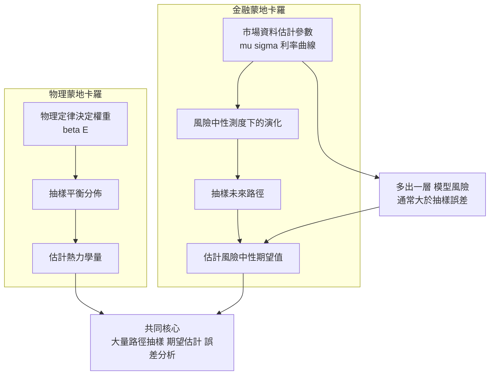

# 第9章　蒙地卡羅方法在金融中的應用

[上一章：第8章　蒙地卡羅方法在物理中的應用](08.0-蒙地卡羅方法在物理中的應用.md) | [下一章：9.1　期權定價與風險管理](09.1-期權定價與風險管理.md)

## 學習目標

完成本章後，讀者應該能夠：

1. 說明為什麼金融是蒙地卡羅法在工業界最大的商業應用領域，並列舉其主要應用場景。
2. 理解金融蒙地卡羅與物理蒙地卡羅在**模型來源**上的根本差異：物理模型由定律決定，金融模型必須由資料估計。
3. 掌握金融蒙地卡羅的基本框架：風險中性測度、動態定價（replication）與蒙地卡羅估計的合法性。
4. 說明「模擬定價的正確性」與「模擬定價的效率」之間取捨的內容。
5. 辨識金融蒙地卡羅的主要誤差來源：抽樣誤差、離散化誤差、模型風險（以微笑參數、期限結構等為例）。
6. 概述蒙地卡羅在衍生品定價、保險與再保險精算、VaR 與風險資本、資產負債管理中的角色。
7. 理解為什麼金融業願意投入大量算力：一次計算的價值遠高於成本。

## 9.0.1 商業上的巨大落差：為什麼金融特別適合蒙地卡羅

物理學家使用蒙地卡羅法，是為了「求一個自然界給出的答案」。金融機構使用蒙地卡羅法，是為了「替一個商品算出一個能寫進合約的數字」。後者的經濟價值高達數十億美元，而計算成本可能只有幾千美元。這種**價值與成本的巨大落差**，是蒙地卡羅法在金融界取得成功的根本原因。

回顧歷史：蒙地卡羅法在金融的應用可追溯到 20 世紀中期，1950–60 年代用於設備投資的風險分析；但真正引爆的導火線是 **Black–Scholes 公式（1973）** 與**波動率微笑的發現（1980 年代末）**。前者建立了「定價＝期望風險中性價值」的框架，後者則證明了**同一個模型無法解釋所有到期日與價位的期權價格**，於是必須用更複雜的模型（局部波動率等）來定價，而那些模型沒有解析解——**這就使得蒙地卡羅法從「可有可無」變成「必需品」**。

主要應用領域：

| 領域 | 典型問題 | 蒙地卡羅的角色 |
| --- | --- | --- |
| 衍生品定價 | 期權、期貨、交換選擇權（swaption）、結構性商品 | 計算風險中性期望值 |
| 保險與再保險 | 巨災債券、參數型保險 | 計算有限時間內的損失分佈 |
| 風險管理 | VaR、Expected Shortfall、壓力測試 | 模擬未來損益分佈 |
| 資產負債管理 | 退休金的資產配置 | 模擬資產負債的聯合演化 |
| 信用風險 | 結構式模型、違約距離 | 模擬違約時間與回收率 |
| 投資組合 | 風險預算、壓力情境 | 模擬多資產的聯合路徑 |

## 9.0.2 金融蒙地卡羅與物理蒙地卡羅的結構對照

物理與金融的蒙地卡羅方法在**演算法層面**幾乎相同：抽樣 → 模擬路徑 → 估計期望 → 計算誤差。但在**模型層面**有一個根本差異。

在統計力學中，權重 $`e^{-\beta E}`$ 由物理定律決定，溫度 $`\beta`$ 由實驗設定，**沒有「猜」的成分**。在金融中：

- 漂移 $`\mu`$ 與波動率 $`\sigma`$ 必須從市場資料估計；
- 利率曲線、無風險利率、股息率來自市場報價；
- 當「微笑」存在時，沒有單一常數 $`\sigma`$ 能描述整個期權面，必須用**參數化的曲面模型**（SVI、杜里耶局部波動率等）。

因此金融蒙地卡羅的誤差結構多了一層——**模型風險（model risk）**，而它通常**遠大於**抽樣誤差。

下圖把兩者的差異與共同點對照呈現。

這張圖的核心論點：**金融蒙地卡羅的精度上限，通常不是由抽樣數決定，而是由模型品質決定**。這解釋了為什麼定價部門同時需要「量化研究」（改進模型）與「工程效能」（加速模擬）兩種人才。

## 9.0.3 風險中性測度：為什麼要「換一個世界」

金融蒙地卡羅的理論基礎是**風險中性定價（risk-neutral pricing）**。核心命題是：若衍生品價格 $`V_0`$ 是無套利價格，則存在一個測度 $`Q`$ （風險中性測度），使得

$$
V_0 = e^{-rT}\,\mathbb{E}^{Q}\left[\text{payoff}(S_T)\right]
$$

這個公式包含三個關鍵的「為什麼」：

**（一）為什麼要換測度？** 因為真實世界的期望 $`\mathbb{E}^{\mathbb{P}}`$ 反映的是投資者的風險偏好，而價格必須反映的是「無套利」——否則就有套利機會。風險中性測度把風險溢價吸收到漂移項中，使得定價問題變成純粹的期望計算。

**（二）為什麼風險中性下的期望可以用蒙地卡羅算？** 因為動態定價／複製論證明：在風險中性測度下，衍生品價格滿足一個**不含衍生品價格本身**的偏微分方程（Black–Scholes 方程及其推廣）。這個 PDE 的解就是期望，蒙地卡羅法是求解它的通用數值方法。

**（三）為什麼 Black–Scholes 需要蒙地卡羅？** 1973 年的 Black–Scholes 公式給出常數波動率下的封閉解；然而 1987 年股災後，人們發現市場上存在系統性的**波動率微笑**（volatility smile）——不同執行價的期權隱含波動率不同，深度價外的期權更貴。這意味著單一常數 $`\sigma`$ 的模型無法解釋整個期權面，必須使用**狀態相依的波動率模型**（局部波動率，如 Dupire 1994）。而這些模型**沒有解析解**，蒙地卡羅遂成為唯一的通用工具。

下圖說明從實體概率測度到風險中性測度的轉換，以及期望如何被計算。

這張圖說明：整個流程的正確性最終由**無套利檢驗**把關（例如 put-call parity 必須成立），這是實務上驗證定價引擎的標準手法。

## 9.0.4 定價、對沖與風險：模擬的三個用途

在實務上，同一套蒙地卡羅模擬會被用於三個不同的目的，三者的精度需求不同：

**（一）定價（pricing）。** 給出衍生品的無套利價格。精度需求：**高**，因為要寫進合約、要對抗競爭者的報價誤差。因此定價往往需要大量路徑（數百萬至數十億），並使用低方差技巧（[第11章](11.0-蒙地卡羅方法的誤差分析與改進.md)）。

**（二）對沖（hedging）。** 計算希臘值（delta、vega、gamma 等），以設定避險部位。精度需求：對沖比例的**絕對精度要求較寬**（避險誤差可用超額對沖吸收），但對 delta 的**平滑性**有要求。

**（三）風險（risk）。** 計算未來損益的分佈、VaR、壓力情境。精度需求：對**尾端分佈**的估計要準，而尾端事件本身是稀有的，蒙地卡羅在這裡效率最差（見 [9.1](09.1-期權定價與風險管理.md)）。

這三者的差別，造成實務上一個有趣的張力：**同一個引擎需要不同的抽樣數設定**，而實務上常見的做法是「用定價的路徑數跑所有用途」，或者在風險用途上採用**重要性抽樣**強化尾端。

## 9.0.5 蒙地卡羅在金融中的效率困境與對策

蒙地卡羅在金融中的效率問題比物理中更嚴重，原因有三：

1. **時間步數多**：一年到期、日度時間步就需要 250 步；長到 30 年的養老金負債模擬需要上萬步。
2. **維度高**：多資產投資組合的相關性矩陣估計本身就有誤差。
3. **尾端稀有**：風險度量關注的是分佈的 0.1% 分位，蒙地卡羅需要約 $`1/(\alpha(1-\alpha))`$ 量級的樣本才有效估計尾端。

標準對策（本書第 6 章與第 11 章會詳細展開）：

| 對策 | 說明 | 效果 |
| --- | --- | --- |
| 對偶變數法（antithetic） | 用 $`Z`$ 與 $`-Z`$ 配對 | 方差降約 25–50% |
| 控制變數法 | 用 Black–Scholes 解析價作為控制變數 | 方差可降數個數量級 |
| 準蒙特卡羅 | 用 Sobol 等低差距序列取代偽隨機 | 收斂率提升到 $`N^{-1}`$ 量級（部分問題） |
| 條件期望法 | 對 payoff 中的正態部分取解析期望 | 大幅降方差 |
| 重要性抽樣 | 強化尾端事件 | 尾端估計效率大增 |
| 跨資產網格法 | 對多資產用多維網格取代獨立抽樣 | 處理相關性與尾端相依 |
| GPU 與平行 | 大量獨立路徑 | 線性擴充 |

## 9.0.6 本章地圖

- **[9.1 期權定價與風險管理](09.1-期權定價與風險管理.md)**：Black–Scholes（1973）與蒙地卡羅的關係——模擬定價在**正確性**上普遍優於封閉解，但**效率**上劣於它；誤差分析；VaR、CVaR／Expected Shortfall 的蒙地卡羅估計；壓力測試與歷史模擬法。
- **[9.2 蒙地卡羅在金融衍生品中的應用](09.2-蒙地卡羅在金融衍生品中的應用.md)**：路徑相依衍生品（亞洲期權、數位與障礙期權）、利率模型（Vasicek 1976、CIR 1985、Hull–White 1990）、波動率微笑與局部波動模型（Dupire 1994）、以及加速技巧。
- **[9.3 隨機過程與投資組合的模擬](09.3-隨機過程與投資組合的模擬.md)**：多資產投資組合模擬、馬可維茲模型與協方差矩陣估計、蒙地卡羅 VaR 的信賴區間、序列相關 bootstrap、copula、壓力測試與情境分析、退休金風險管理。

## 本章要點

1. 金融是蒙地卡羅法最大的商業應用，因為單次計算的經濟價值遠高於其成本。
2. 金融蒙地卡羅與物理蒙地卡羅在演算法上相同，但在模型層面多出一層「從資料估計參數」的步驟，因而多出模型風險。
3. 風險中性定價把定價問題化為期望計算，蒙地卡羅是求解風險中性期望的通用方法。
4. 波動率微笑的發現（1980 年代末）是蒙地卡羅在金融中成為「必需品」的直接原因。
5. 金融蒙地卡羅的精度上限通常由模型品質決定，而非抽樣數。
6. 定價、對沖、風險三種用途對精度的需求不同，實務上常需為風險用途另外設計抽樣策略。
7. 金融場景的效率困境（時間步多、維度高、尾端稀有）催生了對偶變數、控制變數、重要性抽樣、準蒙特卡羅、GPU 等一整套加速技術。

## 延伸閱讀

- Black, F. & Scholes, M. (1973). The pricing of options and corporate liabilities. *Journal of Political Economy*, 81(3), 637–654.
- Glasserman, P. (2004). *Monte Carlo Methods in Financial Engineering*. Springer.（金融蒙地卡羅的標準教科書）
- McNeil, A. J., Frey, R. & Embrechts, P. (2015). *Quantitative Risk Management: Concepts, Techniques and Tools*. Princeton University Press.
- [第4章：蒙地卡羅積分法](04.0-蒙地卡羅積分法.md)
- [第11章：蒙地卡羅方法的誤差分析與改進](11.0-蒙地卡羅方法的誤差分析與改進.md)
