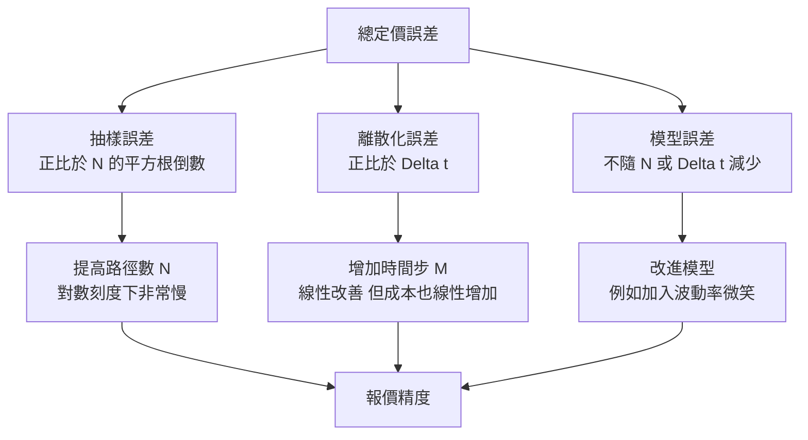
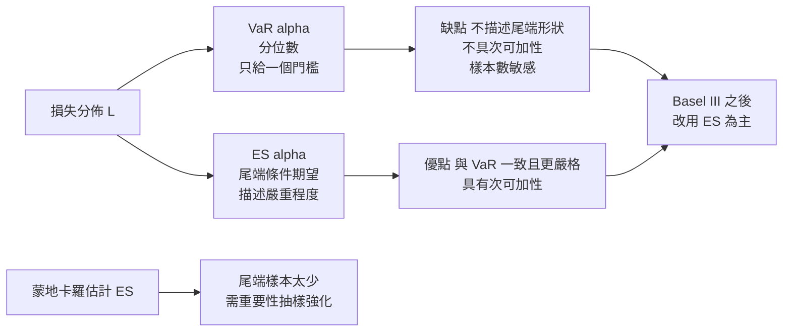
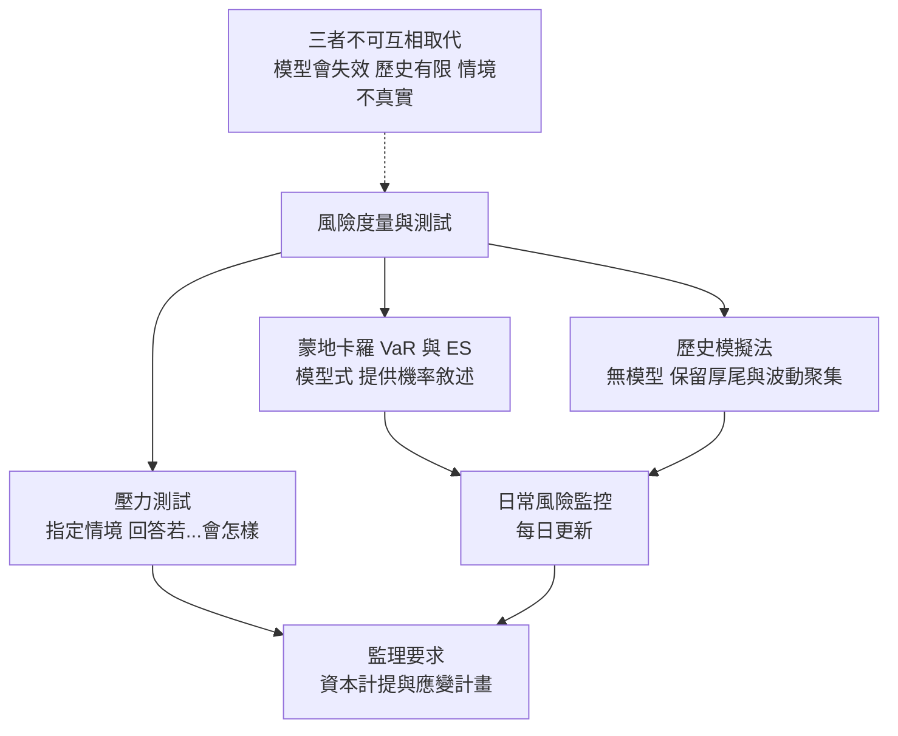

## 9.1　期權定價與風險管理

[上一章：第9章　蒙地卡羅方法在金融中的應用](09.0-蒙地卡羅方法在金融中的應用.md) | [下一章：9.2　蒙地卡羅在金融衍生品中的應用](09.2-蒙地卡羅在金融衍生品中的應用.md)

## 學習目標

完成本節後，讀者應該能夠：

1. 說明 Black–Scholes（1973）定價公式與蒙地卡羅模擬之間的**正確性與效率之取捨**。
2. 解釋為什麼模擬定價在「一般模型」下比封閉解更可信，而在「常數波動率」模型下反而更慢。
3. 掌握蒙地卡羅定價的誤差公式，說明抽樣誤差 $`O(N^{-1/2})`$ 與離散化誤差如何共同影響報價精度。
4. 說明控制變數法如何用 Black–Scholes 解析價把蒙地卡羅的方差降低數個數量級。
5. 定義 VaR、CVaR（Expected Shortfall），並說明它們的估計方法、差異與各自的失效情境。
6. 描述壓力測試與歷史模擬法（historical simulation）的原理，並說明它們與蒙地卡羅模擬的互补關係。
7. 說明為什麼尾端風險是蒙地卡羅在金融中最困難的任務。

## 9.1.1 一個必須先講清楚的事：模擬與解析解誰比較「對」

這是初學者最常混淆的問題。做一次標準的 Black–Scholes 歐洲看漲期權定價，兩種方法都可以：

**方法 A（解析）**：用 Black–Scholes 公式

$$
C = S_0 N(d_1) - Ke^{-rT}N(d_2), \qquad d_1 = \frac{\ln(S_0/K)+(r+\sigma^2/2)T}{\sigma\sqrt{T}}, \quad d_2 = d_1 - \sigma\sqrt{T}
$$


**方法 B（模擬）**：在風險中性測度下生成 $`N`$ 條幾何布朗運動路徑，計算到期 payoff 的平均並貼現。

兩者的答案應當**在統計意義上一致**（因為 Black–Scholes 公式本身就是 $`\mathbb{E}^{Q}[(S_T-K)^+]`$ 的解析解）。但實務上，它們經常**不一致**——不是誰錯了，而是**誰用的模型不同**。

關鍵在於：現實市場上，期權價格**不是**由 Black–Scholes 模型生成的。市場的模型是帶有波動率微笑的（見 [9.2](09.2-蒙地卡羅在金融衍生品中的應用.md)）。因此：

| 比較項目 | 解析解（BS） | 蒙地卡羅（真實市場模型） |
| --- | --- | --- |
| 模型假設 | 常數波動率、常數漂移 | 狀態相依波動率、多因子 |
| 速度 | 微秒級 | 數分鐘到數小時 |
| 能否處理路徑相依 payoff | 否 | 是 |
| 對市場價格的解釋力 | 弱（忽略微笑） | 強 |
| 校準到市場所需 | 無法直接做到 | 可反解參數 |
| 對模型設定的敏感度 | 低 | 高 |

**核心結論**：模擬定價的優勢不在「算得準」，而在「算的是對的模型」。當模型有解析解時，蒙地卡羅在效率上必然輸；當模型沒有解析解但更貼近市場時，蒙地卡羅是唯一選項。

這是一個非常好的「前因後果」範例：Black–Scholes 的成功（解析解）反而製造了它的局限（無法處理微笑），而這個局限催生了蒙地卡羅在金融中的實用價值。

## 9.1.2 蒙地卡羅定價的誤差分析

考慮風險中性下的幾何布朗運動 $`dS_t = r S_t dt + \sigma S_t dW_t`$ ，估計看漲期權價格：

$$
\hat{V}_N = e^{-rT}\frac{1}{N}\sum_{i=1}^{N}\max(S_T^{(i)}-K,0)
$$


誤差有兩個來源：

**（一）抽樣誤差（Monte Carlo error）。** 由中心極限定理，

$$
\mathrm{sd}(\hat{V}_N) = e^{-rT}\frac{\sigma_{\text{payoff}}}{\sqrt{N}}, \qquad \sigma_{\text{payoff}}^2 = \mathrm{Var}[(S_T-K)^+]
$$


對幾何布朗運動， $`S_T = S_0 e^{(r-\sigma^2/2)T+\sigma\sqrt{T}Z}`$ ，因此 payoff 的標準差可以解析求出。注意：** $`1/\sqrt{N}`$ 是極其頑固的**——要把精度提高 10 倍，需要 100 倍的路徑數。

**（二）離散化誤差（discretization error）。** 歐拉-馬蘭松格式的**弱**收斂階為 $`O(\Delta t)`$ （見 [7.2](07.2-隨機微分方程的模擬.md)），因此把時間步數加倍可把離散化誤差減半。而抽樣誤差要加倍精度才減半。

**實務上的取捨**：通常選擇時間步數 $`M`$ 使得離散化誤差小到不影響報價精度（例如相對定價誤差 $`10^{-4}`$ ），然後用剩下的算力增加路徑數 $`N`$ 。

下圖說明兩種誤差的相對大小隨路徑數與時間步數的變化關係。



這張圖表達的論點是：**只有抽樣誤差與離散化誤差是「工程問題」，模型誤差是「研究問題」**。前者可以用資源換取，後者只能靠更好的金融學。

```python
import numpy as np

def bs_call_price(S0, K, r, sigma, T):
    """Black-Scholes 歐洲看漲期權解析價。"""
    from math import log, sqrt, erf
    def N(x):
        return 0.5 * (1.0 + erf(x / sqrt(2.0)))
    if T <= 0:
        return max(S0 - K, 0.0)
    d1 = (log(S0 / K) + (r + 0.5 * sigma**2) * T) / (sigma * sqrt(T))
    d2 = d1 - sigma * sqrt(T)
    return S0 * N(d1) - K * np.exp(-r * T) * N(d2)

def mc_call_price(S0, K, r, sigma, T, n_paths=200000, n_steps=252, seed=0):
    """風險中性下的歐洲看漲期權蒙地卡羅定價（歐拉-馬蘭松）。"""
    rng = np.random.default_rng(seed)
    dt = T / n_steps
    z = rng.standard_normal((n_paths, n_steps))
    # 精確對數 GBM 解（無離散化誤差），用於對照離散格式
    log_inc = (r - 0.5 * sigma**2) * dt + sigma * np.sqrt(dt) * z
    ST = S0 * np.exp(log_inc.sum(axis=1))
    payoff = np.maximum(ST - K, 0.0)
    price = np.exp(-r * T) * payoff.mean()
    se = np.exp(-r * T) * payoff.std(ddof=1) / np.sqrt(n_paths)
    return price, se

S0, K, r, sigma, T = 100.0, 100.0, 0.03, 0.20, 1.0
analytic = bs_call_price(S0, K, r, sigma, T)
print(f"Black-Scholes 解析價 = {analytic:.6f}")
for n in (10000, 100000, 1000000):
    p, se = mc_call_price(S0, K, r, sigma, T, n_paths=n)
    print(f"N={n:8d}  MC = {p:.6f}  SE = {se:.6f}")
```

這段程式碼對應的理論是**中心極限定理**：標準誤 $`\sigma/\sqrt{N}`$ 隨 $`N`$ 的平方根衰減。實測可確認： $`N`$ 增加 100 倍，標準誤只減為約 1/10。

### 控制變數法：把方差降數個數量級

由於解析價已知（ $`C_{BS}`$ ），可以直接用它作為**控制變數**。因為解析價本身就是同一個期望的無偏估計（在同一模型下），所以

$$
\hat{V}^{\text{cv}}_N = \hat{V}_N + \left(C_{BS} - \frac{1}{N}\sum_{i=1}^{N} C_{BS}^{(i)}\right)
$$


其中 $`C_{BS}^{(i)}`$ 是第 $`i`$ 條路徑用 Black–Scholes 公式算出來的解析價。由於 $`\hat{V}`$ 與 $`C_{BS}`$ 的隨機部分高度相關（甚至接近完全相關），殘差 $`C_{BS} - \hat{C}_{BS}`$ 的方差極小，於是

$$
\mathrm{Var}(\hat{V}^{\text{cv}}) \approx \mathrm{Var}(\hat{V})\left(1-\rho^2\right)
$$


其中 $`\rho`$ 是兩者的相關係數。對價內期權， $`\rho`$ 常超過 $`0.99`$ ，方差可降低兩個數量級以上，等價於路徑數增加數千倍。**這是金融蒙地卡羅最重要的加速技巧之一**，其本質是把「已知的解析資訊」注入抽樣估計（[第11章](11.0-蒙地卡羅方法的誤差分析與改進.md)）。

## 9.1.3 風險度量：VaR 與 CVaR

### 價值的風險（VaR）

**在險價值（Value at Risk, VaR）** 是最常用的風險度量。在持有期 $`H`$ 、信心水準 $`\alpha`$ 下，VaR $`\alpha`$ 定義為

$$
\mathrm{VaR}_\alpha = -\inf\left\{ x : \mathbb{P}(L \le x) > 1-\alpha \right\}
$$


其中 $`L`$ 為損失（正數代表虧損）。等價地，若以收益 $`V`$ 表示，VaR 是收益分佈的 $`\alpha`$ 分位點的負值。直覺：「在 $`\alpha`$ 的信心水準下，最壞情況下只會損失這麼多」。

**蒙地卡羅 VaR 的估計**：模擬 $`N`$ 條損益路徑，取終值（或持有期末的損益）的經驗分位數：

$$
\widehat{\mathrm{VaR}}_\alpha = -\text{Quantile}\left(\left\{V_i\right\}_{i=1}^{N},\,1-\alpha\right)
$$


**VaR 的著名缺陷**：
1. **不描述尾端形狀**：VaR 只說「最壞不會超過 x」，不說超過之後會多糟。兩種分佈可以有相同的 VaR 但完全不同的尾端。
2. **不具次可加性（subadditivity）**：VaR 不是一致的風險度量——兩個部位各自的 VaR 之和，可能大於合併後的 VaR。這在數學上違反風險度量的基本要求。
3. **對樣本數極度敏感**：估計 99% 的分位數，在 $`N=10^4`$ 時只有 100 個樣本落在尾端，誤差很大。

### 預期損失（Expected Shortfall / CVaR）

**預期短缺（Expected Shortfall, ES）**，亦稱 **CVaR（Conditional Value at Risk）**，定義為尾部條件期望：

$$
\mathrm{ES}_\alpha = -\frac{1}{\alpha}\mathbb{E}\left[V \mid V \le -\mathrm{VaR}_\alpha\right]
$$


即「在最差的 $`\alpha`$ 比例情境中，平均損失是多少」。它克服了 VaR 的前兩個缺陷：既描述了尾端的平均嚴重程度，也滿足次可加性。**Basel III 之後，VaR 已被 ES（Expected Shortfall）取代為主要資本標準。**

蒙地卡羅估計 ES 的標準做法是「分位數 + 尾端平均」：

$$
\widehat{\mathrm{ES}}_\alpha = -\frac{1}{n_\text{tail}}\sum_{i: V_i \le -\widehat{\mathrm{VaR}}_\alpha} V_i
$$


但這個估計有嚴重的**稀有事件問題**：估計 99.9% 的 ES 意味著要估計分佈最尾端的 0.1%，在 $`N=10^6`$ 時只有 1000 個樣本，估計誤差極大。此時必須使用**重要性抽樣**（例如對分佈的左尾做指數變換），把抽樣集中到尾端。

下圖比較 VaR 與 ES 的差異。



### 尾端估計的重要性抽樣

一個標準做法是對損失使用指數變換：若 $`U \sim \text{Uniform}(0,1)`$ ，則 $`L = F^{-1}(U^{1/\gamma})`$ 會把抽樣集中到左尾（因為 $`U^{1/\gamma}`$ 對 $`U`$ 小的值給出更大的機率）。配合權重修正，蒙地卡羅估計的方差可大幅下降。

## 9.1.4 壓力測試與歷史模擬法

蒙地卡羅方法假設「未來的機率分佈可用現在的模型描述」。但 2008 年金融海嘯顯示：**真實世界會出現模型沒有涵蓋的狀態**。因此風險管理必須搭配不依賴模型的方法。

**（一）歷史模擬法（historical simulation, HS）。** 最簡單也最穩健：

1. 取過去 $`m`$ 年的日報酬資料 $`\{R_1,\dots,R_{250m}\}`$ ；
2. 隨機抽取一個长度为 $`H`$ 天的**區塊**（block bootstrap）重新排列，合成「假想未來」；
3. 對每一組重排計算期末損益；
4. 取分位數得 VaR。

優點：**完全不需要模型假設**，能自動保留厚尾與波動聚集。缺點：樣本數有限（只有 $`m`$ 年歷史），且無法回答「如果發生未曾發生的情境該怎麼辦」。

**（二）壓力測試（stress testing）。** 對模型施加**指定的**極端情境，例如：

- 1998 年盧姆日亞洲金融風暴：股價 -30% + 流動性枯竭 + 相關性上升至 1；
- 2008 年全球金融海嘯：房價 -40% + 信用利差擴張 500bp；
- 利率平行上移 300bp + 信用利差擴張 + 波動率翻倍。

壓力測試的結果**不是機率**，而是「若發生此情境，損失為多少」。它是監理機關（BIS、FSB）與內部風控的核心要求。

**（三）兩者的互补關係。** 下圖說明三種風險度量方法的分工。



這張圖表達的論點：**沒有單一方法能回答所有風險問題**，實務上三者並用；2008 年後的監理改革（如 Basel III 的壓力測試要求）正是把三者制度化的結果。

## 9.1.5 前因後果

Black–Scholes 提供了封閉解，但波動率微笑顯示模型需要推廣；推廣後沒有解析解，蒙地卡羅成為必需品；蒙地卡羅的 $`1/\sqrt{N}`$ 效率使定價成本高昂，於是出現控制變數等加速技巧；而在風險端，模型的失效（2008 年）又催生了歷史模擬與壓力測試的制度化。

下一節我們回到定價本身，處理路徑相依衍生品、利率模型與波動率微笑——也就是蒙地卡羅在金融中「最需要被用上」的地方。

## 本章要點

1. 模擬定價與解析解不是「誰較準」的關係，而是**誰的模型更對**；模型正確時解析解效率高，模型需要推廣時只有模擬可行。
2. 蒙地卡羅定價的誤差 = 抽樣誤差 $`O(N^{-1/2})`$ + 離散化誤差 $`O(\Delta t)`$ + 模型誤差（後者最大且無法用算力換取）。
3. 控制變數法用 Black–Scholes 解析價作為控制變數，方差可降低數個數量級，是金融蒙地卡羅最重要的加速技巧。
4. VaR 只給出分位門檻，不描述尾端形狀且不具次可加性；CVaR／Expected Shortfall 克服這些缺陷，Basel III 已改採 ES。
5. 尾端風險估計是蒙地卡羅最困難的任務，需要重要性抽樣強化。
6. 歷史模擬法不依賴模型但受限於歷史樣本；壓力測試回答「若...會怎樣」但不給機率；兩者與蒙地卡羅互補而非取代。
7. 2008 年金融海嘯證明了模型風險的現實性，是風險管理制度化的直接推動力。

## 延伸閱讀

- Black, F. & Scholes, M. (1973). The pricing of options and corporate liabilities. *Journal of Political Economy*, 81(3), 637–654.
- Jäckel, P. (2002). *Monte Carlo Methods in Finance*. Wiley.
- Glasserman, P. (2004). *Monte Carlo Methods in Financial Engineering*. Springer.
- McNeil, A. J., Frey, R. & Embrechts, P. (2015). *Quantitative Risk Management*. Princeton University Press.
- Basel Committee on Banking Supervision (2019). *Minimum capital requirements for market risk* (BCBS, Basel III framework, updated 2019).
- [9.2　蒙地卡羅在金融衍生品中的應用](09.2-蒙地卡羅在金融衍生品中的應用.md)
