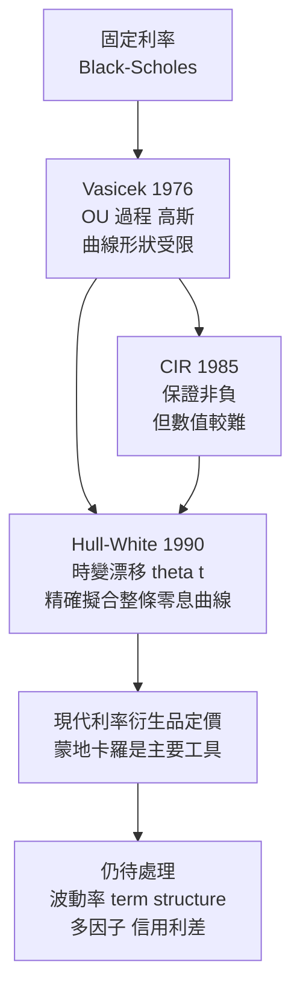
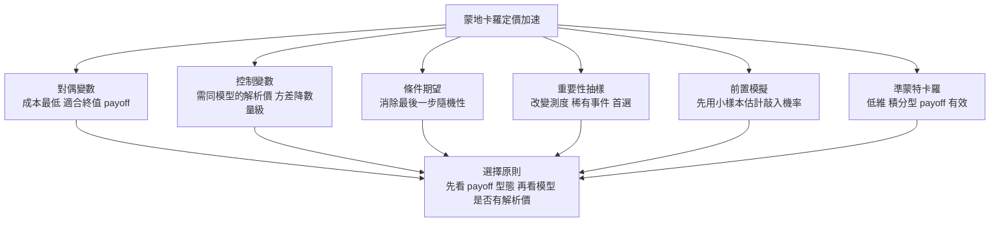

## 9.2　蒙地卡羅在金融衍生品中的應用

[上一章：9.1　期權定價與風險管理](09.1-期權定價與風險管理.md) | [下一章：9.3　隨機過程與投資組合的模擬](09.3-隨機過程與投資組合的模擬.md)

## 學習目標

完成本節後，讀者應該能夠：

1. 說明什麼是**路徑相依衍生品**（path-dependent derivatives），並解釋為何它們在基本上需要模擬而非封閉解。
2. 描述亞洲期權、數位期權與障礙期權的 payoff 定義與定價的挑戰。
3. 陳述 Vasicek（1976）、CIR（1985）、Hull–White（1990）三個利率模型的動態方程與參數意義，並說明各自的優缺點。
4. 說明零息曲線的建構與**曲線擬合**（curve fitting）的思路，指出蒙地卡羅定價必須與市場利率曲線一致。
5. 解釋**波動率微笑**的成因（ leptoterm / 微笑與歪斜）、以及 Dupire（1994）局部波動率模型的原理與校準流程。
6. 說明波動率曲面的一致性條件（no-arbitrage / calendar and butterfly arbitrage）。
7. 掌握蒙地卡羅在衍生品定價中的主要加速技巧：對偶變數、控制變數、條件期望法、重要性抽樣與前置模擬。

## 9.2.1 路徑相依衍生品：模擬的真正舞台

**路徑相依**（path-dependent）衍生品的 payoff 取決於**整條價格路徑**的歷史，而不只是到期價格。典型例子：

| 衍生品 | payoff 依賴 | 為何難 |
| --- | --- | --- |
| 亞洲期權（Asian option） | 到期前各時點價格的**平均** | 算術平均的期望無閉式；幾何平均有 |
| 數位期權（digital / binary） | 到期價格是否高於門檻 | payoff 不連續，敏感度不連續 |
| 障礙期權（barrier option） | 價格是否曾觸及障礙價位 | 需追蹤歷史最小/最大值 |
| 累退期權（cliquet） | 一系列期間的報酬 | 多重條件 |
| 浮利率票息（floater） | 期間的參考利率 | 需重置日機制 |

**前因後果**：封閉解的存在與否，取決於 payoff 的**平移性與對稱性**。Black–Scholes 之所以有閉式解，是因為 payoff 只依賴到期價格 $`S_T`$ ，而 $`S_T`$ 的分佈是對數常態的。亞洲期權依賴整條路徑， $`\frac{1}{n}\sum_i S_{t_i}`$ 的分佈沒有閉式——**這就是為什麼亞洲期權必須用模擬（或 PDE／樹方法）定價**。

注意幾何平均亞洲期權有近似閉式解（在常數波動率下可近似成 Black–Scholes 形式），這是市場上多用算術平均的原因之一——算術平均更貼近「實際收到的現金流」。

## 9.2.2 三種代表性 payoff 的模擬實作

```python
import numpy as np

def asian_arithmetic_call(paths, K, r, T):
    """算術平均亞洲看漲期權：payoff = max(平均 S - K, 0)。"""
    n_avg = paths.shape[1]
    avg = paths.mean(axis=1)
    payoff = np.maximum(avg - K, 0.0)
    return np.exp(-r * T) * payoff.mean()

def digital_call(paths, K, r, T):
    """數位看漲期權：payoff = 1{S_T > K}。"""
    payoff = (paths[:, -1] > K).astype(float)
    return np.exp(-r * T) * payoff.mean()

def barrier_down_and_in_call(paths, K, H, r, T):
    """向下敲入看漲期權：曾跌破障礙 H 才有效，payoff = max(S_T-K,0)。"""
    ever_below = (paths.min(axis=1) < H)
    payoff = np.where(ever_below, np.maximum(paths[:, -1] - K, 0.0), 0.0)
    return np.exp(-r * T) * payoff.mean()
```

這三個函式的差異，正是「路徑相依」的三種程度：亞洲需要平均、數位需要終點、障礙需要**路徑最小值**。值得注意的是，數位期權的 payoff 不連續，這使得：

1. 對波動率與利率的**敏感度不連續**（vega 在接近到期時趨於爆炸）；
2. **離散化誤差特別嚴重**——時間步太粗時，可能完全漏掉「恰好穿過門檻」的事件；
3. 蒙地卡羅估計的**方差相對大**（因為 payoff 是 0/1），需要大量路徑。

這解釋了為什麼數位期權在實務上常以**數值積分（FFT、PDE）**或**樹方法**定價，蒙地卡羅作為交叉驗證。

## 9.2.3 利率模型：從 Vasicek 到 Hull–White

單純的 Black–Scholes 假設利率固定。但真實市場上利率會變動，而許多衍生品（利率互換、債券期權、構造式商品）直接依賴利率路徑。

**（一）Vasicek 模型（1976）。**  Ornstein–Uhlenbeck 過程：

$$
dr_t = \kappa(\theta - r_t)\,dt + \sigma\,dW_t
$$


- $`\kappa`$ ：均值回覆速度；
- $`\theta`$ ：長期平均利率；
- $`\sigma`$ ：波動率。

優點：**零息曲線的形狀由 $`(\theta, \kappa, \sigma)`$ 決定且解析可得**（因而可以與市場曲線擬合），且 $`r_t`$ 服從**高斯分佈**，模擬簡單。缺點：利率可為負（對某些貨幣是實務問題）。

**（二）CIR 模型（Cox–Ingersoll–Ross, 1985）。**

$$
dr_t = \kappa(\theta - r_t)\,dt + \sigma\sqrt{r_t}\,dW_t
$$


$`\sqrt{r_t}`$ 項保證利率**非負**，並使利率服從**平方正態（squared Bessel）分佈**。缺點：波動率在 $`r\to 0`$ 時退化，數值上較難處理；且零息曲線雖解析可得但形式複雜。

**（三）Hull–White 模型（1990）。** 加入**時變漂移**以精確擬合市場的整條零息曲線：

$$
dr_t = \left[\theta(t) - \kappa r_t\right]dt + \sigma\,dW_t
$$


其中 $`\theta(t)`$ 是一個**由零息曲線反解出的確定性函數**。這樣做的好處是：無論市場曲線長什麼樣，模型都能精確重現它；於是「模型風險」被侷限在**曲線形狀之外的動態**（波動率 term structure、凸性調整），這是巨大的進步。

下圖說明利率模型的演進邏輯與各自的侷限。



這張圖表達的論點：**利率模型的演進方向是「讓模型能重現市場上已知的一切，把不確定性集中到看不見的部分」**。這也是所有金融模型的一般設計哲學。

在實務上，蒙地卡羅模擬利率路徑時還需處理**重置日（reset date）機制**：例如浮動利率票息在每個重置日用當時的 LIBOR 重新設定，這構成路徑相依性。

## 9.2.4 波動率微笑與 Dupire 局部波動率

### 微笑與歪斜

1987 年股災後，市場呈現系統性的**波動率微笑（volatility smile）**：以執行價為橫軸、隱含波動率為縱軸的曲線呈現「微笑」形；且**歪斜（skew）**——深度價外的put比價內的call貴——在多數資產上存在（尤其股票指數與外匯）。

成因有兩個層次：

1. **統計層次**：波動率具有**聚集性**（GARCH 效應），且報酬分佈有**厚尾**。這意味著定價不應用單一常數波動率，而應用能捕捉「波動率隨價格狀態變動」的模型。
2. **微觀結構層次**：賣方在接近行權價時提供更低的報價（因為在該價位對沖更難、Gamma 更高），這會直接壓低該處的隱含波動率，形成微笑的「谷底」。

### 一致性條件

一個可交易的波動率曲面必須滿足：

- **日曆價差無套利（calendar spread）**：對同一執行價，總變數 $`\sigma^2(T,K)T`$ 對 $`T`$ 非遞減；
- **蝶式無套利（butterfly）**：對同一到期日， $`C(K)`$ 必須是 $`K`$ 的凸函數，即 $`\partial^2 C/\partial K^2 \ge 0`$ 。

違反這些條件的曲面會產生可套利的相對價值，蒙地卡羅引擎必須拒絕或警示。

### Dupire（1994）局部波動率模型

Dupire 的定理給出把「整個期權面」還原成一個**唯一的**現貨局部波動率函數 $`\sigma_{loc}(S,t)`$ 的方法。核心是對應的**局部波動率下的前向 PDE** 與觀測到的密度（由第二導數得）必須一致。

在定價意義上，Dupire 局部波動率模型的目標是：**讓模型的整個期權面與市場合為一致**，而不是只讓到期價格的分布一致。這與「用狀態變數捕捉微笑」的做法（例如 stochastic volatility 模型配合 CEV）不同——後者只能做到近似的曲面匹配。

**Dupire 局部波動率模型的優點**是讓蒙地卡羅引擎能對**任意**衍生品（不僅僅 vanilla）給出與市場合為一致的价格；**缺點**是局部波動率通常不具備正確的動態（如同向的局部波動率無法產生股票價格與波動率的負相關，而這是現實中最重要的效應之一），因此它在**長到期**與**路徑相依 payoff** 上的定價仍可能偏誤。

Dupire 公式的標準形式（以 call 價格 $`C(K,T)`$ 表示）：

$$
\sigma_{loc}^2(K,T) = \frac{\partial_T C}{\frac12 K^2 \partial_{KK} C + (r-q)K\partial_K C - qC}
$$


這個公式的意義是：**只要給定一個無套利的期權面，就可以反解出唯一的局部波動率**，再用它跑蒙地卡羅。這正是「沒有解析解的模型 + 蒙地卡羅」的典範。

## 9.2.5 蒙地卡羅定價的加速技巧

由於衍生品定價是蒙地卡羅在金融中最主要的商業應用，加速技巧在這裡格外重要。

**（一）對偶變數法（antithetic variates）。** 對每個標準常態 $`Z`$ 同時使用 $`Z`$ 與 $`-Z`$ 。由於 payoff 通常對 $`Z`$ 是單調遞增的，這兩條路徑的 payoff 會「一高一低」，平均值比單條更接近真值。對以終值為基礎的 payoff，方差通常降低 25–50%。**注意：對路徑相依 payoff 效果減弱**，因為路徑的中間狀態可能不對稱。

**（二）控制變數法。** 用同一條路徑的 Black–Scholes 解析價作為控制變數（見 [9.1](09.1-期權定價與風險管理.md)）。**注意：必須使用與被定價模型一致的解析價**；若模型是局部波動率，就不能用 Black–Scholes 價作為控制變數（或只能作為弱控制變數）。

**（三）條件期望法（conditional expectation / CE）。** 對 payoff 中「最後一步」的部分取解析期望。例：歐洲期權的 payoff 對終值 $`S_T`$ 而言，在最後一個時間步內可條件化：

$$
\mathbb{E}\left[(S_T-K)^+ \mid \mathcal{F}_{T-\Delta t}\right] = S_{T-\Delta t}e^{(r-q)\Delta t}N(d_1) - Ke^{-r\Delta t}N(d_2)
$$


這把最後一步的隨機性完全消除，方差顯著下降，且對弱收斂的問題特別有效。

**（四）重要性抽樣。** 對稀有事件（例如深度價外的期權、需要穿越障礙的路徑）改變抽樣分佈。典型做法是對漂移做**改變測度（Girsanov）**：

$$
dS_t = (r + \theta)\,S_t\,dt + \sigma S_t\,dW_t^{Q}, \qquad dW_t^{Q} = dW_t + \theta\,dt
$$


在新測度下模擬，再以權重 $`\exp(-\theta W_T^{Q} - \tfrac12\theta^2 T)`$ 做重要性加權，即可讓「價格外偏」的樣本大量出現。

**（五）前置模擬（pilot simulation / pre-simulation）。** 先用少量路徑估計所需的市場資料（例如障礙期權的**敲入機率**、數位期權的 delta），據此決定正式模擬的抽樣範圍（例如把數位期權的門檻調整到讓約 50% 的樣本落在支付區）。

**（六）準蒙特卡羅。** 用 Sobol 等低差距序列取代偽隨機數。對於**積分型**的 payoff（例如亞洲期權），收斂率可從 $`O(N^{-1/2})`$ 提升到接近 $`O(N^{-1})`$ 。但要注意：**準蒙特卡羅在低維、積分型問題上有效；對含 max/if 的不連續 payoff 效果不佳**（如數位、障礙期權），因為這類問題的積分本來就不存在於連續空間中。

下圖總結這些技巧的適用場合。



這張圖的論點：**加速技巧的選擇由 payoff 的數學性質決定，而非通用清單**。這也是實務上定價工程知識的核心。

## 9.2.6 一個完整的局部波動率定價骨架

```python
import numpy as np

def mc_local_vol_call(S0, K, r, q, T, sigma_loc, n_paths=200000, n_steps=100, seed=1):
    """在給定的局部波動率函數 sigma_loc(S, t) 下，用歐拉-馬蘭松定價歐洲看漲期權。

    sigma_loc: callable(scalar_or_array S, t) -> 波動率
    """
    rng = np.random.default_rng(seed)
    dt = T / n_steps
    S = np.full(n_paths, S0)
    disc = np.exp(-r * T)
    for k in range(n_steps):
        t = k * dt
        vol = sigma_loc(S, t)                    # 對每條路徑取當下的局部波動率
        z = rng.standard_normal(n_paths)
        S = S * np.exp((r - q - 0.5 * vol**2) * dt + vol * np.sqrt(dt) * z)
    payoff = np.maximum(S - K, 0.0)
    price = disc * payoff.mean()
    se = disc * payoff.std(ddof=1) / np.sqrt(n_paths)
    return price, se

# 示範：一個簡化的局部波動率（依價格水平變動，非市場真實參數）
def example_local_vol(S, t):
    S = np.asarray(S, dtype=float)
    return 0.20 + 0.05 * (1.0 - np.exp(-0.5 * S / 100.0))

p, se = mc_local_vol_call(100.0, 100.0, 0.03, 0.0, 1.0, example_local_vol, n_paths=200000)
print(f"局部波動率下的看漲期權價 = {p:.5f} ± {1.96*se:.5f}")
```

這段程式碼對應的理論是：歐拉-馬蘭松格式的**弱**收斂（用於終點分佈定價），以及局部波動率模型中「波動率隨狀態變動」的實作方式。它也示範了為什麼局部波動率模型需要比常數波動率更多的路徑：波動率的變動增加了 payoff 的變異。

## 本章要點

1. 路徑相依衍生品的 payoff 取決於整條歷史路徑，因此基本上需要模擬方法。
2. 亞洲期權取決於價格平均、數位期權取決於終點門檻、障礙期權取決於路徑最小值；三者的離散化誤差與方差特性差異很大。
3. 利率模型的演進（Vasicek → CIR → Hull–White）方向是讓模型能精確重現市場零息曲線，把不確定性集中到不可見的動態。
4. Hull–White 用時變漂移 $`\theta(t)`$ 反解自零息曲線，因此任何市場曲線都能被重現。
5. 波動率微笑源自波動率聚集與厚尾（統計成因）及做市商報價行為（微觀結構成因）；無套利要求日歷價差單調與蝶式凸性。
6. Dupire（1994）局部波動率模型可由無套利期權面反解出唯一的局部波動率，使蒙地卡羅能對任意衍生品給出曲面一致的定價。
7. 加速技巧的選擇必須依 payoff 型態與模型特性決定：對偶變數用於終值 payoff、控制變數需同模型解析價、重要性抽樣用於稀有事件、準蒙特卡羅僅適用於低維積分型問題。

## 延伸閱讀

- Vasicek, O. (1976). An equilibrium characterization of the term structure. *Journal of Financial Economics*, 5(3), 261–271.
- Cox, J. C., Ingersoll, J. E. & Ross, S. A. (1985). A theory of the term structure of interest rates. *Econometrica*, 53(2), 385–407.
- Hull, J. & White, A. (1990). Hull-White interest rate model. *Journal of Financial Quantitative Analysis*, 25(1), 35–45.
- Dupire, B. (1994). Theory of value and its applications. In *Derivatives: A New Perspectives* (Fischer Black, ed.), 181–215. Cambridge University Press.
- Glasserman, P. (2004). *Monte Carlo Methods in Financial Engineering*. Springer.
- [第11章：蒙地卡羅方法的誤差分析與改進](11.0-蒙地卡羅方法的誤差分析與改進.md)
