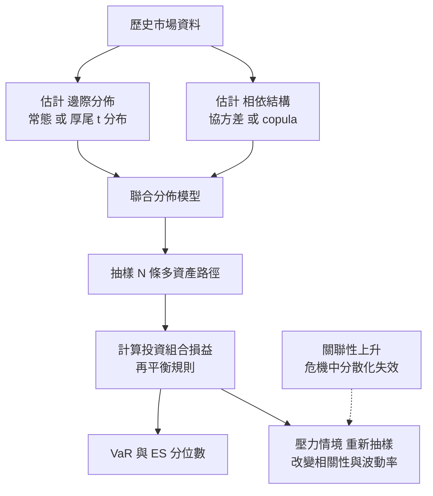
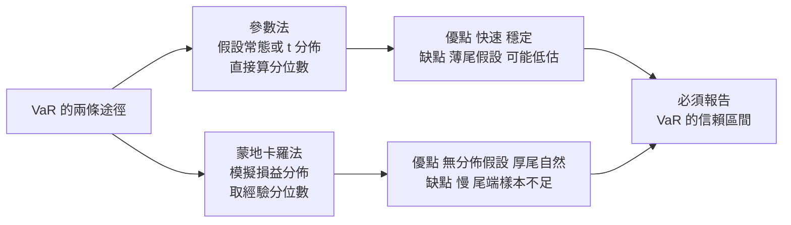
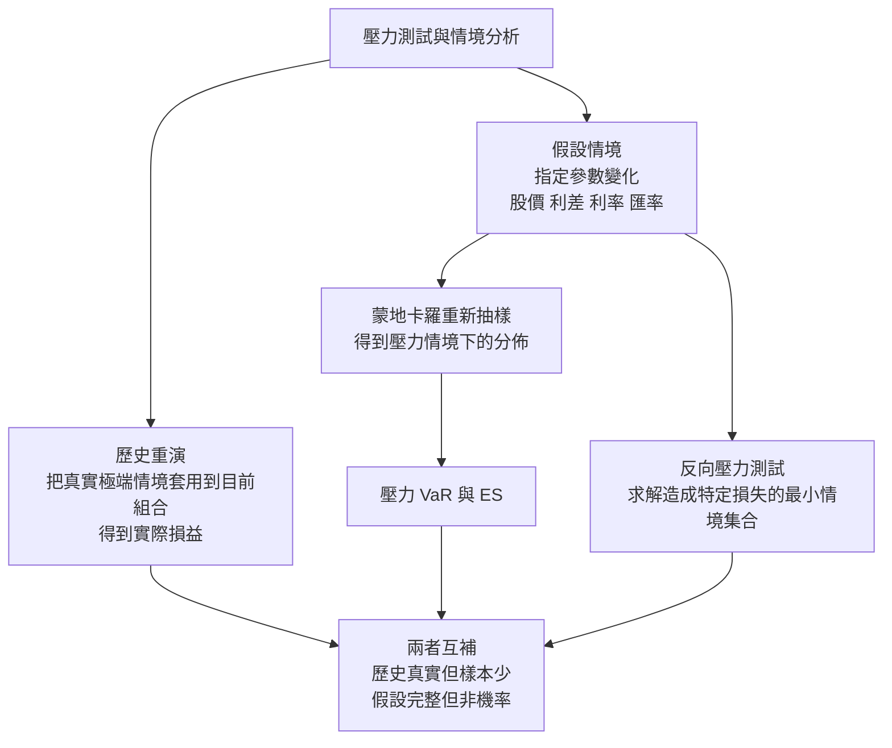

## 9.3　隨機過程與投資組合的模擬

[上一章：9.2　蒙地卡羅在金融衍生品中的應用](09.2-蒙地卡羅在金融衍生品中的應用.md) | [下一章：第10章　變數選擇與蒙地卡羅優化](10.0-變數選擇與蒙地卡羅優化.md)

## 學習目標

完成本節後，讀者應該能夠：

1. 說明多資產投資組合模擬的難點，並解釋為什麼單一資產的模型不能直接延伸到多資產。
2. 理解**相關性**在模擬中的角色：靜態協方差矩陣、動態相關性矩陣，以及「相關性在危機中上升」這個現象對風險估計的影響。
3. 描述馬可維茲模型與協方差矩陣估計方法，並指出樣本協方差矩陣在 $`N \ll T`$ 時的病態問題。
4. 說明蒙地卡羅 VaR 的**信賴區間**推導，並比較「正態假設」與「蒙地卡羅」兩種做法在尾端行為上的差異。
5. 說明**序列相關 bootstrap**（moving block / stationary bootstrap）為什麼必要，以及它如何保留波動聚集與厚尾。
6. 說明 **copula** 的角色：把聯合分佈分解成邊際分佈與相依結構。
7. 描述壓力測試與情境分析在投資組合層級的做法。
8. 說明蒙地卡羅在退休金風險管理中的應用，以及它面臨的特有挑戰（長時域、龐大資產、負債的非線性）。

## 9.3.1 從一個資產到很多個資產：新的難題

[9.1](09.1-期權定價與風險管理.md) 與 [9.2](09.2-蒙地卡羅在金融衍生品中的應用.md) 處理的是**單一資產**的路徑。但投資組合管理要處理的是**多個資產的聯合演化**，這立刻帶來新的難題。

在風險中性測度下， $`d`$ 個資產的聯合動態通常寫成

$$
d\mathbf{S}_t = \boldsymbol{\mu}\,\mathbf{S}_t\,dt + \boldsymbol{\Sigma}\,\mathbf{S}_t\,d\mathbf{W}_t
$$


其中 $`\mathbf{S}`$ 是 $`d`$ 維價格向量， $`\mathbf{W}`$ 是 $`d`$ 維標準布朗運動， $`\boldsymbol{\Sigma}`$ 是**波動率相關矩陣**。這個模型簡潔，但隱含了強假設：**相關矩陣是常數**。

**問題在於**：真實市場中，相關性不是常數，而且它對風險估計有系統性影響。

- **危機中的相關性上升（correlation breakdown）**：2008 年時，股票之間的相關性趨近 1，信用卡與股票也趨近 1。這意味著**分散化在最需要它的時候失效**。
- **常數相關的聯合對數常態分佈會產生「相機效應」（camera effect）**：即長期聯合分佈的左尾比用常數相關性推估的更厚。

這些現象意味著：**用歷史協方差矩陣估計的 VaR，在壓力情境下會系統性低估**。

## 9.3.2 馬可維茲模型與協方差矩陣估計

**馬可維茲模型（Markowitz portfolio theory, 1952）** 假設報酬服從多元常態分佈：

$$
\mathbf{r} \sim N(\boldsymbol{\mu}, \boldsymbol{\Sigma})
$$


投資組合報酬 $`\mathbf{w}^\top\mathbf{r}`$ 的波動率為 $`\sqrt{\mathbf{w}^\top\boldsymbol{\Sigma}\mathbf{w}}`$ 。在均值-變數平面上的最小變數組合（效率前緣）可解出。但要注意：**馬可維茲模型是單期的靜態模型**，它是理解多資產風險的起點，卻不是模擬工具。

**協方差矩陣的估計**有幾個實務問題：

1. **樣本協方差矩陣的病態性**：若觀測期數 $`T`$ 小於資產數 $`d`$ ，樣本協方差矩陣 $`\hat{\boldsymbol{\Sigma}}`$ 是奇異的，且特徵值估計有嚴重偏差。修正方法：**Ledoit–Wolf 收縮估計**（把樣本協方差向目標矩陣收縮）與 **因子模型協方差估計**。
2. **相關性估計的不穩定性**：把協方差轉成相關性矩陣時，分母是各資產的波動率，受波動率估計誤差影響。
3. **非同步交易造成的相關性偏誤**：不同市場的交易日不同，單純對齊日期會產生「非同步交易偏誤」，需用 **Toothpick 模型**或 **Hayashi–Hull–Rosenbaum 估計**修正。

下圖說明多資產模擬的完整架構與相依性的來源。



這張圖表達的論點：**多資產風險的核心不是各資產各自的模型，而是相依結構**；而相依結構恰恰是歷史資料最不可靠的部分。

## 9.3.3 蒙地卡羅 VaR 的信賴區間：正態假設 vs 模擬

假設投資組合損益的估計值為 $`\hat{V}_N`$ （ $`N`$ 條蒙地卡羅路徑的平均），我們需要對它的不確定性給出信賴區間。

**方法 A：正態假設法。** 由 CLT， $`\hat{V}_N \sim N(V, \sigma^2/N)`$ 約略成立，因此

$$
\left[\hat{V}_N - z_{1-\alpha/2}\frac{\sigma}{\sqrt{N}},\ \hat{V}_N + z_{1-\alpha/2}\frac{\sigma}{\sqrt{N}}\right]
$$


是一個約 $`95%`$ 的信賴區間（ $`z_{0.975}\approx 1.96`$ ）。

**方法 B：直接用樣本分位數。** 對 $`N`$ 條路徑的損益值排序，取第 $`\lfloor \alpha N \rfloor`$ 與第 $`\lceil \alpha N \rceil`$ 個次序統計量作為分位數的區間。

**兩者的差異與陷阱**：

| 面向 | 正態假設法 | 直接分位數法 |
| --- | --- | --- |
| 假設 | 估計量的**抽樣分佈**為常態 | 分位數的抽樣分佈 |
| 適用 | CLT 有效時可靠 | 任何情況皆有定義 |
| 陷阱 | 若**母體分佈**厚尾，CLT 收斂慢，區間會過窄 | 樣本數小時，尾端分位數本身不穩定 |

關鍵區分：**正態假設是關於「估計抽樣誤差」而非「損益分佈」的假設**。即使母體厚尾，只要 $`N`$ 夠大，CLT 仍使估計量近似常態，因此方法 A 對**平均值的信賴區間**是正確的。但若我們要估計的是**分位數**（這正是 VaR），方法的選擇就完全不同了。

此外，對分位數的蒙地卡羅估計，標準誤差是

$$
\mathrm{se}(\hat{q}_\alpha) \approx \frac{\sqrt{\alpha(1-\alpha)}}{f(q_\alpha)\sqrt{N}}
$$


其中 $`f`$ 是密度函數。**注意分母中的 $`f(q_\alpha)`$ **：分位數越靠尾端，密度越低，標準誤越大。這從數學上說明了尾端估計為什麼困難，也是為什麼需要重要性抽樣（[第5章](05.0-變換抽樣法.md)）或更有效的方法（如 Cornish–Fisher 展開、抽樣理論的「抽樣極限分佈理論」）。

### 蒙地卡羅 VaR 的特點

與「假設常態分佈再算正態分位數」相比，蒙地卡羅 VaR 的優點是**不需要對母體分佈做假設**，能自然地捕捉厚尾與偏態。缺點是：

1. 需要模擬成本；
2. **樣本數必須足夠大**才能解析尾端（估計 99.9% 分位數需要數百萬路徑）；
3. 蒙地卡羅 VaR 本身仍帶有隨機性，必須報告其信賴區間。

下圖比較兩條途徑。



這張圖表達的論點：**蒙地卡羅 VaR 把「模型風險」轉換成了「抽樣誤差」**，後者可以用置信區間量化，前者則不行——這是兩者的根本差異。

## 9.3.4 序列相關 bootstrap

若直接對歷史報酬做 iid 抽樣（iid bootstrap），會丟掉金融時間序列最重要的兩個特徵：

1. **波動率聚集**（volatility clustering）：大的報酬之後傾向跟著大的報酬；
2. **厚尾與非對稱**：極端報酬的出現頻率高於常態分佈預測。

**區塊 bootstrap（block bootstrap, moving block bootstrap）** 的做法是：把 $`T`$ 天的序列切成 $`m`$ 個長度為 $`b`$ 的區塊，隨機選取（有放回）並拼接成「合成歷史」，再對合成歷史做 iid 抽樣或直接作為未來路徑。

**區塊長度 $`b`$ 的選擇**是核心難題：

- $`b`$ 太短 → 丟掉序列相依性（波動聚集消失）；
- $`b`$ 太長 → 可用樣本數變少，且區塊邊界造成人為相依。

Politis & Romano（1994）給出了自動選擇 $`b`$ 的方法。**Stationary bootstrap**（Politis & Romano, 1994）則用幾何分佈的隨機長度區塊，樣本分佈更接近平穩過程。

實務上，**歷史模擬法（HS，見 [9.1](09.1-期權定價與風險管理.md)）** 基本上就是區塊 bootstrap 的變體。

## 9.3.5 Copula：把聯合分佈拆成兩部分

**Copula** 提供了一個優雅的分解方式，把聯合分佈 $`F`$ 寫成

$$
F(x_1,\dots,x_d) = C\big(F_1(x_1),\dots,F_d(x_d)\big)
$$


其中 $`F_i`$ 是各資產的**邊際分佈**， $`C`$ 是**相依結構**。這個分解來自 Sklar（1959）的定理。

常用的 copula 族：

- **高斯 copula**： $`C = \Phi_d(\Phi^{-1}(u_1),\dots,\Phi^{-1}(u_d);\boldsymbol{\rho})`$ 。優點是易於模擬（把相依常態轉成獨立常態再取分位數）；缺點是無法產生非高斯相依（例如無法同時表現「厚尾」與「非對稱相依」）。
- **t copula**：用 t 分佈代替高斯，能產生厚尾相依；廣泛用於 credit risk。
- **Clayton copula**：下尾相依很強（financial crisis 時的「一起崩盤」）；但上尾相依弱。
- **Gumbel copula**：上尾相依強。
- **極值相依（tail dependence coefficient）** $`\lambda`$ ：描述「一個資產出現極端值時，另一個同時出現極端值的機率」。這是金融風險中最重要的相依參數，因為**系統性風險正是透過尾端相依傳播的**。

Copula 的實務價值在於：**可以從歷史資料估計邊際分佈（用厚尾的 t 或 EVT），再用 copula 描述相依**——這比直接估計多變量高斯更貼近真實。

## 9.3.6 壓力測試與情境分析

投資組合層級的壓力測試有兩種做法：

**（一）反向壓力測試（reverse stress testing）。** 問的是：「什麼情境會讓我的投資組合損失達到某個門檻（例如監理資本的 8%）？」這需要**求解**而非抽樣，通常用優化方法（例如 [第10章](10.0-變數選擇與蒙地卡羅優化.md) 的隨機搜索）在情景空間中尋找。

**（二）情境分析（scenario analysis）。** 指定具體的情境參數集合（例如：股價 -20%、信用利差 +150bp、利率 +100bp、匯率 -5%、波動率 +50%），重新計算投資組合價值。

**（三）蒙特卡羅版本的壓力測試。** 在壓力情境下重新跑蒙地卡羅：把模型的參數（如波動率水準、相關性）改為壓力值，然後重新抽樣，得到「壓力情境下的分佈」，再算該分佈下的 VaR/ES。

第三種的價值在於：**它給出了壓力情境下的機率分佈，而不僅是一個點估計**。但要注意一個陷阱：**在壓力情境下，蒙地卡羅抽樣的結果並不是真實的機率**——因為歷史上這種情境只發生過少數幾次，蒙地卡羅其實是在「假設參數被改變，但相對機率仍依新模型計算」。因此實務上通常同時報告「歷史情境下的實際結果」與「壓力參數下的蒙地卡羅分佈」。

下圖說明壓力測試的兩條路徑。



這張圖表達的論點：**壓力測試的每一種方法都有其侷限，實務上必須並用多個方法**；而「蒙地卡羅版本的壓力測試」特別要注意其結果並非機率陳述。

## 9.3.7 退休金的挑戰

退休金（pension fund）是多資產蒙地卡羅最重要的應用場景之一，也是最困難的。原因：

1. **超長時域**：養老金的負債期限可能長達數十年，需要模擬數千個時間步。
2. **巨額資產**：數千項資產、複雜的債券結構、對沖工具。
3. **負債的非線性**：退休金給付通常與「資產至少是負債的某一比例」或「給付隨報酬調整」相關，因此**資產與負債必須聯合模擬**，且 payoff 是非線性的。
4. **多重不確定性**：資產報酬、利率、死亡率、離職率（survivorship risk）都需模擬。

現代養老金風險管理的主流做法是**隨機規劃（stochastic programming）**：以蒙地卡羅產生的「經濟情境（economic scenarios）」作為優化問題的輸入，尋找能最大化期望效用或滿足最小資金充足率的資產配置。也就是說，蒙地卡羅在此扮演的是**產生情境集的引擎**，真正的決策由最佳化演算法完成——這正是第 10 章的主題。

## 9.3.8 實作：多資產投資組合的蒙地卡羅 VaR

```python
import numpy as np

def simulate_portfolio(weights, returns, n_paths=50000, horizon=250, seed=0, shuffle=True):
    """以 iid bootstrap 抽樣報酬（簡化版），模擬投資組合的 h 期累積報酬。

    weights: 各資產權重（總和為 1）
    returns: 形狀 (T, d) 的歷史報酬矩陣
    """
    rng = np.random.default_rng(seed)
    T, d = returns.shape
    if shuffle:
        idx = rng.integers(0, T, size=(n_paths, horizon))
        draws = returns[idx]                      # (n_paths, horizon, d)
    else:
        draws = np.tile(returns[:horizon], (n_paths, 1, 1))
    port = np.einsum("phd,d->ph", draws, weights)   # 每日投資組合報酬
    cum = np.prod(1.0 + port, axis=1) - 1.0         # 累積報酬
    return cum

def mc_var_es(cum_returns, alpha=0.01):
    """以蒙地卡羅樣本估計 VaR 與 Expected Shortfall（正收益為佳時取負號）。"""
    x = -cum_returns            # 轉成損失
    var = np.quantile(x, alpha)
    tail = x[x >= var]
    es = tail.mean() if tail.size else np.nan
    return var, es

rng = np.random.default_rng(5)
T, d = 1500, 4
# 造一個含厚尾與相關性的歷史報酬資料
common = rng.standard_normal((T, 1)) * 0.012
idio = rng.standard_normal((T, d)) * 0.015
ret = 0.0004 + common + idio
ret[np.random.default_rng(9).random(T) < 0.01] *= 4.0   # 注入厚尾

w = np.array([0.4, 0.3, 0.2, 0.1])
cum = simulate_portfolio(w, ret, n_paths=50000, horizon=250)
var, es = mc_var_es(cum, alpha=0.01)
print(f"蒙地卡羅 99% VaR = {var:.4%}, 99% ES = {es:.4%}")
print(f"（ES 應大於 VaR，反映尾端嚴重程度）")
```

這段程式碼示範的理論對應是：**中心極限定理下的抽樣誤差**（蒙地卡羅樣本提供分位數的非參數估計），以及**厚尾對尾端風險的影響**（注入的 4 倍厚尾會讓 VaR 遠高於常態假設的預測）。

## 9.3.9 前因後果

本章的邏輯鏈是：多資產模型需要相依結構 → 相依結構用相關性或 copula 描述 → 相依結構的歷史估計不可靠（危機中相關性上升）→ 因此風險度量必須配合歷史重演與壓力測試 → 長期養老金等問題更極端，需要隨機規劃把情境集與最佳化結合。

這就把本書從「蒙地卡羅是估計工具」帶到「蒙地卡羅是決策基礎設施」的高度。而下一章要處理的，正是如何**選擇**與**優化**那些決定模擬結果的參數。

## 本章要點

1. 多資產模擬的核心挑戰是相依結構，而不是各資產各自的模型。
2. 危機中相關性上升使分散化失效，用歷史相關性估計的 VaR 在壓力情境下系統性低估。
3. 常數相關的多元對數常態模型有「相機效應」，左尾比直覺預期更厚。
4. 樣本協方差矩陣在 $`T<d`$ 時病態，需用 Ledoit–Wolf 收縮或因子模型修正；非同步交易還需另外修正。
5. VaR 的信賴區間要區分「平均值的 CLT 區間」與「分位數的抽樣誤差」，兩者的假設不同。
6. 分位數的蒙地卡羅標準誤含因子 $`1/f(q_\alpha)`$ ，密度越低（越靠尾端）誤差越大。
7. 序列相關 bootstrap（區塊 bootstrap、stationary bootstrap）用於保留波動聚集與厚尾；區塊長度選擇是核心難題。
8. Copula 把聯合分佈分解為邊際分佈與相依結構，極值相依係數 $`\lambda`$ 直接刻畫系統性風險的傳播。
9. 壓力測試的三種做法（歷史重演、假設情境、反向壓力測試）各有侷限，需並用；蒙地卡羅壓力結果並非機率陳述。
10. 退休金風險管理需要聯合模擬資產與負債，並以蒙地卡羅情境集驅動隨機規劃最佳化。

## 延伸閱讀

- Markowitz, H. (1952). Portfolio selection. *The Journal of Finance*, 7(1), 77–91.
- Ledoit, O. & Wolf, M. (2004). A well-conditioned estimator for large-dimensional covariance matrices. *Journal of Multivariate Analysis*, 88(2), 365–411.
- Politis, D. N. & Romano, J. P. (1994). The stationary bootstrap. *Journal of the American Statistical Association*, 89(428), 1303–1313.
- McNeil, A. J., Frey, R. & Embrechts, P. (2015). *Quantitative Risk Management*. Princeton University Press.
- Glasserman, P. (2004). *Monte Carlo Methods in Financial Engineering*. Springer.
- [第10章：變數選擇與蒙地卡羅優化](10.0-變數選擇與蒙地卡羅優化.md)
