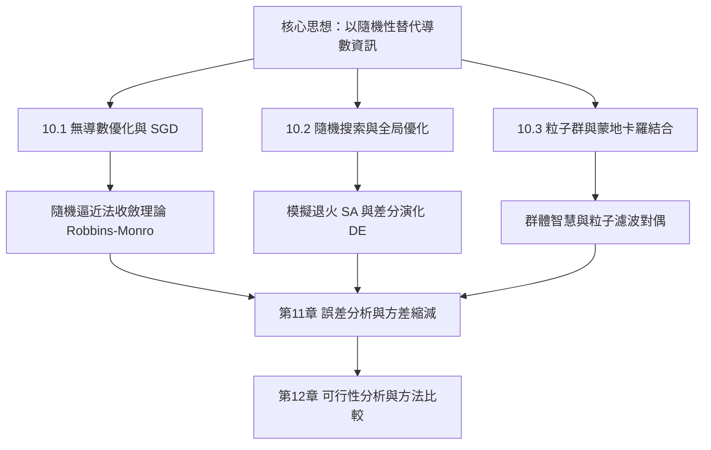

# 第10章　變數選擇與蒙地卡羅優化

[上一章：9.3 隨機過程與投資組合的模擬](09.3-隨機過程與投資組合的模擬.md) | [下一章：10.1 蒙地卡羅方法中的優化技巧](10.1-蒙地卡羅方法中的優化技巧.md)

## 學習目標

完成本章後，讀者應該能夠：

1. 說明為什麼「隨機性」不只可以用來計算積分，也可以用來取代最佳化問題中的導數資訊。
2. 理解本章的核心思想——「以隨機性替代導數資訊」——背後的因果鏈：導數不可得 → 需要替代品 → 隨機性提供廉價替代品 → 但代價是噪聲 → 於是需要噪聲理論來支撐演算法設計。
3. 掌握本章三個技術支柱的分工：10.1 處理「單次評估太貴」的局部優化、10.2 處理「不知道從何處開始」的全局優化、10.3 處理「大量候選解需要統計式評估」的群體智慧。
4. 辨認隨機優化（stochastic optimization）與第 4、5 章的隨機積分之間的共同數學基礎：皆為對同一個期望量的抽樣估計，只是「期望什麼」不同。

## 1. 蒙地卡羅法的第二個身分

前面九章的主軸是同一件事：把一個難以解析求值的積分

$$
I = \int_{\mathcal{D}} f(x)\,p(x)\,dx
$$

改寫成期望，再以獨立同分布樣本 $`X_1,\dots,X_N \sim p`$ 估計之：

$$
\hat{I}_N = \frac{1}{N}\sum_{i=1}^{N} f(X_i), \qquad \operatorname{Var}(\hat{I}_N) = \frac{\operatorname{Var}_p(f(X))}{N}.
$$

關鍵在於這個轉換的**適用範圍其實比「積分」更廣**。任何一個「對不確定性取期望」的問題，只要被決策者以「期望值最大」或「期望值最小」的方式處理，背後就是同一套抽樣機制。第 9 章的期權定價是最明顯的例子：買方願意支付的價格就是未來payoff的期望，而蒙地卡羅是唯一能算出這個期望的可行工具。

本章要把這個思路再推一步：**隨機性不只用來「求值」，還可以用來「探索」**。

考慮一個最佳化問題

$$
x^* = \arg\min_{x \in \mathcal{X}} F(x), \qquad F(x) = \mathbb{E}_{\xi}\big[\ell(x,\xi)\big].
$$

此時 $`F`$ 不是一個可以直接積分的函式，而是一個「期望的期望」。我們要最小化的是它對 $`\xi`$ 的平均表現，而 $`\xi`$ 是隨機的（例如需求、天氣、對手策略、隨機梯度）。最佳化問題自此成為**雙重不確定性**問題：外層是尋找 $`x`$ ，內層是估計 $`F(x)`$ 。

這正是本章要處理的結構。

## 2. 為什麼需要「隨機性替代導數」？

傳統最佳化演算法的骨架幾乎都建立在「梯度可取得」這個前提上。梯度下降需要 $`\nabla F`$ ，牛頓法需要 $`H = \nabla^2 F`$ ，共軛梯度法需要方向導數。然而在真實問題中，梯度常常不可得：

- **函數本身不可微**（決策邊界、分段函數、來自黑箱模擬器的回饋）。
- **梯度存在但取得代價高昂**。例如最佳化一個神經網路的訓練損失，反向傳播需要保存整個計算圖；最佳化一個有限元素模型的響應，伴随法（adjoint method）需要求解線性系統。
- **只有噪聲觀測**。工業製程控制中只能量測到含噪的輸出；強化學習中回饋來自隨機環境。
- **高維且記憶體受限**。在數百萬維的參數空間中保存完整梯度向量本身就不可行。

一旦導數不可得，最自然的替代品就是**隨機抽樣**：既然我們會抽樣來估計 $`F`$ ，那就順便利用抽樣得到的資訊來推動搜尋。這就是「以隨機性替代導數資訊」。

其因果鏈非常清晰：

1. 導數不可得 → 必須以函數值（甚至期望值）代替斜率。
2. 函數值估計本身帶有噪聲 → 需要設計能容忍噪聲的演算法。
3. 噪聲會讓演算法在正確方向上「抖動」→ 需要步長控制理論。
4. 步長控制理論的基礎是隨機逼近法（stochastic approximation, Robbins–Monro, 1951）的收斂定理 → 從此有了數學上的安全保證。

## 3. 隨機性如何進入最佳化：三個來源

在進入具體技術前，先建立分類架構。本章區分三種隨機性來源：

| 來源 | 隨機性在哪裡 | 典型演算法 | 主要誤差源 |
| --- | --- | --- | --- |
| 內生噪聲 | $`\xi`$ 本身隨機（環境、回饋） | 隨機梯度下降 SGD、隨機逼近 | 梯度估計噪聲 |
| 探索噪聲 | 主動加入的隨機方向（隨機搜尋） | 隨機搜索、模擬退火、差分演化 | 覆蓋不足 |
| 群體噪聲 | 多個候選解之間的隨機交互 | 粒子群 PSO、遺傳演算法 GA | 早熟收斂 |

這個分類不是任意的：它對應到三種不同的資訊結構。內生噪聲的隨機性無法被演算法控制，只能被估計與平均；探索噪聲可由演算法自行設計，是**可設計的資源**；群體噪聲則介於兩者之間，隨機性來自多個獨立個體之間的碰撞與共識。

第 10.1、10.2、10.3 節恰好依此順序處理：先處理無法控制的內生噪聲（第 10.1 節），再處理可設計的探索噪聲（第 10.2 節），最後處理群體層級的統計式評估（第 10.3 節）。

## 4. 演算法骨架：把「估計」與「搜尋」耦合起來

無導數最佳化的最通用骨架，是把**函數值估計**與**搜尋步驟**交錯進行：

$$
\text{重複直到停止：}
\qquad
\begin{array}{rl}
1. & \text{在目前位置 } x_k \text{ 產生 } B \text{ 個樣本，估計 } \hat{g}_k = \frac{1}{B}\sum_{b=1}^{B} g(x_k,\xi_{k,b}), \\[4pt]
2. & \text{用 } \hat{g}_k \text{ 更新 } x_{k+1} = x_k - \eta_k \hat{g}_k, \\[4pt]
3. & \text{調整步長 } \eta_k \text{（依據估計的誤差大小）。}
\end{array}
$$

其中 $`g`$ 可能是真正的梯度（此時估計的就是隨機梯度），也可能只是「朝下的方向」（此時是 zero-order 優化）。批次大小 $`B`$ 在這裡扮演關鍵角色： $`B`$ 越大，方向估計越準，但每一步越貴。

信號噪聲比（signal-to-noise ratio）的量度是這樣的。若單次抽樣的方向估計為 $`g + \varepsilon`$ ，其中 $`\mathbb{E}[\varepsilon]=0`$ 、 $`\operatorname{Var}(\varepsilon)=\sigma^2`$ ，則 $`B`$ 個樣本平均後的信噪比為

$$
\text{SNR} = \frac{\|g\|}{\sigma/\sqrt{B}} = \frac{\|g\|\sqrt{B}}{\sigma},
$$

也就是 $`O(\sqrt{B})`$ ；而方向的相對誤差（角度誤差）是 $`O(1/\sqrt{B})`$ 。這個 $`O(1/\sqrt{B})`$ 是整章的定價：多算 $`B`$ 倍的樣本，只換來 $`\sqrt{B}`$ 倍的方向精度。這是蒙地卡羅法的基本速率在優化領域的投影——要將噪聲壓低一個數量級，必須多算 100 倍的樣本。

這個「代價高、收益慢」的比率，正是後面幾節要設計的對策來源：隨機逼近法用**逐步加大批次**來解決「前期要快、後期要準」的矛盾；低方差抽樣與控制變數（[第 11.2 節](11.2-精度提升的技術：低方差抽樣與控制變數法.md)）則從「降低每個樣本的方差 $`\sigma^2`$ 」下手，等價於把 $`O(1/\sqrt{B})`$ 中的常數項縮小；代理模型（surrogate model）則是用模型換掉昂貴的樣本，讓 $`B`$ 變得不那麼昂貴。

## 5. 硬體與實務的驅動

理論上的必要性之外，還有一個重要的實務推力：**樣本可以完全平行**。

網格法（grid method）與有限差分求導在維度 $`d`$ 下需要 $`O(d)`$ 次串行函數評估（每個維度一次差分），而且這些評估彼此獨立在數學上，但通常難以在同一時刻執行完（負載平衡不佳）。相較之下，蒙地卡羅的樣本生成彼此完全獨立，天然地適合以「批次」或「連續流」的方式送入 GPU 或分散式叢集（參見[第 6 章](06.0-蒙地卡羅積分的高效實現.md)）。

這就是為什麼 2012 年之後，深度學習的訓練幾乎全面改用小批次（mini-batch）隨機梯度下降：一塊 GPU 上同時跑 512 個樣本，比跑 512 次串行的批量梯度下降快上數百倍，而代價只是方向估計變 noisy。**硬體的並行性偏好，正是蒙地卡羅方法滲透到機器學習領域的物理原因。**

## 6. 本章的組織

下圖顯示本章三節的分工與依賴關係，以及它們與後續章節的銜接。

由圖可見，第 10 章的三節是並列的三個技術分支，但它們共同依賴同一個理論核心（隨機逼近與噪聲分析），並且都會在第 11 章匯流——因為無論採用哪種演算法，最後都必須回答同一個問題：**這個結果有多可靠？**

## 7. 前置知識與後續問題

閱讀本章需要以下基礎：

- 第 2 章：隨機變數、期望、變數與獨立性（本章的「噪聲」語彙來自此處）。
- 第 4 章：中心極限定理與 $`O(N^{-1/2})`$ 誤差律（本章的 $`O(1/\sqrt{B})`$ 噪聲律是它的孪生結果）。
- 第 6 章：抽樣的平行化（理解為何蒙地卡羅風格在硬體上吃香）。

本章會刻意留下幾個未解的問題，交由後續章節處理：

- **問題一**：隨機優化的收斂率極慢（第 10.1 節的隨機逼近在一般情形只有 $`O(1/k)`$ 的迭代速率），如何改進？（→ 第 11 章）
- **問題二**：如何精確估計「這個解比那個解好」？這需要估計兩個期望值之差的統計顯著性（第 10.3 節會引入）。
- **問題三**：蒙地卡羅真的總是合適的工具嗎？當維度高、精度要求高、或結果需要稽核時，它的弱點會被放大（第 12 章）。

## 本章要點

1. 蒙地卡羅法的核心——把積分改寫為期望並抽樣估計——其適用範圍遠超積分本身，同樣適用於「對隨機環境取期望的最佳化問題」。
2. 隨機性進入最佳化的根本原因是導數資訊不可得或取得代價高昂；以隨機抽樣取代導數，是最廉價也最通用的替代方案。
3. 內生噪聲、探索噪聲、群體噪聲是三種不同的隨機性來源，對應第 10.1、10.2、10.3 三節的技術分工。
4. 方向估計的相對誤差是 $`O(1/\sqrt{B})`$ ：增加十倍計算只換來約三倍精度，這個「邊際效益遞減」是後續所有改進技術的出發點。
5. 演算法的樣本之間彼此獨立，因而可以完全平行；這是蒙地卡羅方法在 GPU 時代與深度學習中取得優勢的硬體原因。
6. 本章的所有演算法最終都必須回答同一個問題：估計值究竟有多可靠？這是第 11 章的主題。

## 延伸閱讀

- H. Robbins and S. Monro (1951), *A Stochastic Approximation Method*, Annals of Mathematical Statistics 22(3), 400–407.
- J. C. Spall (1998), *Adaptive Stochastic Approximation by the Simulated Annealing Algorithm*, IEEE Transactions on Automatic Control 43(1), 83–94.
- J. Nocedal and S. Wright (2006), *Numerical Optimization*, 2nd ed., Springer.（第 10.2 節討論的牛頓型方法與收斂率對照）
- D. P. Bertsekas (1999), *Nonlinear Programming*, 2nd ed., Athena Scientific.（無導數優化與信賴域方法）
- N. J. Higham, *Accuracy and Stability of Numerical Algorithms*, 2nd ed., SIAM, 2002.（第 11 章誤差分析的標準參考）
