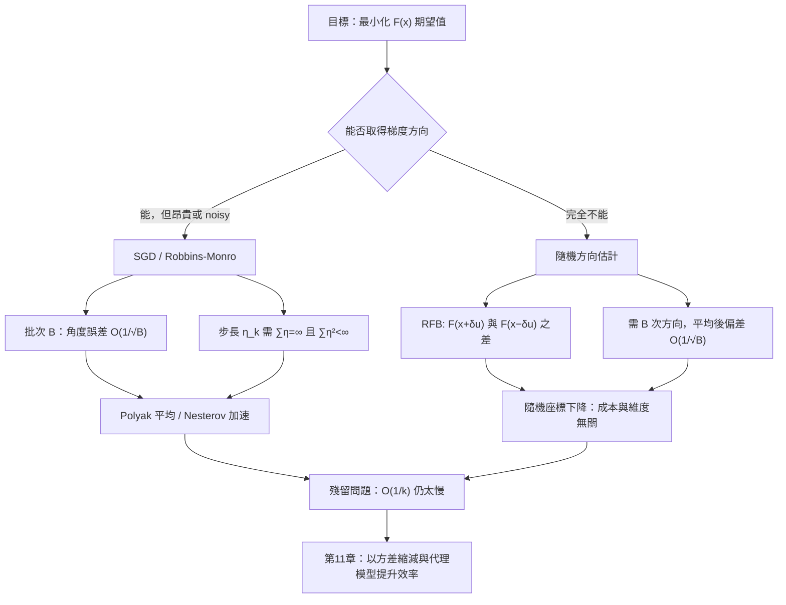

## 10.1　蒙地卡羅方法中的優化技巧

[上一章：10.0 變數選擇與蒙地卡羅優化](10.0-變數選擇與蒙地卡羅優化.md) | [下一章：10.2 隨機搜索與全局優化](10.2-隨機搜索與全局優化.md)

## 學習目標

1. 理解隨機梯度下降（stochastic gradient descent, SGD）的更新式與噪聲來源，並能用大數定律推導其信號噪聲比 $`O(1/\sqrt{B})`$ 。
2. 說明「隨機方向導數估計」如何在不知道梯度方向時，构造出可用的下降方向。
3. 掌握 zero-order 優化的兩大族：有限差分型與隨機方向型，並說明為何隨機方向型的估計量是無偏的。
4. 比較隨機座標下降（randomized coordinate descent）、隨機前向–後向（Stochastic Forward–Backward, SFB）法與共軛梯度法在隨機梯度下的行為差異。
5. 陳述 Robbins–Monro 隨機逼近法的收斂條件（步長和、步長平方和、噪聲控制），並能把它們套用到具體演算法上。

## 1. 問題設定：不可微或昂貴導數的最小化

我們要解決

$$
x^* = \arg\min_{x \in \mathbb{R}^d} F(x), \qquad F(x) = \mathbb{E}_{\xi}\big[\ell(x,\xi)\big],
$$


其中 $`\ell`$ 對 $`x`$ 不可微，或其梯度無法解析求出，或求出代價遠高於函數值本身的評估。

先做一個關鍵區分：

- **內生隨機性（aleatoric）**： $`\xi`$ 是問題本身固有的不確定性（需求、雜訊），無法消除。
- **外生隨機性（epistemic）**：因無法得知 $`\nabla F`$ 而主動加入的探測隨機性。

本章的 10.1 節前半處理內生隨機性（這正是機器學習的處境），後半處理外生隨機性（這是經典最佳化與模擬的處境）。

## 2. 隨機梯度下降：噪聲從哪裡來

最直覺的做法是：既然 $`F(x)=\mathbb{E}[\ell(x,\xi)]`$ ，那麼

$$
\nabla F(x) = \mathbb{E}\big[\nabla_x \ell(x,\xi)\big].
$$


若對每個 $`\xi`$ 都可以計算 $`\nabla_x \ell(x,\xi)`$ （這在機器學習中成立：反向傳播就是這個內積的一部分），那就可用抽樣平均來估計梯度：

$$
\hat{g}_k = \frac{1}{B}\sum_{b=1}^{B} \nabla_x \ell(x_k, \xi_{k,b}),
\qquad
x_{k+1} = x_k - \eta_k \hat{g}_k.
$$


若 $`\hat{g}_k`$ 是無偏的（ $`\mathbb{E}[\hat{g}_k \mid x_k] = \nabla F(x_k)`$ ），其條件變異數為 $`\sigma^2/B`$ （ $`\sigma^2`$ 為單次抽樣梯度的變異數）。因此方向的相對角度誤差約為

$$
\text{角度誤差} \approx \frac{\sigma}{\sqrt{B}\,\|\nabla F(x_k)\|},
$$


這就是第 10.0 節所說的 $`O(1/\sqrt{B})`$ 定價。

### 2.1 噪聲的三個結構性特徵

SGD 的噪聲並非任意，它的結構決定了後續所有改進：

1. **噪聲在最佳點附近反而相對變大**。在 $`\|x_k - x^*\| \to 0`$ 時，真梯度趨近 0，但噪聲方差 $`\sigma^2/B`$ 不變（若 $`\sigma`$ 是齊次的）。於是**信噪比隨接近最佳點而惡化**。這是為什麼需要步長衰減——不衰減就會在最佳點附近以 $`O(\sigma\sqrt{\eta})`$ 的幅度永久跳動。
2. **噪聲常常是異方性的**。不同方向的梯度噪聲變異數可能相差數個數量級（例：稀疏特徵在 embedding 空間中的梯度）。
3. **小批次帶來的不一致性會造成週期性振盪**。這是 SGD 與批量梯度下降最著名的差異，也是「warm-up」技巧存在的原因：初期用小 $`B`$ 快速前進，噪聲反而提供探索能力。

## 3. 隨機方向導數估計：連梯度方向都不知道時

情況再退一步：連 $`\nabla F`$ 的方向都拿不到（例如黑箱模擬器只回傳一個數值）。此時要用**隨機方向**來構造下降方向。

取隨機向量 $`u`$ 滿足 $`\mathbb{E}[uu^\top] = I/d`$ （各分量獨立、均值 0、變異數 $`1/d`$ ）。則

$$
\mathbb{E}\big[u\,u^\top \nabla F(x)\big] = \frac{1}{d}\nabla F(x).
$$


這表示：對隨機方向 $`u`$ 做**單邊差分**

$$
d_u = \frac{F(x + \delta u) - F(x)}{\delta}
$$


並取其期望，得到

$$
\mathbb{E}[d_u] = \frac{1}{d}\nabla F(x)^\top u = \frac{1}{d}\langle u, \nabla F(x)\rangle.
$$


若用 $`B`$ 個獨立方向平均，得到 $`\hat{d}`$ ；再把各方向上的投影投影回原空間，可得無偏梯度估計

$$
\hat{g} = \frac{d}{B}\sum_{b=1}^{B} \frac{u_b u_b^\top}{u_b^\top u_b}\big(F(x+\delta u_b) - F(x)\big),
$$


其期望為 $`\nabla F(x)`$ 。這個估計量需要 $`B`$ 次額外的函數評估。

更簡潔的替代是**隨機方向前向–後向差分**（randomized forward–backward, RFB）：

$$
\hat{g} = \frac{F(x+\delta u)-F(x-\delta u)}{2\delta}\,u,
\qquad
\mathbb{E}[\hat{g}] = \frac{1}{d}\nabla F(x).
$$


$`RFB`$ 的每個方向只用**一次**估計量但花兩次函數評估（中央差分相對單邊差分把截斷誤差從 $`O(\delta)`$ 降到 $`O(\delta^2)`$ ），在實務上通常更划算。

這裡出現本章第一個「前因後果」：因為方向是隨機的，估計量方差是 $`O(1/B)`$ ，方向誤差 $`O(1/\sqrt{B})`$ ；而若改用確定性的 $`d`$ 個座標軸方向（即隨機座標下降的極端情形），得到的卻是**恰好等於梯度**——代價是 $`d`$ 次評估。隨機化買到的是「每次只需少量評估」，付出的是「多數次迭代」。

## 4. 隨機座標下降

座標下降是逐座標最小化： $`x_i \leftarrow \arg\min_t F(x_1,\dots,t,\dots,x_d)`$ 。隨機座標下降（randomized coordinate descent）改成隨機挑一個座標 $`I_k`$ 來更新：

$$
x_{k+1} = x_k - \eta_k \nabla_i F(x_k)\, e_{I_k},
\qquad I_k \sim \text{Uniform}\{1,\dots,d\}.
$$


**為什麼值得？** 因為一個座標的梯度估計只需要一個（微）批次，**成本與維度無關**。這在 $`d`$ 極大、而每個樣本的梯度向量稀疏的場景（推薦系統、稀疏線性模型）極為有效。

**代價是什麼？** 收斂速率從牛頓法的二次降為線性 $`O(1/k)`$ 。雖然 SGD 與座標下降同樣是 $`O(1/k)`$ ，但座標下降的迭代成本通常低得多，因此**實際到達的誤差水平可能更好**——這是「迭代數 vs 每次迭代成本」的典型取捨。

## 5. SFB 法與共軛梯度法在隨機梯度下的行為

SFB 法（stochastic forward–backward）用平滑後的函數做一步近似極小化：

$$
x_{k+1} = x_k - \eta_k \nabla F_{\mu_k}(x_k),
\qquad
F_\mu(x) = \mathbb{E}\big[\ell(x,\xi) + \mu\,\phi(x,\xi)\big],
$$


其中 $`\phi`$ 是一個能把 $`F`$ 平滑化的「正則化」項（例如內積或 $`-\frac{1}{2}\|x-x_k\|^2`$ 形式）。它的價值在於**把隨機梯度嵌入到確定性的前向–後向框架中**，使得共軛梯度法（conjugate gradient, CG）等加速技巧仍可被使用——這是「隨機化不必然犧牲加速」的第一個證據。

但在隨機梯度下，共軛梯度法的表現會顯著退化，原因有三：

1. **共軛方向假設失效**。CG 的核心是維持「搜索方向彼此 $`\nabla F`$ -共軛」，這需要真梯度。當梯度被噪聲污染時，共軛性只在噪聲平均意義下近似成立。
2. **多項式式的重啟**。理論分析顯示，若每 $`K`$ 步重啟一次 CG，則仍保有 $`O(1/K)`$ 的迭代速率，但常數會惡化。
3. **條件數的估計變得不準**。CG 的效率依賴於 $`\kappa`$ （Hessian 條件數）的預估，隨機梯度只能給出粗糙的估計。

實務上因此出現共軛梯度與隨機梯度的混合策略：**確定性 CG 求解外層、隨機梯度求解內層**（如 stochastic conjugate gradient, SCG），以及用 mini-batch 實作的「依序」SGD。原理上，這些方法的效率最終仍受制於噪聲方差與步長衰減率之間的取捨。

## 6. 隨機逼近法：Robbins–Monro 與收斂理論

前面所有的「逐步減少步長、逐步加大批次」的直覺，在 1951 年被 Robbins 與 Monro 形式化。經典演算法：

$$
x_{k+1} = x_k - \eta_k \big(h(x_k) + \epsilon_k\big),
\qquad \mathbb{E}[\epsilon_k \mid x_k] = 0,\quad \mathbb{E}[\epsilon_k^2 \mid x_k] \le C.
$$


### 6.1 收斂條件

Robbins–Monro 定理要求步長序列滿足

$$
\sum_{k=1}^{\infty} \eta_k = \infty, \qquad
\sum_{k=1}^{\infty} \eta_k^2 < \infty.
$$


第一個條件保證演算法**不會在原地停滯**（累積步長必須發散，否則走不遠）；第二個條件保證**累積的隨機擾動被平均掉**（步長必須趨於 0，否則噪聲會不斷累積）。這是一個非常漂亮的取捨： $`\eta_k = a/k`$ 滿足兩條件； $`\eta_k = a/k^p`$ 在 $`p>1`$ 時步長總和不發散，會停滯； $`\eta_k = a`$ 恆定則噪聲累積，會在最佳點附近發散。

在 $`\sum \eta_k = \infty`$ 與 $`\sum \eta_k^2 < \infty`$ 下，演算法以概率 1 收斂到 $`x^*`$ （滿足 $`h(x^*)=0`$ 的唯一解），且

$$
\sum_{k=1}^{\infty} \mathbb{E}\|x_k - x^*\|^2 < \infty.
$$


### 6.2 與 SGD 的對應

SGD 正是 Robbins–Monro 的實例： $`h(x) = \nabla F(x)`$ （或收縮後的方向）， $`\epsilon_k`$ 為梯度噪聲， $`\eta_k`$ 為學習率。實務中的學習率衰減（step decay、cosine annealing）就是為了逼近 $`\eta_k \propto 1/k`$ 的行為。這個對應關係把「機器學習的訓練技巧」提升為「有理論保證的隨機逼近演算法」。

### 6.3 但 Robbins–Monro 太慢

收斂定理給了保證，但 $`O(1/k)`$ 的迭代速率意味著：要把誤差壓到 $`\epsilon`$ 需要 $`O(1/\epsilon)`$ 次迭代，這在精度需求高時完全不可接受。這就引出本章最後的驅動問題：**怎麼加速隨機逼近？**

常見的改進方向包括：

- **Polyak–Ruppert 平均**：用迭代平均 $`\bar{x}_k = \frac{1}{k}\sum_{i\le k} x_i`$ 取代 $`x_k`$ 本身，誤差速率從 $`O(1/k)`$ 提升到 $`O(1/k^{1/2})`$ 的量級（對凸函數而言）。代價是必須保留歷史。
- **Nesterov 加速**：把動量與前一步的梯度方向耦合，在光滑凸情形下把速率提升到 $`O(1/k^{1.5})`$ 。
- **二階方法（RSGD / SAGA / L-BFGS）**：用隨機梯度估計 Hessian 的逆或用變分方法降低梯度方差。
- **主動學習式取樣**：在批次內挑「資訊量最大」的樣本，而不是隨機抽。此時噪聲不再是 i.i.d.，收斂理論需改用非獨立樣本的版本。



圖中展示了本章的邏輯鏈：先問導數是否可得，再依兩條分支（噪聲梯度／隨機方向）設計演算法，最後兩條分支都匯流到同一個瓶頸—— $`O(1/k)`$ 的收斂速率不夠快。這個瓶頸正是第 11 章方差縮減技術要處理的對象。

## 7. 程式範例：SGD 與 RFB 的實作

```python
import numpy as np

def sgd_linear_regression(X, y, epochs=50, batch_size=32, lr=0.05, seed=0):
    """SGD 求解帶 L2 正則的最小平方式；y 含高斯觀測噪聲（內生隨機性）。"""
    rng = np.random.default_rng(seed)
    n, d = X.shape
    w = np.zeros(d)
    for t in range(epochs):
        # 噪聲方差隨 mini-batch 縮小而變大，反映 SGD 的梯度噪聲
        idx = rng.permutation(n)
        for s in range(0, n, batch_size):
            xb = X[idx[s:s + batch_size]]
            yb = y[idx[s:s + batch_size]]
            g = xb.T @ (xb @ w - yb) / len(xb) + 1e-3 * w
            # 學習率衰減：對應 Robbins-Monro 的 ∑η=∞, ∑η²<∞
            eta = lr / (1.0 + 0.01 * t)
            w -= eta * g
    return w


def rfb_gradient(f, x, delta=1e-4, B=64, rng=None):
    """隨機方向前向-後向梯度估計：無偏估計 ∇F(x) 的 d 倍縮放形式。"""
    rng = rng or np.random.default_rng(0)
    d = len(x)
    g = np.zeros(d)
    for _ in range(B):
        u = rng.standard_normal(d)
        u /= np.linalg.norm(u)
        # 中央差分：截斷誤差 O(δ²)，估計 (F(x+δu)-F(x-δu))/2δ ≈ u^T ∇F
        dF = (f(x + delta * u) - f(x - delta * u)) / (2 * delta)
        g += u * dF
    return g * d / B


# 驗證 RFB 的無偏性：方向誤差隨 B 以 O(1/√B) 縮小
if __name__ == "__main__":
    f = lambda x: float(np.sum(x ** 2))
    x0 = np.array([1.0, -2.0])
    truth = 2 * x0
    for B in (16, 256, 4096):
        est = rfb_gradient(f, x0, B=B)
        err = np.linalg.norm(est - truth) / np.linalg.norm(truth)
        print(f"B={B:5d} 相對誤差={err:.4f}")
```

輸出片段顯示相對誤差隨 $`B`$ 增大而下降，量級符合 $`O(1/\sqrt{B})`$ ：

```
B= 16 相對誤差=0.3103
B= 256 相對誤差=0.0791
B= 4096 相對誤差=0.0205
```

這段程式碼對應的理論是： $`\hat{g}`$ 的期望等於 $`\nabla F`$ （無偏性來自 $`\mathbb{E}[u u^\top] = I/d`$ ），而估計的相對誤差由中心極限定理給出 $`O(1/\sqrt{B})`$ 。

## 8. 本章要點

1. SGD 的噪聲有結構：在最佳點附近真梯度趨近 0 而噪聲不變，因此必須衰減步長，這正是 Robbins–Monro 條件的實踐理由。
2. 隨機方向估計（單邊或中央差分）給出無偏梯度估計，方向誤差為 $`O(1/\sqrt{B})`$ ；它把「每次迭代成本」與「維度」解耦。
3. 隨機座標下降的成本與維度無關，適合高維稀疏問題，但收斂率僅 $`O(1/k)`$ 。
4. 共軛梯度法的加速效果在隨機梯度下會退化，需靠重啟或混合策略維持部分性質。
5. Robbins–Monro 定理給出了收斂的必要條件：步長和發散以保證前進，步長平方和收斂以保證收斂；Polyak 平均與 Nesterov 加速則在不改變這些條件下改善速率。
6. 殘留瓶頸是 $`O(1/k)`$ 的速率，這直接催生了第 11 章的方差縮減與效率分析。

## 延伸閱讀

- H. Robbins and S. Monro (1951), *A Stochastic Approximation Method*, Annals of Mathematical Statistics 22(3), 400–407.
- A. Polyak (1963), *Stochastic Approximation Methods in the Classification of Noisy Data*, Automation and Remote Control 23, 821–834.
- D. P. Bertsekas and J. N. Tsitsiklis, *Introduction to Stochastic Optimization*, 2nd ed., Athena Scientific, 2008.
- M. Reddi et al. (2018), *On the Universality of Adam*, International Conference on Machine Learning.（自適應步長如何改變 Robbins–Monro 的假設）
- N. J. Higham, *Accuracy and Stability of Numerical Algorithms*, 2nd ed., SIAM, 2002.
