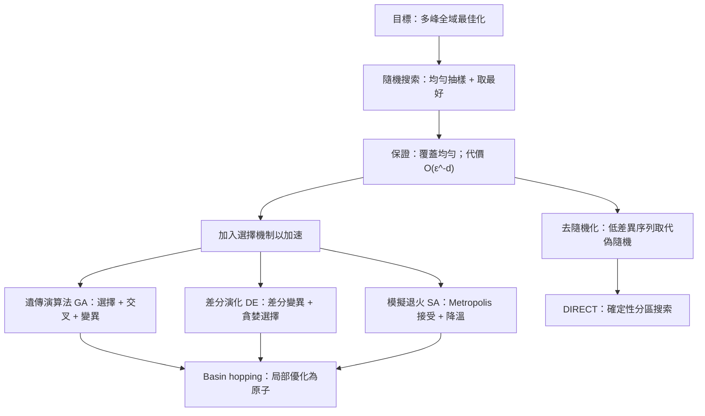

## 10.2　隨機搜索與全局優化

[上一章：10.1 蒙地卡羅方法中的優化技巧](10.1-蒙地卡羅方法中的優化技巧.md) | [下一章：10.3 粒子群算法與蒙地卡羅方法的結合](10.3-粒子群算法與蒙地卡羅方法的結合.md)

## 學習目標

1. 說明為什麼「局部方法」（梯度法、牛頓法）無法保證找到全域最佳解，而隨機搜索卻能提供某種意义上的全域性保證。
2. 推導隨機搜索達到 $`\epsilon`$ 精度所需的樣本數 $`O(\epsilon^{-d})`$ ，並解釋「維度災難」在搜尋上的具體後果。
3. 掌握演化演算法（evolutionary algorithms）、遺傳演算法（genetic algorithms, GA）、模擬退火（simulated annealing, SA）、basin hopping、差分演化（differential evolution, DE）與 DIRECT 的核心機制與適用條件。
4. 理解「去隨機化」（derandomization）的思想：如何用確定性低差異序列取代偽隨機抽樣，以獲得可重現且更均勻的覆蓋。
5. 判斷在什麼情況下，複雜的元啟發式演算法（metaheuristic）其實並不優於「隨機搜索 + 局部改進」。

## 1. 局部方法的侷限：為什麼需要搜尋

第 10.1 節的方法都是**局部方法**：它們假設存在一個局部收斂的機制，牛頓方向在 $`d`$ 維空間中指向唯一一個方向，一旦梯度為零就停在那裡。問題是最佳化問題的解空間幾乎總是**多峰（multimodal）**的。

試想一個最簡單的反例：

$$
F(x) = \sum_{i=1}^{d} \sin^2(3\pi x_i), \qquad x_i \in [0,1].
$$


在 $`d`$ 維中，這個函數有 $`3^d`$ 個局部最佳點。任意一個局部最佳解的函數值都可能是 $`O(1)`$ ，而全域最佳值是 0。**全域最佳解存在於「概率極低」的位置**，正是因為位置太多了。這就是多峰問題的本質困難，不是演算法不夠聰明，而是資訊結構本身使然。

更麻煩的是：局部方法要從一個起點出發，起點決定了落入哪個盆地（basin of attraction）。若不知道好解在哪裡，就只能多起點重啟，而每個起點要跑到收斂需要 $`O(\log(1/\epsilon))`$ 次迭代。

**隨機搜索的價值就在這裡**：它不依賴起點，只依賴「多樣化 + 概率覆蓋」。代價是效率極低，需要 $`O(\epsilon^{-d})`$ 次評估。

## 2. 隨機搜索：最簡單也最誠實的全局優化

最簡單的隨機搜索（random search）：

1. 在可行域 $`\mathcal{X}`$ 中均勻抽樣 $`x_1, x_2, \dots, x_N`$ 。
2. 取 $`x^* = \arg\min_i F(x_i)`$ 。
3. 重複直到滿足精度需求。

它有什麼保證？假設全域最佳區域的體積比例為 $`p`$ （即 $`\mathcal{X}^* = \{x : F(x) \le F^* + \epsilon\}`$ 在 $`\mathcal{X}`$ 中的比例），則至少抽到一個落在 $`\mathcal{X}^*`$ 內的機率為

$$
1 - (1-p)^N.
$$


要求成功率至少 $`1-\delta`$ ，需要

$$
N \ge \frac{\ln \delta}{\ln(1-p)} \approx \frac{\ln(1/\delta)}{p}.
$$


若 $`p \approx \epsilon^d`$ （在最佳點附近 $`d`$ 維的 $`\epsilon`$ 球，體積比例正比於 $`\epsilon^d`$ ），則

$$
N = O(\epsilon^{-d}).
$$


**這就是維度災難的搜尋版本**：精度提高十倍，樣本數增加 $`10^d`$ 倍。在 20 維中這意味著 $`10^{20}`$ 次評估——完全不可行。

隨機搜索唯一的優點是**極度簡單且無局部假象**：它保證全域覆蓋，而且**沒有任何假設**。這個樸素的基線在實務上出奇地有競爭力：在一個高維、評估昂貴的問題上，「1000 次隨機抽樣 + 最好的 10 個候選各做一次局部優化」經常勝過「一次複雜的元啟發式演算法」。這是一個重要的現實提醒：**演算法的複雜度有成本，而複雜度換來的收益未必抵銷成本。**

## 3. 演化演算法：把「隨機搜索 + 選擇」變成系統化的搜尋

### 3.1 遺傳演算法（Holland, 1975）

遺傳演算法（genetic algorithm, GA）的循環是：

1. **編碼**：把解表示成染色體（字串、實數向量）。
2. **族群（population）**：維持 $`M`$ 個個體。
3. **適應度（fitness）**：以目標函數值衡量好壞（最小化問題可取負值或倒數）。
4. **選擇（selection）**：以機率 $`p_i`$ 保留個體，常用輪廓選擇（roulette wheel），使適應度高的個體更可能被選中。
5. **交叉（crossover）**：把兩個父代染色體的片段交換，產生子代，產生新的基因組合。
6. **變異（mutation）**：以小機率隨機改變單一位元，維持多樣性。

**為什麼交叉與變異有效？** 這是演化演算法的關鍵洞見：**選擇提供「方向」，變異提供「探索」，交叉提供「結構的重新組合」**。若只有選擇與變異，退化成第 10.1 節的隨機爬山；若只有交叉沒有變異，族群會迅速同質化（收斂到同一染色體），多樣性崩潰，演算法停滯。這個「多樣性維持」的張力貫穿所有演化演算法的設計。

### 3.2 遺傳演算法與蒙地卡羅的關係

GA 與蒙地卡羅共享同一個抽樣骨架：維持一群候選解、依某個分佈抽樣、依目標函數值加權。差別只在**分佈如何更新**：

- 蒙地卡羅積分：分佈固定為 $`p`$ ，抽樣與目標函數無關（除非用重要性抽樣）。
- GA：分佈隨世代演化，逐漸集中於優秀區域（這本質上就是**重要性抽樣的迭代版本**）。

因此 GA 可以看成「自適應重要性抽樣」。這個觀點在文獻中常被用來解釋為何 GA 對連續問題（需要高階 crossover）表現不佳：二進位編碼在連續空間中會產生大量「海森堡問題」（相鄰實數被映到相鄰位元但解本身不連續）。

### 3.3 模擬退火（Kirkpatrick, Gelatt & Vecchi, 1983）

模擬退火（simulated annealing, SA）的思想來自統計物理：用溫度 $`T`$ 控制接受劣解的機率。

Metropolis 接受準則：從 $`x`$ 走到鄰點 $`x'`$ ，若 $`F(x') < F(x)`$ 則接受；否則以機率

$$
p = \exp\!\left(-\frac{\Delta F}{T}\right), \qquad \Delta F = F(x') - F(x) > 0
$$


接受。

溫度從高到低緩慢下降（cooling schedule）。其物理直覺是：高溫時系統可以四處遊蕩，等同於近似均勻抽樣；低溫時只接受極小的退步，接近純貪婪搜尋。**退火速率必須夠慢**，慢到 Boltzmann 分佈在每一步都接近平衡，否則系統會「凝結」在壞的局部解。

SA 的理論保證：在「對數排程」（ $`T_k \sim c/\log k`$ ）下，演算法以概率 1 收斂到全域最佳解，但速率極慢（ $`O(\exp(d))`$ 級的樣本數需求）。因此實務上用「指數型」排程犧牲保證換取速度——這是一個典型的**理論保證 vs 實務效率**的取捨。

SA 與 [第 8.2 節](08.2-1953年Metropolis抽樣與粒子模擬.md) 的 Metropolis 抽樣是同一個接受準則的兩種用法：Metropolis 用於**從平衡分佈抽樣**，SA 用於**在搜尋空間中移動**。

## 4. Basin Hopping：以局部優化為原子的全局優化

Basin hopping（Linnainmaa 與 Viola 等人發展）的結構非常直接：

```
while 未收斂:
    1. 對當前解 x 做局部優化（梯度法或爬山），得到局部極小 y
    2. 對 y 施加一次隨機擾動 y' = y + η (η 為隨機向量)
    3. 若 F(y') < F(best) 則更新 best = y'
```

**核心觀點**：局部最佳解構成「盆地」，其位置構成了另一個（更粗的） landscape。隨機擾動相當於在這個粗 landscape 上做隨機行走，溫度參數控制擾動幅度。

這個想法的重要性在於它**把局部優化器的強項（快速、精確）與隨機性結合**，並且在許多問題上比純 GA 更有效，因為它把「搜尋」與「精確化」分工：隨機性負責找到有希望的山頭，局部優化負責在山頭上精確定位。

## 5. 差分演化（Storn & Price, 1997）

差分演化（differential evolution, DE）是最成功的現代演化演算法之一，在連續空間上表現優異。核心變異—選擇操作：

$$
v_i = x_{r1} + F\,(x_{r2} - x_{r3}),
$$


其中 $`r1,r2,r3`$ 是與 $`i`$ 不同的隨機索引， $`F \in (0,2]`$ 是差分權重。接著與目標個體 $`x_i`$ 交叉產生試驗向量 $`u_i`$ （交叉概率 $`C_R`$ ），再以「試驗向量若更好就取代」的貪婪選擇完成一代：

$$
x_i^{\text{new}} =
\begin{cases}
u_i, & F(u_i) < F(x_i), \\
x_i, & \text{otherwise}.
\end{cases}
$$


**為什麼 DE 比 GA 好用於連續空間？** 因為變異向量是**差分形式**：直接作用在連續值上，不需要編碼；而且差分步長會**自適應**：族群收斂時 $`x_{r2}-x_{r3}`$ 自然變小，搜尋粒度自動細化，無需额外的排程調參。

## 6. DIRECT：分區搜索

DIversion free RECTangle search（Jones, Diakomitsos & George, 1993）走的是另一條路：不做隨機抽樣，而是把可行域反覆**二分**成矩形區域，並依區域中心值與半徑比較來決定哪些區域值得繼續細分。

核心思想很簡單：若區域 $`R`$ 的中心值 $`f(c)`$ 已經比許多其他區域差，且區域半徑 $`r`$ 很大（低精度貢獻的可能），就把它丟掉；若 $`f(c)`$ 很好，就細分它。DIRECT 的優點是**不需要任何隨機性**，結果完全可重現，且對多峰函數的全局定位相當有效；缺點是維度受限（ $`d`$ 較大時矩形數量爆炸）。

## 7. 去隨機化：用低差異序列取代偽隨機數

所有上述方法都依賴「隨機」抽樣。但我們真正想要的並不是隨機，而是**均勻覆蓋（低差異）**。於是有了去隨機化（derandomization）的想法：以確定性的低差異序列（low-discrepancy sequence，如 Halton、Sobol）取代偽隨機數。

好處有三：

1. **覆蓋更均勻**：低差異序列的誤差是 $`O(N^{-1}(\log N)^{d-1})`$ 級的均勻性，優於偽隨機的 $`O(N^{-1/2})`$ 。
2. **完全可重現**：給定同一序列，整個實驗可以逐位元重現，利于審計。
3. **可與數值積分技術接軌**：直接把低差異序列當作準蒙地卡羅（quasi-MC）用於積分，誤差率從 $`O(N^{-1/2})`$ 提升到 $`O(N^{-1})`$ 。

這是第 11 章低方差抽樣的前奏：**隨機演算法與確定性積分方法之間不是對立的，而是可以互相融合的。**



圖中呈現一條清楚的演化路徑：隨機搜索提供了「全域覆蓋」這個不可替代的性質，其他演算法都是在這個骨架上加入「方向性」（選擇、差分、降溫），代價是失去部分數學保證；而去隨機化與 DIRECT 則是回到確定性、恢復可重現性的兩條路徑。

## 8. 元啟發式的現實評估

在實際專案中，一個非常重要的判斷準則是：

> 當評估函數非常昂貴時，**複雜的元啟發式演算法相對於「隨機搜索 + 少量局部精修」幾乎沒有優勢**。

原因有三：元啟發式需要數百到數千次評估才能展現其群體智能；其超參數（族群大小、變異率、溫度排程）本身需要調參，而調參成本往往超過直接用局部方法；而其結果**不可重現**（除非固定種子），在監管環境下是重大缺陷。

因此實務建議是：

- 評估便宜（毫秒級）且多峰明顯 → DE、PSO、SA 有意義。
- 評估昂貴（數小時）且維度高 → 考慮代理模型（kriging / 神經網路）配合局部優化，或直接用多起點局部優化。
- 需要可重現與稽核 → 用低差異序列、去隨機化、或 DIRECT。

## 9. 本章要點

1. 局部方法的侷限源自資訊結構：多峰函數在 $`d`$ 維中局部最佳點數量可達指數級，因此必須依賴全域覆蓋而非梯度資訊。
2. 純隨機搜索的樣本複雜度是 $`O(\epsilon^{-d})`$ ；它幾乎沒有假設、絕對可重現（固定種子），是所有全域方法的基線。
3. 演化演算法（GA, DE, SA）加入「方向性」來加速，但代價是失去保證、引入超參數、且結果依賴隨機種子。
4. 差分演化以差分變異自適應步長，在連續空間上特別有效；模擬退火以溫度控制接受劣解的能力，理論保證需要極慢的對數排程。
5. Basin hopping 揭示了「局部最佳點本身構成粗 landscape」這個重要觀點，是很多實務上最有效的混合策略原型。
6. 去隨機化把「隨機」換成「低差異」，兼得均勻覆蓋與完全可重現性，並為第 11 章的準蒙地卡羅技術鋪路。

## 延伸閱讀

- D. E. Goldberg, *Genetic Algorithms in Search, Optimization, and Machine Learning*, Addison-Wesley, 1989.
- S. Kirkpatrick, C. Gelatt and M. Vecchi (1983), *Optimization by Simulated Annealing*, Science 220(4598), 671–680.
- R. Storn and K. Price (1997), *Differential Evolution — A Simple and Efficient Heuristic for Global Optimization over Continuous Spaces*, Journal of Global Optimization 11(4), 341–359.
- J. D. Carr and D. R. Jones (1996), *Remark on Algorithms for Solving Nonlinear Problems*, SIAM Review 38(2), 193–220.（DIRECT 家族）
- F. Jin and J. Branke (2005), *Stochastic Global Optimization*, Wiley.（隨機搜尋與元啟發式的統一教科書）
- A. Engel, *Stochastic Global Optimization and Its Applications*, 2nd ed., Springer, 2016.
