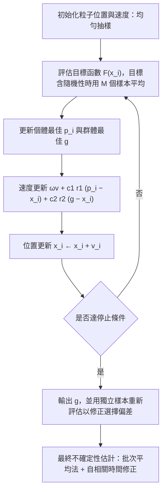

## 10.3　粒子群算法與蒙地卡羅方法的結合

[上一章：10.2 隨機搜索與全局優化](10.2-隨機搜索與全局優化.md) | [下一章：第11章 蒙地卡羅方法的誤差分析與改進](11.0-蒙地卡羅方法的誤差分析與改進.md)

## 學習目標

1. 說明粒子群優化（particle swarm optimization, PSO）原始論文的隨機性來源：粒子的初始位置、速度初始化，以及由「個體最佳 + 全域最佳」構成的隨機化資訊結構。
2. 理解 PSO 的速度更新式如何把「隨機探索」與「向 leader 收斂」兩種力量合成同一個向量，並分析收斂行為與參數 $`\omega, c_1, c_2`$ 的關係。
3. 解釋粒子濾波（particle filter）與 PSO 的對偶關係：粒子濾波是「用粒子表示後驗分佈」，PSO 是「用粒子表示解的搜尋」；兩者都是把隨機性用於狀態空間的探索與近似。
4. 掌握「共振適應性」（resonance adaptation）這個把物理共振概念引入 PSO 的加速機制。
5. 能設計「PSO + 蒙地卡羅積分」的混合策略：用 PSO 搜尋積分中的重要參數，或用蒙地卡羅評估 PSO 的目標函數（以噪聲處理不確定目標）。

## 1. 從鳥群到演算法

1995 年，Kennedy 與 Eberhart 發表 *Particle Swarm Optimization*。靈感來自一群鳥的搜尋行為：每隻鳥（粒子）沒有整體計畫，只知道三件事——自己飛得不錯的方向、鄰居飛得不錯的方向、以及整群目前最好的位置。

原始的圖像模型相當簡單：多隻鳥在二維平面上隨機飛行尋找食物（目標）。每隻鳥同時具有「速度」（方向 + 速率）與「位置」。鄰近的鳥互相影響速度，使得鳥群在接近目標時形成球形，並以某個角度轉向目標——這種行為後來被稱為 **swarm intelligence（群體智慧）**。

關鍵洞見是：**個體的隨機性經由群體的局部互動被協調起來**。這與 [第 10.2 節](10.2-隨機搜索與全局優化.md) 的演化演算法形成對比——演化演算法靠世代交替與選擇壓力傳遞資訊，PSO 靠**鄰域通訊**即時傳遞資訊。這是「傳播速度」上的根本差異。

## 2. PSO 的演算法形式

令第 $`i`$ 個粒子的位置為 $`x_i`$ 、速度為 $`v_i`$ 。每個粒子記憶兩個「best」：

- $`p_i`$ ：個體歷史最佳位置（personal best）。
- $`g`$ ：群體（全域或局部鄰域）最佳位置（global best）。

速度更新：

$$
v_i \leftarrow \omega v_i + c_1 r_1 \odot (p_i - x_i) + c_2 r_2 \odot (g - x_i),
$$


其中 $`\omega`$ 是慣性權重（inertia weight）， $`c_1, c_2`$ 為加速係數， $`r_1, r_2`$ 為 $`[0,1]`$ 上的隨機向量（逐維獨立）， $`\odot`$ 為逐元素乘法。位置更新：

$$
x_i \leftarrow x_i + v_i.
$$


### 2.1 三個力的角色

這個式子是全章的技術核心，三項加項各自對應一個明確的作用：

| 項 | 作用 | 若為 0 的後果 |
| --- | --- | --- |
| $`\omega v_i`$ | 慣性：保留既有運動方向，提供動量 | 粒子立刻被拉向 leader，失去慣性穿越窄谷的能力 |
| $`c_1 r_1 (p_i-x_i)`$ | 認知項（cognitive）：朝自己過去的最好位置 | 退化成純全局貪婪（gbest PSO），易早熟 |
| $`c_2 r_2 (g-x_i)`$ | 社會項（social）：朝群體最好位置 | 退化成純局部搜尋，失去群體共享 |

**隨機性在哪裡？** 有兩處：一是初始位置與速度的隨機抽樣；二是每次更新中的 $`r_1, r_2`$ 。後者是「隨機加權的探索」與「確定性的吸引」之間的插值——這是 PSO 與梯度法最根本的差異：**梯度法完全沒有隨機成分，PSO 每次迭代都重新隨機混合了兩個方向的權重**。

### 2.2 收斂行為分析

標準 PSO（gbest 變體）在非退化條件下，迭代滿足

$$
\frac{\|v_i\|}{\|x_i - g\|} \to 0 \quad \text{as } t \to \infty,
$$


即粒子速度相對於其到群體最佳點的距離趨於 0，粒子群在 $`g`$ 附近收斂。

在有限時間分析上，文獻給出的典型結果是：對單一極小值問題，PSO 的收斂速率與問題條件數有關，約為 $`O(t^{-\frac{1}{2k}})`$ （ $`k`$ 為目標函數局部光滑階數）量級。**更關鍵的是統計保證**：對 $`M`$ 個獨立初始化的粒子，PSO 在有限次評估內找到全域最佳解的機率趨於 1；這讓 PSO 具有「概率性的全域性」——但沒有嚴格的多項式時間保證（no free lunch）。

### 2.3 慣性權重的退火

Shi 與 Eberhart 提出線性遞減慣性權重： $`\omega`$ 從約 0.9 降到 0.4（甚至 0）。其因果邏輯非常清楚：

- 初期 $`\omega`$ 大 → 粒子慣性強 → 大範圍探索，能跳過局部盆地。
- 後期 $`\omega`$ 小 → 粒子被 leader 拉緊 → 局部精細化，精度提升。

這其實是「**探索—開發（exploration–exploitation）取捨**」在單一參數上的外顯化，也是 [第 10.2 節](10.2-隨機搜索與全局優化.md) 模擬退火降溫的同構設計，只是把「溫度」換成「慣性」。

## 3. PSO 與粒子濾波的對偶

這是本章最值得玩味的部分。粒子濾波（particle filter, sequential Monte Carlo）與 PSO 表面上做完全不同的事情：

| | 粒子濾波 | PSO |
| --- | --- | --- |
| 目的 | 表示後驗分佈 $`p(\theta_t \mid y_{1:t})`$ | 搜尋目標函數 $`F(x)`$ 的最小值 |
| 粒子的意義 | 後驗分佈的一個抽樣 | 解空間中的一個候選解 |
| 更新機制 | 加權重抽樣（依似然）+ 狀態轉移抽樣 | 速度-位置更新，朝 leader 移動 |
| 隨機性的作用 | 表達「不確定性」 | 表達「探索」 |
| 收斂對象 | 後驗分佈的集中 | 群體最佳解 |

但兩者的**演算法結構是同構的**：

1. 粒子濾波中的「重要度重抽樣（resampling）」與 PSO 中的「向 g 收斂」都在做同一件事：**把粒子群重新分配到高權重區域**。
2. 粒子濾波的 MCMC 移動與 PSO 的速度更新都在做：**在不確定性注入的同時，向高密度區域移動**。
3. 兩者都依賴「維持足夠的多樣性」來避免早熟收斂——粒子濾波靠重抽樣的多樣性機制，PSO 靠 $`\omega`$ 與隨機係數。

這個對偶性有實際意義：它解釋了為什麼 PSO 適合用於**目標函數本身是隨機的**（每次評估結果不同）情況——此時 gbest 的定義需要改成「多次評估的平均最佳」，這正好把粒子濾波的「加權平均」概念搬過來。也解釋了為什麼可以用粒子濾波式的重抽樣來修正 PSO 的早熟收斂。

## 4. 共振適應性（resonance adaptation）

2006 年提出的一個 PSO 加速機制，靈感來自物理中的**共振（resonance）**：當外來驅動的頻率與系統的自然頻率接近時，振幅會急劇放大。

在 PSO 中，「共振」被實現為**自適應地調整粒子的搜尋頻率**：當粒子群在某一區域反覆振盪但沒有進展時，演算法調整慣性權重或認知／社會係數的配比，使粒子的「運動節奏」與問題的局部結構匹配。

概念上，這是把一個固定的探索—開發取捨，換成**自適應的、依據局部地形回饋而調整的取捨**。它與模擬退火、降溫排程屬於同一族「隨時間變化的取捨參數」設計，但驅動訊號是演算法自身的收斂歷史而非預先設定的排程。

從統計的角度看，共振適應性嘗試讓 PSO 的收斂行為符合**適應性（adaptive）**而非**非適應性**理論：非適應性分析（如第 2.2 節的收斂速率）假定參數固定，而自適應參數能顯著改善實務表現，代價是理論保證變弱。

## 5. 混合策略：PSO 與蒙地卡羅積分的結合

PSO 與蒙地卡羅方法的結合有兩種方向，兩者都有實務價值。

### 5.1 方向一：用蒙地卡羅評估 PSO 的目標函數

**情境**：目標函數本身含有內生隨機性，例如

$$
F(x) = \mathbb{E}_\xi\big[\ell(x,\xi)\big]
$$


其中 $`\xi`$ 是隨機環境。此時「更好的解」本身帶噪聲，PSO 的 gbest 可能只是**抽樣幸運**。

**解法一：把噪聲吸收到目標定義中**。對每個候選解，用固定數量 $`M`$ 的樣本估計 $`F(x)`$ ，並以估計值比較。此時**估計的隨機性成為 PSO 的額外隨機來源**，且必須注意：若不同候選用不同隨機種子比較，會引入比較偏差。

**解法二：使用共同隨機數（common random numbers, CRN）**。對所有候選解使用**同一組** $`\xi`$ 樣本來評估：

$$
\hat{F}_i = \frac{1}{M}\sum_{m=1}^{M} \ell(x_i, \xi_m).
$$


這會讓不同候選的估計**高度相關**，估計差 $`\hat{F}_i - \hat{F}_j`$ 的方差遠小於兩者獨立抽樣時的方差之和。代價是估計值有共同偏誤（所有候選共享同一批 $`\xi`$ 的偏差）。這就是 [第 11.2 節](11.2-精度提升的技術：低方差抽樣與控制變數法.md) 的控制變數法與相關抽樣思想在優化場景的應用。

**解法三：Rao–Blackwell 化**。若目標函數的部分成分可用條件期望精確計算，則只對剩餘部分抽樣：

$$
F(x) = \mathbb{E}_{\xi_1}\big[g(x,\xi_1)\big] = \mathbb{E}_{\xi_1}\big[\mathbb{E}_{\xi_2}[g(x,\xi_1,\xi_2) \mid \xi_1]\big],
$$


把內層期望以解析值代入，剩下的外層期望方差更小（參見[第 11.2 節](11.2-精度提升的技術：低方差抽樣與控制變數法.md)）。

### 5.2 方向二：用 PSO 搜尋蒙地卡羅積分中的重要參數

**情境**：積分

$$
I = \mathbb{E}_{X \sim p}\big[f(X;\theta)\big]
$$


依賴參數 $`\theta`$ （例如重要抽樣的分佈參數、變換抽樣的指數族參數），我們希望選 $`\theta^*`$ 使估計方差最小。

**目標**： $`\theta^* = \arg\min_\theta \operatorname{Var}_\theta(f(X;\theta))`$ 。用 PSO 搜尋 $`\theta`$ ，每次評估用小樣本估計方差，是一個自然做法。特別地，這個問題往往**非凸**，梯度不易取得，非常適合 PSO 這類無導數方法。

更進階的做法是把 PSO 與變分近似結合：用 PSO 最佳化 ELBO（evidence lower bound）等變分目標，而 ELBO 的值本身用蒙地卡羅抽樣估計。這在 [第 14 章](14.0-蒙地卡羅方法在機器學習中的應用.md) 會再次出現。

### 5.3 混合策略的風險

混合策略必須注意兩個陷阱：

1. **雙重隨機性**：PSO 自身的隨機性與目標評估的隨機性疊加，使得誤差分析必須同時考慮兩者，只估計其中之一會低估真實不確定性。
2. **選擇偏差**：若用 noisy 估計值來挑選 gbest，被選中的解有「倖存者偏差」——它的估計值系統性偏低。若後續要對最優解的函數值做推論，必須另外做偏誤修正（例如用選後的獨立樣本重新評估）。

## 6. 演算法流程



這張圖把本章三個主題串成一條可執行流程：PSO 的評估步驟（節 2）、以隨機平均處理 noisy 目標（節 5.1），以及結束時的偏差修正與不確定性報告（節 5.3 與第 11 章）。特別注意最後的「用獨立樣本重新評估」——這是實務上最常被忽略、卻直接影響報告可信度的一步。

## 7. 程式範例：以 PSO 最佳化含噪目標函數

```python
import numpy as np


def pso_noisy_optimize(f_true, bounds, n_particles=40, max_iter=60,
                        n_eval_samples=16, seed=0, c1=1.5, c2=1.5, omega=0.9):
    """PSO 最佳化一個含內生隨機性的目標 f_true(x, xi)。

    目標值估計使用共同隨機數 (CRN)，讓候選解之間的比較方差大幅下降。
    """
    rng = np.random.default_rng(seed)
    d = len(bounds)
    lo = np.array([b[0] for b in bounds])
    hi = np.array([b[1] for b in bounds])

    # 初始化：位置均勻抽樣，速度取區間寬度的一小部分
    x = rng.uniform(lo, hi, size=(n_particles, d))
    v = rng.uniform(-0.1, 0.1, size=(n_particles, d))

    # 共同隨機數：所有候選解共用同一批環境樣本
    xi = rng.standard_normal((n_eval_samples, 4))

    def estimate(xv):
        # 以固定樣本估計期望值（CRN 消除候選間比較noise）
        vals = [f_true(xv, xi[m]) for m in range(n_eval_samples)]
        return float(np.mean(vals))

    f_val = np.array([estimate(xi_) for xi_ in x])
    p_best = x.copy()
    p_val = f_val.copy()
    g_idx = int(np.argmin(f_val))
    g_best, g_val = x[g_idx].copy(), f_val[g_idx]

    for t in range(max_iter):
        # 慣性權重線性退火：早期探索、後期開發
        w = 0.9 - 0.5 * t / max(max_iter - 1, 1)
        r1 = rng.random((n_particles, d))
        r2 = rng.random((n_particles, d))
        v = (w * v
             + c1 * r1 * (p_best - x)
             + c2 * r2 * (g_best - x))
        x = np.clip(x + v, lo, hi)

        f_val = np.array([estimate(xi_) for xi_ in x])
        improved = f_val < p_val
        p_best[improved] = x[improved]
        p_val[improved] = f_val[improved]
        g_idx = int(np.argmin(p_val))
        if p_val[g_idx] < g_val:
            g_best, g_val = x[g_idx].copy(), p_val[g_idx]

    # 選擇偏差修正：用全新獨立樣本重新評估最優解
    xi_eval = rng.standard_normal((512, 4))
    final = float(np.mean([f_true(g_best, xi_eval[m]) for m in range(512)]))
    return g_best, final


# 測試：目標函數含環境擾動
if __name__ == "__main__":
    def f_true(x, xi):
        a, b = x
        return (a - 1.0) ** 2 + (b - 2.0) ** 2 + 0.3 * xi[0] * (a + b)

    best, val = pso_noisy_optimize(f_true, [(-3, 3), (-3, 3)])
    print("最優解:", best, " 重新評估值:", round(val, 4))
```

程式的關鍵設計是 **CRN 與偏差修正**：前者對應第 5.1 節「估計差方差縮小」的理論，後者對應第 5.3 節「選擇偏差必須修正」的警告。少了後者，報告的函數值會系統性偏低。

## 8. 本章要點

1. PSO 的隨機性有兩處來源：初始抽樣，以及每次速度更新中隨機混合的認知項與社會項；後者使 PSO 在每一步都重新插值「探索 vs 開發」。
2. 三個力量（慣性、認知、社會）各自對應不同的失效模式，缺少任何一個都會讓演算法退化成另一個更簡單的演算法。
3. 慣性權重退火是探索—開發取捨的外顯化；共振適應性則把固定排程改為依收斂歷史自適應調整。
4. 粒子濾波與 PSO 在演算法結構上同構：兩者都用一群粒子加權表示某個目標（後驗分佈 vs 最優解），都靠「加權重分配 + 帶噪移動」來推進——這是理解兩者互通的關鍵。
5. PSO 與蒙地卡羅的兩種結合方向（用蒙地卡羅評估 noisy 目標、用 PSO 搜尋積分參數）都會引入雙重隨機性，誤差分析必須把兩者都算進去。
6. noisy 目標下的 PSO 必須做選擇偏差修正，否則報告的最優函數值系統性偏低。

## 延伸閱讀

- J. Kennedy and R. Eberhart (1995), *Particle Swarm Optimization*, Proceedings of IEEE ICNN, 1942–1948.
- R. Eberhart and J. Kennedy (1997), *A New Optimizer using Particle Swarm Theory*, Proceedings of the Sixth International Symposium on Micromachine and Human Science.
- J. Kennedy, R. Eberhart and R. Swarm Intelligence (2001), *Swarm Intelligence: From Natural to Artificial Systems*, Morgan Kaufmann.
- H. Zhu et al. (2007), *Adaptive Particle Swarm Optimization with Resonance Searching*, IEEE Congress on Evolutionary Computation.
- M. S. Arulampalam et al. (2002), *A Tutorial on Particle Filters*, IEEE Signal Processing Magazine 19(2), 19–41.
- J. S. Liu and R. Chen (2005), *Particle Swarm Optimization for Global Optimization and Its Applications*, in *Handbook of Swarm Intelligence*.
