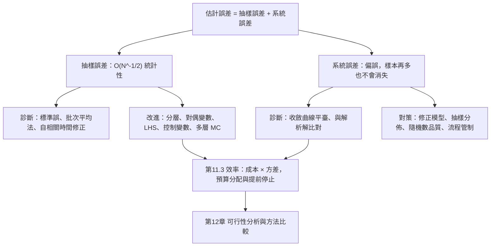

# 第11章　蒙地卡羅方法的誤差分析與改進

[上一章：10.3 粒子群算法與蒙地卡羅方法的結合](10.3-粒子群算法與蒙地卡羅方法的結合.md) | [下一章：11.1 蒙地卡羅誤差的來源與控制](11.1-蒙地卡羅誤差的來源與控制.md)

## 學習目標

1. 建立蒙地卡羅誤差的二分法架構：**抽樣誤差（統計誤差）** 與 **系統誤差（偏誤）**。說明為什麼這個二分是必要的——兩者的成因、症狀與對策完全不同。
2. 理解抽樣誤差的根源：中心極限定理給出的 $`O(N^{-1/2})`$ 收斂率，以及此速率為何是難以突破的「硬天花板」。
3. 理解系統誤差的來源：抽樣分佈與目標分佈不匹配、隨機數品質、離散化、程式實作錯誤、輸入參數錯誤。
4. 掌握誤差分析的三個實用工具：樣本標準差估計、批次平均法（batch means）、自相關時間（autocorrelation time）修正。
5. 理解方差縮減（variance reduction）的思想與分類：改變抽樣機制（分層、對偶變數、Latin hypercube）、引入控制變數（control variates）、以及用代理模型取代昂貴評估。
6. 理解效率問題的本質是「每樣本成本 × 方差」的乘積，以及計算預算分配、提前停止與順序檢定的角色。

## 1. 為什麼誤差分析是專門的一章

前面各章反覆出現同一個訴求： $`O(N^{-1/2})`$ 的誤差率。這個速率的含義是：**要把精度提高 100 倍，樣本數必須增加 10,000 倍。** 這是一個令人挫折的事實，因為在工程實務中，樣本數往往是最稀缺的資源（CPU 時間、模擬小時、實驗經費）。

但更令人挫折的是：**有時候你的估計根本就是錯的，而且錯得很離譜，與樣本數無關。** 一個抽了 10^9 個樣本、但抽樣分佈搞錯的蒙地卡羅估計，其偏誤是 $`O(1)`$ ，再多抽樣也不會改善。

因此，誤差分析不能只問「我的標準誤多大」，還必須問「我的估計有沒有偏誤」。本章的兩大支柱正是對應這兩個問題。

## 2. 誤差的二分：統計誤差與系統誤差

考慮一個一般的蒙地卡羅估計量

$$
\hat{\theta}_N = \frac{1}{N}\sum_{i=1}^{N} f(X_i), \qquad X_i \sim p,
$$

以及真值 $`\theta = \mathbb{E}_p[f(X)]`$ 。誤差可分解為

$$
\hat{\theta}_N - \theta = \underbrace{\big(\hat{\theta}_N - \mathbb{E}[\hat{\theta}_N]\big)}_{\text{隨機誤差（抽樣誤差）}} + \underbrace{\big(\mathbb{E}[\hat{\theta}_N] - \theta\big)}_{\text{偏誤（系統誤差）}}.
$$

這是一個**恆等式**，因此兩者的治理策略完全不同：

| | 抽樣誤差 | 系統誤差 |
| --- | --- | --- |
| 成因 | 有限樣本 | 模型錯、抽樣錯、實作錯 |
| 表現 | 每次執行結果不同 | 每次執行結果不同但**平均值**錯 |
| 隨 $`N\to\infty`$ | 以 $`O(N^{-1/2})`$ 消失 | **不消失**（若有偏誤） |
| 對策 | 增加樣本、方差縮減 | 找出並消除原因 |
| 診斷 | 標準誤、置信區間 | 與解析解／獨立實作比對、收斂曲線平臺 |

**關鍵診斷技巧**：如果把 $`N`$ 加倍，估計值會**收斂到某個不對的數字**，那個數字就是偏誤。這是把偏誤與噪聲分開的最直接方法。

這個二分不是本章發明的——它是統計學的基礎結構——但把它明確套用到蒙地卡羅的實務上，具有決定性的價值：**很多團隊把時間花在「降低標準誤」上，而真正的問題是偏誤。**

## 3. 抽樣誤差： $`O(N^{-1/2})`$ 的硬天花板

### 3.1 中心極限定理給出的速率

若 $`f(X)`$ 有有限變異數 $`\sigma^2 = \operatorname{Var}_p(f(X))`$ ，則由中心極限定理（central limit theorem, CLT），

$$
\frac{\hat{\theta}_N - \theta}{\sigma/\sqrt{N}} \xrightarrow{d} \mathcal{N}(0,1).
$$

因此 $`\hat{\theta}_N`$ 近似常態分佈，標準誤（standard error）為

$$
\operatorname{SE}(\hat{\theta}_N) \approx \frac{\sigma}{\sqrt{N}},
$$

而 $`\hat{\theta}_N`$ 落在 $`\theta \pm 1.96\,\sigma/\sqrt{N}`$ 的機率約為 95%。這是第 4 章已經建立的結果，本章要強調的是它的**實務含義**：

- 誤差與樣本數的平方根成反比。要從 1% 精度到 0.01% 精度，需要 $`10^4`$ 倍樣本。
- 若某個樣本評估要 1 毫秒，10^4 倍樣本意味著總時間增加 100 倍。
- 這個「平方根定律」是**所有**抽樣式方法的共通性質，不是蒙地卡羅的缺陷，而是「用隨機性換取無偏性」的代價。

### 3.2 為什麼難以突破

直覺上似乎可以「用更好的抽樣方法」來改進。但 CLT 告訴我們：**若樣本是 i.i.d. 且來自正確的分佈，那麼 $`O(N^{-1/2})`$ 就是最優的**。任何改進必須來自打破 i.i.d. 或正確分佈這兩個假設之一。

這正是第 11.2 節的策略：

- **分層抽樣（stratified）**：用非 i.i.d. 的樣本，但保證每層內部均勻。
- **對偶變數（antithetic）**：用負相關的樣本對。
- **Latin hypercube**：每個維度都做分層，且樣本間保持某種正交性。
- **準蒙地卡羅（quasi-MC）**：用確定性的低差異序列，誤差率可達 $`O(N^{-1})`$ （維度固定時）。
- **控制變數**：不改變抽樣，改變估計量本身。

## 4. 系統誤差：五個常見來源

在實務中，系統誤差往往來自以下五類，每一類都有對應的「前因後果」鏈：

1. **抽樣分佈不匹配（distributional mismatch）**：模擬的分佈與真實世界不符。例如假設需求為對數常態，但真實需求有厚尾。重尾會讓 $`\sigma`$ 估計本身不穩定——這是**最危險**的偏誤，因為它同時破壞無偏性與誤差估計。
2. **隨機數品質**：使用劣質偽隨機數產生器會導致樣本之間存在隱藏相關性，讓實際方差遠大於 $`\sigma^2/N`$ 。
3. **離散化偏誤（discretization bias）**：把連續模型離散成時間步或網格，累積系統性偏差。
4. **程式實作錯誤**：指標差異、索引移位、單位換算（公制 vs 英制）、狀態更新順序。
5. **輸入參數錯誤**：最常見也最難察覺。

其中第 5 類與前四類性質不同：它無法用統計方法偵測，只能用**流程控制**（code review、參數表、自動化測試）防範。

## 5. 誤差分析的三大工具

### 5.1 樣本標準差

最直接的估計：

$$
\hat{\sigma} = \sqrt{\frac{1}{N-1}\sum_{i=1}^{N}\big(f(X_i) - \hat{\theta}_N\big)^2},
\qquad \widehat{\operatorname{SE}} = \frac{\hat{\sigma}}{\sqrt{N}}.
$$

**前提**：樣本必須近似 i.i.d.。若樣本有自相關（例如連續模擬的相鄰時間步），這個公式會**低估**真實標準誤，可能低估數十倍。

### 5.2 批次平均法（batch means）

把 $`N`$ 個樣本切成 $`K`$ 個長度為 $`m`$ 的批次， $`N = Km`$ 。若批次間近似獨立，則

$$
\hat{\sigma}^2_{\text{BM}} = \frac{m}{K-1}\sum_{k=1}^{K}\big(\bar{Y}_k - \bar{Y}\big)^2,
$$

而標準誤估計為 $`\hat{\sigma}_{\text{BM}}/\sqrt{N}`$ 。若批次長度 $`m`$ 充分大於自相關時間，這個估計是可靠的。

### 5.3 自相關時間修正

對有自相關的序列，定義自相關時間

$$
\tau = 1 + 2\sum_{k=1}^{\infty} \rho(k),
$$

其中 $`\rho(k)`$ 是自相關函數。有效的獨立樣本數只有 $`N/\tau`$ ，因此

$$
\operatorname{SE} \approx \frac{\sigma}{\sqrt{N/\tau}} = \frac{\sigma\sqrt{\tau}}{\sqrt{N}}.
$$

**這個修正極其重要**：在連續時間的蒙地卡羅模擬（如 [第 7 章](07.0-隨機過程與模擬.md) 的隨機微分方程）中， $`\tau`$ 可能是數百，忽略它會讓你以為精度已達 $`10^{-3}`$ ，實際上只有 $`10^{-2}`$ 。

## 6. 方差縮減：把「增加樣本」換成「更聰明的樣本」

既然 $`O(N^{-1/2})`$ 難以突破，出路就是降低 $`\sigma`$ 或降低每樣本成本。方差縮減技術可分為三大類：

1. **改變抽樣機制**（第 11.2 節前段）：分層抽樣、對偶變數、Latin hypercube、準蒙地卡羅。
2. **改變估計量**（第 11.2 節中段）：控制變數法、Rao–Blackwell 化、important sampling 回顧。
3. **改變計算模型**（第 11.2 節後段）：代理模型（surrogate model）、多層蒙地卡羅（multilevel Monte Carlo）。

每一類都在回答同一個問題：**如何在不增加 $`N`$ 的前提下降低總誤差？**

## 7. 效率：本質是「成本 × 方差」

一個更完整的效率指標不是樣本數，而是**總成本**：

$$
\text{Cost} = N \times c, \qquad c = \text{每樣本評估成本}.
$$

在固定預算 $`B = Nc`$ 下，精度由

$$
\operatorname{SE} = \frac{\sigma}{\sqrt{N}} = \frac{\sigma\sqrt{c}}{\sqrt{B}}
$$

決定。**關鍵洞見：在固定預算下，減少方差 $`\sigma^2`$ 與減少每樣本成本 $`c`$ 是等價的。** 這解釋了為什麼代理模型（把 $`c`$ 從數小時降到毫秒）與方差縮減（把 $`\sigma`$ 降低）是同一個問題的兩條路徑。

這個「等價性」是 [第 11.3 節](11.3-蒙地卡羅法的效率問題與解決方案.md) 的主軸，也是連接第 11 章與第 12 章（可行性分析）的橋樑——因為第 12 章要問的正是：**在既定的成本與精度需求下，蒙地卡羅是否是最划算的選擇？**

## 8. 本章結構

圖中呈現本章的雙支柱結構：左支（抽樣誤差）走向統計性的改進技術並匯入效率分析；右支（系統誤差）走向診斷與流程管制。兩支最終都進入第 11.3 節的效率議題，因為「精度」與「成本」永遠是一體兩面。

## 9. 本章要點

1. 誤差可分解為抽樣誤差與系統偏誤，這是恆等式；兩者的治理策略完全不同，混淆兩者是實務上最常見的效能損失來源。
2. 抽樣誤差在 i.i.d. 假設下的 $`O(N^{-1/2})`$ 是 CLT 給出的最優速率；任何改進必須打破 i.i.d. 或抽樣分佈正確這兩個假設。
3. 偏誤的判別金句是「加大樣本數後收斂到哪裡」；若收斂到錯的數字，那是偏誤而非噪聲。
4. 標準誤估計必須處理自相關：批次平均法與自相關時間 $`\tau`$ 修正是在連續模擬中不可省略的步驟，忽略 $`\tau`$ 會嚴重高估精度。
5. 方差縮減技術可分為改抽樣、改估計量、改計算模型三類，目標都是降低 $`\sigma^2`$ 或降低每樣本成本 $`c`$ 。
6. 在固定預算下，降低 $`\sigma`$ 與降低 $`c`$ 等價，這是效率章節的核心判準，也是第 12 章可行性分析的依據。

## 延伸閱讀

- W. Krauth, *Monte Carlo Methods*, 2nd ed., Springer, 1996.
- N. J. Higham, *Accuracy and Stability of Numerical Algorithms*, 2nd ed., SIAM, 2002.
- R. E. Gressman, *Monte Carlo Methods in Statistical Physics*, Springer, 2013.
- C. Robert and G. Casella, *Monte Carlo Statistical Methods*, 2nd ed., Springer, 2004.
- J. R. Rubinstein and A. W. Young, *Simulation and the Monte Carlo Method*, 2nd ed., Wiley, 2016.
