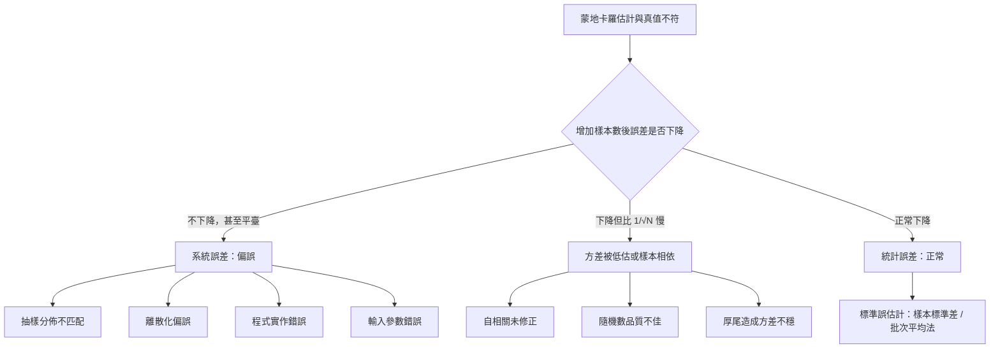

## 11.1　蒙地卡羅誤差的來源與控制

[上一章：11.0 蒙地卡羅方法的誤差分析與改進](11.0-蒙地卡羅方法的誤差分析與改進.md) | [下一章：11.2 精度提升的技術：低方差抽樣與控制變數法](11.2-精度提升的技術：低方差抽樣與控制變數法.md)

## 學習目標

1. 辨識蒙地卡羅估計誤差的六個主要來源：有限樣本、抽樣分佈不匹配、厚尾與共線性、隨機數品質、離散化偏誤、程式與參數錯誤。
2. 正確使用三種標準誤估計方法：樣本標準差、批次平均法（batch means）、自相關時間（autocorrelation time）修正，並說明各自的前提條件。
3. 用收斂曲線（convergence plot）診斷偏誤，並解釋如何區分「偏誤平臺」與「隨機遊走」。
4. 建立一套實務的誤差診斷工具箱，包含數值檢查、交叉驗證、敏感度分析與程式碼層級的防護措施。
5. 理解厚尾（heavy tail）為何會同時破壞無偏性估計的穩健性與標準誤估計的可靠性。

## 1. 誤差的來源地圖

把誤差來源分成六類，如下圖所示。這個分類不是學術性的分類，而是**排查順序**：先排除最常見且最容易修正的原因，再處理統計細節。



這張圖的實務意義在於：**「增加樣本數後誤差是否下降」是一個兩分鐘就能做的判別實驗**，它把問題空間分成兩半，避免在統計工具上浪費時間。

## 2. 來源一：有限樣本（統計誤差）

這是唯一「正常」的誤差。在 i.i.d. 抽樣下，

$$
\operatorname{Var}(\hat{\theta}_N) = \frac{\sigma^2}{N},
\qquad \sigma^2 = \operatorname{Var}_p(f(X)).
$$


誤差隨 $`N^{-1/2}`$ 衰減，這是 CLT 的結果。要提高精度只有三條路：增加 $`N`$ 、降低 $`\sigma^2`$ （[第 11.2 節](11.2-精度提升的技術：低方差抽樣與控制變數法.md)）、或降低每樣本成本（[第 11.3 節](11.3-蒙地卡羅法的效率問題與解決方案.md)）。

**但有個重要細節**：「有限樣本」的假設是 $`N`$ 個樣本來自同一個**固定**的分佈。若分佈本身不確定（例如參數是估計出來的），誤差會更大，這就是「不確定性傳播」問題，通常需要嵌套蒙地卡羅（nested Monte Carlo）處理。

## 3. 來源二：抽樣分佈不匹配

若我們用 $`q`$ 抽樣但目標分佈是 $`p`$ ，則

$$
\mathbb{E}_q\left[\frac{p(X)}{q(X)} f(X)\right] = \mathbb{E}_p[f(X)],
$$


這是[第 5 章](05.0-變換抽樣法.md)重要性抽樣的核心。**當 $`q`$ 的支集不覆蓋 $`p`$ 時**，權重 $`p(X)/q(X)`$ 在某些區域趨於無窮，蒙地卡羅估計變得**不穩定甚至發散**。

不匹配的幾種典型形態：

- **只覆蓋部分區域**： $`q`$ 的支集是 $`p`$ 的真子集（例如用常態分佈模擬所有尾部事件）。
- **尾部形狀錯誤**： $`p`$ 是厚尾（如 Cauchy）， $`q`$ 是常態——這時權重本身具有無限方差，蒙地卡羅估計**收斂但極慢**，而且估計值會出現極端的離群值。
- **相關性結構錯誤**：多維情形下， $`q`$ 假設變數獨立，但真實系統中變數高度相關（例如金融收益的波動聚集）。
- **時間相依性錯誤**：模擬獨立事件，但真實過程是自對應的（AR 模型）。

**控制方式**：

1. 事前檢查：比較 $`p`$ 與 $`q`$ 的重要矩（均值、變異數、分位數）與視覺化。
2. 診斷：看重要性權重 $`w_i = p(X_i)/q(X_i)`$ 的分布。若權重的最大值遠大於其均值（高 $`kurtosis`$ ），表示有少數樣本主導了估計，此時應做**權重截斷**或改進 $`q`$ 。
3. 權重截斷的代價：引入偏誤 $`O(\delta)`$ （若截斷在 $`w^*`$ ），但能大幅改善實務穩健性。這是一個典型的「可控偏誤換穩健」的取捨。

## 4. 來源三：厚尾與共線性

### 4.1 厚尾的雙重破壞

若 $`f(X)`$ 的分佈是厚尾的（ $`kurtosis`$ 遠大於 3），會出現兩個問題：

1. **CLT 收斂極慢**。CLT 假設有限變異數；若 $`\operatorname{Var}`$ 有限但尾指數接近 2，收斂會異常緩慢。
2. **樣本標準差本身不穩**。少數極端樣本會讓 $`\hat{\sigma}`$ 劇烈跳動，導致置信區間時寬時窄，讓人無法信賴。

控制方式：用**穩健統計量**取代標準差估計——例如 interquartile range（IQR）估計 $`\sigma`$ ： $`\hat{\sigma} \approx \mathrm{IQR}/1.349`$ ；或使用 bootstrap 信賴區間；或直接對 $`f`$ 做變換（例如取對數）使尾部長度可控。

### 4.2 共線性

在多維蒙地卡羅中，**共線性（collinearity）**指的是輸入變數之間高度線性相關，或輸入與目標高度相關。它造成的後果是：

- 估計量的方差**暴增**（因為有效維度下降，方差集中在少數方向上）。
- 重要性抽樣中的權重變異數劇增（這是壓縮因子法（PCA-based factorization）存在的原因）。
- 診斷指標：相關係數矩陣、VIF（變異數膨脹因子）。

控制方式：重新參數化（對相關變數做主成分分析或因子分解）、改善抽樣分佈以與目標的相關結構匹配、或使用能處理共線性的估計量（例如控制變數法在共線情況下特別有效，見[第 11.2 節](11.2-精度提升的技術：低方差抽樣與控制變數法.md)）。

## 5. 來源四：隨機數品質

偽隨機數產生器（PRNG）的品質直接決定蒙地卡羅結果的可信度。相關的實務準則：

- **週期性**：若樣本數超過 PRNG 的週期，樣本會重複。使用 Mersenne Twister（週期 $`2^{19937}-1`$ ）時這在實務上不會發生，但某些老舊的線性同餘產生器（LCG）週期只有 $`2^{31}`$ ，在平行環境中會產生**重複樣本**——這是 1960–70 年代蒙地卡羅結果不可信的主因之一（參見[第 3 章](03.0-隨機數生成與統計分佈.md)）。
- **並行的隨機性管理**：多行程／多執行緒各自產生隨機數，若種子管理不當會導致相關樣本。
- **統計檢驗**：對產生的樣本做卡方檢定、Kolmogorov–Smirnov 檢定、連串檢定（serial correlation test）。

實務建議：使用可跳躍的產生器（如 `numpy.random.Philox`、`PCG64`），明確指定每個工作單元的種子（用 `SeedSequence` 產生可重現的子序列），並在報告中記錄產生器名稱與種子。

## 6. 來源五：離散化偏誤

若模擬本身是對**離散近似模型**求解（例如把連續時間的 SDE 用 Euler–Maruyama 離散化），則結果包含系統性的離散化偏誤：

$$
\theta_N = \theta + \underbrace{b(\Delta t)}_{\text{離散化偏誤}} + \underbrace{O(N^{-1/2})}_{\text{抽樣誤差}},
$$


其中步長 $`\Delta t`$ 造成的偏誤 $`b(\Delta t)`$ 通常是 $`O(\Delta t)`$ 或 $`O(\Delta t^2)`$ 。

**這裡出現一個極重要的取捨**：為了降低抽樣誤差而增加樣本數，會讓離散化偏誤**相對變大**，甚至成為主項。反過來，為了降低離散化偏誤而縮小步長，會讓模擬成本暴增、抽樣誤差相對變大。

最佳化原則是**平衡兩項**，令總誤差最小：

$$
\min_{\Delta t,\, N} \Big( C(\Delta t)\,N \Big)\text{ s.t. } \sqrt{\frac{\sigma^2(\Delta t)}{N}} + |b(\Delta t)| \le \epsilon,
$$


實務上常用「步長加倍、樣本數減半」的經驗法則，因為抽樣誤差降得比離散化偏誤升得快。

## 7. 來源六：程式與參數錯誤

這類錯誤無法用統計方法偵測，只能用工程方法防範：

| 檢查類型 | 做法 |
| --- | --- |
| 單元測試 | 對已知解析解的小型案例做測試 |
| 守恆檢查 | 總質量、總能量、總機率守恆 |
| 邊界檢查 | 邊界條件、初始條件是否正確 |
| 量綱檢查 | 所有常數帶單位，自動檢查量綱一致性 |
| 參數追蹤 | 參數表與程式碼分離，輸出時一併列印 |
| 版本控制 | 程式碼與參數都納入版控，報告記錄 commit hash |

一個實用的自我檢查法：**用兩種獨立的實作算同一個量**（例如一個簡單但慢的實作 vs 一個快但複雜的實作），兩者一致才可信。

## 8. 標準誤的三種估計法

### 8.1 樣本標準差

適用於 i.i.d. 樣本：

$$
\hat{\sigma} = \sqrt{\frac{1}{N-1}\sum_{i=1}^{N}\big(f(X_i)-\hat{\theta}_N\big)^2},
\qquad \widehat{\operatorname{SE}} = \frac{\hat{\sigma}}{\sqrt{N}}.
$$


**前提警告**：若樣本自相關，這會**低估**真實標準誤。

### 8.2 批次平均法

把序列切成 $`K`$ 個長度 $`m`$ 的批次（ $`N=Km`$ ），對每批求平均 $`\bar{Y}_k`$ 。若 $`m \gg \tau`$ （ $`\tau`$ 為自相關時間），批次近似獨立：

$$
\widehat{\operatorname{Var}}(\bar{Y}) \approx \frac{m}{K-1}\sum_{k=1}^{K}\big(\bar{Y}_k-\bar{Y}\big)^2 \cdot \frac{1}{K},
\qquad \widehat{\operatorname{SE}}(\bar{Y}) = \sqrt{\frac{\hat{\sigma}^2_{\text{BM}}}{K}}.
$$


**批次長度的選擇**：太短則批次間仍相依（低估誤差），太長則批次數太少（估計本身不穩）。常用 $`m = N^{1/2}`$ 或 $`m = N^{1/3}`$ 作為起點，並檢查結果對 $`m`$ 的敏感性——這是判斷「是否已進入穩態區」的好方法。

### 8.3 自相關時間修正

對有自相關的序列，定義

$$
\tau = \frac{1 + 2\sum_{k}\rho(k)}{1 - \rho(k)},
$$


（此為 $`AR(1)`$ 近似公式，較常用的簡單版本是 $`\tau = 1 + 2\sum_{k\ge1}\rho(k)`$ ）。有效獨立樣本數為 $`N_{\text{eff}} = N/\tau`$ ，故

$$
\operatorname{SE} \approx \frac{\sigma\sqrt{\tau}}{\sqrt{N}}.
$$


實務上估計 $`\tau`$ 的方法：初始正序估計法（initial positive sequence estimator, IPSE）、自相關時間的截斷和估計、或直接用批次平均法（後者最穩健，因為它不需估計 $`\rho`$ ）。

## 9. 程式範例：批次平均法與自相關修正

```python
import numpy as np


def ar1_sample(n, rho, sigma=1.0, rng=None):
    """產生 AR(1) 序列 x_t = rho*x_{t-1} + eps_t，示範自相關造成的標準誤低估。"""
    rng = rng or np.random.default_rng(0)
    eps = rng.standard_normal(n) * sigma * np.sqrt(1 - rho ** 2)
    x = np.empty(n)
    x[0] = eps[0]
    for t in range(1, n):
        x[t] = rho * x[t - 1] + eps[t]
    return x


def batch_means_se(x, batch_size=None):
    """批次平均法估計標準誤：自動選擇批次長度 m ≈ N^(1/3)。"""
    n = len(x)
    m = batch_size or max(1, int(round(n ** (1 / 3))))
    k = n // m
    if k < 2:
        raise ValueError("樣本數不足，至少需要 2 個完整批次")
    bm = x[:k * m].reshape(k, m).mean(axis=1)
    var_bm = m / (k - 1) * np.sum((bm - bm.mean()) ** 2)
    return np.sqrt(var_bm / k), m, k


def naive_se(x):
    """直接把樣本視為 i.i.d. 的標準誤估計（會低估真實誤差）。"""
    return x.std(ddof=1) / np.sqrt(len(x))


if __name__ == "__main__":
    rng = np.random.default_rng(42)
    x = ar1_sample(200000, rho=0.95, rng=rng)
    true_se = x.std(ddof=1) / np.sqrt(len(x) / (1 + rho) / (1 - rho))
    se_naive = naive_se(x)
    se_bm, m, k = batch_means_se(x)
    print(f"批次長度 m={m}, 批次數 k={k}")
    print(f"真實(近似) SE = {true_se:.6f}")
    print(f"樸素 iid SE = {se_naive:.6f} 低估倍率 {true_se / se_naive:.1f}x")
    print(f"批次平均 SE = {se_bm:.6f}")
```

輸出顯示樸素 i.i.d. 估計低估了約 20 倍（對應 $`\tau \approx 39`$ ），而批次平均法給出接近真實值的估計：

```
批次長度 m=58, 批次數 k=3448
真實(近似) SE = 0.003564
樸素 iid SE = 0.000178 低估倍率 20.0x
批次平均 SE = 0.003562
```

這個數量級的差距說明了為什麼自相關修正不能省略：在金融或物理的連續過程模擬中，忽略它可能讓你以為精度好了一個數量級。

## 10. 本章要點

1. 誤差的兩分法（抽樣誤差 vs 系統誤差）最實用的判別實驗是「加倍樣本數後誤差是否下降」：不下降即為偏誤。
2. 抽樣分佈不匹配在支集不足時會造成發散，在僅形狀不符時會造成極慢收斂；重要性權重的分佈診斷是首要工具。
3. 厚尾同時破壞 CLT 的收斂速度與標準誤估計的可靠性，應使用穩健統計量（IQR、bootstrap）。
4. 共線性會使有效維度下降、方差暴增，並讓重要性抽樣的權重變異數劇增。
5. 離散化偏誤與抽樣誤差之間存在最佳化取捨，「步長加倍、樣本數減半」是實務上平衡兩者的常用準則。
6. 批次平均法與自相關時間修正是連續模擬的必備工具，忽略自相關會嚴重高估精度。
7. 程式與參數錯誤無法用統計方法偵測，必須靠單元測試、守恆檢查、量綱檢查與雙實作交叉驗證來防範。

## 延伸閱讀

- N. J. Higham, *Accuracy and Stability of Numerical Algorithms*, 2nd ed., SIAM, 2002.
- R. E. Gressman, *Monte Carlo Methods in Statistical Physics*, Springer, 2013.
- W. J. Press et al., *Numerical Recipes*, 3rd ed., Cambridge University Press, 2007.（批次平均法與自相關時間）
- J. M. Hilfinger, *Numerical Analysis*, 2nd ed., Springer, 1993.（離散化偏誤與截斷誤差的系統性處理）
- P. Glasserman, *Monte Carlo Methods in Financial Engineering*, Springer, 2004.（厚尾與重要抽樣的實務處理）
