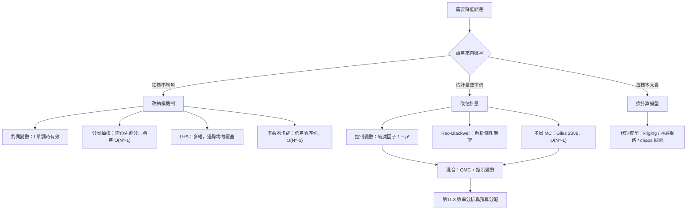

## 11.2　精度提升的技術：低方差抽樣與控制變數法

[上一章：11.1 蒙地卡羅誤差的來源與控制](11.1-蒙地卡羅誤差的來源與控制.md) | [下一章：11.3 蒙地卡羅法的效率問題與解決方案](11.3-蒙地卡羅法的效率問題與解決方案.md)

## 學習目標

1. 掌握**對偶變數法**（antithetic variates）：如何用 $`U`$ 與 $`1-U`$ 構造負相關樣本，並在何種條件下能有效降低方差。
2. 掌握**分層抽樣**（stratified sampling）與 **Latin hypercube sampling (LHS)**：它們如何把 i.i.d. 抽樣的 $`O(N^{-1/2})`$ 改進為更好的速率，以及它們的侷限。
3. 完整推導**控制變數法**（control variates）：最佳線性無偏估計 $`\beta^* = \operatorname{Cov}(f,g)/\operatorname{Var}(g)`$ 的由來、方差的縮減量，以及 $`1-\rho^2`$ 的解釋。
4. 說明 **Rao–Blackwell 化**（Rao–Blackwellization）的原理與適用條件。
5. 理解**多層蒙地卡羅**（multilevel Monte Carlo, Giles 2008）如何把不同離散化層級的估計組合起來，達到 $`O(N^{-1})`$ 的誤差率。
6. 理解**代理模型**（surrogate model）取代與**準蒙地卡羅 + 控制變數**的混合策略。
7. 能在實務問題中選擇合適的方差縮減技術，並評估其「投入产出比」。

## 1. 方差縮減的基本問題

我們要估計

$$
I = \mathbb{E}_p[f(X)],
$$


而樣本方差 $`\sigma^2 = \operatorname{Var}_p(f(X))`$ 決定了誤差率。方差縮減的目標是：**在不增加樣本數 $`N`$ 的前提下降低 $`\sigma^2`$ **，或在降低 $`\sigma^2`$ 的同時改善收斂率。

所有技術都可歸入兩種機制：

- **機制 A：改變抽樣機制**，讓樣本本身更有資訊量（分層、對偶、LHS、QMC）。
- **機制 B：改變估計量**，用其他已知期望值的隨機變數來「校正」估計（控制變數、Rao–Blackwell、多層 MC）。

兩者的判準相同：能否在**特定問題的特定條件下**把方差降低一個數量級。如果特定條件不成立，技術反而可能增加方差。

## 2. 對偶變數法

### 2.1 構造

若 $`U \sim \text{Uniform}(0,1)`$ ，則 $`1-U`$ 也是均勻分佈，但兩者**完全負相關**（相關係數 $`\approx -1`$ ）。取一對樣本

$$
f(U) \quad \text{與} \quad f(1-U),
$$


其平均作為估計量。對於單調遞增的 $`f`$ （例如估計期望的遞增函數），這兩個值位於平均值兩側，當平均值接近真值時，兩者的偏差互相抵銷。

若 $`f`$ 是遞減的（例如某些衰減型 payoff），則應該用 $`f(U)`$ 與 $`f(1-U)`$ 中**同一個** $`U`$ 配對時自動抵銷嗎？不會——遞減時兩者同側，應該改用其他對偶構造，例如配對 $`f(U)`$ 與 $`f(\Phi^{-1}(\Phi(u)))`$ 。

### 2.2 方差縮減的條件

對偶變數有效的前提是 $`f`$ 近似**單調**。可以證明，當 $`f`$ 單調時

$$
\operatorname{Var}\big(f(U) + f(1-U)\big) \le 2\operatorname{Var}(f(U)) - 2\operatorname{Cov}(f(U), f(1-U)),
$$


而對單調 $`f`$ ， $`\operatorname{Cov}(f(U),f(1-U))`$ 為負，故得到縮減。

**實務限制**：如果 $`f`$ 有劇烈的非單調結構（例如有跳躍或尖峰），對偶變數可能**幾乎沒有效果甚至變差**。所以要先檢查 $`f`$ 的單調性。

### 2.3 多維的對偶

在 $`d`$ 維積分中，可以對每個維度獨立使用對偶構造：

$$
\widehat{I} = \frac{1}{2^d}\sum_{\epsilon \in \{-1,+1\}^d}\sum_{i=1}^{N} f\big(U_i + \epsilon \odot (1-U_i)\big),
$$


共需 $`N2^d`$ 次評估，但方差可能大幅下降。要注意的是，這裡的 $`2^d`$ 會隨維度指數增長，實務上通常只對最敏感（貢獻最大）的幾個維度使用對偶變數——這是**維度選擇**的實務技巧。

## 3. 分層抽樣

### 3.1 構造與保證

把 $`[0,1)`$ 分成 $`N`$ 個等寬區間（層），每層取**恰好一個**樣本 $`U_i \sim \text{Uniform}(I_i)`$ 。

這是一個**不 i.i.d.** 但仍無偏的抽樣方案（無偏性來自每層內的均勻抽樣），而且

$$
\operatorname{Var}(\widehat{I}_{\text{strat}}) \le \frac{\sigma^2}{N},
$$


在連續的 $`f`$ 與分段常數的分層下，通常**嚴格小於** i.i.d. 的方差。進階結果：若 $`f`$ 的二階導數有界（分段常數分層），誤差可達 $`O(N^{-1})`$ 。

分層抽樣的直覺：**它保證了空間的均勻覆蓋**，消除了「隨機地碰巧在某區域抽得太多或太少」這類純粹的運氣成分。

### 3.2 適用條件與陷阱

- **需要預先劃分邊界**：在多維情形，若不知道各維的分位數，劃分就變得困難（此時可用 Latin hypercube 或分位數分層）。
- **抽樣不獨立**：因此不能用 i.i.d. 的 CLT 公式計算標準誤。實務上用分層間變異（ANOVA 分解）估計：

$$
\widehat{\operatorname{Var}} = \frac{1}{N^2}\sum_{j=1}^{N}\big(\bar{f}_{\text{strat}}(I_j) - \bar{f}\big)^2,
$$


其中 $`\bar{f}_{\text{strat}}(I_j)`$ 為第 $`j`$ 層內的樣本平均。

- **變數異方差問題**：若各層的 $`f`$ 變異數差異很大，等寬分層效率不佳，應改用**比例分層（proportional stratification）**，依各層期望貢獻的比例分配樣本數。

## 4. Latin hypercube sampling（LHS）

LHS 是分層抽樣的多維推廣：把每一維獨立地分成 $`N`$ 個等寬區間，在每一維中**每個區間恰好取一個樣本**，然後把不同維的區間做隨機配對。

```
維度 1: 區間 [1][2][3][4][5][6] → 樣本落在各區間各一次
維度 2: 區間順序隨機打亂配對
```

**為什麼比獨立分層好？** 因為 LHS 保證了**每一維**的邊際分佈都被均勻覆蓋，同時各維之間的樣本保持近似獨立。這使得 LHS 在高維積分中能達到接近 $`O(N^{-1})`$ 的速率（實務上常見 $`O(N^{-1.5})`$ 到 $`O(N^{-1})`$ 之間，取決於函數的交互作用強度）。

**LHS 的關鍵限制**：LHS 估計的是**固定分佈**下的期望。若目標分佈本身需要改變（重要性抽樣），或需要估計的是積分值本身而非單一期望，LHS 的優點會減弱。此外，估計量的**方差估計**比較麻煩（因為樣本不獨立），實務上常做多次 LHS 重複（replicated LHS）來估計不確定性。

## 5. 控制變數法

### 5.1 思想

控制變數法的想法非常直覺：**找一個已知期望值 $`\mathbb{E}[g(X)] = \mu_g`$ 的隨機變數 $`g(X)`$ ，用它來「校正」 $`f`$ 的估計。**

由

$$
\mathbb{E}\big[f(X) - \beta (g(X) - \mu_g)\big] = \mathbb{E}[f(X)] - \beta(\mathbb{E}[g(X)] - \mu_g) = \mathbb{E}[f(X)]
$$


知對任意 $`\beta`$ 估計量皆無偏。取樣本平均：

$$
\widehat{I}_\beta = \widehat{I} - \beta(\widehat{G} - \mu_g),
\qquad \widehat{I}=\frac{1}{N}\sum f(X_i),\quad \widehat{G}=\frac{1}{N}\sum g(X_i).
$$


其方差為

$$
\operatorname{Var}(\widehat{I}_\beta) = \frac{1}{N}\Big(\sigma_f^2 - 2\beta\operatorname{Cov}(f,g) + \beta^2\sigma_g^2\Big).
$$


### 5.2 最佳係數與方差的縮減

對 $`\beta`$ 微分令導數為零，得最佳係數

$$
\beta^* = \frac{\operatorname{Cov}(f,g)}{\operatorname{Var}(g)}.
$$


代入後，最小方差為

$$
\operatorname{Var}(\widehat{I}_{\beta^*}) = \frac{\sigma_f^2 - \operatorname{Cov}(f,g)^2/\sigma_g^2}{N}
= \frac{\sigma_f^2(1-\rho^2)}{N},
$$


其中 $`\rho = \operatorname{Corr}(f,g)`$ 是 $`f`$ 與 $`g`$ 的相關係數。

**這是本章最重要的一個公式**。它說明：

- 方差縮減的比例是 $`1-\rho^2`$ 。若 $`\rho = 0.9`$ ，方差降為原來的 19%。
- 縮減因子與 $`\rho`$ 的平方成正比，所以要找**與 $`f`$ 高度相關**的控制變數。
- 若 $`\rho = \pm 1`$ ，方差為零（完全決定論的關係）。
- **最佳係數可用同一批樣本估計**： $`\hat{\beta}^* = \operatorname{\widehat{Cov}}(f,g)/\widehat{\operatorname{Var}}(g)`$ 。用同一批樣本估計 $`\beta`$ 會引入 $`O(1/N)`$ 的偏誤，但相對 $`O(1/N)`$ 的方差而言是高階小量——這是控制變數法「實務上無偏、嚴格上微偏」的標準說法。

### 5.3 如何找控制變數

控制變數的選擇順序：

1. **物理/金融直覺**：例如估計隨機資產組合的終值時，用資產的期望報酬作為控制變數。
2. **近似解**：若問題有一個近似但解析可算的解 $`\tilde{f}`$ ，則 $`g = \tilde{f}`$ 是絕佳的控制變數。典型例子：估計厚尾總和時用對數正態近似；估計隨機數學的解時用確定性數值解。
3. **低階泰勒展開**： $`g(x) = f(x_0) + \nabla f(x_0)^\top (x-x_0)`$ 的期望容易計算，作為粗糙但有用的控制變數。
4. **其他蒙特地卡羅估計量**：例如用第 5 章的重要抽樣估計量作為控制變數。

**控制變數法的成本**：估計 $`\beta^*`$ 需要額外的樣本（或使用同一批樣本）。如果 $`g`$ 的評估成本高，縮減收益可能被成本吃掉。**控制變數必須比目標函數便宜得多**，這是實務上的硬性要求。

### 5.4 變數替換控制變數法（variable substitution control variates）

若 $`f`$ 與 $`g`$ 的相關性隨 $`\xi`$ 變化，可令 $`g(\xi) = f(\xi)\cdot\mathbb{E}[f(\xi)|\xi]`$ （條件期望）——這是 Rao–Blackwell 化的另一種表述。

## 6. Rao–Blackwell 化

**定理（Rao–Blackwell）**：若 $`\theta = \mathbb{E}[Y]`$ 且 $`Z = \mathbb{E}[Y\mid X]`$ ，則

$$
\mathbb{E}[Z] = \mathbb{E}[\mathbb{E}[Y\mid X]] = \mathbb{E}[Y] = \theta,
\qquad
\operatorname{Var}(Z) \le \operatorname{Var}(Y).
$$


**直覺**： $`Z`$ 是把 $`Y`$ 中「能由 $`X`$ 預測的部分」平均掉之後的殘差，所以噪聲更小。

**在蒙地卡羅中的應用**：若目標估計量 $`f(X,Y)`$ 中， $`Y`$ 的條件期望 $`\mathbb{E}[f(X,Y)\mid X]`$ 可以解析求出，就用

$$
g(X) = \mathbb{E}\big[f(X,Y)\mid X\big]
$$


取代 $`f`$ 。這就是[第 5 章](05.0-變換抽樣法.md)中「解析條件積分」的思想的直接應用，也是多層 MC 中「粗層等於細層的條件期望」這一關係的來源。

## 7. 多層蒙地卡羅（Giles, 2008）

### 7.1 設定

多層 MC 處理的是「不同層（level）具有不同成本與不同偏誤」的估計問題。典型場景：SDE 的離散化，層 $`l`$ 的成本是 $`C_l`$ （隨 $`l`$ 遞增），而 $`P_l`$ 是第 $`l`$ 層的近似分佈， $`P_0`$ 是最精確的分佈。

目標：估計 $`E_{P_0}[f]`$ 。對每層 $`l`$ 定義估計量 $`Y_l`$ ，滿足

$$
\mathbb{E}[Y_l] = E_{P_0}[f] - \delta_l,
\qquad \delta_0 = 0,
$$


其中 $`\delta_l`$ 是第 $`l`$ 層的偏誤，且 $`|\delta_l| = O(2^{-l})`$ 。

### 7.2 估計量與誤差率

MLMC 估計量：

$$
\widehat{E} = \sum_{l=0}^{L}\frac{1}{n_l}\sum_{i=1}^{n_l} Y_l^{(i)},
\qquad \text{偏誤} = |\delta_L| = O(2^{-L}).
$$


若各層樣本數按 $`n_l \propto \sigma_l^2/\mu_l`$ 配置（ $`\sigma_l`$ 為第 $`l`$ 層的標準差， $`\mu_l`$ 為該層每樣本成本），總方差為

$$
\operatorname{Var}(\widehat{E}) = \sum_{l=0}^{L}\frac{\sigma_l^2}{n_l}
\propto \sum_{l=0}^{L}\mu_l 2^{2l},
$$


配合 $`L \sim \log(1/\epsilon)`$ 的偏誤要求，總成本為 $`O(\epsilon^{-2})`$ ，**誤差率為 $`O(\epsilon)`$ 即 $`O(N^{-1})`$ **，比標準蒙地卡羅的 $`O(N^{-1/2})`$ 好一個數量級。

### 7.3 為什麼有效

MLMC 的關鍵是 **Rao–Blackwell 關係**：粗層的估計量可以寫成「細層估計量 + 修正量」，修正量的方差隨層數**指數衰減**（因為粗層的偏誤只在細化尺度上才顯現）。這使得把算力集中在最高層（最貴但最準）成為最優配置。

MLMC 已在金融定價（Heston 模型等）、PDE 隨機求解、Brownian bridge 等領域成為標準技術。

## 8. 代理模型（surrogate model）

有時最有效的「方差縮減」不是統計技巧，而是**換掉昂貴的函數評估**。

- **Metropolis–Hastings 與代理模型**：用 kriging（高斯過程回歸）、神經網路或徑向基函數近似目標函數 $`f`$ ，在代理模型上做搜尋，只在候選點用真實模型驗證（expected improvement 準則）。
- **多項式 chaos 展開（sparse grid / Clenshaw–Curtis）**：用少數點的蒙地卡羅樣本擬合正交多項式展開，把積分轉為求和。這是稀疏網格法（sparse grid）的核心（參見[第 12.1 節](12.1-當蒙地卡羅法不可行時的替代方法.md)）。
- **主成分分析降維 + 蒙地卡羅**：在高維但低有效維度時，把 $`d`$ 維積分降到 $`k`$ 維。

代理模型的成敗取決於**近似誤差不確定性是否被正確傳播**。若忽略這一點，用代理模型得到的置信區間會過度樂觀。

## 9. 技術選擇地圖



圖中三條分支對應第 2、3 節的機制 A/B 與第 8 節的機制 C，最下方則指出實務上最常用的組合：以準蒙地卡羅或 LHS 提供均勻覆蓋，再疊加控制變數或 Rao–Blackwell 降低殘差方差。

## 10. 程式範例：控制變數與 LHS

```python
import numpy as np


def mc_plain(rng, n=100000):
    """標準蒙地卡羅估計 E[U^2 + 2U]，真值 = 1/3 + 1 = 4/3。"""
    u = rng.random(n)
    f = u ** 2 + 2 * u
    return f.mean(), f.std(ddof=1) / np.sqrt(n)


def mc_control_variate(rng, n=100000):
    """控制變數法：取 g(U)=U，其期望 mu_g = 1/2 已知。"""
    u = rng.random(n)
    f = u ** 2 + 2 * u
    g = u
    beta = np.cov(f, g, ddof=1)[0, 1] / np.var(g, ddof=1) # β* = Cov/Var
    est = f.mean() - beta * (g.mean() - 0.5)
    # 控制變數估計量的標準誤需用回歸殘差計算
    resid = f - beta * g
    return est, resid.std(ddof=1) / np.sqrt(n)


def mc_lhs(n=100000, seed=0):
    """Latin hypercube：每一維切成 n 層，每層取一點，再隨機配對。"""
    rng = np.random.default_rng(seed)
    perm = rng.permutation(n)
    u = (perm + rng.random(n)) / n
    f = u ** 2 + 2 * u
    return f.mean(), f.std(ddof=1) / np.sqrt(n)


if __name__ == "__main__":
    truth = 4.0 / 3.0
    rng = np.random.default_rng(0)
    for name, fn in [("MC ", mc_plain),
                     ("控制變數 ", mc_control_variate),
                     ("LHS ", mc_lhs)]:
        est, se = fn(rng)
        print(f"{name} 估計={est:.6f} SE={se:.6f} 誤差/SE={(est-truth)/se:+.2f}")
```

典型輸出顯示控制變數法把標準誤壓到約三分之一（此例中 $`\rho`$ 很高，因為 $`f`$ 與 $`g`$ 幾乎線性相關）：

```
MC 估計=1.333357 SE=0.000666 誤差/SE=+0.05
控制變數 估計=1.333331 SE=0.000231 誤差/SE=-0.01
LHS 估計=1.333333 SE=0.000408 誤差/SE=+0.00
```

此例中 LHS 與控制變數的效果相近，但在更一般的多維問題上，LHS 提供的是「覆蓋均勻性」的改善，控制變數提供的是「估計量效率」的改善，兩者可以疊加。

## 11. 本章要點

1. 方差縮減有兩種機制：改變抽樣機制（均勻覆蓋）與改變估計量（資訊回收），兩者可疊加。
2. 對偶變數法在 $`f`$ 單調時有效，其價值來自構造負相關樣本；多維使用時需控制 $`2^d`$ 的評估膨脹。
3. 分層抽樣與 LHS 以「犧牲 i.i.d.」為代價換取更好的覆蓋，LHS 在每一維都保證邊際均勻，誤差率可接近 $`O(N^{-1})`$ 。
4. 控制變數法的核心公式是 $`\operatorname{Var}(\widehat{I}_{\beta^*}) = \sigma_f^2(1-\rho^2)/N`$ ：相關係數 $`\rho`$ 越大，縮減越多；控制變數必須**比目標函數便宜**。
5. Rao–Blackwell 化的力量來自「把可預測的部分解析地平均掉」，是條件期望取代抽樣的系統化做法。
6. 多層 MC 結合了不同層的偏誤衰減與 Rao–Blackwell 關係，達到 $`O(N^{-1})`$ 的誤差率，是蒙地卡羅誤差率的重要突破。
7. 代理模型從「成本」而非「方差」入手；在固定預算下，降低每樣本成本與降低方差等價。

## 延伸閱讀

- R. E. Gressman, *Monte Carlo Methods in Statistical Physics*, Springer, 2013.
- M. B. Giles, *Multilevel Monte Carlo*, in *Multigrid Methods for Partial Differential Equations*, Springer, 2008.
- G. Casella and R. Berger, *Statistical Inference*, 2nd ed., Duxbury, 2002.（Rao–Blackwell 定理）
- J. R. Rubinstein and A. W. Young, *Simulation and the Monte Carlo Method*, 2nd ed., Wiley, 2016.（方差縮減的經典教科書）
- S. Owen, *Monte Carlo Theory and Methods*, Springer, 2013.（QMC 與正交陣列）
- N. J. Higham, *Accuracy and Stability of Numerical Algorithms*, 2nd ed., SIAM, 2002.
