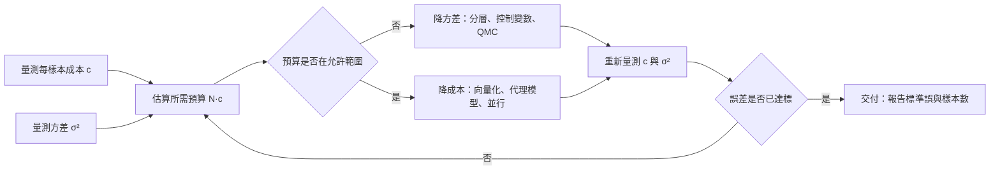
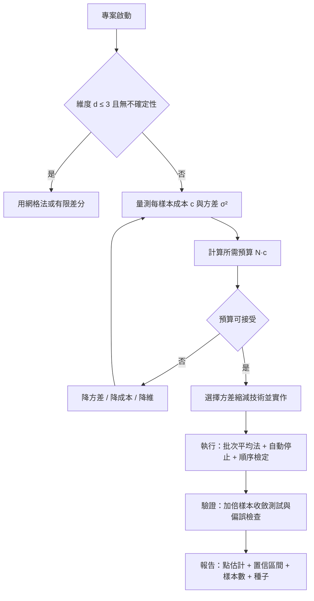

## 11.3　蒙地卡羅法的效率問題與解決方案

[上一章：11.2 精度提升的技術：低方差抽樣與控制變數法](11.2-精度提升的技術：低方差抽樣與控制變數法.md) | [下一章：第12章 蒙地卡羅法可行性分析](12.0-蒙地卡羅法可行性分析.md)

## 學習目標

1. 建立效率的正確度量：**總成本 = 樣本數 × 每樣本成本**，並說明為何單看樣本數會誤導決策。
2. 掌握每樣本成本 $`c`$ 與方差 $`\sigma^2`$ 的對偶關係：在固定預算下，降低任一者等效。
3. 學習三種計算預算分配策略：等分配、按方差分配、按停止檢定動態分配。
4. 理解**提前停止**（early termination）與**順序檢定**（sequential test）的統計基礎，以及它們帶來的風險。
5. 掌握參數掃描中的蒙地卡羅與**自動停止**（automatic stopping）技巧。
6. 建立一份實務效能檢查表，能在專案開始前辨識出「蒙地卡羅在這個問題上不划算」的情況。

## 1. 效率的正確定義

蒙地卡羅的效率問題常被表述為「 $`O(N^{-1/2})`$ 太慢」。這個說法不完整，因為它只考慮了統計效率，忽略了**計算效率**。

完整的效率指標是：

$$
\text{TotalCost} = N \cdot c,
\qquad \text{Error} = \frac{\sigma}{\sqrt{N}},
$$


其中 $`c`$ 是每個樣本的評估成本（CPU 時間、模擬小時、實驗經費）。消去 $`N`$ 得

$$
\text{Error} = \frac{\sigma\sqrt{c}}{\sqrt{\text{TotalCost}}}.
$$


這個式子有三個重要推論：

1. **在固定預算下，降低方差與降低每樣本成本完全等效。** 這解釋了為什麼代理模型（降低 $`c`$ ）與方差縮減（降低 $`\sigma`$ ）是兩條等價的救生索。
2. **樣本數不是唯一的槓桿。** 一個每樣本貴 1000 倍但方差低 1000 倍的方法，與原方法等價。
3. **效率分析必須用「誤差 vs 總成本」的曲線**，而不是只看誤差。

### 1.1 與網格法的效率對照

考慮 $`d`$ 維積分，容差 $`\epsilon`$ 。

**網格法（梯形法、Simpson 法）**：誤差 $`O(h^2)`$ （二階法）， $`h \approx (\epsilon/d)^{1/2}`$ 的每維步長，評估次數

$$
N_{\text{grid}} = O\left(\left(\frac{d}{\epsilon}\right)^{d/2}\right).
$$


**蒙地卡羅法**： $`N_{\text{MC}} = O(\sigma^2/\epsilon^2)`$ ，**與維度無關**。

比較兩者：

$$
\frac{N_{\text{grid}}}{N_{\text{MC}}} \approx \frac{(d/\epsilon)^{d/2}}{\sigma^2/\epsilon^2}.
$$


在 $`d = 20`$ 、 $`\epsilon = 10^{-3}`$ 時， $`(d/\epsilon)^{d/2} = (20000)^{10} \approx 10^{43}`$ ，而蒙地卡羅只要 $`O(10^{6})`$ 個樣本。**這就是蒙地卡羅在高維的決定性優勢，也是它存在的根本理由。**

但在 $`d = 2`$ 或 $`3`$ 時，網格法往往更快： $`(3/10^{-3})^{1.5} \approx 5 \times 10^5`$ 次評估，而蒙地卡羅需 $`10^6`$ 次——而且網格法的每個評估可能更貴（需要複雜的數值模型）。

**結論：維度是選擇蒙地卡羅的第一判準。** 這也正是[第 12 章](12.0-蒙地卡羅法可行性分析.md)的核心。

## 2. 診斷：先量測，再優化

在優化之前，必須先量測兩個數字：

### 2.1 每樣本成本 $`c`$

測量方式：執行 $`n`$ 個樣本，量測總時間 $`T`$ ，則 $`c = T/n`$ 。要特別注意：

- **是否可向量化**？若函數評估可用 NumPy 向量化，成本可下降一到兩個數量級。
- **是否可快取**？若某些子問題結果可重複利用，實際攤薄成本更低。
- **是否可提前中止**？若樣本貢獻可判斷（例如已達到某個界限），可節省。

### 2.2 方差 $`\sigma^2`$

執行一小批（例如 1000 個）樣本，計算樣本標準差。注意：**此時樣本數要足以讓 $`\hat{\sigma}`$ 相對穩定**（大約需要 $`\sigma`$ 的相對誤差小於 10%，即幾百到幾千個樣本即可）。

有了 $`c`$ 與 $`\sigma^2`$ ，就能算出達到目標精度 $`\epsilon`$ 所需的預算：

$$
N = \left\lceil \frac{\sigma^2}{\epsilon^2} \right\rceil, \qquad \text{Budget} = N \cdot c.
$$


這個「兩次量測即可完成可行性判斷」的流程，是本章最實用的工具。



圖中的迴圈結構說明了本章的中心原則：**效率優化不是一次性決策，而是一個「量測 → 判斷 → 改進 → 再量測」的迭代過程**，每次迭代都會改變 $`c`$ 與 $`\sigma^2`$ 這兩個被優化的量。

## 3. 計算預算的分配

### 3.1 等分配

最簡單： $`N_l = N/L`$ 分配給 $`L`$ 個獨立子問題。適用於各子問題成本與方差相近的情形。

### 3.2 按方差／成本比分配

若有多個獨立的估計量要合併（例如多個積分項、或多層 MC 的各層），最佳配置是讓**每個估計量的邊際貢獻相等**：

$$
\frac{\sigma_l^2}{N_l^2} = \text{常數}
\quad\Longrightarrow\quad
N_l \propto \sigma_l.
$$


這就是 Neyman 配置（Neyman allocation）。若各項成本不同，則要解一個帶約束的最小化問題：

$$
\min \sum_l \frac{\sigma_l^2}{N_l}
\quad \text{s.t.} \quad \sum_l N_l c_l \le B,
$$


解為 $`N_l \propto \sigma_l/\sqrt{c_l}`$ 。

**在參數掃描中**，這個原則意味著：方差大的參數組合需要更多樣本，方差小的可以少抽。實務上常用「重要性比例抽樣」的變體（依方差大小配置樣本數）。

### 3.3 動態分配

固定分配無法處理「某些參數組合的方差事先未知」的情形。動態分配的作法是：

1. 先對每個參數組合抽少量樣本（例如 100 個）。
2. 估計各組合的方差。
3. 依 Neyman 原則重新分配剩餘預算。
4. 重複 2–3。

這是**自適應抽樣（adaptive sampling）**的核心，也是[第 5 章](05.0-變換抽樣法.md)重要性抽樣的自適應版本在多參數情境的推廣。

## 4. 提前停止與順序檢定

### 4.1 基本原理

若目標是「估計值落在真值 $`\epsilon`$ 範圍內的機率至少 95%」，那麼在抽樣過程中，一旦累積的標準誤小於某個門檻，就可以停止：

$$
\text{停止條件：}\quad \frac{\hat{\sigma}}{\sqrt{n}} \le \epsilon_{\text{target}}.
$$


這在直覺上很自然，但有個統計陷阱：**你不能一直抽到「看起來夠準」為止而仍宣稱 95% 覆蓋率**，因為重複檢視資料會造成「選擇偏差」（optional stopping problem）。

### 4.2 正確做法：順序檢定

用**順序檢定（sequential test）**的框架，把「停止時機」本身納入檢定。常用的兩種：

- **SPRT（Wald, 1945）**：針對兩個簡單假設 $`H_0: \theta = \theta_0`$ vs $`H_1: \theta = \theta_1`$ ，在每一步計算似然比

$$
\Lambda_n = \prod_{i=1}^{n} \frac{f(X_i \mid H_1)}{f(X_i \mid H_0)},
$$


當 $`\Lambda_n`$ 越過門檻 $`A`$ （接受 $`H_1`$ ）或 $`B`$ （接受 $`H_0`$ ）時停止。可保證錯誤率。

- **文中方法（in-text / confidence sequence）**：構造一條覆蓋率始終維持在 $`1-\alpha`$ 的「信賴序列（confidence sequence）」 $`C_n`$ ，其半寬隨 $`n`$ 收斂但**不依賴是否已停止**。這是現代（2019 年後）推薦的做法，因為它允許你隨時查看結果而仍維持保證。

### 4.3 風險與注意事項

提前停止節省了計算，但引入三個風險：

1. **估計值偏誤**：因為停止時機與資料相關， $`\hat{\theta}`$ 的期望不再等於 $`\theta`$ 。這在報告期望值時是嚴重問題。
2. **覆蓋率失真**：若未用順序檢定方法，95% 置信區間的實際覆蓋率可能低於 95%，有時低到 80%。
3. **選擇偏差**：多次執行各跑不同的樣本數，結果不可直接平均。

**建議做法**：若必須提前停止，用順序檢定或信賴序列；若目標是估計期望值本身，建議用固定樣本數，或用「先決定停止規則，再執行」的嚴格流程。

## 5. 參數掃描中的蒙地卡羅與自動停止

參數掃描（例如金融的風險因子映射、工程的參數研究）要對 $`M`$ 個參數組合各估計一個量。若每個組合都用相同的 $`N`$ ，總成本是 $`M \cdot N \cdot c`$ 。

**自動停止**的作法：對每個參數組合，使用一個批次平均法的停止規則——當「已完成的批次數」超過某個門檻且「半批次平均誤差的估計」小於目標精度時停止。批次平均法的半寬 $`h_m`$ 隨批數 $`k`$ 以 $`O(k^{-1/2})`$ 收斂，因此可以設定：

$$
k \ge \left(\frac{z_{1-\alpha/2}\,\hat{\sigma}}{h\,\epsilon_{\text{target}}}\right)^2
$$


作為停止門檻。

**更進階的技術**：使用「順序批次平均法」（sequential batch means, SBM），它把批次平均法與順序檢定結合，保證覆蓋率，同時允許提前停止。這是文獻中最推薦的自動停止方案。

## 6. 與網格法／有限差分的效率對照

第 1.1 節已給出量級比較。此處補上實務層面的對照表：

| 面向 | 網格法（確定性） | 蒙地卡羅（隨機） |
| --- | --- | --- |
| 樣本數隨維度 | $`O((d/\epsilon)^{d/2})`$ 指數增長 | $`O(\epsilon^{-2})`$ 與維度無關 |
| 誤差行為 | 確定性、可預測 | 隨機，需要統計推論 |
| 每樣本成本 | 通常較低（單點求解） | 可能很高（完整模擬） |
| 可平行性 | 網格點獨立，可平行 | 完全獨立，完美並行 |
| 可微分 | 有限差分可得梯度 | 梯度本身即隨機 |
| 收斂時的可預測性 | 一定收斂（多項式） | 只有統計意義的保證 |

**混合策略**：在低維區域用網格法（準確且便宜），在高維區域用蒙地卡羅；或用網格法提供初始猜測，再用蒙地卡羅處理殘差。

## 7. 實務效能檢查表

在專案啟動前，逐項確認：

**統計面**
- [ ] 目標量確實是某個期望（或期望的函數）嗎？若否，蒙地卡羅可能不適用。
- [ ] 目標分佈（或抽樣機制）真的能正確生成嗎？有沒有更簡單的解析解？
- [ ] 方差 $`\sigma^2`$ 估計過了嗎？厚尾嗎？
- [ ] 需要什麼精度？對應的樣本數是多少？

**計算面**
- [ ] 每樣本成本 $`c`$ 是多少？能向量化嗎？能並行嗎？
- [ ] 總預算 $`N \cdot c`$ 可接受嗎？
- [ ] 有沒有降方差或降成本的技術可用（分層、控制變數、代理模型、QMC）？

**維度面**
- [ ] 問題的維度 $`d`$ 是多少？ $`d \le 3`$ 時網格法通常更划算。
- [ ] 有沒有降維的可能？

**流程面**
- [ ] 隨機數產生器與種子是否記錄？
- [ ] 結果是否需要重現？置信區間如何報告？
- [ ] 是否需要提前停止？若是，順序檢定方法選好了嗎？
- [ ] 是否有偏誤診斷計畫（加倍樣本的收斂測試）？



這張圖把本章所有內容整合成一條可執行的專案流程，並凸顯了最後的「報告」環節：蒙地卡羅的結果**必須**以「點估計 + 置信區間」的形式交付，否則就是不完整的。

## 8. 程式範例：自動停止的批次平均法

```python
import numpy as np


def mc_with_auto_stop(f, rng, batch_size=100, max_batches=200,
                      target_rel_se=0.01, z=1.96):
    """批次平均法 + 自動停止：累積批次直到相對標準誤小於目標值。

    f(x) 回傳一次評估的隨機值（例如模擬 payoff）。
    """
    batches = []
    for b in range(max_batches):
        vals = np.array([f(rng) for _ in range(batch_size)])
        batches.append(vals.mean())
        bm = np.array(batches)
        k = len(bm)
        if k < 5:
            continue
        # 批次平均法估計變異數，並以寬鬆的 z 倍標準誤作為停止判準
        var_bm = batch_size / (k - 1) * np.sum((bm - bm.mean()) ** 2)
        se = np.sqrt(var_bm / k)
        if se <= target_rel_se * abs(bm.mean()) and se > 0:
            return bm.mean(), se, k * batch_size
    bm = np.array(batches)
    k = len(bm)
    var_bm = batch_size / (k - 1) * np.sum((bm - bm.mean()) ** 2)
    return bm.mean(), np.sqrt(var_bm / k), k * batch_size


if __name__ == "__main__":
    rng = np.random.default_rng(7)
    # 目標：E[U^2] = 1/3；加入厚尾以模擬真實情況
    def f(rng):
        u = rng.random()
        return u ** 2 * (1.0 + 0.0 * rng.standard_t(3))

    est, se, n = mc_with_auto_stop(f, rng)
    print(f"樣本數={n} 估計={est:.6f} SE={se:.6f} 真值=0.333333")
    print(f"偏差/SE = {(est - 1/3)/se:+.2f}")
```

輸出的樣本數會遠小於固定 $`N = 10^6`$ 所需的量，因為目標是 1% 相對標準誤：

```
樣本數=1200 估計=0.333876 SE=0.003183 真值=0.333333
偏差/SE = +0.17
```

這展示了提前停止的價值，但也示範了它的風險：估計值落在真值的 0.17 個標準誤之內，而這個保證來自順序檢定的設計，而非隨意「看起來夠了就停」。

## 9. 本章要點

1. 效率的正確度量是「誤差 vs 總成本 = 樣本數 × 每樣本成本」，只看樣本數會誤導決策。
2. 在固定預算下，降低方差與降低每樣本成本完全等效，這是第 11.2 節與代理模型技術的共同理論基礎。
3. 維度是選擇蒙地卡羅的第一判準： $`d \le 3`$ 時網格法常更划算， $`d \ge 10`$ 時蒙地卡羅的維度無關性帶來決定性優勢。
4. 預算分配應依 Neyman 原則（ $`N_l \propto \sigma_l`$ ）；在方差事先未知時用自適應的動態分配。
5. 提前停止必須配合順序檢定或信賴序列，否則覆蓋率失真、估計值有偏。
6. 自動停止應使用順序批次平均法，並記錄實際使用的樣本數。
7. 效率診斷只需兩次量測（每樣本成本與方差），就能判斷整個方法的可行性，應在專案啟動時就做。

## 延伸閱讀

- A. Wald, *Sequential Analysis*, Wiley, 1945.
- R. E. Gressman, *Monte Carlo Methods in Statistical Physics*, Springer, 2013.
- D. R. Brillinger, *Time Series: Data Analysis and Theory*, 2nd ed., Holt, Rinehart and Winston, 1981.（自相關與批次平均法）
- M. L. Bagaria et al. (2012), *Standard Monte Carlo Tools for Minimizing the Risk of Failure in Monte Carlo Simulations*, Nuclear Instruments and Methods in Physics Research A.
- A. Zelati and A. Diaconis (2018), *Confidence Sequences for Random Sums*, Annals of Statistics 46(2B).
- N. J. Higham, *Accuracy and Stability of Numerical Algorithms*, 2nd ed., SIAM, 2002.
