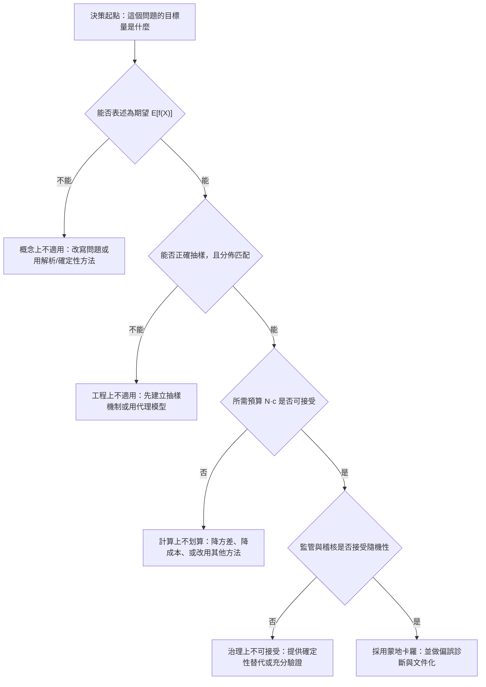

# 第12章　蒙地卡羅法可行性分析

[上一章：11.3 蒙地卡羅法的效率問題與解決方案](11.3-蒙地卡羅法的效率問題與解決方案.md) | [下一章：12.1 當蒙地卡羅法不可行時的替代方法](12.1-當蒙地卡羅法不可行時的替代方法.md)

## 學習目標

1. 建立一套**可操作的判斷流程**，回答「這個問題該不該用蒙地卡羅法」這個在實務上每天都要面對的問題。
2. 理解蒙地卡羅的**四個前提條件**：目標量必須可表述為期望、必須能抽樣、抽樣分佈必須與真實過程匹配、以及精度需求必須與 $`O(N^{-1/2})`$ 的速率相容。
3. 區分三種「不該用」的情況：概念上不適用、計算上不划算、以及治理／合規上不可接受。
4. 掌握可行的替代方案族（確定性數值積分、稀疏網格、代理模型、直接抽樣、變分近似），並知道何時該轉向哪一個。
5. 建立**文件化與可審計性**的要求：蒙地卡羅的結果要怎麼說服一個不接受隨機性的人。

## 1. 為什麼需要這一章

前面十一章都在說蒙地卡羅「能做什麼」。這一章要回答相反方向的問題：**它不能做什麼，以及什麼時候不該用它。**

這個問題的重要性可以用一個經驗法則說明：在實際專案中，蒙地卡羅被「誤用」的比例遠高於「未用」——人們常因為它容易實作、容易平行化、容易得到一個數字，就直接採用它，卻沒有檢查它是否真的適合這個問題。而它的失敗模式往往是**靜默的**：你會得到一個看起來合理的數字，但它是偏的，或是精度遠不如宣稱的。

因此本章的目標不是「唱衰蒙地卡羅」，而是提供一套**在專案啟動時就能做的判斷工具**，讓技術選型成為一個有依據的決策。

## 2. 判斷的第一個問題：目標量是期望嗎

蒙地卡羅只能估計「期望型」的量。具體而言，它適用於

$$
\theta = \mathbb{E}_p\big[f(X)\big]
$$

或這類量的可微函數，例如 $`g(\mathbb{E}[f(X)])`$ 、 $`\mathbb{E}[f(X)]^2`$ 、 $`\mathbb{E}[\log f(X)]`$ 。

**判斷方法**：問自己三個問題。

1. 目標量是否可以用「對某個不確定性取平均」來表述？
2. 如果是，這個不確定性有明確的分佈（或可模擬的過程）嗎？
3. 或者，是否可以找到一個**與之相關但更簡單**的量，並用控制變數法處理（[第 11.2 節](11.2-精度提升的技術：低方差抽樣與控制變數法.md)）？

如果三個問題的答案都是否，那麼蒙地卡羅**在概念上不適用**，此時應該找的是：解析解、確定性數值方法、或重新定義問題。

一個典型的概念不適用案例：**求一個函數在區間上的最大值**。最大值不是期望。但如果我們要求的是「最大值位置的期望」，那就適用了——很多實務問題可以如此改寫，這本身就是可行性分析的第一步：**把「求最壞情況」改寫為「求期望的最壞情況」**。

## 3. 判斷的第二個問題：抽樣可行嗎

即使目標量是期望，仍需要能產生樣本。需要檢查：

- **抽樣機制是否明確**？「隨機選一條途徑」是否可以被程式化描述？
- **分佈參數是否已知**？若參數本身需要估計（例如共變異數矩陣），則需要嵌套蒙地卡羅，成本上升。
- **樣本是否獨立**？若是馬可可夫鏈或需要保存狀態，則有自相關，需要[第 11.1 節](11.1-蒙地卡羅誤差的來源與控制.md)的修正，且樣本不能任意並行（必須依序推進鏈）。

**並行性檢查**是一個容易忽略的陷阱：很多蒙地卡羅計算在紙面上「可平行」，實際上卻有串行依賴。例如連續時間的 SDE 模擬必須逐步推進（除非使用布朗橋等技術）。第 6 章的 GPU 加速技術正是針對此問題。

## 4. 判斷的第三個問題：抽樣分佈對得上嗎

蒙地卡羅的無偏性建立在「用正確的分佈抽樣」之上。若真實過程是複合的（例如：有狀態、有歷史依賴、有外生衝擊），而模擬把它簡化為獨立同分布，則結果系統性偏誤。

實務檢查清單：

- [ ] 分佈的尾巴是否被正確涵蓋？（常態抽樣會漏掉厚尾事件）
- [ ] 變數間的相依性是否被保留？
- [ ] 時間序列的動態結構（均值回覆、 波動聚集、跳躍）是否被保留？
- [ ] 參數的**不確定性**是否被納入（而非把參數當成已知常數）？

第 4 點特別值得強調：用「參數估計值固定」的蒙地卡羅，估的是「條件期望」，會**低估**整體的不確定性。修正方法是用嵌套蒙地卡羅：外層抽參數，內層抽過程。

## 5. 判斷的第四個問題：精度與成本是否相容

第 11.3 節給出了定量判準：所需樣本數 $`N \approx \sigma^2/\epsilon^2`$ ，總成本 $`N \cdot c`$ 。因此判斷步驟是：

1. 用小批量實測 $`\sigma^2`$ 與 $`c`$ 。
2. 計算目標精度 $`\epsilon`$ 下的預算。
3. 與可用預算比較。

**關鍵對照**：確定性方法在同一問題上的成本是多少？若網格法只要 $`10^4`$ 次評估而蒙地卡羅要 $`10^8`$ 次，則蒙地卡羅不該用（低維時）。

## 6. 三種「不該用」的情況

把上面的檢查總結為三個層次：

這張圖是本章的核心工具，也是本章與第 12.1、12.2、12.3 節的銜接點：每一個「不適用」的出口，都對應到後續章節的一組替代方案。

值得注意的是三個層次的**嚴格遞增**：概念上不適用的問題，任何工程手段都救不了；工程上不適用的問題，可以靠建立更好的抽樣機制救；計算上不划算的問題，可以靠方差縮減與代理模型救。而治理層次的問題，往往可以靠**文件化與充分驗證**部分化解——這是與前三者本質不同的地方。

## 7. 一個綜合範例

假設要估算一個電力系統的**期望停電頻率**，模型包含隨機故障、隨機修復時間、隨機負載。

- **概念層面**：期望停電頻率正是期望型量 → 適用。
- **抽樣層面**：故障與修復可模擬；但負載有年度週期，且必須與故障時間序列保持一致 → 需要在模擬中保留時間結構，不可抽樣後再隨機組合 → 需注意自相關。
- **分佈層面**：故障率估計自歷史資料，其不確定性需透過嵌套蒙地卡羅納入。
- **計算層面**：一次全年模擬需數秒， $`\epsilon = 5%`$ 時需 $`N \approx 400\sigma^2/0.0025`$ ；若年變異數為 0.2，則 $`N \approx 64000`$ 次模擬 → 總成本約 18 小時，可接受但需並行化。
- **治理層面**：若要提交監管機關，需要展示收斂性與敏感度分析。

這個範例說明：可行性分析不是是非題，而是**每一個維度都要檢查，並在每一個維度上採取對應措施**。

## 8. 本章結構

| 節 | 主題 |
| --- | --- |
| [12.1](12.1-當蒙地卡羅法不可行時的替代方法.md) | 每一種「不適用」情境下的替代技術族 |
| [12.2](12.2-蒙地卡羅法與其他數值方法的比較.md) | 與確定性方法、機器學習方法的系統性比較表 |
| [12.3](12.3-蒙地卡羅法的適用條件與限制.md) | 適用條件、已知限制與治理要求 |

## 9. 本章要點

1. 可行性分析是一個四層檢查：概念（能否表述為期望）、工程（能否抽樣且匹配）、計算（精度與成本是否相容）、治理（監管能否接受隨機性）。
2. 蒙地卡羅在概念上只適用於期望型量；很多「求最壞情況」的問題可以改寫為期望型問題，這是擴大適用範圍的第一步。
3. 抽樣分佈與參數不確定性是最容易被忽略的偏誤來源；嵌套蒙地卡羅是納入參數不確定性的標準做法。
4. 定量判準是 $`N \cdot c`$ 與可用預算的比較， $`c`$ 與 $`\sigma^2`$ 可用小批量實測取得。
5. 維度是關鍵分界：低維時確定性網格法通常更划算，高維時蒙地卡羅的維度無關性帶來決定性優勢。
6. 三個層次的「不適用」需要不同的處置：概念問題要改寫問題，工程問題要改善抽樣，計算問題要降方差或降成本。

## 延伸閱讀

- R. E. Gressman, *Monte Carlo Methods in Statistical Physics*, Springer, 2013.
- N. J. Higham, *Accuracy and Stability of Numerical Algorithms*, 2nd ed., SIAM, 2002.
- J. R. Rubinstein and A. W. Young, *Simulation and the Monte Carlo Method*, 2nd ed., Wiley, 2016.
- C. F. van Loan and G. Golub, *Matrix Computations*, 4th ed., Johns Hopkins University Press, 2013.（稀疏矩陣與迭代法的成本結構）
