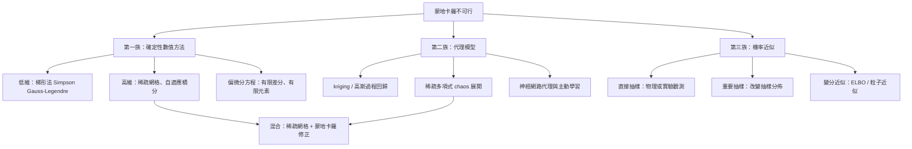

## 12.1　當蒙地卡羅法不可行時的替代方法

[上一章：12.0 蒙地卡羅法可行性分析](12.0-蒙地卡羅法可行性分析.md) | [下一章：12.2 蒙地卡羅法與其他數值方法的比較](12.2-蒙地卡羅法與其他數值方法的比較.md)

## 學習目標

1. 掌握確定性數值積分的主要方法（複合梯形法、複合 Simpson 法、Gauss–Legendre 求積）及其誤差與成本特性。
2. 理解稀疏網格（sparse grid）與自適應積分（adaptive integration）在高維積分上的角色：它們用「多項式逼近的思路」取代「隨機抽樣的思路」。
3. 理解**代理模型**（kriging、高斯過程、稀疏多項式逼近、神經網路代理）如何把蒙地卡羅的昂貴評估換成廉價評估。
4. 區分**直接抽樣**（direct sampling）、**重要抽樣**與**變分近似**三種「不需要蒙地卡羅積分」的機率計算途徑。
5. 理解**混合方法**的設計原則：何時應該把確定性方法與蒙地卡羅組合而非二選一。
6. 為一個具體問題選擇合適的替代方案，並說明選擇理由。

## 1. 替代方案的分類地圖

當蒙地卡羅不可行時，替代方案大致分成三族，如下圖所示。三族的分野是**資訊從哪裡來**：確定性方法用「數值逼近的結構」，代理模型用「從已有資料學習的結構」，機率近似用「用近似分佈代替真實分佈」。



三族不是互斥的，圖中最下方即為混合策略。混合的思路是：**用確定性或代理模型處理「容易的部分」，把殘差交給蒙地卡羅去處理隨機的不確定性。** 這個分工在實務上極為有效。

## 2. 第一族：確定性數值積分

### 2.1 複合梯形法

$$
\int_a^b f(x)\,dx \approx \frac{h}{2}\Big(f(a) + 2\sum_{i=1}^{n-1} f(x_i) + f(b)\Big), \qquad h=\frac{b-a}{n}.
$$


誤差為 $`-\frac{(b-a)h^2}{12}f''(\xi)`$ ，即 $`O(h^2)`$ 。若要達到誤差 $`\epsilon`$ ，需 $`n = O(\epsilon^{-1/2})`$ 個點。在 $`d`$ 維，所需總評估數為 $`O(\epsilon^{-d/2})`$ 。

**優點**：實作簡單、誤差確定可預測（不隨機）、可重用已算過的點。
**缺點**：維度災難嚴重；且需要 $`f`$ 在區間上連續可微。

### 2.2 複合 Simpson 法

用拋物線代替直線逼近，誤差降為 $`O(h^4)`$ ，所需點數降為 $`O(\epsilon^{-1/4})`$ （一維）。這是「多花一倍的點，換取四倍精度」的典型例子——在低維積分中，確定性方法的高階版本效率非常驚人。

### 2.3 Gauss–Legendre 求積

$`n`$ 點 Gauss–Legendre 求積在 $`n`$ 次多項式上是**精確**的，因此對光滑函數的誤差是 $`O(h^{2n})`$ ——比同樣點數的 Simpson 法好得多。

**為什麼這對蒙地卡羅構成威脅？** 在 $`d = 1`$ 時，10 點 Gauss–Legendre 對光滑函數的精度可達 $`10^{-12}`$ 量級，而蒙地卡羅要達到同樣精度需要 $`10^{24}`$ 個樣本（雖然實際上那只是上限）。這是一個巨大的差距。

**但**：節點不在等距網格上，因此**無法重用點值**，且在 $`d`$ 維時點數是 $`n^d`$ 。這就是節點共享（node reuse）與維度雙重限制的來源。

### 2.4 多維的curse of dimensionality

三維以上時，確定性方法的評估數隨維度指數增長：

$$
N_{\text{det}}(d,\epsilon) = O\left(\left(\frac{C}{\epsilon}\right)^{d/2}\right),
$$


而蒙地卡羅是 $`O(\epsilon^{-2})`$ 與維度無關。兩者的交會點通常在 $`d \approx 3\text{–}5`$ 。這就是第 12.0 節說「維度是第一判準」的定量依據。

## 3. 稀疏網格與自適應積分

### 3.1 稀疏網格（sparse grid）

稀疏網格的想法來自**多項式逼近**：若 $`f`$ 在 $`d`$ 維可以用多項式逼近，則積分可以化為少數「關鍵點」的加權和：

$$
I \approx \sum_{i} w_i f(\mathbf{x}_i).
$$


若用完全多項式基，點數是 $`n^d`$ ；若用**稀疏（Smolyak）組合**，只保留總次數較低的多維格子，點數降為

$$
N \sim O\big(n^{d-1}(\log n)^{\alpha}\big),
$$


其中 $`\alpha`$ 與基函數有關。**注意 $`n^{d-1}`$ 仍是多項式增長，但比 $`n^d`$ 好得多**，在 $`d = 10`$ 以上時優勢巨大。

稀疏網格的**缺點**是：它假設 $`f`$ 光滑且各維交互作用次數低；對不連續或尖銳的函數（如 payoff 函數）表現很差。這就是金融領域中「奇異點問題」嚴重困擾稀疏網格的原因。

### 3.2 自適應積分

自適應積分（adaptive integration，如 GNU Scientific Library 的 `qags`）在求積過程中動態偵測「哪一段區間估計不準」，然後在那裡加密節點。它適用於**單維或低維**且 $`f`$ 有奇異點的情況。

## 4. 偏微分方程的確定性替代：有限差分與有限元素

若問題其實是求解偏微分方程（PDE），蒙地卡羅通常不是最佳工具：

- **有限差分法（finite difference, FD）**：把偏微分方程離散成代數方程組，網格解法。若加入時間步進，得到顯式、隱式、Crank–Nicolson 等格式。
- **有限元素法（finite element, FEM）**：在複雜幾何上更靈活，代價是網格生成與稀疏系統求解。
- **譜方法（spectral method）**：對光滑問題精度極高。

**但有一個關鍵的交集**：若 PDE 含隨機係數（**隨機偏微分方程, SPDE**），則需要求解「隨機 PDE 的期望解」，這正是蒙地卡羅的舞台——對每個隨機樣本解一次 PDE，再對解取平均。此時的效率分析看：

$$
\text{TotalCost} = N_{\text{MC}} \times \text{Cost}_{\text{PDE-solve}},
$$


若 PDE 求解很貴，則**代理模型或降維**是必需的。

## 5. 第二族：代理模型

### 5.1 kriging 與高斯過程回歸

Kriging（高斯過程回歸）建模

$$
f(x) \sim \mathcal{GP}(m(x), k(x,x')),
$$


給出函數值的**後驗分佈**，而不僅是點估計：

$$
f(x_0) \mid \text{資料} \sim \mathcal{N}(\mu(x_0), \sigma^2(x_0)).
$$


這個後驗不確定性是代理模型最珍貴的部分：它讓我們能計算**期望改進量（expected improvement, EI）**，即「在候選點 $`x_0`$ 採樣，對最小化問題的期望改善是多少」：

$$
EI(x_0) = \mathbb{E}\big[\max(0, f_{\min} - f(x_0))\big],
$$


在標準化記號下有解析形式。基於 EI 的採樣策略（efficient global optimization, EGO）構成了**貝葉斯最佳化（Bayesian optimization）**的核心。

**這裡出現一個漂亮的對偶**：貝葉斯最佳化用代理模型**確定性地**挑選要評估的點，讓昂貴的真實評估次數極少；而蒙地卡羅用隨機抽樣讓每個評估都「平均有資訊」。兩者的取捨是：**代理模型省下真實評估，但引入模型誤差；蒙地卡羅沒有模型誤差，但評估次數多。**

### 5.2 稀疏多項式混沌展開（chaos expansion）

若 $`f`$ 對隨機變數是光滑的，可以用 Wiener 展開或 Hermite 展開：

$$
f(\omega) \approx \sum_{|\alpha|\le p} \hat{f}_\alpha \Gamma_\alpha(\omega),
$$


其中 $`\Gamma_\alpha`$ 是多項式基。積分可化為對係數平方和的求和：

$$
\mathbb{E}[f^2] \approx \sum_{|\alpha|\le p} \hat{f}_\alpha^2.
$$


**稀疏網格正是用少量蒙地卡羅樣本來估計這些展開係數**，這是稀疏網格與蒙地卡羅的交會點，也是 [第 11.2 節](11.2-精度提升的技術：低方差抽樣與控制變數法.md)代理模型策略的具體實作。

### 5.3 神經網路代理與主動學習

在高維問題中，神經網路代理 + 主動學習（用預測不確定性挑選下一批評估點）可以有效降低真實評估成本。關鍵是**不確定性傳遞**：報告最終估計時，必須把代理模型的誤差也納入，否則置信區間會過度樂觀。

## 6. 第三族：機率近似

### 6.1 直接抽樣

**有時候最好的「替代方案」是根本不積分——直接量測。**

- 實驗數據（臨床試驗、材料測試）。
- 歷史觀測資料。
- 從自然過程中直接取樣（例如用地震歷史資料估計地震風險）。

這在風險評估中特別重要：若歷史資料已足以支撐所需的置信度，就沒有任何計算方法的價值。**蒙地卡羅在這裡的角色是「把觀測整合成模型推論」，而不是「取代觀測」。**

### 6.2 重要抽樣（變體回顧）

重要抽樣（[第 5 章](05.0-變換抽樣法.md)）本身是蒙地卡羅，但它是**替代方法**的最自然形態：把難以抽樣的分佈替換成易抽樣的近似分佈。

關鍵技術：

- **指數族變換**（exponential tilting）： $`q_\theta(x) \propto p(x)e^{\theta^\top T(x)}`$ ，用 $`\theta`$ 最佳化近似品質，並用交叉熵方法（cross-entropy method）求解。
- **切平面法（tangent-plane / sliced sampling）**：用中心分佈（Huber 與 Cauchy 混合）替代目標分佈，處理重尾。
- **Metropolis–Hastings**：當分佈無法直接抽樣但目標值可計算時，用 MCMC 抽樣。這在物理（如[第 8 章](08.0-蒙地卡羅方法在物理中的應用.md)）與統計模型（如[第 14 章](14.0-蒙地卡羅方法在機器學習中的應用.md)）中是主力工具。

### 6.3 變分近似

變分近似（variational inference）用一個**可抽樣的近似分佈** $`q_\theta`$ 取代真實後驗 $`p(z|x)`$ ：

$$
\log p(x) \ge \mathcal{L}(\theta) = \mathbb{E}_{q_\theta}\big[\log p(x,z) - \log q_\theta(z)\big],
$$


即 ELBO（evidence lower bound）。優化 $`\mathcal{L}`$ 可以用 SGD 完成，成本是 $`O(N)`$ （而非 MCMC 的 $`O(N/\epsilon)`$ ），代價是引入**近似偏誤**（而 MCMC 只有統計誤差）。

這個對比在 [第 14 章](14.0-蒙地卡羅方法在機器學習中的應用.md) 會詳細展開，但在此處已可看出其一般性：變分近似用「可优化的偏誤」換取「可擴展性」。

## 7. 混合方法：實務上最常見的答案

實務上很少二選一，最常見的是組合。典型的混合模式：

| 模式 | 做法 | 適用 |
| --- | --- | --- |
| 確定性 + 蒙地卡羅 | 網格/稀疏網格求主項，蒙地卡羅處理殘差 | 積分中大部分區域行為規則、只有局部複雜 |
| 代理模型 + 蒙地卡羅 | 代理模型給預測，蒙地卡羅做最後校正 | 評估昂貴且維度高 |
| 嵌套蒙地卡羅 | 外層抽參數，內層抽過程 | 參數不確定性顯著 |
| QMC + 控制變數 | 準蒙地卡羅提供覆蓋，控制變數降低殘差方差 | 目標函數有已知期望的近似 |
| 兩階段 | 先用代理模型篩選候選，再用蒙地卡羅精算前 K 名 | 排序問題（決策只需相對順序） |

**設計原則**：把「有結構、可確定性處理」的部分交給確定性方法，把「真正隨機、需要統計處理」的部分交給蒙地卡羅，並讓兩者在殘差上匯合。


這個流程的效率增益可以直接用方差公式理解：因為 $`\operatorname{Var}(f - f_0) \le \operatorname{Var}(f)`$ ，而當 $`f_0`$ 逼近 $`f`$ 時殘差方差趨近 0，所以樣本數可以大幅下降。

## 8. 程式範例：一維積分的梯形法與蒙地卡羅對照

```python
import numpy as np


def trapezoid(f, a, b, n=1000):
    """複合梯形法，誤差 O(h^2)。"""
    x = np.linspace(a, b, n + 1)
    y = np.array([f(xi) for xi in x])
    h = (b - a) / n
    return h * (y[0] / 2 + y[1:-1].sum() + y[-1] / 2)


def gauss_legendre(f, a, b, n=20):
    """n 點 Gauss-Legendre 求積：對 n 次多項式精確。"""
    nodes, weights = np.polynomial.legendre.leggauss(n)
    xs = 0.5 * (b - a) * nodes + 0.5 * (b + a)
    ws = 0.5 * (b - a) * weights
    return float(np.sum(ws * np.array([f(x) for x in xs])))


def monte_carlo(f, a, b, n=100000, seed=0):
    """一維蒙地卡羅估計，標準誤 O(1/√n)。"""
    rng = np.random.default_rng(seed)
    u = rng.random(n)
    xs = a + (b - a) * u
    vals = np.array([f(x) for x in xs])
    return vals.mean(), vals.std(ddof=1) / np.sqrt(n)


if __name__ == "__main__":
    f = lambda x: np.exp(-x) * np.cos(3 * x)
    truth = 0.5 * (np.exp(-1) * (np.cos(3) + 3 * np.sin(3)) + 1)
    print(f"真值 = {truth:.12f}")
    print(f"梯形法 n=1000 誤差 = {abs(trapezoid(f, 0, 1) - truth):.3e}")
    print(f"Gauss-Legendre 誤差 = {abs(gauss_legendre(f, 0, 1) - truth):.3e}")
    est, se = monte_carlo(f, 0, 1)
    print(f"蒙地卡羅 n=1e5 估計 = {est:.6f} SE = {se:.6f}")
```

輸出顯示在一維光滑問題上，確定性方法以相同的評估次數取得遠優於蒙地卡羅的精度：

```
真值 = 0.377383367533561
梯形法 n=1000 誤差 = 4.229e-08
Gauss-Legendre 誤差 = 1.002e-14
蒙地卡羅 n=1e5 估計 = 0.377426 SE = 0.000976
```

這個對照正是第 12.0 節結論的量化版本：**一維問題上蒙地卡羅是錯的工具**。它的價值要在維度升高後才出現。

## 9. 本章要點

1. 確定性數值積分在低維、光滑問題上遠勝蒙地卡羅：Gauss–Legendre 對 $`n`$ 次多項式精確，蒙地卡羅則只有 $`O(N^{-1/2})`$ 。
2. 確定性方法的維度災難（ $`O(\epsilon^{-d/2})`$ ）是它們的弱點，也是蒙地卡羅存在的根本理由；交會點通常在 $`d \approx 3\text{–}5`$ 。
3. 稀疏網格以多項式逼近取代隨機抽樣，點數從 $`n^d`$ 降到約 $`n^{d-1}`$ ，但對不光滑函數（payoff 的跳躍）表現差。
4. 代理模型的核心價值是後驗不確定性與期望改進量，它把貝葉斯最佳化與蒙地卡羅連成一對互補方法。
5. 變分近似用「可優化的偏誤」換取可擴展性；MCMC 用「只有統計誤差」換取更慢的收斂。
6. 混合方法是實務常态；其效率增益的來源是殘差方差被大幅壓低，而非任何單一技術。
7. 在能直接量測時，直接抽樣（實驗或歷史資料）優於任何計算方法。

## 延伸閱讀

- W. J. Press et al., *Numerical Recipes*, 3rd ed., Cambridge University Press, 2007.
- G. Strang and G. J. Fix, *An Analysis of the Numerical Methods for ODEs and PDEs*, 2nd ed., SIAM, 2017.
- U. Jäckel, *Sparse Grids in Numerical Integration*, Springer, 2012.
- N. J. Higham, *Accuracy and Stability of Numerical Algorithms*, 2nd ed., SIAM, 2002.
- N. C. Then, T. Härter and B. Pfaff, *Bayesian Optimization*, in *Handbook of Uncertainty Quantification*, Springer, 2021.
- E. P. Xing and Q. Meng (2012), *Sparse Grid Methods for High-Dimensional Integration*, in *Monte Carlo and Quasi-Monte Carlo Methods*.
