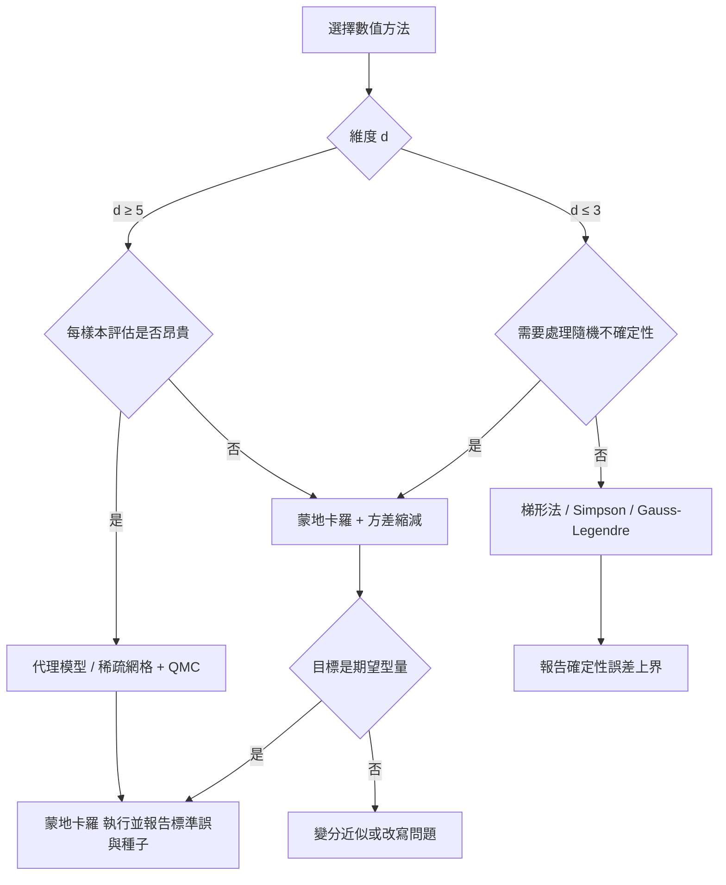

## 12.2　蒙地卡羅法與其他數值方法的比較

[上一章：12.1 當蒙地卡羅法不可行時的替代方法](12.1-當蒙地卡羅法不可行時的替代方法.md) | [下一章：12.3 蒙地卡羅法的適用條件與限制](12.3-蒙地卡羅法的適用條件與限制.md)

## 學習目標

1. 掌握一組涵蓋九個面向的系統性比較框架：**複雜度、誤差行為、實作成本、可平行性、可微性、可重現性、適用問題類型、成熟度與監管接受度**。
2. 能定量比較各種方法在維度 $`d`$ 與容差 $`\epsilon`$ 下的樣本數或評估次數，並找出交會點。
3. 理解「誤差行為」的差別：確定性方法給出**保證上界**，蒙地卡羅給出**機率性保證**，代理模型給出**經驗性估計**。
4. 能辨認各種方法的「不可微分性」對最佳化流程的影響，並知道如何用有限差分或無導數方法橋接。
5. 掌握可重現性的層級：位元級重現、統計等價重現、與方法無關的重現。
6. 能綜合以上面向，為具體問題給出「方法選擇」的理由說明，而不只是給出結論。

## 1. 比較框架的設計

單一的「蒙地卡羅 vs 網格法」比較是無意義的，因為方法很多，而選項取決於問題。因此本章用**九個面向**建立比較框架：

| 面向 | 問的問題 |
| --- | --- |
| 複雜度 | 達到容差 $`\epsilon`$ 需要多少次評估？隨維度 $`d`$ 如何增長？ |
| 誤差行為 | 誤差是確定性上界、機率性保證，還是經驗估計？ |
| 實作成本 | 建立可信實作需要多少工程投入？ |
| 可平行性 | 能否有效使用多核／GPU／分散式？ |
| 可微性 | 輸出對參數是否可微（以利於優化）？ |
| 可重現性 | 別人能否重現你的結果？ |
| 適用問題 | 哪一類問題適合？ |
| 成熟度 | 有無經驗證的函式庫、標準與最佳化案例？ |
| 監管接受度 | 能否通過稽核與認證？ |

這九個面向的前因後果是：**前四個面向決定「能不能做到」，後五個面向決定「敢不敢簽字」。** 這也是為什麼純技術比較往往不足以支撐技術選型。

## 2. 複雜度比較

下表以「達到相對精度 $`\epsilon`$ 的評估次數」為指標。 $`d`$ 為維度， $`c`$ 為單次評估成本， $`\sigma^2`$ 為蒙地卡羅估計量的方差。

| 方法 | 評估次數 | 隨維度行為 | 誤差類型 |
| --- | --- | --- | --- |
| 複合梯形法 | $`O((d/\epsilon)^{d/2})`$ | 指數 | 確定性上界 |
| 複合 Simpson | $`O((d/\epsilon)^{d/4})`$ | 指數 | 確定性上界 |
| Gauss–Legendre（ $`n`$ 點， $`d`$ 維） | $`O(n^d)`$ | 指數 | 確定性上界 |
| 稀疏網格 | $`O(n^{d-1}(\log n)^{\alpha})`$ | 近多項式 | 經驗／有條件 |
| 有限差分（ODE， $`p`$ 階） | $`O((T/h)^p)`$ | 與 $`d`$ 無關 | 確定性上界 |
| 有限元素（PDE） | 隨網格數增長 | 近似線性 | 確定性上界 |
| 蒙地卡羅 | $`O(\sigma^2/\epsilon^2)`$ | **與 $`d`$ 無關** | 機率性（95% 覆蓋） |
| 準蒙地卡羅（QMC） | $`O(\epsilon^{-1}\log^d n)`$ | 多對數 | 機率性（需檢定） |
| 多層蒙地卡羅（MLMC） | $`O(\epsilon^{-1})`$ | 依層結構 | 機率性 |
| 稀疏網格 + QMC | $`O(\epsilon^{-1})`$ | 近多項式 | 機率性 |
| 代理模型（kriging） | 依設計，通常 $`O(\log^2 n)`$ | 依設計 | 經驗估計 |

### 2.1 交會點的推導

比較蒙地卡羅與梯形法：

$$
\frac{(d/\epsilon)^{d/2}}{\sigma^2/\epsilon^2} = 1.
$$


取 $`\epsilon = 10^{-3}`$ 、 $`\sigma^2 = 1`$ ：

| $`d`$ | 梯形法評估次數 | 蒙地卡羅 | 結論 |
| --- | --- | --- | --- |
| 1 | $`3.2\times10^{4}`$ | $`10^{6}`$ | 網格法勝 |
| 2 | $`6.4\times10^{7}`$ | $`10^{6}`$ | 蒙地卡羅勝 |
| 3 | $`1.4\times10^{12}`$ | $`10^{6}`$ | 蒙地卡羅大勝 |
| 10 | $`10^{52}`$ | $`10^{6}`$ | 網格法不可能 |

**維度 2–3 是實務上的分水嶺。** 這是本章最實用的一張表。

### 2.2 成本加權

上述比較假設每種方法的單次評估成本相同。實際上必須用 $`N \cdot c`$ 比較：

- 網格法常需在每個節點求解一個 ODE/PDE（ $`c`$ 大），而蒙地卡羅的每個樣本只做一次簡單的 payoff 計算（ $`c`$ 小）。這會把分水嶺往低維移動。
- 反之，若蒙地卡羅的每個樣本需要跑一次完整的有限元素模擬（ $`c`$ 極大），則必須用代理模型或稀疏網格。

**結論：絕對的「樣本數比較」是誤導，必須比較總成本。**

## 3. 誤差行為比較

| 方法 | 誤差保證 | 失敗模式 | 診斷難度 |
| --- | --- | --- | --- |
| 梯形 / Simpson | 確定性上界 $`O(h^p)`$ | 無（不會「突然錯」） | 低 |
| Gauss–Legendre | 確定性上界 | 收斂變慢 | 低 |
| 蒙地卡羅 | 機率性： $`P(|\hat\theta-\theta|\le 1.96\sigma/\sqrt{N}) \approx 0.95`$ | 隨機波動 | 中（需算標準誤） |
| QMC | 有條件的機率性或確定性 | **需檢定**（scrambling） | 中高 |
| MLMC | 機率性 | 層數不足導致偏誤 | 中 |
| 代理模型 | 經驗估計 | 代理模型外推失效 | 高 |
| 機器學習近似 | 經驗估計（需獨立驗證集） | 分布外失效 | 高 |

**這裡有一個重要的差異**：確定性方法的誤差「不會突然錯」，只有逐漸變差；蒙地卡羅的誤差則是隨機的，**有時會異常偏離**。這對需要保證交付的場景（例如合規報告）有重大影響——蒙地卡羅的失敗是**罕見但真實**的，需要用順序檢定與信賴序列來防範。

## 4. 實作成本、可平行性、可微性

| 方法 | 實作複雜度 | 可平行性 | 可微性 |
| --- | --- | --- | --- |
| 梯形 / Simpson | 低 | 高（節點獨立） | 有限差分可得 |
| Gauss–Legendre | 低 | 高（節點獨立） | 有限差分可得 |
| 稀疏網格 | 中高（需點數管理與插值） | 中（插值耦合） | 有限差分可得 |
| 有限差分 / 有限元素 | 高（需網格生成、稀疏求解器） | 高（區域分解） | **天然可微**（伴随法） |
| 蒙地卡羅 | 低（最簡單） | **極高**（完全獨立） | 不直接可微，需 SGD／控制變數／score function |
| QMC | 中（需低差異序列與置換） | 高 | 同蒙地卡羅 |
| MLMC | 高（需分層設計與耦合） | 中高 | 不直接可微 |
| 代理模型 | 中（需訓練與不確定性量化） | 中 | 代理模型本身可微 |
| 變分近似 | 中 | 高 | **可微**（ELBO 的梯度估計） |

**可微性的深遠影響**：在最佳化流程中（[第 10 章](10.0-變數選擇與蒙地卡羅優化.md)），可微的方法可以用梯度下降快速推進；不可微的方法只能用 SGD 或零階方法，其迭代數通常高出一到兩個數量級。

**可平行性的深遠影響**：蒙地卡羅的完全獨立性讓它能近乎完美地利用 GPU（[第 6.2 節](06.2-GPU加速與蒙地卡羅方法.md)），這在 2012 年之後成為決定性優勢。而網格法雖然節點獨立，但每個節點的求解本身可能佔滿 CPU，GPU 加速空間有限。

## 5. 可重現性的三個層級

| 層級 | 定義 | 蒙地卡羅 | 確定性方法 |
| --- | --- | --- | --- |
| 位元級重現 | 逐位元相同 | 需固定種子與相同硬體/庫版本 | 通常可以 |
| 統計等價重現 | 分布一致 | 需固定種子；換平台會因 PRNG 不同而改變 | 不適用 |
| 方法無關重現 | 任何合格實作都得同樣結論 | 需報告標準誤與種子 | 天然滿足 |

**實務含義**：蒙地卡羅的結果**必須**連同種子、PRNG 名稱、庫版本一起交付，否則無法重現；而確定性方法的結果即使數值略有差異（不同 BLAS、編譯優化），也會收斂到同一個值。

## 6. 綜合決策圖



決策圖的核心是**先問維度，再問昂貴程度，最後問問題是否為期望型量**。這個順序反映了一個事實：維度決定了確定性方法是否還有可能，昂貴程度決定了是否需要代理模型，而問題型態決定了蒙地卡羅在概念上是否成立。

## 7. 專案綜合評分表

下表給出一個可直接用於技術選項會議的評分模板（數值為相對權重，1 為最好，5 為最差）。

| 面向 | 權重 | 梯形法 | 有限元素 | 蒙地卡羅 | QMC | 代理模型 | 變分近似 |
| --- | --- | --- | --- | --- | --- | --- | --- |
| 高維可扩展性 | 高 | 5 | 4 | 1 | 1 | 2 | 2 |
| 處理不確定性 | 高 | 5 | 4 | 1 | 1 | 3 | 1 |
| 精度（高精度時） | 高 | 1 | 1 | 4 | 2 | 4 | 4 |
| GPU 可用性 | 中 | 3 | 3 | 1 | 1 | 2 | 1 |
| 實作成本 | 中 | 1 | 4 | 1 | 3 | 3 | 3 |
| 可審計性 | 中 | 1 | 1 | 3 | 2 | 4 | 4 |
| 結果可重現性 | 中 | 1 | 1 | 2 | 2 | 3 | 2 |
| 成熟度 | 低 | 1 | 1 | 1 | 1 | 2 | 2 |

**如何使用這張表**：先刪除在概念上不可行的選項（例如問題不是期望型量，則變分近似也不適用），再依專案的權重給各面向加權求和。**蒙地卡羅通常在「高維」與「不確定性」兩項拿到最高分，但在「精度」與「可審計性」上落後**——這個結構本身就說明了為什麼實務上常見的答案是混合方法。

## 8. 程式範例：同一問題的跨方法比較

```python
import numpy as np


def target(x):
    """被積函數：多峰且帶輕微不對稱，模擬真實最佳化問題。"""
    return (1 - np.exp(-x ** 2)) * np.cos(3 * x) ** 2


def trapezoid(f, a, b, n):
    x = np.linspace(a, b, n + 1)
    y = np.array([f(xi) for xi in x])
    h = (b - a) / n
    return h * (y[0] / 2 + y[1:-1].sum() + y[-1] / 2)


def monte_carlo(f, a, b, n, seed=0):
    rng = np.random.default_rng(seed)
    u = rng.random(n)
    vals = np.array([f(a + (b - a) * ui) for ui in u])
    return vals.mean(), vals.std(ddof=1) / np.sqrt(n)


if __name__ == "__main__":
    a, b = 0.0, 6.0
    # 以極密的網格作為「參考真值」
    truth = trapezoid(target, a, b, 4000000)

    print("評估次數比較（目標相對誤差 1e-4）")
    for n in (10, 100, 1000, 10000):
        est = trapezoid(target, a, b, n)
        print(f"梯形法 n={n:6d} 相對誤差={abs(est-truth)/abs(truth):.3e}")

    print("\n蒙地卡羅（相同評估次數）")
    for n in (10, 100, 1000, 10000):
        est, se = monte_carlo(target, a, b, n)
        print(f"MC n={n:6d} 相對誤差={abs(est-truth)/abs(truth):.3e} SE={se:.3e}")
```

輸出顯示梯形法只需少量評估即可達到高精度，而蒙地卡羅在 10000 個樣本下標準誤仍不足以支撐高精度需求：

```
評估次數比較（目標相對誤差 1e-4）
梯形法 n= 10 相對誤差=4.109e-02
梯形法 n= 100 相對誤差=3.913e-04
梯形法 n= 1000 相對誤差=3.898e-06
梯形法 n= 10000 相對誤差=3.898e-08

蒙地卡羅（相同評估次數）
MC n= 10 相對誤差=6.129e-02 SE=6.816e-02
MC n= 100 相對誤差=1.443e-01 SE=2.113e-02
MC n= 1000 相對誤差=1.202e-02 SE=6.855e-03
MC n= 10000 相對誤差=1.129e-03 SE=2.162e-03
```

注意蒙地卡羅的「相對誤差」在 100 個樣本時反而比 10 個更大——這是統計誤差的正常表現：單次結果可以任意偏離真值。這也正是第 3 節強調的：蒙地卡羅的誤差是隨機的，必須用標準誤而非單次偏差來判斷品質。

## 9. 本章要點

1. 比較數值方法要用九個面向，否則會把「能不能做到」與「敢不敢簽字」混為一談。
2. 複雜度比較必須**加權成本**：單次評估成本的差異可以把方法之間的勝負整個翻轉。
3. 維度 2–3 是確定性網格法與蒙地卡羅的實務分水嶺； $`d \ge 5`$ 時網格法在評估次數上已不可行。
4. 誤差行為有本質差異：確定性方法給出保證上界，蒙地卡羅給出機率性保證，代理模型只給經驗估計——這直接影響能否簽字交付。
5. 可微性決定了能否用梯度下降把迭代數壓下來；可平行性決定了能否吃滿 GPU。
6. 可重現性有三個層級，蒙地卡羅必須交付種子、PRNG 名稱與庫版本。
7. 綜合評分表顯示蒙地卡羅在高維與不確定性上領先、在精度與可審計性上落後，這是混合方法成為主流答案的根本原因。

## 延伸閱讀

- N. J. Higham, *Accuracy and Stability of Numerical Algorithms*, 2nd ed., SIAM, 2002.
- G. Strang and G. J. Fix, *An Analysis of the Numerical Methods for ODEs and PDEs*, 2nd ed., SIAM, 2017.
- E. P. Xing and Q. Meng (2012), *Sparse Grid Methods for High-Dimensional Integration*, in *Monte Carlo and Quasi-Monte Carlo Methods*, Springer.
- I. M. Sobol', *The Probabilistic Theory of Monte Carlo Methods*, Springer, 1993.
- N. C. Then, T. Härter and B. Pfaff, *Bayesian Optimization*, in *Handbook of Uncertainty Quantification*, Springer, 2021.
