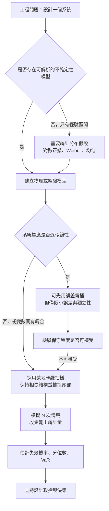

# 第13章　蒙地卡羅法在工程中的應用

[上一章：第12章　蒙地卡羅法可行性分析](12.0-蒙地卡羅法可行性分析.md) | [下一章：第13.1節　系統可靠性分析](13.1-系統可靠性分析.md)

前十幾章建立了蒙地卡羅法的數學地基：抽樣、估計、誤差、變換抽樣、並行加速。但在教科書的脈絡中，讀者最常問的一個問題是：**這套工具到底能替我解決什麼真實的問題？** 本章與第14、15章共同回答這個問題，分別處理工程、機器學習與跨學科三個方向。

本章是第一個「落地」的章節：它不引入新的數學工具，而是說明同一套抽樣—模擬—統計的骨架，如何在工程產業中形成可重複、可審計的標準流程。

## 學習目標

完成本章後，你應該能夠：

1. 說明工程領域採用蒙地卡羅法的三個根本理由：對不確定性本身的建模、面對非線性耦合系統、以及作為破壞性實驗的數位替代。
2. 辨認「一個參數估計問題」何時其實是「一個需要抽樣分佈的期望估計問題」。
3. 描述業界蒙地卡羅分析的標準工作流程：定義不確定性來源 → 建立模型 → 抽樣 → 模擬 → 統計 → 決策。
4. 說明平方根收斂在工程情境中的實際含意（需要多少樣本才能得到可靠的分位數）。
5. 指出工程蒙地卡羅與學術蒙地卡羅在「可審計性、隨機性控制、情境凍結」上的差異。
6. 為第13.1節（可靠度分析）與第13.2節（風險評估）預先建立框架。

## 13.1 為什麼工程界需要蒙地卡羅

工程決策的特徵是：**輸入不確定、模型非線性、後果不可逆**。三者同時出現時，傳統的確定性分析（單一「最可能值」代入模型、保守上界、或純粹的線性誤差傳播）都會失效，而蒙地卡羅恰好對準這三個痛點。

### 13.1.1 理由一：不確定性建模本身就是任務

工程文獻中常見的「±20%」標示，往往意味著一個形狀不明、但大致有界的分佈。如果工程師只知道上下界，做出的結論往往是「過度保守」：把所有不確定性當成同時發生的最壞情況，得到的設計會貴得離譜，卻在真實世界中毫無競爭力。

蒙地卡羅的價值在於把「±20%」升級成**明確的機率模型**：如果某零件壽命是對數正態分佈（lognormal），參數是 $`\lambda`$ 與 $`\sigma`$ ，那麼「壽命超過 1000 小時的機率」是一個有明確意義的量，而不是「保守上界等於…」的含糊說法。

$$
P(T > t) = 1 - \Phi\!\left(\frac{\ln t - \mu}{\sigma}\right)
$$


這個轉換把工程問題從「給一個數」變成「給一個機率分布」，從此可以做信賴敘述、做風險分級、做不同設計方案的機率比較。**這是蒙地卡羅在工程界最根本、也最容易被低估的價值。**

### 13.1.2 理由二：非線性與耦合無法用誤差傳播處理

第一階（線性）誤差傳播假設輸出對輸入的偏導數在作業點附近近似常數：

$$
\Delta y \approx \sum_{i} \frac{\partial y}{\partial x_i}\,\Delta x_i
$$


這個近似在兩個條件下成立：相對誤差小、系統近似線性。但工程系統常常兩者都不成立：電網潮流是二次以上的非線性方程、生命週期成本對通膨與折現率呈非對稱的凹函數、材料疲勞壽命與應力是對數－冪次關係。

更麻煩的是**耦合**：多個元件共享環境因子（溫度、濕度、負載），其失效並非獨立。此時把各元件誤差「加權相加」會嚴重低估尾部風險。蒙地卡羅模擬可以讓所有不確定變數**一起抽樣並保持其相依結構**，這是誤差傳播在原理上做不到的。

### 13.1.3 理由三：破壞性實驗的數位替代

航空業的「結構裕度分析」、核電的「PRA（probabilistic risk assessment）」、土木的「可靠度分析」有一個共同點：**真實試驗昂貴、耗時、且往往會摧毀被試品**。你無法對 1000 架飛機做機翼疲勞試驗，也無法在實驗室重現百萬分之一機率的連鎖失效。

蒙地卡羅提供的是「數位的試驗場」：在電腦中跑 10⁶ 次破壞性實驗，得到失敗機率的分佈，而不是做 10 次真實試驗然後外推。這不是「勉強可用的近似」，在很多領域（如核能、航太）它已是監管機關認可的標準方法論。



上圖說明本章的論點：蒙地卡羅不是「工程分析的最後手段」，而是在**不確定性、非線性、破壞性**三者交會時的**結構性正確做法**。中間那個「誤差傳播」分支之所以常被放棄，不是因為它錯，而是因為它附加的線性與獨立性假設在真實系統中普遍不成立；而這兩個假設一旦失效，蒙地卡羅的抽樣機制就成為唯一能同時滿足它們的方法。

## 13.2 業界的標準工作流程

不同產業的名稱不同（可靠度分析、風險評估，蒙地卡羅分析，不確定性量化），但流程驚人地一致：

1. **界定系統邊界與決策問題**：要回答的問題是什麼？「這個設計在 20 年內失效的機率是否低於 $`10^{-3}`$ ？」
2. **盤點不確定性來源並分類**：
   - *隨機性*（Aleatoric）：負載、材料批次差異、隨機失效——無法消除，但可量化。
   - *認知不確定性*（epistemic）：模型形式不確定、參數估計誤差——可以靠更多資料降低。
   這個區分在工程實務中極為重要，因為兩者的處置策略不同：前者要用保險／備援吸收，後者要用研究／實驗消除。
3. **指派分佈與相依性**：對每個變數指定機率分佈（常見：對數正態用於壽命與容量、Weibull 用於疲勞與電子元件失效、均勻用於不確定的製造公差、三角分佈用於專家意見），並用 Copula 或共同隨機因子表達相依。
4. **建立響應模型**：可能是解析式、ODE/ODE 求解器、有限元素（FEM）代理模型、或離散事件模擬。**這裡是工程蒙地卡羅最昂貴的一步**，也正是第11章、第6章的變換抽樣與硬體加速發揮作用的地方。
5. **抽樣與模擬**：抽 $`N`$ 組輸入，逐一計算響應。 $`N`$ 的選擇應以輸出量的抽樣誤差為準，而不是任意設定。
6. **統計分析**：估計機率、分位數、風險指標、敏感度排序。
7. **決策與文件化**：把結果轉成設計取捨，並留下可審計的紀錄。

### 13.2.1 情境凍結（Scenario Freeze）

業界有個不成文的規矩叫「情境凍結」：在正式評估開始前，把隨機數種子、輸入分佈、相依性假設、程式碼版本全部固定並簽署。此後任何改動都必須重新跑完整評估。

原因是蒙地卡羅結果帶有隨機誤差，難怪工程師會想「偷偷調一下分佈讓結果好看一點」——這在實務上稱為 *p-hacking* 的工程版。凍結制度把「重現性」與「可審計性」變成流程要求，而非個人品德。

### 13.2.2 隨機性控制與common random numbers

比較兩個設計方案時，若兩者各自獨立抽樣，兩者差異的估計會被各自的抽樣誤差淹沒，蒙地卡羅反而無法分辨方案好壞。業界標準解法是**共同隨機數**（common random numbers, CRN）：對每個樣本編號 $`i`$ ，讓方案 A 與方案 B 都使用**同一組**輸入抽樣值，只是以不同的響應模型處理。

若輸出為 $`Y_A(X)`$ 與 $`Y_B(X)`$ ，估計差值 $`\Delta = \mathbb{E}[Y_A(X)] - \mathbb{E}[Y_B(X)]`$ 時，使用 CRN 後估計量的方差為

$$
\mathrm{Var}(\hat{\Delta}_{\text{CRN}}) = \mathrm{Var}\!\big(Y_A(X) - Y_B(X)\big)
$$


而獨立抽樣時則是兩者方差之和。當兩方案高度相關（例如只差一個零件尺寸）時，CRN 能把差值估計的方差降低數個數量級，讓「方案 B 比方案 A 好 2%」這種結論變得可辨識。這正是第11章「控制變數法」的實務版本。

## 13.3 一個完整的最小範例

下面示範一個典型工程情境：小型發電設備的可用性評估。設備有 3 個關鍵元件，各自壽命為對數正態分佈，另有共用的環境因子（高溫會同時加速所有元件老化）。

```python
import numpy as np

rng = np.random.default_rng(2026)

def mc_availability(n_samples=200_000, seed=None):
    """估計三元件並聯系統的可用度與首個失效時間。
    對應理論：抽樣 N 組不確定輸入 → 逐次模擬 → 統計輸出分佈。"""
    r = rng if seed is None else np.random.default_rng(seed)
    # 共用環境因子：溫度應力加速老化（log-normal 乘法模型）
    env = r.lognormal(mean=0.0, sigma=0.25, size=n_samples)

    # 三個元件各自的壽命（對數正態），乘上環境因子
    lives = []
    for mu, sigma in [(9.2, 0.30), (9.6, 0.25), (9.0, 0.35)]:
        lives.append(r.lognormal(mean=mu, sigma=sigma, size=n_samples) * env)

    # 並聯系統：元件失效後系統仍可運作，直到最後一個元件失效
    t_system = np.min(np.array(lives), axis=0)

    # 假設維修時間為指數分佈（均值 8 小時），系統可用度 = MTBF/(MTBF+MTTR)
    mttf = t_system.mean()
    mttr = 8.0
    availability = mttf / (mttf + mttr)

    return {
        "MTBF_hours": mttf,
        "availability": availability,
        "P(首個失效 < 2000 小時)": float((t_system < 2000).mean()),
        "P(首個失效 < 5000 小時)": float((t_system < 5000).mean()),
        "95% 分位壽命": float(np.quantile(t_system, 0.95)),
    }

res = mc_availability()
for k, v in res.items():
    print(f"{k}: {v:,.3f}")
```

輸出的量級說明幾件事：

- **可用度與 MTBF 是不同層次的量**。可用度同時含入修復時間，即使元件本身很可靠，若修不好（備件缺貨、需現場吊裝），可用度仍然低。這正是第13.1節「Bethal 可用性」要處理的問題。
- **機率指標比「平均壽命」更貼近決策**。決策者真正想知道的是「有多少機率撐不過驗證期」，而不是平均值。
- **抽樣誤差的量級**：以 $`N = 2\times10^5`$ 抽樣估計一個機率 $`p`$ ，相對標準誤約為 $`1/\sqrt{Np}`$ ；若 $`p \approx 0.02`$ ，則約 1.6%。這就是為什麼工程報告必須附帶信賴區間。

## 13.4 與後續章節的關係

- 第13.1節把本章的框架具體化到**可靠度（reliability）**：元件失效機率、串並聯架構、共因失效、故障樹，並會引入稀有事件抽樣的必要性。
- 第13.2節延伸到**風險與決策**：VaR/CVaR、工程經濟評估、多目標分析、敏感度分析與監管可審計性。
- 第14章則證明蒙地卡羅並未侷限於工程：機器學習的貝葉斯推論與生成模型本質上就是同一套抽樣機制。
- 第15章把三個領域的共通結構抽象成一張「案例地圖」，說明為什麼同一套方法能在生物學、化學與大數據領域重複出現。

## 本章要點

- 工程界使用蒙地卡羅的三個根本理由：不確定性本身就是需要建模的對象；非線性與變數間耦合使線性誤差傳播失效；破壞性實驗需要數位替代。
- 蒙地卡羅把「±區間」升級為「機率模型」，讓設計比較、風險分級與信賴敘述成為可能。
- 業界標準流程為：界定問題 → 區分隨機性與認知不確定性 → 指派分佈與相依性 → 建立響應模型 → 抽樣模擬 → 統計 → 決策。
- 情境凍結與共同隨機數是把蒙地卡羅帶入可審計工業流程的兩個關鍵制度。
- 蒙地卡羅的隨機誤差必須隨報告一起交付，否則決策者會把噪聲誤讀為訊號。
- 本章的框架將在 13.1（可靠度）與 13.2（風險決策）兩節中分別落地。

## 延伸閱讀

- Phoon, K. K. & Beck, J. L. (2011). *Reliability and Uncertainty in Geotechnical Engineering*. McGraw-Hill.——不確定性量化在土木工程中的系統性論述。
- UQ World / NASA-HDBK-7009 *Reliability Analysis and Probability*.——可查證的公開標準，可作為可靠度章節的制度性背景。
- Saltelli, A. et al. (2020). *Global Sensitivity Analysis: The Primer*. Wiley.——敏感度分析（tornado 圖與 Sobol 指數）的權威入門。
- Epstein, J. M. & Epstein, R. L. (1987). *Monte Carlo Methods in Reliability Theory*. CRC Press.——可靠度與蒙地卡羅的經典專著。
- [第13.1節：系統可靠性分析](13.1-系統可靠性分析.md)、[第13.2節：風險評估與決策支持](13.2-風險評估與決策支持.md)、[第11章：蒙地卡羅方法的誤差分析與改進](11.0-蒙地卡羅方法的誤差分析與改進.md)
