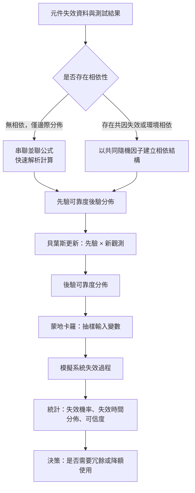

## 13.1 系統可靠性分析

[上一章：第13章　蒙地卡羅法在工程中的應用](13.0-蒙地卡羅法在工程中的應用.md) | [下一章：第13.2節　風險評估與決策支持](13.2-風險評估與決策支持.md)

可靠度工程（reliability engineering）回答一個問題：**系統還能撐多久？** 這個問題表面簡單，卻是蒙地卡羅在工業界最成功的應用領域之一。原因很直觀：可靠度天然是一個機率問題，而系統架構、失效機制、失效之間的相依性又使解析解迅速失效。本節從最基礎的可靠度定義出發，一路走到故障樹分析與稀有事件抽樣——正是那裡會迫使我們離開「樸素的蒙地卡羅」，轉向第5章的變換抽樣。

## 學習目標

完成本節後，你應該能夠：

1. 定義可靠度（reliability）、可用度（availability）與失敗率的差別，並說明為什麼三者不可互換。
2. 推導串聯、並聯與備援架構的可靠度，並指出其背後的「獨立失效」假設。
3. 說明共因失效（common cause failure）如何使元件級可靠度估計樂觀偏差，並給出建模方式。
4. 使用貝葉斯定理，把先驗可靠度資訊與新觀測的失效／存活資料整合，更新可靠度估計。
5. 描述蒙地卡羅可靠度分析的四個步驟：抽樣輸入變數 → 模擬失效 → 統計輸出。
6. 解釋故障樹分析（fault tree analysis, FTA）的稀有事件問題，並算出估計 $`10^{-9}`$ 級機率所需的模擬次數。
7. 說明重要性抽樣（importance sampling）如何解決稀有事件問題，以及它引入的新風險。
8. 描述加速壽命測試（accelerated life testing）如何把實驗時間壓縮，並說明其背後的物理假設與外推風險。

## 13.1.1 三個概念的分界

**可靠度**是時間觀點的量：

$$
R(t) = P(T > t)
$$


其中 $`T`$ 是隨機失效時間， $`R(t)`$ 是系統在時刻 $`t`$ 仍能正常運作的機率。若失效機率 $`\lambda(t)`$ 為常數（指數分佈），則 $`R(t) = e^{-\lambda t}`$ ，此時 $`\lambda`$ 稱為**恆定失效率**。

**可用度**是狀態觀點的量：系統在任一隨機時刻處於可運作狀態的機率

$$
A(t) = P(\text{系統於 } t \text{ 可用}) = \frac{U(t)}{U(t) + D(t)}
$$


其中 $`U(t)`$ 為累積可用時間、 $`D(t)`$ 為累積停機時間。

**Bethal 可用性**是極限情形：若可修復系統的失效率 $`\lambda`$ 與修復率 $`\mu`$ 皆為常數且 $`\mu > \lambda`$ ，則長期可用度趨近於

$$
A_{\infty} = \frac{\mu}{\lambda + \mu} = \frac{\mathrm{MTTF}}{\mathrm{MTTF} + \mathrm{MTTR}}
$$


這個式子立刻說明了一個工程界常見的誤解：**元件再可靠，系統也未必好用**。若 $`\lambda = 10^{-3}/\text{小時}`$ （MTTF = 1000 小時）而 MTTR = 100 小時，可用度仍只有 0.91。因此「提升可靠度」與「提升可維護性」是兩條不同的工程路線，蒙地卡羅分析可以同時評估兩者的邊際效益。

## 13.1.2 架構與可靠度整合

最簡單的架構推導如下：

- **串聯（series）**：所有元件都必須正常。獨立假設下

$$
R_{\text{series}} = \prod_{i=1}^{n} R_i(t)
$$


- **並聯（parallel）**：只要有一個正常即可。獨立假設下

$$
R_{\text{parallel}} = 1 - \prod_{i=1}^{n} \left(1 - R_i(t)\right)
$$


- **k-out-of-n 備援**：允許 $`n-k`$ 個失效

$$
R_{k\text{-}of\text{-}n} = \sum_{j=k}^{n} \binom{n}{j} R^{j} (1-R)^{n-j}
$$


這三個公式都建立在一個關鍵假設上：**元件失效彼此獨立**。實務上這個假設經常不成立，而且失效的方向是系統性的——失誤方向總是「讓結果變差」。例如多個電子元件共享同一電源、同樣的環境應力、同一批次的製程缺陷；這類現象稱為**共因失效**（common cause failure, CCF），會讓實際可靠度**遠低於**獨立公式的預測。Beta 因子的常見做法是把並聯系統的失效機率寫成

$$
\lambda_{\text{sys}} = \beta \lambda_{\text{ind}} + (1-\beta)\lambda_{\text{ccf}}
$$


其中 $`\beta`$ 為共因比例，是經驗估計的參數，本身也帶不確定性——這正是需要蒙地卡羅的理由之一。



上圖呈現本節的主軸：可靠度分析從「架構公式」出發，但一旦遇見相依性就必須進入抽樣世界；而抽樣得到的參數分佈又需要貝葉斯更新來吸收新資料，形成「先驗 → 抽樣 → 觀測 → 更新」的閉環。圖中最後的「決策」節點提醒我們：可靠度分析的產出不是一個數字，而是一個可以回答「要多冗餘才夠」的量。

## 13.1.3 可靠度整合：貝葉斯更新

工程實務中，新的測試資料會一點點累積：先驗是廠商測試報告或同類產品的歷史資料，觀測是新樣品的存活／失效紀錄。

以指數分佈的失效率 $`\lambda`$ 為例，先驗取伽瑪分佈 $`\lambda \sim \mathrm{Gamma}(\alpha_0, \beta_0)`$ （形狀、比率參數化），觀測到 $`m`$ 個失效、 $`n`$ 個存活（總測試時間 $`T_{\text{tot}}`$ ），後驗仍為伽瑪分佈：

$$
\lambda \mid D \sim \mathrm{Gamma}\left(\alpha_0 + m,\; \beta_0 + T_{\text{tot}}\right)
$$


這個「共軛性」（conjugacy）是貝葉斯可靠度整合的便利之處：更新只改兩個數字，不必重新做數值積分。

由於 $`R(t) = e^{-\lambda t}`$ 對 $`\lambda`$ 單調遞減，後驗可靠度可由後驗 $`\lambda`$ 的分佈直接推得，並以蒙地卡羅抽樣計算其分位數：

```python
import numpy as np

rng = np.random.default_rng(7)

def bayes_exponential_reliability(alpha0, beta0, failures, total_time, t, n_samples=200_000):
    """指數分佈失效率的貝葉斯更新與可靠度抽樣。
    對應理論：共軛先驗 Gamma(alpha0,beta0) → 後驗 Gamma(alpha0+m, beta0+T)。"""
    # 1. 後驗失效率抽樣（Gamma 的形狀-尺度參數化：尺度 = 1/beta）
    lam_post = rng.gamma(shape=alpha0 + failures, scale=1.0 / (beta0 + total_time),
                         size=n_samples)
    # 2. 由失效率傳遞到可靠度（單調變換）
    r_post = np.exp(-lam_post * t)
    # 3. 統計：平均可靠度與貝葉斯可信區間
    lo, hi = np.quantile(r_post, [0.025, 0.975])
    return {
        "後驗平均可靠度": r_post.mean(),
        "95% 可信區間下限": lo,
        "95% 可信區間上限": hi,
        "P(可靠度 < 0.99)": float((r_post < 0.99).mean()),
    }

res = bayes_exponential_reliability(alpha0=2.0, beta0=1000.0, failures=3,
                                    total_time=15000.0, t=5000.0)
for k, v in res.items():
    print(f"{k}: {v:.5f}")
```

這段程式碼體現了可靠度整合的關鍵：後驗不確定性會**透過非線性變換 $`e^{-\lambda t}`$ 傳導**到可靠度本身，因此直接抽 $`\lambda`$ 再變換，遠比對可靠度做線性近似更正確。輸出中的可信區間就是決策者真正需要的東西。

> 補充：在貝葉斯可靠度整合中，**先驗的選擇會實質影響結論**。當測試資料稀少（ $`m`$ 小）時，後驗幾乎由先驗主導，因此產業界常規定：在資料充分前，決策必須同時報告「不同先驗下的結果」或明確揭露先驗假設。這也是第13.2節監管與可審計性討論的伏筆。

## 13.1.4 蒙地卡羅可靠度分析

當系統行為無法用封閉公式描述（多元件、有維修策略、有負載相依、有共因失效）時，就要用模擬。標準流程是：

1. **抽樣輸入變數**：對每個元件抽失效時間或壽命，使用對數正態／Weibull 分佈，並以共因因子表達相依。
2. **模擬失效**：依序（依時間排序）處理失效事件，或直接取「系統失效時間 = 最小失效時間」（簡單並聯系統）。
3. **統計輸出**：估計失效機率、失效時間的百分位數、平均無故障時間（MTBF）、可靠度曲線。

```python
import numpy as np

def mc_series_system(n=100_000, t_mission=3000.0):
    """串聯系統可靠度的蒙地卡羅估計（含共因失效機制）。
    對應理論：R_series = prod R_i（獨立）與 CCF 造成的偏差修正。"""
    r = np.random.default_rng(11)
    # 三個元件的對數正態壽命
    mu = np.array([8.6, 8.9, 8.4])
    sigma = np.array([0.30, 0.25, 0.35])
    lives = r.lognormal(mean=mu, sigma=sigma, size=(n, 3))
    # 系統失效時間 = 最早失效的元件（串聯）
    t_fail = lives.min(axis=1)
    # 獨立模型下的可靠度（解析對照）
    R_indep = float(np.mean(np.all(lives > t_mission, axis=1)))
    # 蒙特卡羅估計的可靠度（與上面同一抽樣）
    R_mc = float((t_fail > t_mission).mean())
    # 95% 置信區間（CLT）
    se = np.sqrt(R_mc * (1 - R_mc) / n)
    return R_mc, (R_mc - 1.96 * se, R_mc + 1.96 * se), R_indep
```

實務注意事項：

- **抽樣誤差要隨機性檢查**：蒙地卡羅估計可靠度 $`p`$ 時，相對標準誤為 $`1/\sqrt{Np}`$ 。若目標是估計 $`p = 0.999`$ 的系統，還需要確認「失效」的樣本數足夠多，否則連失效率本身都估不準（這就是下一節的稀有事件問題）。
- **種子固定與平行化**：可重現性與第6章的並行抽樣相容——把樣本區塊以不同種子分配到不同行程，合併後仍可重現。
- **模型驗證**：蒙地卡羅結果的正確性取決於輸入分佈的正確性。應對失效資料做繪圖檢定（Weibull plot 等），而非只信賴供應商的報告。

## 13.1.5 故障樹分析與稀有事件問題

**故障樹分析**（fault tree analysis, FTA）從頂端事件（如「反應爐停機」）向下分解成基本事件（「泵失效」、「感測器誤動」）的樹狀結構，用布林代數計算頂端事件機率。優點是能清楚表達邏輯、方便敏感度分析；缺點是**結構固定、參數須確定**，且隨系統複雜度迅速膨脹（組合爆炸）。

更關鍵的是**稀有事件問題**。若目標事件的機率是 $`10^{-9}`$ ，用樸素的蒙地卡羅估計，需要大約

$$
N \approx \frac{10}{p} = 10^{10}
$$


次模擬才能預期觀察到 10 個事件以估計機率（若只要 1 個事件則需 $`10^9`$ 次）。每次模擬若是有限元素求解，成本立刻不可行。

**解決之道：重要性抽樣**。我們不用原分佈抽樣，而是改用一個「更容易碰到失效」的替代分佈 $`q`$ ，並以權重修正：

$$
p = \mathbb{E}_{X \sim q}\!\left[\frac{\pi(X)}{q(X)}\,\mathbb{1}_{\{X \in A\}}\right]
$$


其中 $`A`$ 是失效事件集合， $`\pi`$ 是原始輸入聯合分佈。若 $`q`$ 把大量樣本集中在失效區域，估計量的方差會大幅下降——抽 $`10^4`$ 次或許就夠用 $`10^9`$ 次原本的量。

但這引入了新的風險：**權重估計量的方差可能比原估計量更大**（若 $`q`$ 選得不好），而且估計結果不再是無偏的簡單平均。因此實務上必須：報告加權樣本的有效樣本數（effective sample size, ESS）、以多個不同 $`q`$ 交叉驗證、以及在報告中說明所用的抽樣分佈與其驗證過程。

```python
import numpy as np
from scipy.stats import norm

def importance_sampling_rare_event(samples=200_000, seed=3):
    """估計 P(X > 6)，其中 X ~ N(0,1)：真值約 9.87e-10（稀有事件）。
    對應理論：p = E_q[ pi(X)/q(X) * 1_A ]，用替代分佈 q 取代原始分佈 pi。"""
    r = np.random.default_rng(seed)
    pi = norm(0.0, 1.0)      # 原始分佈（難以命中尾端）
    q = norm(4.0, 1.0)       # 替代分佈（把樣本推向尾端）

    x = q.rvs(size=samples, random_state=r)          # 從 q 抽樣
    log_w = pi.logpdf(x) - q.logpdf(x)               # 對數權重 pi/q，避免數值下溢
    w = np.exp(log_w)
    indicator = (x > 6.0).astype(float)               # 事件指示函數 1_A
    p_hat = float(np.mean(w * indicator))            # 重要性抽樣估計

    # 有效樣本數：ESS = (sum w)^2 / sum(w^2)，衡量加權樣本的資訊量
    ess = float(w.sum() ** 2 / np.sum(w ** 2))

    # 對照：樸素的蒙地卡羅（從 pi 抽樣）在同等樣本數下幾乎無法命中事件
    x_naive = pi.rvs(size=samples, random_state=r)
    hits = int((x_naive > 6.0).sum())
    return {"p_hat": p_hat, "真值": float(pi.sf(6.0)), "ESS": ess,
            "樸素MC命中次數": hits}
```

輸出中的 `p_hat` 會非常接近真值 $`9.87\times10^{-10}`$ ，而 ESS 顯示雖然抽了 20 萬次，其中真正有資訊的加權樣本只佔一部分——這正是重要性抽樣需要誠實揭露的代價。完整的稀有事件抽樣（如 subset simulation）會在第15.3節詳細討論。

> 實務提醒：多變數情形下權重必須是聯合密度之比 $`\pi(\mathbf{x})/q(\mathbf{x})`$ ，且需檢查 $`q`$ 是否在 $`\pi`$ 的支撐集內有正密度（否則權重無定義）；另外應以多組不同的 $`q`$ 交叉驗證，避免單一替代分佈造成的偏差。

## 13.1.6 加速壽命測試

實驗室裡測試元件壽命常常不可行：軸承在正常工況下可撐 100,000 小時，測試一組就要數年。**加速壽命測試**（accelerated life testing, ALT）在更高溫度、更高電壓或更高應力下測試，再用物理模型外推回正常工況。

最常用的是 Arrhenius 關係：失效速率隨絕對溫度變化

$$
\lambda(T) = \lambda(T_0) \exp\!\left[\frac{E_a}{k}\left(\frac{1}{T_0} - \frac{1}{T}\right)\right]
$$


其中 $`E_a`$ 為活化能、 $`k`$ 為波茲曼常數。已知高溫下的失效資料即可推得 $`E_a`$ ，再外推到常溫壽命。

這裡有一個深遠的方法論教訓：ALT 把「蒙地卡羅的抽樣」與「物理的外推」結合起來——蒙地卡羅處理的是統計不確定性（壽命資料的抽樣誤差），而 Arrhenius 外推處理的是**模型不確定性**（外推距離越遠，外推誤差越大）。這兩者必須分開報告：前者用信賴區間描述，後者用情境分析描述。把兩者混成一個數字，是可靠度報告最常見的缺陷。

## 13.1.7 常見陷阱

1. **把 MTBF 當成壽命保證**。MTBF 是平均值；對指數分佈而言，「平均 10,000 小時」的系統，壽命低於 1,000 小時的機率約 9.5%。決策應基於分位數。
2. **忽略共因失效**。並聯冗餘的實際可靠度增益常遠低於獨立公式的預測。
3. **資料不足卻給出過度精確的機率**。 $`\hat{p}`$ 的抽樣誤差與樣本數有關，且失效觀察數少時機率估計的相對誤差極大。
4. **把先驗當成經驗事實**。貝葉斯更新後的後驗仍受先驗影響，報告必須揭露。

## 本章要點

- 可靠度 $`R(t)=P(T>t)`$ 、可用度與失效率是三個不同層次的量；Bethal 可用度 $`A_\infty = \mathrm{MTTF}/(\mathrm{MTTF}+\mathrm{MTTR})`$ 顯示「可靠」不等於「好用」。
- 串聯／並聯／備援的解析公式都依賴失效獨立假設；共因失效會系統性造成偏差。
- 貝葉斯共軛更新把新測試資料與先驗整合，並以抽樣把失效率後驗傳導到可靠度後驗。
- 蒙地卡羅可靠度分析的骨架是：抽樣輸入變數 → 模擬失效 → 統計失效機率與分位數，必須附帶抽樣誤差。
- 故障樹分析在稀有事件（ $`10^{-9}`$ 級）面前遭遇抽樣數壁壘，需要重要性抽樣或子集模擬（第15.3節）來突破。
- 加速壽命測試把統計不確定性（蒙地卡羅）與模型不確定性（Arrhenius 外推）混在同一個流程中，兩者必須分開交代。

## 延伸閱讀

- Bl reliability handbook / DNV-RP-FMEA《Failure Modes and Effects Analysis (FMEA) Handbook》，提供 FMEA 與 FTA 的工程實務規範。
- Lewis, E. E. (1996). *An Introduction to Reliability and Applied Probability*. Wiley.——可靠度理論與共因失效的標準教材。
- Ayyub, B. M. & McCuen, R. H. (eds.) (2006). *Reliability of Structures and Systems*. ASCE Press.——結構可靠度與可靠度分析（reliability-based design）。
- Epstein, J. M. & Epstein, R. L. (1987). *Monte Carlo Methods in Reliability Theory*. CRC Press.
- Au, S.-K. & Beck, J. L. (2001). *Subset Simulation for Reliability in Engineering*. Springer.——稀有事件可靠度估計的關鍵文獻。
- [第13.0節：蒙地卡羅法在工程中的應用](13.0-蒙地卡羅法在工程中的應用.md)、[第13.2節：風險評估與決策支持](13.2-風險評估與決策支持.md)、[第15.3節：大數據與蒙地卡羅方法](15.3-大數據與蒙地卡羅方法.md)
