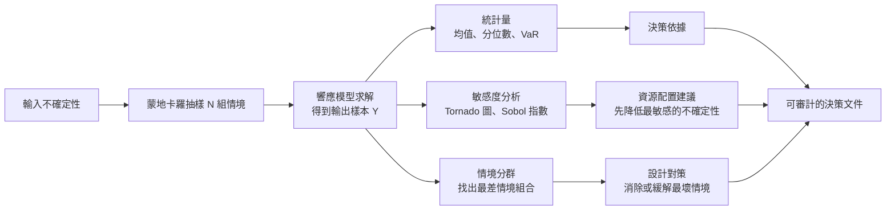

## 13.2 風險評估與決策支持

[上一章：第13.1節　系統可靠性分析](13.1-系統可靠性分析.md) | [下一章：第14章　蒙地卡羅方法在機器學習中的應用](14.0-蒙地卡羅方法在機器學習中的應用.md)

第13.1節回答「系統會不會壞」。本節把問題推前一層：**壞了之後會怎樣，而我們應該選擇哪一個方案？** 這就是風險評估與決策支持（decision support）的範圍。相較可靠度，本節多了三樣東西：不確定的**代價**（loss）、不同方案的**比較**、以及把分析結果轉成行動的**決策規則**。

本章的核心主張是：蒙地卡羅在這裡的價值不只是「給出期望值」，而是**給出結果的分佈**——因為決策者真正怕的是尾部，而不是平均值。

## 學習目標

完成本節後，你應該能夠：

1. 說明「風險」在工程決策中的定義（機率 × 影響），以及為什麼單一期望值不足以支撐決策。
2. 定義 VaR 與 CVaR（預期損失／Expected Shortfall），並解釋 CVaR 相對 VaR 的資訊優勢與代價。
3. 描述工程經濟評估（EVM）中的蒙地卡羅用法，以及為什麼淨現值的不確定性必須傳導到決策規則。
4. 說明多目標不確定性分析的問題：多個互相衝突的目標如何同時呈現。
5. 描述成本效益分析（CBA）的蒙地卡羅實例結構。
6. 使用敏感度分析（含 tornado 圖）辨認主導不確定性來源，並說明它與變換抽樣的關係。
7. 把決策樹與蒙地卡羅結合，解釋「期望效用」與「風險偏好」如何進入計算。
8. 指出監管要求（如製程安全、壩體安全、核電 PRA）為何要求可審計性，以及實務上如何達成。

## 13.2.1 從機率到風險

「失效機率是 $`10^{-3}`$ 」只是風險敘述的一半。完整的風險需要**後果**：

$$
\text{Risk} = P(\text{failure}) \times \text{Consequence}
$$


在工程經濟的量化框架中，後果被寫成**損失函數** $`L(x)`$ ，其中 $`x`$ 是情境參數（成本、壽命、後果嚴重度）。於是風險的量化成為一個期望估計問題，正是蒙地卡羅擅長的事：

$$
\mathbb{E}[L] = \mathbb{E}_{X \sim p}[L(X)]
$$


但這一步只給出「平均損失」。決策問題的困難在於：**人們對損失的感知是非線性的**。損失 100 萬元的痛苦不是損失 50 萬元的兩倍。於是出現了風險指標的階梯。

## 13.2.2 VaR 與 CVaR

**風險價值（Value at Risk, VaR）**：在信心水準 $`\alpha`$ （例如 95%）下的損失分位數

$$
\mathrm{VaR}_\alpha = \inf \{ l : P(L \le l) \ge \alpha \}
$$


直覺是：「有 95% 的機率，損失不超過這個金額」。它的優點是單一數字、易於溝通；缺點是**完全忽略尾部形狀**——99.9% 分位的損失可能是 100 萬，也可能是 1 億，兩者的 VaR 看起來一樣。

**預期損失（Expected Shortfall, CVaR，亦稱 Expected Shortfall）**：在尾部區間上的條件期望

$$
\mathrm{CVaR}_\alpha = \mathbb{E}\!\left[L \,\middle|\, L > \mathrm{VaR}_\alpha\right]
$$


CVaR 直接給出「在最壞的 5% 情境中，平均損失是多少」，因此對尾部形狀敏感。它是「一致風險度量」（coherent risk measure，Artzner 等人提出）的一員：滿足單調性與分散性不變性，這在風險聚合時很重要——把各子系統的 VaR 直接相加在數學上並不保證保守。

實務上，VaR 與 CVaR 都是**抽樣分位數與分位數平均**，蒙地卡羅提供了直接路徑：

```python
import numpy as np

def risk_metrics(losses, alpha=0.95):
    """由蒙地卡羅損失樣本計算 VaR 與 CVaR。
    對應理論：VaR 是分位數；CVaR 是尾部的條件期望。"""
    losses = np.asarray(losses)
    var = float(np.quantile(losses, alpha))
    tail = losses[losses > var]
    cvar = float(tail.mean()) if tail.size else var
    # 蒙地卡羅抽樣誤差的粗估（分位數的標準誤量級 ≈ 1/sqrt(N f(q))）
    return {"VaR_95": var, "CVaR_95": cvar,
            "平均損失": float(losses.mean()),
            "最壞情境": float(losses.max())}

# 範例：某專案的 10 萬次情境損失
rng = np.random.default_rng(5)
losses = rng.lognormal(mean=11.0, sigma=1.2, size=100_000)
for k, v in risk_metrics(losses).items():
    print(f"{k}: {v:,.0f}")
```

> **抽樣誤差的注意事項**：估計分位數的蒙地卡羅誤差與樣本密度有關。若尾部本身稀薄（少量極端樣本），CVaR 的抽樣誤差會相當大。實務上應對尾部做自助抽樣（bootstrap，見第15.3節）來取得置信區間，而不要只報一個點估計。

## 13.2.3 工程經濟評估（EVM）與決策

工程經濟評估（engineering valuation / economic evaluation）的典型任務是：在數個設計方案中，選出**淨現值（Net Present Value, NPV）**最高者。

$$
\mathrm{NPV} = -C_0 + \sum_{t=1}^{T} \frac{R_t - C_t}{(1+r)^t}
$$


其中 $`C_0`$ 是初始投資、 $`R_t`$ 與 $`C_t`$ 是第 $`t`$ 年的收益與成本、 $`r`$ 是折現率。問題是： $`C_0`$ 、 $`R_t`$ 、 $`C_t`$ 、 $`r`$ 全部不確定，而且**它們彼此相依**（例如通膨同時推高收益與成本、折現率與風險溢酬相關）。

蒙地卡羅在此提供「NPV 的分佈」，進而支持三種更高階的決策規則：

1. **期望 NPV 最大**： $`\arg\max \mathbb{E}[\mathrm{NPV}]`$ 。對風險中性決策者適用。
2. **機率規則**：選擇「NPV < 0 的機率最小」的方案，例如

   $$
   \text{選擇 } \arg\min_j P(\mathrm{NPV}_j < 0)
   $$

3. **風險調整指標**：使用 CVaR 或「下行風險」衡量最壞情境。

這三者會給出不同答案，而**選擇哪一條規則本身就是一個需要明說的治理決策**。這一點在實務上比技術細節更重要，也是監管審查的焦點。

## 13.2.4 多目標不確定性

現代工程設計往往同時要求：可靠度、成本、碳排、重量、維修頻率。多目標問題有兩個難點：**目標間衝突**（降低重量往往增加成本）、**目標間相依**（成本與碳排正相關）。

單一加權分數（weighted sum）雖然簡單，但把不同單位的目標混成一個數字後，權重的選擇會主導結論，透明度低。蒙地卡羅的貢獻是讓**帕累托前沿**（Pareto front）在隨機情境下以機率形式呈現：

$$
P(\text{方案 } A \text{ 在成本上優於 } B) = \frac{1}{N}\sum_{i=1}^{N}\mathbb{1}\!\left[\mathrm{cost}_A(X_i) < \mathrm{cost}_B(X_i)\right]
$$


這比「A 的平均成本比 B 低 3%」有用得多：它回答「我們有多確定 A 更便宜」。

## 13.2.5 成本效益分析的蒙地卡羅實例

成本效益分析（cost-benefit analysis, CBA）把「方案成本」與「方案效益」都放入蒙地卡羅框架，計算淨效益的機率分佈。典型結構：

```python
import numpy as np

def cba_monte_carlo(n=200_000, seed=42):
    """成本效益分析的蒙地卡羅實例。
    對應理論：不確定性 → 抽樣 → 傳播 → 決策；並用控制變數降低淨現值估計的方差。"""
    r = np.random.default_rng(seed)

    # --- 成本側 ---
    capex = r.lognormal(mean=13.8, sigma=0.25, size=n)      # 初始投資（對數正態）
    opex = r.lognormal(mean=10.2, sigma=0.20, size=n)       # 年營運成本
    discount = r.normal(loc=0.05, sigma=0.015, size=n)      # 折現率（常以常態近似）
    life = np.clip(r.normal(loc=15, sigma=1.5, size=n), 5, 30)  # 專案壽命（年）

    # --- 效益側 ---
    annual_benefit = r.lognormal(mean=12.6, sigma=0.30, size=n)

    # 折現因子：以年金公式近似，壽命隨機
    t = np.arange(1, 31)
    disc = 1.0 / (1.0 + discount)[:, None] ** t[None, :]
    mask = (t[None, :] <= life[:, None])
    pv_benefit = (annual_benefit[:, None] * disc * mask).sum(axis=1)
    pv_cost = capex + (opex[:, None] * disc * mask).sum(axis=1)
    npv = pv_benefit - pv_cost

    # 控制變數：以 capex 作為已知期望的代理線性關聯量，降低估計方差
    # 對應理論：Var(Y - cX) = Var(Y) + c^2 Var(X) - 2c Cov(Y,X)，取 c=Cov/Var 可最小化
    c = np.cov(npv, capex)[0, 1] / np.var(capex)
    npv_cv = npv - c * (capex - capex.mean())

    return {
        "NPV 平均（原始）": float(npv.mean()),
        "NPV 平均（控制變數）": float(npv_cv.mean()),
        "P(NPV < 0)": float((npv < 0).mean()),
        "NPV 的 5% 分位": float(np.quantile(npv, 0.05)),
        "CVaR_95（下行平均）": float(npv[npv < np.quantile(npv, 0.05)].mean()),
    }

res = cba_monte_carlo()
for k, v in res.items():
    print(f"{k}: {v:,.1f}")
```

程式碼中的控制變數法直接對應第11章的方差縮減公式：把與目標變數高度相關、但期望值已知的量（此處是初始投資）從樣本中扣除再平均，可在不增加樣本數的前提下縮小估計方差。對照輸出中「原始」與「控制變數」的標準誤差異，可以看出這個技巧的實際效益。

**這段程式碼也示範一個易犯的錯誤**：把 `life` 直接當作整數年數處理，會在壽命短於 30 年時產生不連續的折現項。實務上應改用年金因子或更細的時間網格；此處保留簡化是為了凸顯抽樣結構。

## 13.2.6 敏感度分析與 tornado 圖

決策者下一步的問題是：**要花錢去降低哪一個不確定性？** 這就是敏感度分析。

最直覺的工具是 **tornado 圖**：對每個輸入變數，固定其他變數在基準值，只讓該變數在其合理區間內變動，計算輸出變動幅度，按幅度由大到小畫成橫條。這本質上是「單因子分析」，在工程中廣泛使用。

但 tornado 圖有已知缺陷：**忽略變數間的相依性**，且**忽略非線性交互作用**。更嚴謹的方法是全域敏感度分析：

- **Sobol 指數**：把輸出方差分解為各變數的主效應 $`S_i`$ 與交互項， $`V = \sum_i S_i V_i + \sum_{i<j} S_{ij} V_{ij}`$ 。計算方法是基於 Saltelli 的抽樣設計，本質上又是蒙地卡羅的一種變體。
- **基於排序的敏感度**：用 Spearman 等級相關或迴歸係數衡量影響，比線性相關更不受非線性影響。



上圖說明敏感度分析的定位：它不取代蒙地卡羅，而是**同一批抽樣的第二種利用方式**。同一份樣本可以同時算出風險指標、敏感度排序與最壞情境，於是「哪個不確定性最值得花錢去消除」這個問題有了量化依據——這正是第13.0節所說「蒙地卡羅把 ± 區間升級為可行動的機率模型」的具體實現。

## 13.2.7 決策樹與蒙地卡羅

決策樹（decision tree）把「先決策、後隨機、再決策」的結構明確畫出來。與蒙地卡羅結合時，**隨機節點的分枝機率不應是點估計，而應是分佈**。這會讓「期望效用」的計算變成對不確定性的積分：

$$
\mathrm{EU} = \sum_{\text{葉節點}} p(\text{路徑}) \cdot u(\text{後果})
$$


其中 $`p(\text{路徑})`$ 由蒙地卡羅抽樣得到， $`u`$ 為效用函數（反映對風險的態度）。 $`u`$ 為線性時結果與用點估計相同；一旦效用為凹（例如 $`\log`$ 或 CARA 型），**風險態度的差異會被放大，這才是決策樹在風險領域的真正價值**。

常見的實務提醒：若決策樹的機率本身是從其他分析（如第13.1節的可靠度分析）傳遞而來，必須處理**相依的機率樹**（共享中間事件），否則會重複計算同一份風險。

## 13.2.8 監管要求與可審計性

在核電、航空、土木壩體、製程安全等領域，風險分析不是自由發揮，而是受監管規範約束。以程序安全與壩體安全為例，審查的焦點通常包括：

1. **可重現性**：固定種子、記錄程式版本與輸入資料版本。
2. **模型充分性**：分佈假設與資料來源必須有文件；模型偏差（model bias）須以情境外加（outer loop）機制納入。
3. **保守性與一致性的取捨**：安全閘門（如「每年失效機率不得超過 $`10^{-4}`$ 」）要求的是明確的門檻判定，蒙地卡羅必須報告其統計不確定性是否足以支持「通過」的結論——這需要**假設檢定**而非只報信賴區間。
4. **第三方可重做**：第三方審查者必須能用相同輸入重現結果，這就是隨機數種子與版本控制的實務意義。
5. **不確定性傳遞鏈**：不同分析工具（可靠度 → 事故後果 → 經濟損失）之間的不確定性必須一致地傳遞，不能在某一層偷偷用平均值。

實務上達成可審計性的具體做法包括：把隨機數生成器與抽樣設計寫成配置檔案、讓所有報告圖表都能由單一條命令重現、保存每次分析的抽樣樣本（可用壓縮的隨機位元串重現）、以及對每次正式評估做「情境凍結」簽署。

## 本章要點

- 風險量化是「機率 × 後果」的組合，後果以損失函數 $`L`$ 表示；單一期望值不足以支撐決策，因為損失的尾部才是決策者真正的關切。
- VaR 給出分位數門檻但忽略尾部形狀；CVaR 給出尾部條件期望，且屬於一致風險度量，適合用於風險聚合。
- 工程經濟評估（NPV）的不確定性需要完整傳播；期望最大化、風險規則（ $`P(\mathrm{NPV}<0)`$ 最小）、風險調整三種規則可能給出不同答案，選擇規則本身是治理決策。
- 多目標問題宜以帕累托前沿的機率形式呈現，而非混加權分數。
- 敏感度分析（tornado、Sobol）與決策樹是同一批蒙地卡羅樣本的再利用，讓「資源該投在哪裡」有量化依據。
- 監管環境要求可審計性：可重現、假設文件化、不確定性一致傳遞、第三方可重做。

## 延伸閱讀

- Artzner, F., Delbaen, F., Eber, J.-M. & Heath, D. (1999). "Coherent Measures of Risk." *Mathematics of Finance*.——一致風險度量的理論基礎（VaR/CVaR 的文獻源頭）。
- McDonald, D. B. (2002). *Engineering Economic Analysis*.——工程經濟與不確定性分析；對 EVM 與 NPV 機率分析的實務處理。
- Saltelli, A. et al. (2020). *Global Sensitivity Analysis: The Primer*. Wiley.——tornado 圖與 Sobol 指數的操作手冊。
- U.S. NRC (2007). *Performance-Based Nuclear Regulatory Commission: RG 1.174* 及 *Standard Review Plan on probabilistic risk assessment*。——監管要求下的 PRA 可審計性實務。
- Clemen, R. E. (1996). *Making Hard Decisions with DecisionTools*. Cengage.——決策樹與不確定性下的決策分析。
- [第13.1節：系統可靠性分析](13.1-系統可靠性分析.md)、[第11.2節：精度提升的技術](11.2-精度提升的技術：低方差抽樣與控制變數法.md)、[第15.3節：大數據與蒙地卡羅方法](15.3-大數據與蒙地卡羅方法.md)
