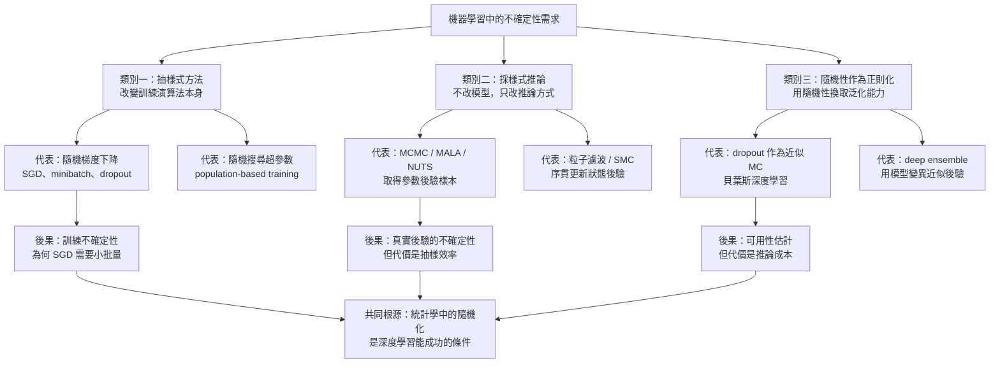

# 第14章　蒙地卡羅方法在機器學習中的應用

[上一章：第13.2節　風險評估與決策支持](13.2-風險評估與決策支持.md) | [下一章：第14.1節　生成模型與蒙地卡羅](14.1-生成模型與蒙地卡羅.md)

前面十三章把蒙地卡羅從一個數值技巧，逐步推成一種工程方法論。到了機器學習，這套方法論卻以另一種面貌回來——而且回來得比預期更徹底。原因是機器學習裡有太多問題的答案是「從某個複雜分佈中抽樣」，而這正是蒙地卡羅（更精確地說，是馬可夫鏈蒙地卡羅，MCMC）的本行。

本章是第14章的導論。它不細講任何演算法，而是先把「蒙地卡羅在機器學習中的用法」分成三個層次，因為這三者的機制、挑戰與成熟度完全不同，混在一起談會造成誤解。

## 學習目標

完成本章後，你應該能夠：

1. 說明為什麼機器學習天然地依賴抽樣：模型的不確定性、參數的後驗分佈、生成模型的目标分佈。
2. 把蒙地卡羅在機器學習中的用法分為三類：抽樣式方法（sampling-based methods）、採樣式推論（sampling-based inference）、以及把隨機性當作正則化（randomness as regularization）。
3. 說明每一類方法的代表演算法、解決的問題，以及它們彼此的因果關係。
4. 理解為什麼第8章的 Metropolis 抽樣（1953）在機器學習時代重新流行。
5. 指出「抽樣式方法」與「採樣式推論」的差異：前者改變模型的**訓練演算法**，後者改變模型的**推論方式**。
6. 建立第14.1至14.3節的閱讀地圖：生成與模型訓練（14.1）、貝葉斯後驗抽樣（14.2）、深度學習中的隨機性（14.3）。

## 14.1 機器學習為什麼需要蒙地卡羅

機器學習的本質是「從資料中學習一個分佈或一個函數」，而它的難點通常不在於最佳化本身，而在於**我們想要的答案是一個分佈而非一個點**。

具體而言，有三類問題會自然地導向抽樣：

**第一類：模型本身的不確定性。** 一個訓練好的網路給出預測 $`f_\theta(x)`$ ，但 $`\theta`$ 本身不唯一——不同的初始化、不同的資料順序、不同的正則化強度會得到不同的 $`\theta`$ 。我們想知道的是 $`p(\theta \mid D)`$ ，即參數的後驗分佈。最大化某個代理目標（ELBO、變分下界）只會讓我們得到後驗的一個近似點，而真正的後驗往往寬闊且不對稱。

**第二類：真正的貝葉斯推論。** 貝葉斯定理給出

$$
p(\theta \mid D) = \frac{p(D \mid \theta)\,p(\theta)}{p(D)}
$$


分母 $`p(D)`$ 在高維參數空間中無法解析計算（需要對整個參數空間積分），所以後驗只能透過抽樣取得。變分推論（variational inference）試圖用一個可微的近似分佈 $`q(\theta)`$ 取代抽樣；MCMC 則是直接抽樣。兩者的取捨——「近似但快」對「精確但慢」——是第14.2節的主題。

**第三類：生成模型的訓練。** 一個生成模型的目標函數往往寫成對數likelihood 的期望或 ELBO：

$$
\mathcal{L} = \mathbb{E}_{z \sim q(z)}\left[\log \frac{p_\theta(x, z)}{q(z)}\right]
$$


這是一個**期望**，因此必然帶有抽樣誤差。深度生成模型的整個訓練動態——梯度估計器的方差、取樣步數與步長的取捨——都被這個期望的性質決定。

**為什麼是蒙地卡羅而不是別的？** 因為在多數機器學習場景中，被抽樣的分佈既高維、又缺乏解析形式、且我們連其形式都不完全知道。變分近似需要我們猜對近似分佈的族（需要對模型做結構假設），而蒙地卡羅只需要能「評估密度比」或「在目標分佈下抽樣」——這是更弱的假設。



上圖是本章的骨架。三個類別看似不同，但它們共享同一個技術源頭：**把「抽樣」當作處理不確定性的通用工具**。更重要的是，圖中右下角的箭頭揭示了一個反直覺的事實：深度學習的**成功本身就依賴隨機性**——隨機初始化與小批量梯度下降並非工程瑕疵，而是把問題置於一個隨機優化的動態中，避免陷入銳利極小值。若沒有第8章那套「用隨機性換取效率」的觀念，就沒有今天的深度學習。

## 14.2 三個類別的技術內容與因果鏈

### 14.2.1 類別一：抽樣式方法（sampling-based methods）

這類方法**改變訓練演算法本身**。最典型的例子是隨機梯度下降（SGD）：

$$
\theta_{t+1} = \theta_t - \eta_t \nabla_\theta \hat{L}_t(\theta_t), \qquad
\hat{L}_t = \frac{1}{|B_t|} \sum_{(x,y) \in B_t} \ell(x, y; \theta)
$$


其中 $`B_t`$ 是隨機抽取的小批量（minibatch）。 $`\hat{L}_t`$ 是真實目標 $`L`$ 的無偏估計，因此 SGD 是對真實梯度 $`\nabla L`$ 的**隨機近似**。

**前因**：全批次梯度下降每一步都要掃過整個資料集，成本不實用。
**後果**：引入梯度的隨機性，使得最佳化過程在參數空間中做隨機漫步，能繞過銳利極小值（sharp minima）並偏好平坦極小值（flat minima），後者與更好的泛化有關。
**新問題**：梯度噪聲的尺度由小批量大小決定，太小則噪聲大、收斂慢；太大則失去好處。學習率與小批量的耦合成為超參數問題。

### 14.2.2 類別二：採樣式推論（sampling-based inference）

這類方法**不動模型，改變我們從模型取出答案的方式**。核心是 MCMC：構造以目標後驗為不變分佈的馬可夫鏈，再從鏈上取樣。

**前因**：深度模型的參數空間是數十億維的，網路能否做貝葉斯推論？答案是後驗不可解析，但可抽樣。
**後果**：可以給出真正的後驗不確定性，可解釋「模型對這張影像的預測有多確定」。但 MCMC 在高維空間有嚴重的混合（mixing）問題：鏈在相關性很高的方向上移動極慢。
**新問題**：現代 HMC 系（NUTS）用梯度資訊與動量來構造高效的跳躍；同時催生了變分推論與抽樣的混合方法（如重要性抽樣的變分近似）。

### 14.2.3 類別三：隨機性作為正則化

這類方法**在推論時注入隨機性，以近似貝葉斯的行為**。最著名的例子是 **MC dropout**：在測試時保留 dropout 的隨機丟棄，重複前向傳播 $`T`$ 次，得到一個預測分佈，用以近似模型參數的後驗。

**前因**：標準 dropout 在測試時會關閉丟棄，等於把隨機性「平均掉」；模型因此只給出一個點預測。
**後果**：MC dropout 讓成本極低（一個模型的多次前向傳播），卻能給出 Aleatoric 與 Epistemic 兩種不確定性，在醫療影像等領域廣受歡迎。
**新問題**：它只是後驗的粗糙近似（假設 dropout 率對應特定先驗）；而且每次推論成本乘上 $`T`$ ，在需要低延遲的場景不實用。

## 14.3 為什麼 1953 年的 Metropolis 在 2020 年代重新流行

第8章介紹過 1953 年 Metropolis 等人提出的抽樣方法，那時它用來解決統計力學中的問題。為什麼七十年後它成為機器學習的核心工具？因為**硬體與演算法條件同時成熟**：

1. **GPU 的出現**讓鏈的每一步（尤其是需要梯度的 HMC）成本大幅下降。
2. **變分推論的興盛**同時也推動了對「精確後驗」的比較基準，促進 MCMC 方法的工程化。
3. **貝葉斯深度學習的需求**：醫療影像、自動駕駛等高風險應用需要校準的不確定性估計，而深度模型的參數後驗無法解析。
4. **軟體生態**：PyMC、Stan、NumPyro 等把 HMC/NUTS 包裝成可用的一行程式碼，讓非專家也能使用貝葉斯方法。

這是一個典型的「技術—需求—時機」三邊匯流的例子：方法本身四十年前就存在，但只有在算力、需求與工具鏈同時到位時才會被廣泛採用。**蒙地卡羅法在機器學習中的復興，本質上是統計方法等待硬體的耐心案例。**

## 14.4 一個示範：抽樣帶來的兩種不確定性

下面用一個最小例子說明本章的分類：同一個模型，隨機性可以用來**加速最佳化**（抽樣式方法），也可以用來**量化不確定性**（採樣式推論）。

```python
import numpy as np

rng = np.random.default_rng(0)

# --- 類別一：抽樣式方法。用 minibatch 估計梯度，噪聲本身帶來正則化 ---
def quadratic(x):
    """目標函數：非對稱的碗形（加入擾動以模擬非凸區域的局部差異）。"""
    return x[0]**2 + 2.5 * x[1]**2 + 0.3 * x[0] * x[1]

def grad_full_batch(x):
    return np.array([2*x[0] + 0.3*x[1], 5.0*x[1] + 0.3*x[0]])

def grad_minibatch(x, batch=1, n=200, noise=0.0):
    """以隨機抽樣的『資料點』估計梯度：這是 SGD 的最小模型。"""
    est = np.zeros(2)
    for _ in range(n):
        g = grad_full_batch(x + rng.normal(scale=noise, size=2))
        est += g
    return est / n

x = np.array([3.0, 3.0])
print("全批次梯度:", grad_full_batch(x))
print("minibatch 估計:", grad_minibatch(x, batch=1, n=200))

# --- 類別三：隨機性作為正則化。用 dropout 遮蔽估計預測的分佈 ---
def dropout_predict(x, w, p_drop=0.3, n_samples=500):
    """以 T 次隨機遮蔽估計 E[f(x)] 與 Var[f(x)]（MC dropout 的最小模型）。"""
    preds = []
    for _ in range(n_samples):
        mask = rng.random(w.size) >= p_drop          # 隨機遮蔽
        w_eff = w * mask / (1 - p_drop)               # 期望校正
        preds.append(float(w_eff @ x))
    preds = np.array(preds)
    return preds.mean(), preds.var()

w = np.array([1.0, -0.5, 0.8])
mean, var = dropout_predict(np.array([1.0, 1.0, 1.0]), w)
print(f"MC dropout 預測均值={mean:.3f}, 方差={var:.4f}")
```

這段程式碼把本章的分類落到可執行的層次：

- 第一段是**抽樣式方法**：minibatch 梯度是全梯度的隨機近似，噪聲使最佳化能跳出銳利極小值（`batch` 越小，噪聲越大）。
- 第二段是**隨機性作為正則化**：遮蔽 $`\omega`$ 定義了一個分佈，蒙地卡羅以 $`T`$ 次抽樣估計 $`E[f(x)]`$ 與 $`\mathrm{Var}[f(x)]`$ ——這正是第8章蒙地卡羅積分的應用。
- 至於**採樣式推論**（MCMC 取得參數後驗），示範見第14.2節。

三者的共同點是：**用隨機性換取某種東西**——分別是效率、可量化性與準確性。這個共同點，正是本章把三者放在一起討論的理由。

## 14.5 本章的閱讀地圖

- **第14.1節 生成模型與蒙地卡羅**：從 Metropolis–Hastings、Gibbs 抽樣，到 annealed importance sampling、正規化流（normalizing flows）與擴散模型（diffusion models）的取樣機制，並討論生成模型的評估指標（MMD、重要性抽樣分數）與能量模型（EBM）訓練中的 MCMC 難題。
- **第14.2節 蒙地卡羅抽樣在貝葉斯推斷中的應用**：MCMC 作為後驗抽樣器、Metropolis-within-Gibbs、診斷（ $`\hat{R}`$ 、ESS、trace plot）、Hamiltonian Monte Carlo 與 NUTS、序貫蒙地卡羅（SMC）與粒子退化。
- **第14.3節 深度學習與蒙地卡羅方法**：深度學習中的隨機性來源、MC dropout 與貝葉斯深度學習、deep ensemble、隨機重啟，以及蒙地卡羅在強化學習中的角色。

三節的共同主題是：**當我們無法（或不想）用封閉形式表達答案時，抽樣是唯一能誠實傳遞不確定性的機制**——這正是前面各章的主題在機器學習領域的重現。

## 本章要點

- 機器學習依賴抽樣的三個來源：模型參數的不確定性、貝葉斯後驗、生成模型目標函數中的期望。
- 蒙地卡羅在機器學習中可分為三類：抽樣式方法（改訓練演算法）、採樣式推論（改推論方式）、隨機性作為正則化（在推論時注入隨機性近似後驗）。
- 三者共享同一根源：把抽樣當作處理不確定性的通用工具；深度學習的成功本身就依賴 SGD 的隨機梯度。
- 抽樣式方法與採樣式推論的差別在於「改模型」與「不改模型」，兩者可組合使用。
- MCMC 的復興是算力、需求與軟體生態三邊匯流的結果：1953 年的方法等了七十年才等到合適的時機。
- 第14.1至14.3節分別處理生成、推論與深度網路三個面向。

## 延伸閱讀

- Blei, D. M., Kucukelbir, A. & McAuliffe, J. D. (2017). "Variational Inference: Foundations for Modern Statistical Methods." *Annual Review of Statistics and Its Application*.——變分推論與抽樣式推論的對照。
- Neal, R. M. (2011). *MCMC using Hamiltonian Dynamics*. Springer.——HMC 的權威文獻。
- Goodfellow, I., Bengio, Y. & Courville, A. (2016). *Deep Learning*. MIT Press, 第8章（正則化與隨機性）。
- [第8章：蒙地卡羅方法在物理中的應用](08.0-蒙地卡羅方法在物理中的應用.md)、[第8.2節：1953年Metropolis抽樣與粒子模擬](08.2-1953年Metropolis抽樣與粒子模擬.md)、[第5章：變換抽樣法](05.0-變換抽樣法.md)
