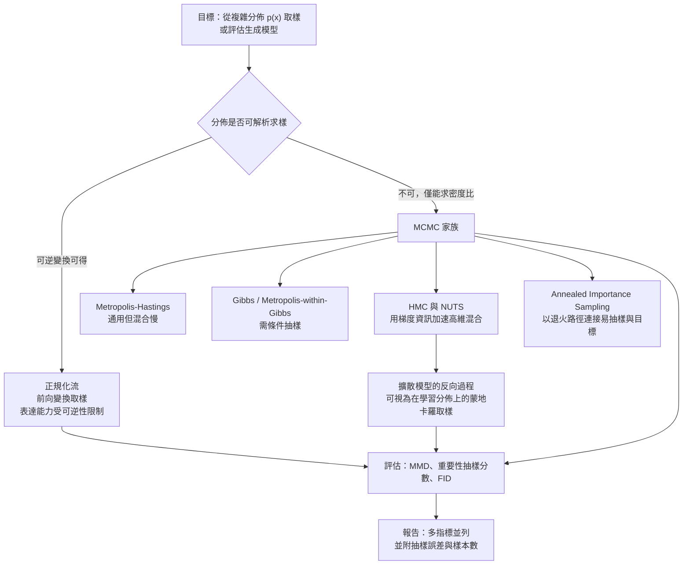

## 14.1 生成模型與蒙地卡羅

[上一章：第14章　蒙地卡羅方法在機器學習中的應用](14.0-蒙地卡羅方法在機器學習中的應用.md) | [下一章：第14.2節　蒙地卡羅抽樣在貝葉斯推斷中的應用](14.2-蒙地卡羅抽樣在貝葉斯推斷中的應用.md)

生成模型的訓練目標，本質上常常是一個關於**期望**的式子。而期望的數值計算，在本書前面的邏輯下只有兩條路：解析積分或抽樣。生成模型的分佈既高維又複雜，於是抽樣成為必然。本節沿著這條主線，依次介紹 Metropolis–Hastings、Gibbs 抽樣、annealed importance sampling、正規化流與擴散模型，並在最後討論一個尖銳的問題：**當抽樣是訓練的一部分時，我們要如何知道抽樣做得夠不夠？**

## 學習目標

完成本節後，你應該能夠：

1. 寫出 Metropolis–Hastings 的接受機率，並說明它如何滿足詳細平衡（detailed balance）從而保證目標分佈為不變分佈。
2. 說明 Gibbs 抽樣「一次更新一維」如何把高維的困難分解成低維的條件抽樣，以及它為何比全域抽樣有效。
3. 理解 annealed importance sampling 如何用一條「溫度路徑」連接易採樣分佈與目標分佈。
4. 解釋正規化流（normalizing flows）如何把簡單分佈的抽樣透過可逆變換送到複雜分佈，以及它與 MCMC 的取捨差異。
5. 描述擴散模型（diffusion models）的反向過程為何本身就是一個精心設計的抽樣／去噪過程。
6. 評估生成模型的兩類指標：基於抽樣的指標（重要性抽樣分數、MMD）與基於密度的指標（log-likelihood）。
7. 說明能量模型（EBM）的負對數似然為何需要 MCMC，以及由此產生的訓練與推論雙重困難。

## 14.1.1 從 MCMC 到生成模型

在物理（第8章）中，Metropolis 抽樣的任務是：在位能 $`U(x)`$ 給定的 Boltzmann 分佈

$$
\pi(x) \propto e^{-U(x)/k_B T}
$$


中抽樣。在機器學習中，目標換成了任意形狀的模型分佈 $`p_\theta(x)`$ 。兩者的橋樑是**比例關係**——我們通常不需要知道 $`p_\theta`$ 的正規化常數，只要能求出「在 $`x`$ 處的密度」與「在 $`y`$ 處的密度」之比。這正是 MCMC 演算法所需要的。

## 14.1.2 Metropolis–Hastings 演算法

Metropolis–Hastings（MH）演算法從當前狀態 $`x`$ 出發，提出一個建議分佈 $`q(y \mid x)`$ 產生的候選 $`y`$ ，並以接受機率

$$
\alpha(x, y) = \min\left(1,\; \frac{\pi(y)\,q(x \mid y)}{\pi(x)\,q(y \mid x)}\right)
$$


決定是否移動到 $`y`$ 。若接受則令 $`x \leftarrow y`$ ，否則留在原處。

這個公式的每個因子都有意義：分子的 $`\pi(y)/\pi(x)`$ 是「目標分佈偏好新狀態的程度」， $`q(x\mid y)/q(y\mid x)`$ 是「建議機制的對稱性修正」。當 $`q`$ 對稱時，後者退化為 1，退化成原始的 Metropolis 規則。

**為什麼它對？** 接受機率的設計使得轉移核滿足**詳細平衡**：

$$
\pi(x)\,T(x \to y) = \pi(y)\,T(y \to x)
$$


詳細平衡比「不變分佈」更強（不變分佈只要求邊緣機率守恆）。保證詳細平衡，就保證了 $`\pi`$ 是鏈的不變分佈；而在可遞迴（irreducible）與週期性等條件下，這個鏈會收斂到 $`\pi`$ 。這是第8章 Metropolis 對稱建議的完整推廣。

**實務要點**：MH 的效率取決於建議分佈與目標分佈的匹配程度。在高維（如神經網路權重）中，兩個問題變得突出：

- **維度災難**：兩個高維點的密度比在數值上極不穩定。
- **混合緩慢**：鏈沿「狹長山谷」移動極慢。

第二個問題的解法是引入梯度資訊（Hamiltonian Monte Carlo），是第14.2節的主題。

## 14.1.3 Gibbs 抽樣

Gibbs 抽樣把高維問題拆解：若目標分佈可分解為

$$
p(x_1, \dots, x_d) = \prod_{j=1}^{d} p(x_j \mid x_{-j})
$$


則可以反覆地從各條件分佈抽樣：

$$
x_1^{(t)} \sim p(x_1 \mid x_2^{(t-1)}, \dots, x_d^{(t-1)}), \quad \dots
$$


每個座標都用**最新**的值更新（此即「Metropolis-within-Gibbs」的簡化版本，掃描或隨機選座標皆可）。

**為什麼 Gibbs 在高維比全域 MH 好？** 因為每次只移動一個座標，移動方向沿著「條件分佈的高密度區域」，等於用問題的座標結構來加速混合。典型的例子是收斂到多元常態分佈的相關結構上：全域 MH 沿對角線方向移動，步長受最小特徵值限制；Gibbs 逐軸更新則不受此限制。

**Gibbs 的侷限**：第一，必須能從條件分佈抽樣（或用 MH 近似，即 Metropolis-within-Gibbs）。第二，條件分佈本身可能仍難抽樣。第三，座標之間強相關時，逐軸更新也會導致慢混合。第四，它不提供對目標分佈梯度的需求，但也不利於利用梯度資訊。

## 14.1.4 Annealed Importance Sampling

**Annealed importance sampling（AIS）** 的想法來自物理中的退火（annealing）：構造一條從「好抽樣」到「難抽樣」的路徑。

$$
\pi_0 \;\longrightarrow\; \pi_1 \;\longrightarrow\; \cdots \;\longrightarrow\; \pi_K = \pi
$$


其中 $`\pi_k \propto \pi_0^{1-\beta_k}\pi^{\beta_k}`$ ， $`\beta_k`$ 從 0 遞增到 1。 $`\beta = 0`$ 是容易抽樣的基準分佈（如標準常態）， $`\beta = 1`$ 是目標分佈。

關鍵是**用重要性權重把沿路徑的資訊累積起來**，同時在路徑上抽樣：

$$
w_k = \frac{\pi_k(z_k)}{\pi_{k-1}(z_k)} \cdot \frac{q_{k-1}(z_k \mid z_{k-1})}{q_k(z_k \mid z_{k-1})}
$$


最終以加權樣本估計目標期望，且 AIS 天然給出**有效的自診斷量**（例如權重的 ESS）來判斷路徑是否足夠。

**前因後果**：MCMC 在高維混合緩慢；AAS/AIS 用「路徑」換取效率。**代價**是路徑設計與步數 $`K`$ 需要調整，且每一步的抽樣仍需 MCMC 或其他方法。

## 14.1.5 正規化流：用可逆變換取代抽樣

**正規化流（normalizing flows）** 走的是完全不同的路線：不用抽樣來近似複雜分佈，而是構造一個**可逆變換**，把簡單分佈送到目標分佈。

設 $`z \sim q(z)`$ （例如標準常態），定義變換 $`x = f_\theta(z)`$ ，並要求其雅可比行列式 $`\det \frac{\partial f_\theta}{\partial z}`$ 存在且可計算。變換後的分佈密度為

$$
p_\theta(x) = q\!\left(f_\theta^{-1}(x)\right) \left| \det \frac{\partial f_\theta^{-1}}{\partial x} \right|
$$


訓練時對資料做最大概似然，就等於**在尋找一個把資料分佈映射回簡單分佈的可逆座標變換**。

**關鍵取捨**：

| 面向 | 正規化流 | MCMC |
| --- | --- | --- |
| 抽樣速度 | 極快（前向變換一次即可） | 慢（需跑鏈） |
| 表達能力 | 受可逆性與參數化限制 | 理論上無限制 |
| 精確度 | 精確（模型就是分佈） | 精確（若收斂） |
| 訓練 | 只需最大概似，無抽樣 | 可能需要 MCMC 內迴圈 |

**因果關係**：MCMC 慢 → 人們想要更快的抽樣 → 正規化流提供答案 → 但可逆性限制了表達能力 → 於是有了「流 + MCMC」的混合（如 flow-based posterior estimation）以及擴散模型這種「用一串簡單變換逼近複雜分佈」的設計。

## 14.1.6 擴散模型：把取樣變成一串去噪

**擴散模型（diffusion models）** 示範了另一種思維：不直接建模複雜資料分佈，而是定義一個「把資料逐步破壞成簡單噪音」的過程，再學會反過來。

前向過程（固定、不含可學參數）定義為

$$
q(x_t \mid x_{t-1}) = \mathcal{N}\!\left(x_t;\sqrt{1-\beta_t}\,x_{t-1},\; \beta_t I\right)
$$


經過 $`T`$ 步後分佈趨近於標準常態。反向過程則用一個參數化模型

$$
p_\theta(x_{t-1} \mid x_t) = \mathcal{N}\!\left(x_{t-1};\mu_\theta(x_t, t),\; \Sigma_\theta(x_t, t)\right)
$$


來學會逐步還原。

**與蒙地卡羅的關係**：反向過程在 $`T`$ 很大時，是一個**隨機微分方程（SDE）**的近似離散化，而它的取樣在數學上等價於一個以 $`\nabla \log p_t(x)`$ 為漂移項的擴散過程——也就是**在學習到的分佈上做蒙地卡羅取樣**。這就把物理（第7、8章）與機器學習直接接起來。

實務上，擴散模型的取樣用 DDPM（數百到上千步）或 DDIM（少數步數）加速。DDIM 的關鍵改進是把反向過程重寫成**確定性**的 ODE 形式，因此可以用求解器跳步，把取樣步數從 1000 降到 50 以下而不顯著犧牲品質。

## 14.1.7 生成模型的評估：抽樣方法如何被檢驗

生成模型沒有 ground truth 資料可比對，所以評估本身就是一個統計問題——而蒙地卡羅方法在其中扮演核心角色。

**兩大類指標：**

1. **基於抽樣的指標**：
   - **重要性抽樣分數（importance sampling score）**：以模型分佈為重要性分佈，在真實資料上估計 $`\log p(D)`$ 的下界。
   - **最大平均差異（MMD, maximum mean discrepancy）**：比較真實樣本 $`\{x_i\}`$ 與生成樣本 $`\{z_j\}`$ 在某個特徵空間中的距離

     $$
     \mathrm{MMD}^2 = \mathbb{E}_{x,x'}\!\left[k(x,x')\right] - 2\mathbb{E}_{x,z}\!\left[k(x,z)\right] + \mathbb{E}_{z,z'}\!\left[k(z,z')\right]
     $$


     其中 $`k`$ 是核函數（如 RBF 核）。MMD 的無偏估計可由蒙地卡羅抽樣直接計算，是實務上最常用的生成品質指標之一。
   - **Fréchet Inception Distance（FID）**：在特徵空間中比較兩者的高斯近似。
2. **基於密度的指標**：log-likelihood（及其衍生）。注意：在高維連續資料上，log-likelihood 與樣本品質的相關性並不完美，甚至可能出現「最好模型分數最差」的悖論。

**因果關係與教訓**：評估方法的演進，反映了「單一數字不足以描述生成品質」這一認識。目前的共識是應組合多個指標、並在**具體下游任務**（如分類器能否區分真實與生成樣本）上驗證。此外，由於 MMD 等指標本身是蒙地卡羅估計，它們也有抽樣誤差，不同樣本數下的分數不可直接比較。

```python
import numpy as np

def mmd_rbf(X, Y, gamma=1.0, seed=0):
    """MMD^2 的無偏蒙地卡羅估計（RBF 核）。
    對應理論：MMD^2 = E[k(x,x')] - 2E[k(x,y)] + E[k(y,y')]，
    三個期望皆以樣本平均估計，故整體估計量無偏。"""
    r = np.random.default_rng(seed)
    X = np.asarray(X, dtype=float)
    Y = np.asarray(Y, dtype=float)

    def sq_dist(A, B):
        d = (A**2).sum(1)[:, None] + (B**2).sum(1)[None, :] - 2 * A @ B.T
        return np.maximum(d, 0.0)

    dxx = sq_dist(X, X)
    dyy = sq_dist(Y, Y)
    dxy = sq_dist(X, Y)
    k = lambda d: np.exp(-gamma * d)   # RBF 核
    kxx, kyy, kxy = k(dxx), k(dyy), k(dxy)

    n, m = len(X), len(Y)
    # 去掉對角線項以得到無偏估計（對角線恆為 1，會造成偏差）
    sxx = (kxx.sum() - np.trace(kxx)) / (n * (n - 1))
    syy = (kyy.sum() - np.trace(kyy)) / (m * (m - 1))
    sxy = kxy.mean()
    return float(sxx - 2 * sxy + syy)

# 範例：兩團相近的高斯雲，其 MMD 應接近 0
r = np.random.default_rng(0)
X = r.normal(size=(500, 8))
Y = r.normal(size=(500, 8)) + 0.05
print("MMD^2 =", mmd_rbf(X, Y))
```

程式碼中的「去掉對角線」是無偏性的關鍵： $`k(x_i,x_i)=1`$ 恆成立，若不排除，估計量會系統性偏低。



上圖把本節的技術串成一張地圖：核心的張力在「**快但受限**」（正規化流）與「**準但慢**」（MCMC）之間。擴散模型是這個張力的有趣折衷——它不追求一次性可逆映射，而是把複雜分佈拆成一串簡單的局部步驟，每一步的取樣都可用蒙地卡羅式的隨機微分方程描述。而右下角的「報告多指標並附抽樣誤差」提醒我們：評估方法本身也是蒙地卡羅估計，也會有噪聲。

## 14.1.8 能量模型：MCMC 的雙重負擔

**能量模型（EBM）** 用「能量」 $`E_\theta(x)`$ 參數化分佈：

$$
p_\theta(x) = \frac{e^{-E_\theta(x)}}{Z(\theta)}, \qquad Z(\theta) = \int e^{-E_\theta(x)}\,dx
$$


其中配分函數 $`Z`$ 無法解析求出。訓練時，最大概然的目標為

$$
\mathcal{L}(\theta) = \mathbb{E}_{p_\text{data}}\!\left[E_\theta(x)\right] - \mathbb{E}_{p_\theta}\!\left[E_\theta(x)\right]
$$


第一項可由資料直接估計；第二項則**必須從模型分佈抽樣**——也就是要用 MCMC（或其他取樣方法）。

這造成 EBM 的著名困境，形成一個雙重負擔：

1. **訓練時**：每次更新參數都要跑一條 MCMC 鏈來估計第二項，鏈必須從上一條鏈的終點續行（warm start），否則每次都從頭開始、極其昂貴。
2. **推論時**：從模型取樣同樣需要 MCMC，採樣速度直接決定實用性。
3. **更糟的是**：MCMC 鏈的混合不佳會**系統性地**讓第二項估計有偏，而這個偏差會被最大化的目標函數利用——模型會刻意讓鏈「走不動」的地方成為低能量的偽影。這是 EBM 訓練中最著名的失效模式。

**因果鏈**：EBM 的優雅（直接建模能量，樣本品質可望更高）→ 需要 MCMC 估計配分函數 → MCMC 的偏差被訓練目標利用 → 需要更強的抽樣方法或替代的訓練策略（如 Dugrain et al. 的噪聲對比估計、逐步 MCMC 的公平比較等）→ 又衍生新的近似誤差問題。

## 本章要點

- Metropolis–Hastings 透過詳細平衡保證目標分佈為不變分佈；其效率取決於建議分佈與目標的匹配，高維時混合緩慢是主要瓶頸。
- Gibbs 抽樣用「一次改一維」把高維難題拆成條件抽樣，在有座標結構的問題上比全域 MH 有效。
- Annealed importance sampling 用一條退火路徑連接易抽樣分佈與目標分佈，並提供有效的自診斷量。
- 正規化流以可逆變換取代抽樣：快且精確，但表達能力受可逆性限制；MCMC 則相反。
- 擴散模型的反向過程可視為在學習分佈上的蒙地卡羅取樣（隨機微分方程的離散化）。
- 生成模型的評估指標（MMD、重要性抽樣分數）本身是蒙地卡羅估計，必須報告樣本數與抽樣誤差，並以多指標與下游任務交叉驗證。
- 能量模型的負對數似然需要從模型分佈抽樣，導致訓練與推論的雙重 MCMC 負擔，且鏈的混合偏差可能被訓練目標利用。

## 延伸閱讀

- Metropolis, N. et al. (1953). "Equation of State Calculations by Fast Computing Machines." *J. Chem. Phys.* 21(6), 1087–1092.
- Hastings, W. K. (1970). "Monte Carlo Sampling Methods Using Markov Chains and Their Applications." *Biometrika* 57(1), 97–109.
- Andrieu, J.-C. & Thoms, J. S. (2008). "A Tutorial on Annealed Importance Sampling." *Statistical Computing*.——AAS 的完整論述。
- Papamakarios, G., Naliseth, K. J., Provost, M. & Tan, K. (2021). *Normalizing Flows for Probabilistic Modeling and Inference*. JMLR.——正規化流的權威文獻。
- Ho, J., Jain, A. & Abbeel, P. (2020). "Denoising Diffusion Probabilistic Models." *NeurIPS*.——DDPM 原論文。
- Gretton, A. et al. (2012). "A Kernel Two-Sample Test." *JMLR*.——MMD 檢定。
- [第14.2節：蒙地卡羅抽樣在貝葉斯推斷中的應用](14.2-蒙地卡羅抽樣在貝葉斯推斷中的應用.md)、[第8.2節：1953年Metropolis抽樣與粒子模擬](08.2-1953年Metropolis抽樣與粒子模擬.md)、[第5章：變換抽樣法](05.0-變換抽樣法.md)
