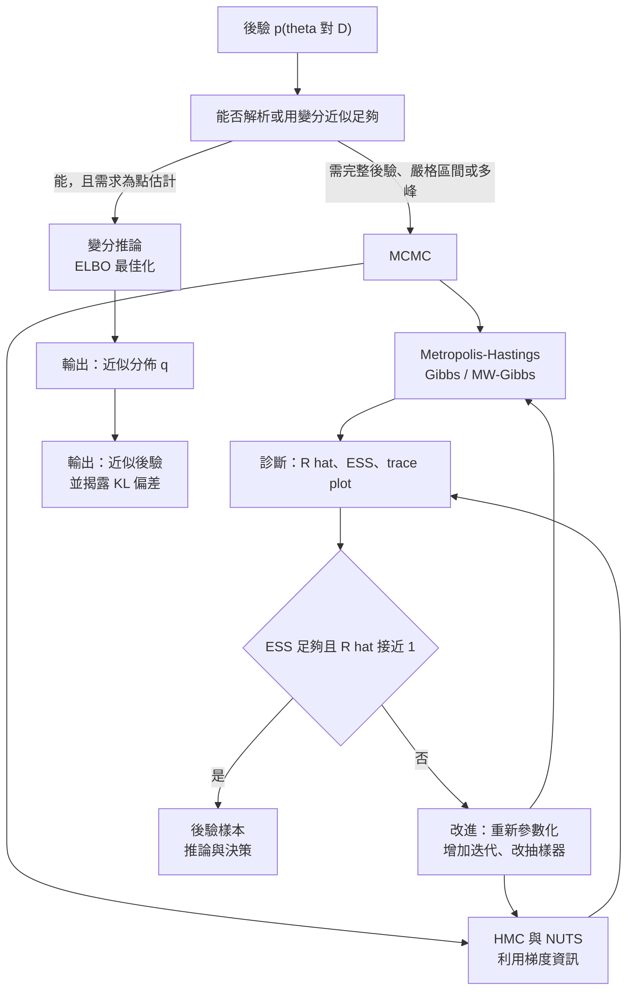

## 14.2 蒙地卡羅抽樣在貝葉斯推斷中的應用

[上一章：第14.1節　生成模型與蒙地卡羅](14.1-生成模型與蒙地卡羅.md) | [下一章：第14.3節：深度學習與蒙地卡羅方法](14.3-深度學習與蒙地卡羅方法.md)

第14.1節展示了蒙地卡羅如何嵌入生成模型的訓練與評估。本節轉向另一個核心任務：**用蒙地卡羅從後驗分佈抽樣**。這是貝葉斯推論最古老也最重要的工具——形式化於 1940 年代（MCMC 的取樣思想可追溯到 Metropolis 等人在 1953 年的工作），至今仍是深度貝葉斯模型的支柱。

本節的主線是一個不斷重複的問題迴圈：**抽樣器給出樣本 → 我們懷疑它不對 → 用診斷檢查 → 發現不對 → 換更好的抽樣器**。因此診斷（diagnostics）在貝葉斯推論中不是選配，而是流程的必備環節。

## 學習目標

完成本節後，你應該能夠：

1. 說明為什麼貝葉斯後驗必須用抽樣取得，並解釋分母 $`p(D)`$ 難以計算這件事的真正後果。
2. 寫出 Metropolis-within-Gibbs 的更新規則，說明它相較 Metropolis–Hastings 的適用條件。
3. 比較 Metropolis–Hastings 與 Gibbs 抽樣在效率、實作難度與適用範圍上的差異。
4. 說明 $`\hat{R}`$ （potential scale reduction factor）、有效樣本數（ESS）與 trace plot 各自的診斷意義與限制。
5. 解釋 Hamiltonian Monte Carlo 的物理直覺與數學形式，以及它為何能解決高維混合問題。
6. 說明 No-U-Turn Sampler（NUTS）的動機：如何自動決定軌跡長度。
7. 描述序貫蒙地卡羅／粒子濾波（SMC）的構造，以及粒子退化（particle degeneracy）問題與其解法。
8. 判斷何時該用 MCMC、何時該用變分推論，並說明這個取捨背後的準則。

## 14.2.1 為什麼後驗必須抽樣

貝葉斯定理：

$$
p(\theta \mid D) = \frac{p(D \mid \theta)\,p(\theta)}{p(D)}, \qquad
p(D) = \int p(D \mid \theta)\,p(\theta)\,d\theta
$$


分母 $`p(D)`$ 是「資料的邊際機率」，它是**純粹的正規化常數**，在很多實務情境中我們只是把它消掉（因為決策只依賴比率）。但即使如此，後驗仍需要以「分佈」的形式呈現：給定資料的參數可能有哪些值、各自多可能？這個問題沒有解析解，於是抽樣。

**前因**：深度模型的參數維度是 $`10^8`$ 到 $`10^{10}`$ 量級；即使對數後驗能被計算出來，網路上做積分仍不切實際。
**後果**：MCMC 成為可行方案，但必須處理高維混合、診斷、以及抽樣成本的問題。
**新問題**：MCMC 慢（一次前向傳播要跑 $`T`$ 步鏈）。這直接催生了變分推論的實用化，以及「用變分近似初始化 MCMC」的混合方法。

## 14.2.2 Metropolis-within-Gibbs

在貝葉斯模型中，我們常希望把參數分成不同「區塊」（block），每個區塊有各自的條件分佈。例如在混合模型中，一個區塊是離散變數（哪個成分），另一個是連續變數（成分的均值與變異數）。

Metropolis-within-Gibbs 的做法是：對每個區塊，用一個能接受該區塊條件分佈的更新器（可以是精確抽樣，也可以是 MH 步驟），依序更新：

$$
\theta_1^{(t)} \sim p(\theta_1 \mid \theta_2^{(t-1)}, \dots, D)
$$

$$
\theta_2^{(t)} \sim p(\theta_2 \mid \theta_1^{(t)}, \dots, D)
$$


這裡的「參數更新順序」是 Gibbs 的一個著名結果（Liu & Wu, 1999）：當各區塊條件分佈的抽取互相獨立時，更新順序會影響混合速度，隨機順序通常優於固定順序。

**與 Metropolis–Hastings 的比較：**

| 面向 | Metropolis–Hastings | Gibbs / Metropolis-within-Gibbs |
| --- | --- | --- |
| 適用條件 | 只需能評估密度比 | 需要能（或近似）從條件分佈抽樣 |
| 高維效率 | 差（步長受最小特徵值限制） | 好（逐區塊利用座標結構） |
| 實作難度 | 低（通用） | 中（需設計區塊與抽樣器） |
| 混合診斷 | 需要 | 需要 |

## 14.2.3 診斷：如何知道鏈夠不夠

這是 MCMC 實務中最重要的部分。**一條未經診斷的鏈不應被用來做任何決策。**

### Trace plot（軌跡圖）

把每次迭代的參數值畫成隨迭代序號變化的曲線。健康的鏈呈「毛刷」狀（fuzzy caterpillar）：沒有趨勢、沒有週期性、振盪幅度穩定。不健康的跡象包括：明顯的緩慢上升趨勢（未收斂）、多條鏈分處不同高度（未混合）、固定的週期性振盪（鏈卡在狀態空間的週期上）。

### 有效樣本數（ESS）

自相關的存在使得 $`N`$ 個樣本的有效資訊量小於 $`N`$ 。ESS 估計為

$$
\mathrm{ESS} = \frac{N}{1 + 2\sum_{k=1}^{K}\rho_k}
$$


其中 $`\rho_k`$ 是落後 $`k`$ 階的自相關。ESS 的重要意義在於**它是蒙地卡羅誤差真正的分母**：若某參數的後驗標準差為 $`\sigma`$ ，則其標準誤應為 $`\sigma/\sqrt{\mathrm{ESS}}`$ 而非 $`\sigma/\sqrt{N}`$ 。

### $`\hat{R}`$ （potential scale reduction factor）

由 Gelman & Rubin (1992) 提出，用多條鏈估計「尚未混合的程度」。定義為

$$
\hat{R} = \sqrt{\frac{\widehat{\mathrm{Var}^+}(\theta)}{\widehat{\mathrm{Var}}(\theta)}}
$$


其中分子是鏈間與鏈內方差的加權，後者反映鏈已混合時應有的方差。判讀慣例： $`\hat{R} < 1.01`$ 可接受， $`1.01`$ – $`1.05`$ 有疑慮， $`>1.05`$ 表示未混合。現代實作（如 Stan 的 `R-hat`）使用的是 rank-normalized 版本，對重尾分佈更穩健。

```python
import numpy as np

def chain_diagnostics(chains):
    """計算多條 MCMC 鏈的 ESS 與 R-hat（簡化版，基於 split-R-hat 概念）。
    chains 形狀為 (n_chains, n_draws)。"""
    c, n = chains.shape
    means = chains.mean(axis=1)
    variances = chains.var(axis=1, ddof=1)
    # 鏈間方差 B 與鏈內方差 W
    B = n * means.var(ddof=1)
    W = variances.mean()
    var_hat = (n - 1) / n * W + B / n
    r_hat = float(np.sqrt(var_hat / W))

    # 以自相關求 ESS（對每條鏈估計後取最小）
    ess_list = []
    for ch in chains:
        x = ch - ch.mean()
        rho_sum = 0.0
        for lag in range(1, min(n // 2, 100)):
            rho = np.corrcoef(x[:-lag], x[lag:])[0, 1]
            if rho < 0.05:
                break
            rho_sum += rho
        ess_list.append(n / (1 + 2 * rho_sum))
    return {"R_hat": r_hat, "ESS_min": float(min(ess_list)),
            "ESS_total": float(sum(ess_list))}
```

**這段程式的教訓**： $`R`$ hat 只告訴你「鏈之間是否一致」，ESS 才告訴你「樣本有多少獨立資訊」。一個常見的誤用是看到 $`R`$ hat 接近 1.0 就宣稱抽樣充分——但如果鏈本身高度自相關（例如每 100 步才移動一次），ESS 可能只有 $`N/100`$ ，蒙地卡羅誤差仍然是原來估計的 10 倍。**因此 ESS 與 $`R`$ hat 必須一起看。**

## 14.2.4 Hamiltonian Monte Carlo

**Hamiltonian Monte Carlo（HMC）** 是對第7章物理方法的直接借用。引入與位置 $`q`$ 共軛的動量 $`p`$ ，定義哈密頓量

$$
H(q, p) = -\log \pi(q) + \frac{1}{2} p^\top M^{-1} p
$$


（此處省略動能項的負號慣例），由於 $`\frac{dH}{dt} = 0`$ ，沿哈密頓方程的演化**保持分佈不變**。因此可以像 MCMC 那樣在狀態空間中「跳」，但跳躍路徑由力的積分決定，可以很長。

$`\nabla H`$ 的計算需要 $`\nabla \log \pi(q)`$ ，也就是**對數後驗的梯度**——這在貝葉斯深度學習中可由反向傳播自動微分取得（深度學習框架天然提供這項能力，是 HMC 能進入機器學習的技術前提）。

**為什麼有效**：在狹長山谷狀的後驗中，梯度資訊讓鏈沿山谷方向快速移動，把步長的限制從「山谷最窄處」放寬到「最陡峭處」。這解決了高維 MCMC 的核心瓶頸。

**代價**：每一步需要梯度計算（成本等同一次反向傳播），且需要精細調參（步長 $`\epsilon`$ 、軌跡長度 $`L`$ ）。若步長太大，數值積分誤差會破壞不變性；太小則效率低。

## 14.2.5 No-U-Turn Sampler

HMC 需要手動選定軌跡長度 $`L`$ ：太短則移動不足，太長則浪費計算（且會在軌跡兩端折返，浪費一半）。

**NUTS**（Hoffman & Gelman, 2014）的想法是：**讓軌跡長度自動決定**——當軌跡開始「掉頭」（U-turn）時就停止。判準通常使用動量與梯度的一致性條件：

$$
(\nabla \log \pi(q_t))^T M^{-1} p_{t-1} > 0, \qquad
(\nabla \log \pi(q_t))^T M^{-1} p_t < 0
$$


實務上 NUTS 還需要**步長調整**（通常用 dual averaging 配合接受率目標），以及**窗函數（mass matrix）**的估計，以處理各參數尺度的差異。

結果是：NUTS 大幅減少了需要手動調校的參數數量，使 HMC 在貝葉斯深度學習中真正可用。NUTS 是 Stan、NumPyro、PyMC 的預設核心演算法。

## 14.2.6 序貫蒙地卡羅與粒子濾波

**序貫蒙地卡羅（SMC）** 處理的是另一類問題：狀態隨時間演進，且每一步都有新觀測。例如追蹤目標、資料同化（data assimilation）、在線變化點偵測。

基本構造：維護一群加權粒子 $`\{x_t^{(i)}, w_t^{(i)}\}`$ ，代表當前狀態後驗 $`p(x_t \mid y_{1:t})`$ 。每一步：

1. **傳播**：依狀態轉移模型把粒子往前推 $`x_t^{(i)} \sim p(x_t \mid x_{t-1}^{(i)})`$ 。
2. **加權**：以觀測似然更新權重 $`w_t^{(i)} \propto w_{t-1}^{(i)} p(y_t \mid x_t^{(i)})`$ 。
3. **重抽樣**：依權重重抽樣粒子（消除退化）。
4. **平移／微調**（SMC 特有的步驟）：用 MH 或其他方法把粒子稍微移動，使其更好地匹配當前後驗。

**粒子退化（particle degeneracy）** 是核心問題：隨時間推移，權重會集中到少數粒子（有效粒子數 $`N_\text{eff} = 1/\sum_i (w^{(i)})^2`$ 下降），所有粒子都變得相似，從而失去對後驗的代表性。

**解法**：

- **重抽樣**（SMC 的核心）：按權重比例重抽，恢復粒子多樣性，但會引入額外的樣本複製與耗散。
- **Resampling moving average（RMMA）**：把重抽樣時機延後並平滑化，減少重抽樣次數。
- **引導粒子篩選**：把粒子集合限制在高似然區域，例如 HMC 內迴圈用於每個粒子的後驗重加權。

```python
import numpy as np

def particle_filter(y_obs, x0, Q, R, n_particles=2000, rng=None):
    """線性高斯模型下的序貫蒙地卡羅（粒子濾波）示範。
    對應理論：傳播 → 加權 → 重抽樣（處理粒子退化）→ 估計。"""
    rng = rng or np.random.default_rng(0)
    x = np.tile(x0, (n_particles, 1))
    w = np.full(n_particles, 1.0 / n_particles)
    xs, wss = [], []

    for y in y_obs:
        # 1. 傳播：狀態轉移
        x = x + rng.normal(size=n_particles) * np.sqrt(Q)
        # 2. 加權：觀測似然（此例假設觀測即狀態加量測噪聲）
        lik = np.exp(-0.5 * (y - x)**2 / R)
        w = w * lik
        w /= w.sum()
        # 3. 重抽樣：避免粒子退化
        idx = rng.choice(n_particles, size=n_particles, p=w)
        x = x[idx]
        w = np.full(n_particles, 1.0 / n_particles)

        xs.append(x.mean())      # 後驗均值（MMSE 估計）
        wss.append(1.0 / np.sum(w**2))  # 有效粒子數

    return np.array(xs), np.array(wss)
```

這段程式碼示範了 SMC 的核心迴圈；「重抽樣」那一行是處理退化的關鍵，但每次重抽樣都會使粒子群失去多樣性（同一粒子被複製多次），這就是 SMC 為何需要額外的「平移」步驟。

## 14.2.7 MCMC 與變分推論的取捨

| 準則 | MCMC | 變分推論（VI） |
| --- | --- | --- |
| 精確度 | 漸近精確（僅有抽樣誤差） | 近似（ELBO 估計與 KL 散度造成偏差） |
| 複雜度 | 高（需診斷、需調參） | 低（最佳化即可） |
| 後驗形狀 | 完整樣本 | 受 $`q`$ 的族限制 |
| 分佈覆蓋 | 適合複雜多峰後驗 | 單峰近似會漏掉多峰 |
| 適用 | 小中型模型、精準需求 | 大型模型、近似足夠時 |

**實務判準**：如果決策只需一個點估計且資料量大，變分推論通常更划算；如果需要可信的區間、需要多峰後驗、或需要對不確定性做嚴格聲明，MCMC 更可靠。折衷方案（例如先以變分近似產生好的初始點再跑 MCMC）在實務上非常有效。

## 14.2.8 實務檢查清單

1. 至少跑 4 條鏈，初始值**過度分散**（over-dispersed），以檢查混合。
2. 先用少量迭代做「預熱」（warmup），讓鏈離開低機率區域；預熱期樣本必須丟棄。
3. 同時報告 $`R`$ hat 與 ESS；若 ESS 太低，增加迭代數或改用更好的參數化（重新參數化是解決高相關性的第一手段）。
4. 檢查 trace plot 的形狀，而非只看統計量。
5. 先驗對結果的影響要透過先驗敏感度分析揭露。
6. 若鏈效率仍不足，考慮 HMC/NUTS，而非硬加迭代數。



上圖是本節的核心閉環：**診斷不是最後的裝飾步驟，而是驅動改進的迴圈**。這與工程章節（第13章）的「抽樣 → 統計 → 檢查 → 決策」流程本質相同，只是對象從實體系統換成了後驗分佈。右下的兩個出口也點出本章的核心張力：MCMC 更可信但更慢，變分更快但有不可消除的近似偏差。

## 本章要點

- 貝葉斯後驗的分母不可得、高維積分不可行，因此必須用抽樣取得；MCMC 的代價是高維混合緩慢。
- Metropolis-within-Gibbs 善用參數的區塊與條件結構，比全域 MH 更適合有座標結構的模型。
- 診斷是流程必備環節： $`R`$ hat 檢查混合、ESS 決定真正的蒙地卡羅誤差分母、trace plot 提供視覺把關； $`R`$ hat 單獨使用會誤導。
- HMC 以哈密頓動力學保持分佈不變，並利用對數後驗梯度（自動微分提供）跨越狹長谷地；NUTS 以 U-turn 準則自動決定軌跡長度。
- SMC 以「傳播 → 加權 → 重抽樣」處理時序狀態後驗，核心挑戰是粒子退化。
- MCMC 與變分推論的取捨取決於精度需求、模型規模與後驗複雜度，兩者可混合使用。

## 延伸閱讀

- Gelman, A. et al. (2013). *Bayesian Data Analysis* (3rd ed.), CRC Press.——MCMC 與貝葉斯推論的標準參考。
- Hoffman, M. D. & Gelman, A. (2014). "The No-U-Turn Sampler: Adapting Set...". *J. Machine Learning Research* 15(47), 1593–1623.
- Duerrand, S. et al. (2011). "Hamiltonian Monte Carlo for High-Dimensional..."（HMC 的早期系統化工作）。
- Neal, R. M. (2011). *MCMC using Hamiltonian Dynamics*. Springer.
- Doucet, A., de Freitas, N. & Gordon, N. (eds.) (2001). *Sequential Monte Carlo Methods in Practice*. Springer.——SMC 的經典文集。
- Blei, D. M., Kucukelbir, A. & McAuliffe, J. D. (2017). "Variational Inference: Foundations for Modern Statistical Methods." *Annual Review of Statistics and Its Application*.
- [第14.1節：生成模型與蒙地卡羅](14.1-生成模型與蒙地卡羅.md)、[第14.3節：深度學習與蒙地卡羅方法](14.3-深度學習與蒙地卡羅方法.md)、[第5章：變換抽樣法](05.0-變換抽樣法.md)
