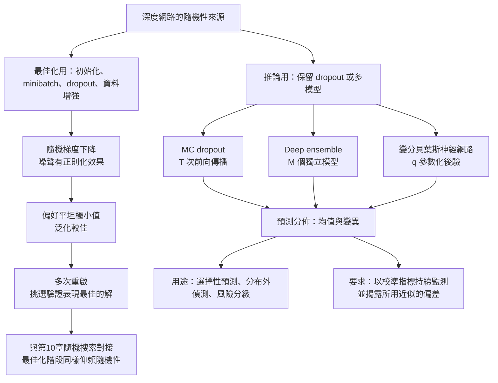

## 14.3 深度學習與蒙地卡羅方法

[上一章：第14.2節：蒙地卡羅抽樣在貝葉斯推斷中的應用](14.2-蒙地卡羅抽樣在貝葉斯推斷中的應用.md) | [下一章：第15章　跨學科應用案例](15.0-跨學科應用案例.md)

前兩節把蒙地卡羅放進機器學習的「貝葉斯」與「生成」兩條主線。本節處理第三條、也最貼近日常工程的主線：**深度網路本身的訓練與推論充滿了隨機性，而這些隨機性可以不僅是噪聲，還可以被刻意設計成不確定性估計的來源。**

本節的核心論點是：**深度學習中的隨機性有兩種用途——一種是讓最佳化得以進行（必要之惡），另一種是讓不確定性可以被估計（可利用之寶）。** 蒙地卡羅方法是把後者實現出來的工具。

## 學習目標

完成本節後，你應該能夠：

1. 盤點深度學習中的隨機性來源：參數初始化、minibatch 抽樣、dropout、資料增強、注意力遮罩等。
2. 解釋隨機初始化為何與隨機最佳化（及銳利／平坦極小值）有關。
3. 說明 dropout 在訓練與推論階段行為不同，以及 MC dropout 如何把測試時的隨機性轉化為預測分佈。
4. 區分 Aleatoric（偶發）與 Epistemic（認知）不確定性，並說明 MC dropout 對兩者的處理方式。
5. 描述 deep ensemble（深度集成）作為後驗近似的方法，以及它與 MC dropout 的取捨。
6. 說明貝葉斯深度學習的三條主要路線（MC dropout、深度集成、變分後驗）與其共同代價。
7. 說明隨機初始化與多次重啟（random restarts）在實務上的價值與侷限。
8. 描述蒙地卡羅在強化學習中的應用：隨機策略評估、蒙特卡羅樹搜尋與其信賴上界。

## 14.3.1 深度學習中的隨機性來源

把一個深度網路的訓練過程攤開，會發現隨機性無處不在：

| 來源 | 作用 | 若關閉會怎樣 |
| --- | --- | --- |
| 參數初始化 | 決定最佳化起點與對稱性破缺 | 不同單元保持對稱，無法學到不同特徵 |
| Minibatch 抽樣 | 梯度估計的隨機近似 | 全批次梯度，收斂慢且易陷銳利極小值 |
| Dropout | 隱藏層隨機遮蔽 | 隱層過度依賴彼此共適應，泛化變差 |
| 資料增強 | 輸入隨機變換 | 模型記住訓練樣本，過度擬合 |
| 標籤平滑、隨機遮蔽 | 正則化與資料擴增 | 泛化下降 |
| 注意力／dropout 遮罩 | 近似 MC 注意力的期望 | 退化成單一注意力分佈 |

**第一個因果關係**是：初始化的隨機性不只為了「打破對稱」這個教科書理由，更重要的是把最佳化置於一個**隨機過程**中。這使得 SGD 偏好平坦極小值，而平坦極小值與更好的泛化有關。第二個因果關係是：minibatch 的隨機性讓梯度含有噪聲，這種噪聲本身就有正則化效果。

**這裡的核心洞見是：深度學習的成功本身，就是「用隨機性換取效率與泛化」這個蒙地卡羅式交易的實例。** 這也是本章與第10章（蒙地卡羅優化）的接點。

## 14.3.2 隨機初始化與銳利／平坦極小值

在高階非凸損失面上，最佳化會收斂到眾多不同的局部極小值。Keskar 等人（2017）與 Dinh 等人（2020）的研究顯示：

- 從不同初始化出發，會收斂到**不同的**局部極小值，且這些解的測試損失差異顯著。
- 隨機初始化的解傾向落在**平坦**區域（loss landscape 的曲率小），而從同一初始化出發用梯度下降找到的解往往是銳利的。
- 平坦極小值與更好的測試泛化相關。

這說明初始化不是可以隨便設定的工程細節，而是**決定最終解品質的隨機變數**。實務上的推論是：與其嘗試找出「最好的初始化」，不如**用多個初始化重啟並挑選**——這正是「多次重啟」的蒙地卡羅式實踐（參見第10章隨機搜索與全局優化）。

## 14.3.3 MC dropout：把推論變成抽樣

標準 dropout 在**訓練時**以機率 $`p`$ 隨機丟棄隱藏層單元，在**推論時**則把剩餘單元乘上 $`1/(1-p)`$ 來校正期望。這等於把隨機性「平均掉」，輸出是一個確定的函數。

**MC dropout**（Gal & Ghahramani, 2016）反其道而行：**在推論時也保留隨機丟棄**。對同一輸入 $`x`$ 做 $`T`$ 次前向傳播，得到

$$
\{f(x; \omega_t)\}_{t=1}^{T}, \qquad \omega_t \sim \text{Bernoulli}(p)
$$


以此估計預測分佈的均值與變異：

$$
\mathbb{E}[f(x)] \approx \frac{1}{T}\sum_{t=1}^{T} f(x; \omega_t), \qquad
\mathrm{Var}[f(x)] \approx \frac{1}{T}\sum_{t=1}^{T}\left(f(x; \omega_t) - \mathbb{E}[f(x)]\right)^2
$$


**為什麼這可視為蒙地卡羅抽樣？** 因為 dropout 的遮蔽 $`\omega`$ 定義了一個分佈 $`\mathcal{D}(\omega)`$ ，MC dropout 的輸出分佈是在 $`\mathcal{D}`$ 上對網路輸出的期望的近似估計——也就是把參數不確定性積分掉：

$$
\mathbb{E}_{\theta \sim q(\theta)}\!\left[f_\theta(x)\right]
$$


其中 $`q(\theta)`$ 是以 dropout 遮蔽為參數的隱式後驗近似。這是第8章 Monte Carlo 積分的直接應用：**用有限次抽樣估計一個高維期望**。

### Aleatoric 與 Epistemic

MC dropout 產生的變異，同時包含兩種成分：

- **Aleatoric（偶發）不確定性**：資料本身的固有噪聲（例如同一腫瘤的不同 MRI 影像）。它**不應**隨模型不確定性而改變，也不會因訓練資料增加而消失。
- **Epistemic（認知）不確定性**：模型對輸入缺乏了解造成的（資料稀少區域的預測更不確定）。它**應**隨資料增加而下降。

MC dropout 的一個實用價值是：用「多次抽樣預測的變異」作為**代理指標**，來偵測輸入是否落在訓練資料的分布外（out-of-distribution）區域——這在醫療影像中特別有用，因為分布外偵測是安全性的前提。

**但要誠實**：MC dropout 對這兩種成分的區分是粗糙的。嚴格的分解需要明確建模，例如在貝葉斯框架下把變分近似拆成 $`q(\theta)`$ 與 $`q(\phi)`$ 兩部分（分別對應參數不確定性與資料噪聲），或直接估計貝葉斯模型的後驗方差。

## 14.3.4 醫療影像中的應用

醫療影像是不確定性估計最迫切的領域之一：病灶邊界模糊、影像品質參差、訓練資料稀少且標註昂貴。

一個典型的 MC dropout 流程：

1. 以 dropout 訓練一個分割網路（訓練時 dropout 率通常 0.1–0.5）。
2. 推論時對同一張 CT 跑 $`T = 20`$ – $`50`$ 次前向傳播，得到 $`T`$ 張分割機率圖。
3. 逐像素計算平均機率（segmentation）與逐像素變異（不確定性圖）。
4. 臨床端使用「需要人工複核」的標記 = 變異高的區域。

```python
import numpy as np
import torch
import torch.nn as nn

class DropoutSegNet(nn.Module):
    """含 dropout 的分割網路骨架（示範用；實際模型請換成合適的架構）。"""
    def __init__(self, in_ch=1, n_classes=3):
        super().__init__()
        self.body = nn.Sequential(
            nn.Conv2d(in_ch, 32, 3, padding=1), nn.ReLU(),
            nn.Dropout2d(0.2),                      # 訓練與推論都保持啟用
            nn.Conv2d(32, 64, 3, padding=1), nn.ReLU(),
            nn.Dropout2d(0.2),
            nn.Conv2d(64, n_classes, 1),
        )

    def forward(self, x):
        return self.body(x)


def mc_dropout_predict(model, image, n_samples=30):
    """以 MC dropout 產生平均預測與逐像素不確定性。
    對應理論：以 T 次抽樣估計 E[f(x)] 與 Var[f(x)]（第8章蒙地卡羅積分）。"""
    model.eval()   # eval 關閉 BatchNorm 的統計更新，但保留 dropout
    preds = []
    with torch.no_grad():
        for _ in range(n_samples):
            logits = model(image)
            preds.append(torch.softmax(logits, dim=1))
    stack = torch.stack(preds, dim=0)              # (T, B, C, H, W)
    mean = stack.mean(dim=0)                      # 平均預測機率
    var = stack.var(dim=0, unbiased=True)          # 逐像素變異 = 不確定性圖
    return mean, var
```

這段程式碼的關鍵在 `model.eval()` 的正確使用：PyTorch 的 `eval()` 只關閉 BatchNorm 的批次統計更新，**不會**關閉 dropout。許多實作者誤以為 `eval()` 會停用 dropout 而導致 MC dropout 失效——這是一個常見的實作陷阱，與本節強調的「隨機性必須被刻意保留」互相呼應。

**評估上的要求**：不確定性圖不能只看「漂亮」，必須用正確的指標評估，例如以 Brier score 評估機率校準、或用 ECE（expected calibration error）評估校準度、把不確定性與實際錯誤做關聯分析（選擇性預測：只在低不確定性時自動輸出，其餘轉人工）。這些都是第15.3節「大規模資料與統計基礎」會再出現的問題。

## 14.3.5 深度集成與其他後驗近似路線

**Deep ensemble**（Lakshminarayanan et al., 2017）是另一條路徑：訓練 $`M`$ 個獨立初始化的模型，用它們的預測分佈近似後驗。

$$
q(f) = \frac{1}{M}\sum_{m=1}^{M} \delta_{f_{\theta_m}}, \qquad
\mathbb{E}[f(x)] \approx \frac{1}{M}\sum_m f_{\theta_m}(x)
$$


| 面向 | MC dropout | Deep ensemble |
| --- | --- | --- |
| 額外訓練成本 | 低（單一模型） | 高（ $`M`$ 倍） |
| 推論成本 | $`T`$ 次前向傳播 | $`M`$ 次前向傳播 |
| 後驗近似品質 | 粗糙（單峰、依賴 dropout 率） | 較好（多個不同解） |
| 覆蓋多峰後驗 | 否 | 是（不同初始化可能落在不同模式） |
| 實作複雜度 | 低 | 低 |

還有一條是**變分貝葉斯深度學習**（Bayesian neural networks）：把權重的後驗用一個可分解的變分分佈 $`q(\theta)`$ 近似（如 mean-field 或 KL 球面），以 ELBO 為目標訓練，好處是可以把不確定性直接「烘焙」進模型（計算成本與單次前向傳播同階）。

**三條路線的共同代價**：它們都提供的是**近似**後驗。報告不確定性時必須說明用的是哪一種近似、以及它的已知偏差（dropout 對應哪個先驗、ensemble 的多樣性來源、變分近似的 KL 差距）。這是第13.2節「可審計性」原則在機器學習中的對應物。

## 14.3.6 蒙地卡羅在強化學習中的應用

強化學習（RL）本質上就是統計決策問題，因此蒙地卡羅方法遍布其中：

**隨機策略評估**：對一個策略 $`\pi`$ ，用其與環境互動得到的折現回報 $`G_t`$ 的樣本估計期望

$$
J(\pi) \approx \frac{1}{N}\sum_{i=1}^{N} G^{(i)}
$$


這是 actor-critic 演算法中 critic 的基礎，也是 Q-learning 更新中「目標值」的來源。

**Monte Carlo Tree Search（MCTS）**：把樹搜尋的節點擴展與回傳值建立在隨機模擬上，並用 UCT（Upper Confidence Bound for Trees）準則平衡「利用」與「探索」：

$$
\mathrm{UCT} = \frac{Q(s,a)}{N(s,a)} + c\sqrt{\frac{\ln N(s)}{N(s,a)}}
$$


這是第10章「隨機搜索與全局優化」在樹結構上的版本，也是 AlphaGo（Silver et al., 2016）與 AlphaZero 的核心。AlphaZero 更進一步：把 MCTS 產生的搜尋結果作為訓練資料，訓練一個策略與價值網路，再用網路給出的機率分布當作 MCTS 的先驗——這形成了一個**自我改進的蒙地卡羅迴圈**。

**模型式 RL 中的後驗抽樣**：當環境模型本身不確定時（例如未知動力學），可以用貝葉斯模型平均或抽樣多個模型來傳遞不確定性，此時第14.2節的 MCMC/SMC 就直接進入 RL 的迴圈。

## 14.3.7 實務教訓與陷阱

1. **不要把單次預測的 softmax 機率當成不確定性**。這是「過度自信」的經典來源。
2. **MC dropout 的抽樣次數 $`T`$ 要與用途匹配**。用於「是否需人工複核」的門檻判斷時， $`T`$ 太小會使變異估計本身噪聲過大；應以 ESS 或重複實驗的穩定性來決定 $`T`$ 。
3. **不確定性估計需要校準**。模型信心與實際正確率不一致時，門檻決策會失效；應以校準指標（Brier、ECE）持續監測。
4. **隨機種子的管理**在實驗比較中特別重要：為每個隨機性來源（初始化、資料順序、dropout）各自記錄種子，才能在出現異常時做受控的消融。
5. **分布外偵測與不確定性估計是兩件事**，不應混為一談。



上圖把本節的兩條路線並置：左側是**最佳化階段**使用隨機性（其成果是「用多次重啟挑選更好的解」），右側是**推論階段**使用隨機性（其成果是「用抽樣把點預測變成分佈」）。兩者共同的教訓是：隨機性不是必須被消除的缺陷，而是可以被設計利用的資源——這與第13章工程應用的精神完全一致：不確定性不該被藏起來，而該被建模、被量化、被用來改善決策。

## 本章要點

- 深度學習中有大量隨機性：初始化、minibatch、dropout、資料增強；其中初始化的隨機性影響最終收斂到哪個（平坦或銳利）極小值。
- 深度學習的成功本身，就是「用隨機性換取效率與泛化」的蒙地卡羅式交易。
- MC dropout 在推論時保留 dropout，用 $`T`$ 次前向傳播估計預測分佈，等價於對參數不確定性做蒙地卡羅積分。
- MC dropout、deep ensemble、變分貝葉斯深度學習是三條近似後驗的路線，取捨在訓練成本、推論成本與近似品質之間；使用時必須揭露所用近似的偏差。
- 醫療影像中的不確定性估計需要以校準指標（Brier、ECE）驗證，並支援「低信心轉人工」的工作流程。
- 強化學習中，隨機策略評估與 MCTS 是蒙地卡羅方法的直接應用；AlphaZero 更形成「搜尋產生資料 → 訓練網路 → 網路引導搜尋」的自我改進迴圈。

## 延伸閱讀

- Gal, Y. & Ghahramani, Z. (2016). "Dropout as a Bayesian Approximation." *ICML*.——MC dropout 的原始論文。
- Lakshminarayanan, B. et al. (2017). "Simple and Scalable Predictive Uncertainty Estimation using Deep Ensembles." *NeurIPS*.
- Neal, R. M. (1996). *Bayesian Learning for Neural Networks*. Springer.——貝葉斯神經網路與 dropout 先驗的早期論述。
- Keskar, A. et al. (2017). "Large Batch Training for Deep Learning: Generalization Guarantees."——小批量與泛化的關係。
- Silver, D. et al. (2016). "Mastering the game of Go with deep neural networks and tree search." *Nature*.
- Gal, Y. & Ghahramani, Z. (2018). "Dropout as a Bayesian Approximation" 的延伸與實務檢視：*Modern Neural Networks for Probabilistic Forecasting*.
- [第14.2節：蒙地卡羅抽樣在貝葉斯推斷中的應用](14.2-蒙地卡羅抽樣在貝葉斯推斷中的應用.md)、[第10章：變數選擇與蒙地卡羅優化](10.0-變數選擇與蒙地卡羅優化.md)、[第13.2節：風險評估與決策支持](13.2-風險評估與決策支持.md)
