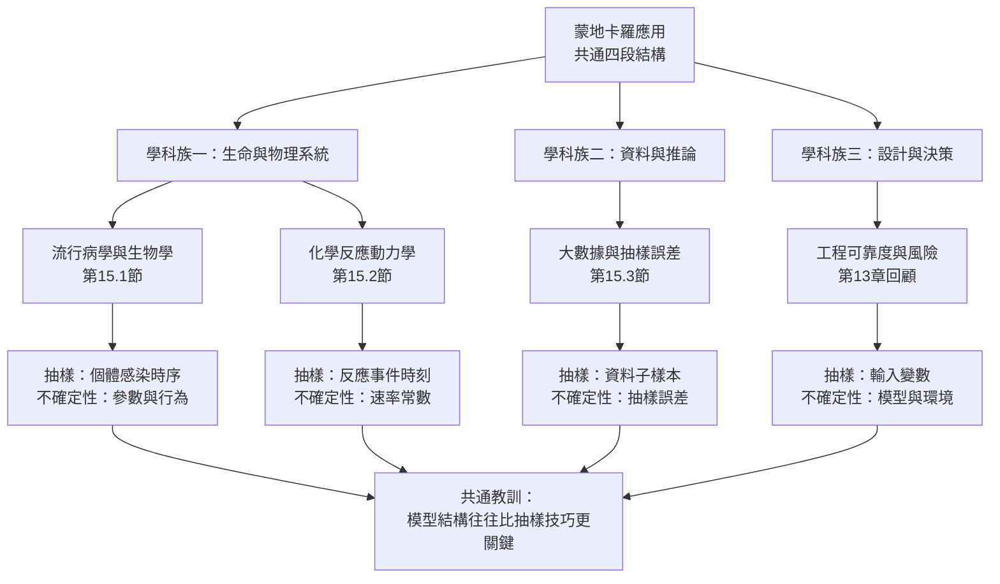

# 第15章　跨學科應用案例

[上一章：第14.3節：深度學習與蒙地卡羅方法](14.3-深度學習與蒙地卡羅方法.md) | [下一章：第15.1節：生物學與流行病學中的蒙地卡羅法](15.1-生物學與流行病學中的蒙地卡羅法.md)

前面十四章，讀者已經看過蒙地卡羅法在工程可靠性、風險決策、機器學習與生成模型中的應用。這些領域的表面形態差異極大——一個是壽命測試，一個是變分後驗，一個是影像分割的不確定性圖——但如果把方法剝開，會發現它們的**骨架完全相同**。

本章是全書的「收束」章：它不引入新方法，而是抽象出一個**跨學科共通結構**，並以此為框架，用三節（生物學與流行病學、化學反應動力學、大數據）分別示範這個骨架在不同學科中的形態與陷阱。抽象共通結構的目的不是為了統一，而是為了讓讀者能夠**在自己的領域裡辨認出那個熟悉的骨架**，並預判它會在哪裡失效。

## 學習目標

完成本章後，你應該能夠：

1. 說明跨學科蒙地卡羅應用的共通四段結構：不確定性來源 → 抽樣 → 傳播 → 決策，並說明每一段的學科無關性與學科相關性。
2. 辨認「抽樣物件」這個關鍵變項：抽的是輸入參數、隨機過程路徑、構型空間狀態、還是非同源樣本。
3. 解釋為什麼跨領域遷移的障礙通常不是演算法，而是「機率語意」（同一個符號在不同領域代表不同對象）。
4. 描述本章案例地圖所涵蓋的三個學科族及其核心不確定性來源。
5. 說明為什麼「重複的實驗結構」比「新的數學」更值得跨學科借鑑。
6. 理解蒙地卡羅方法在跨學科使用時最常見的三種誤用：把相關當獨立、把點估計當結論、以及忽略抽樣誤差的絕對尺度。

## 15.1 共通結構：四段式

任何一個嚴謹的蒙地卡羅應用，都可以被拆解成四個環節：

```
不確定性來源  →  抽樣機制  →  傳播與求解  →  統計與決策
```

- **不確定性來源**：哪些量是不確定的？它們是隨機的（固有）還是不確定已知的（認知）？彼此相依嗎？
- **抽樣機制**：如何從（已建模的）不確定性中取出樣本？抽樣分佈是原始的，還是替代的（重要性抽樣）、構造的（Gibbs 條件抽樣）、或由演化過程產生的（隨機過程）？
- **傳播與求解**：抽出的樣本如何被「送進」某個模型並得到回應？這一步通常是最貴的，也最決定方法可行性。
- **統計與決策**：從回應樣本中抽出什麼樣本量？誤差如何報？結論如何支撐行動？

這四段在物理、流行病學、化學與機器學習中，**每一段的實作內容都不同，但結構一致**。這個一致性是本書最重要的實用價值之一：一門跨領域的技術，其實傳承的是一套**思考程序**，而不只是一堆公式。

### 15.1.1 抽樣物件：跨學科差異的真正所在

若要在四段中找出一個最能區分學科的變項，那就是「抽樣的是什麼」：

| 學科 | 抽樣物件 | 傳播機制 | 統計量 |
| --- | --- | --- | --- |
| 物理／統計力學 | 構型空間的微觀狀態 | 局部躍遷（Metropolis） | 平均能量、位能分布 |
| 流行病學 | 個體的感染時序 | 隨機過程（連鎖反應） | $`R_0`$ 、發病率曲線 |
| 化學動力學 | 反應事件的發生時刻 | Gillespie 直接法 | 濃度軌跡、速率常數 |
| 工程可靠度 | 輸入變數（壽命、負載） | 響應模型求解 | 失效機率、分位數 |
| 機器學習 | 後驗參數或遮蔽 | 馬可夫鏈 | 後驗均值、可信區間 |
| 大數據 | 資料索引或子樣本 | 統計量的重算 | 抽樣誤差、檢定統計量 |

這個表格是本章的實質內容之一。當工程師說「我們也用蒙地卡羅」，他很可能抽的是與流行病學家完全不同種類的東西，因此**成功的條件與失敗的型態也完全不同**。

### 15.1.2 跨學科遷移的真正障礙：機率語意

同一個數學式子在不同領域可能代表完全不同的東西，這是跨學科借鑑最常踩的坑。舉例而言：

- 在統計力學中， $`\exp(-E/kT)`$ 是**構型的權重**（比例），比例常數不重要。
- 在統計推論中， $`p(x \mid y)`$ 是**條件機率**，正規化是必需的。
- 在流行病學的 SEIR 模型中， $`\beta`$ 既是**接觸率參數**，其量綱又牽動整個模型的時間尺度。

若把物理學家的「比例常數不重要」直接搬到貝葉斯模型，就會犯下正規化錯誤；若忽略 epidemiology 中參數的量綱，就會得到「估計值隨時間單位改變」的荒誕結論。

**因此，跨學科借鑑的正確做法是：借鑑「四段結構」與「演算法骨架」，而非直接搬運公式與常數。**

## 15.2 案例地圖



上圖是本章的案例地圖：中央是共通的四段結構，外圍是四個學科族。底部的「共通教訓」節點是本章的結論——在這些案例中，**決定成敗的往往不是抽樣技巧多精巧，而是模型結構是否捕捉到真實機制**。這是從第12章「可行性分析」延伸而來的告誡：蒙地卡羅只能把「你給的模型」計算得很準，卻無法修正「模型本身錯了」。

## 15.3 三個案例的對照：同一結構的三種形態

| 面向 | 流行病學（第15.1節） | 化學（第15.2節） | 大數據（第15.3節） |
| --- | --- | --- | --- |
| 不確定性主要來源 | 行為假設、參數稀疏資料 | 速率常數、噪聲 | 抽樣誤差、資料代表性 |
| 抽樣物件 | 隨機過程中的事件時序 | 化學反應事件的等待時間 | 資料列／索引 |
| 傳播機制 | 個體狀態轉移（連鎖） | 化學計量學（stoichiometry） | 統計量的重算 |
| 統計量 | $`R_0`$ 、時間序列 | 濃度、速率常數估計 | 信賴區間、檢定力 |
| 特有陷阱 | 決定論 SEIR 會低估 $`R_0`$ | 分子數過少時連續近似失效 | 抽樣單位與相關性 |
| 典型加速技術 | 加速疾病模型、重抽樣 | 稀釋極限、重要性抽樣 | 重要性抽樣、分層抽樣 |

## 15.4 四段結構的可重複骨架

共通結構若只是口號，就無法被實際使用。下面把它寫成一段**可重複的程式骨架**：同一份程式碼，只要替換「不確定性來源」與「傳播求解器」兩個元件，就能承載本章三個學科的案例。

```python
import numpy as np

def monte_carlo_pipeline(sample_inputs, solve_response, decision_rule, n=10_000, seed=0):
    """跨學科共用的蒙地卡羅四段式骨架。
    對應理論：不確定性來源 → 抽樣 → 傳播與求解 → 統計與決策。"""
    rng = np.random.default_rng(seed)

    # 1. 不確定性來源 + 2. 抽樣：抽出 n 組情境參數
    scenarios = sample_inputs(n, rng)

    # 3. 傳播與求解：逐情境計算回應（本步最貴，決定方法可行性）
    responses = np.array([solve_response(s) for s in scenarios])

    # 4. 統計與決策：由回應樣本導出結論與不確定性
    stats = {
        "mean": float(responses.mean()),
        "se": float(responses.std(ddof=1) / np.sqrt(n)),
        "p05": float(np.quantile(responses, 0.05)),
        "p95": float(np.quantile(responses, 0.95)),
    }
    return stats, decision_rule(stats, responses)


# --- 示範一：可靠度（工程，第13章） ---
def reliability_case(n, rng):
    lives = rng.lognormal(mean=8.6, sigma=0.30, size=(n, 3))   # 三元件壽命
    return lives

def reliability_solve(lives):
    return float(np.all(lives > 3000.0, axis=1).mean())          # 3000 小時仍正常的比例

def reliability_decision(stats, responses):
    return {"建議": "通過" if stats["p05"] > 0.99 else "需降額使用或加冗餘"}

# --- 示範二：疫情（生物學，第15.1節） ---
def epi_case(n, rng):
    return rng.poisson(6.0 * 8.0 * 0.06, size=n)                # 每位感染者造成的後代數

def epi_solve(offspring):
    return float(offspring.mean())                              # 分支過程的繁殖數 R0

def epi_decision(stats, responses):
    return {"建議": "需追加疫苗" if stats["mean"] > 1.0 else "現有策略足夠"}

for name, case, solve, rule in [
    ("可靠度", reliability_case, reliability_solve, reliability_decision),
    ("R0", epi_case, epi_solve, epi_decision),
]:
    stats, decision = monte_carlo_pipeline(case, solve, rule, n=20_000)
    print(f"{name}: mean={stats['mean']:.4f}, se={stats['se']:.4f}, {decision}")
```

這段骨架揭示了本章最重要的實用論點：**跨學科可攜的是「程式結構」而非「公式」**。可靠度案例抽的是元件壽命、疫情案例抽的是後代數，兩者的語意完全不同，但「抽樣 → 傳播 → 統計 → 決策」這條管線完全共用。這正是第15.1至15.3節各自案例的骨架。

## 15.5 跨學科使用蒙地卡羅的三種典型誤用

在實際的教學與研究中，以下三種誤用反覆出現，值得單獨列出：

**誤用一：把相關當獨立。** 這是最普遍也最危險的錯誤。當多個元件共享環境因子、多個變數來自同一母體、多個資料點來自同一受試者時，把它們當成獨立會系統性地低估風險。在物理中要引入共同隨機因子與共因失效（見第13.1節），在流行病學中要引入社群結構，在大數據中要用群組抽樣（cluster sampling）與分層設計。

**誤用二：把點估計當結論。** 蒙地卡羅天然產出的是一個隨機估計量；它的價值在於可以談誤差。當人們只引用「模擬結果是 37.4%」而不附抽樣誤差與信賴區間，蒙地卡羅就退化成了「跑了很多次的直覺」，反而比不用模擬更危險——因為它看起來很精確。

**誤用三：忽略抽樣誤差的絕對尺度。** 這一點最容易被忽略，但影響重大。蒙地卡羅的相對誤差 $`1/\sqrt{N}`$ 聽起來很小，但當估計量本身接近零（例如一個機率是 $`10^{-6}`$ 的事件），即使相對誤差很小，**絕對誤差仍可能大於估計值本身**。因此正確的做法是：先決定「我需要多大的絕對精度」，再據此推算所需樣本數，而不是先定 $`N = 10^6`$ 再看結果。

## 15.6 本章三節的閱讀指引

- **第15.1節 生物學與流行病學中的蒙地卡羅法**：示範「隨機過程建模」這一分支。核心案例是 SEIR 模型、R0 的蒙地卡羅估計、疫苗策略優化、個體基礎模擬（agent-based simulation），以及生物資訊中的應用。
- **第15.2節 化學反應動力學中的模擬**：示範「把微觀事件序列當作隨機過程」這一分支。核心是 Gillespie 直接法、化學平衡的蒙地卡羅、自由能計算與化學主方程的關係。
- **第15.3節 大數據與蒙地卡羅方法**：示範「把統計推論本身當作抽樣問題」這一分支。核心是抽樣誤差、bootstrap 與 jackknife、稀有事件偵測、subset simulation、MCTS 與線上實驗。

三節的共通問題是：**當系統的規模或複雜度使得「直接計算真值」不可能時，蒙地卡羅如何給出一個可用的近似，以及這個近似的邊界在哪裡。**

## 本章要點

- 所有嚴謹的蒙地卡羅應用都可拆成四段：不確定性來源 → 抽樣機制 → 傳播與求解 → 統計與決策；跨學科借鑑的應該是這套結構。
- 區分各學科最有效的變項是「抽樣物件」：它決定了方法的可行條件與失敗型態。
- 跨學科遷移的主要障礙不是演算法，而是機率語意與量綱；直接搬運公式是最常見的錯誤。
- 決定成败的通常是模型結構是否忠實於機制，而非抽樣技巧的精巧程度。
- 三種最常見的誤用：把相關當獨立、把點估計當結論、忽略抽樣誤差的絕對尺度。
- 第15.1至15.3節分別示範隨機過程建模、微觀事件模擬、統計推論本身化三種分支。

## 延伸閱讀

- Kitman, E. P. (2008). *All the Statistics*. Cambridge University Press.——統計思維的通識入門，適合作為跨學科讀者的橋樑書。
- Greengard, S. & Roubenko, G. (2013). *The Monte Carlo Method for Solving Complex Systems*.——隨機過程模擬的跨學科視角。
- Higdon, C., Kettenring, J., & Pawlowski, N. (1995). "A Guide to Uncertainty Quantification for Statistical Applications."——不確定性量化的跨領域原則。
- [第15.1節：生物學與流行病學中的蒙地卡羅法](15.1-生物學與流行病學中的蒙地卡羅法.md)、[第15.2節：化學反應動力學中的模擬](15.2-化學反應動力學中的模擬.md)、[第15.3節：大數據與蒙地卡羅方法](15.3-大數據與蒙地卡羅方法.md)、[第12章：蒙地卡羅法可行性分析](12.0-蒙地卡羅法可行性分析.md)
