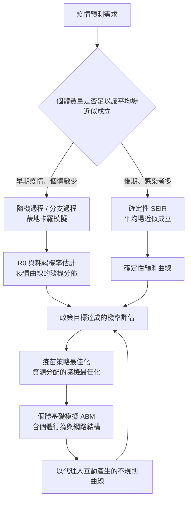

## 15.1 生物學與流行病學中的蒙地卡羅法

[上一章：第15章　跨學科應用案例](15.0-跨學科應用案例.md) | [下一章：第15.2節：化學反應動力學中的模擬](15.2-化學反應動力學中的模擬.md)

流行病學是蒙地卡羅方法在生物科學中最成熟、也最有社會影響力的應用領域。它的核心任務——「一場疫情會如何發展、 $`R_0`$ 是多少、哪一種疫苗策略最划算」——本質上都是機率問題；而個體之間的互動、隨機的接觸、機會性的感染，則天然適合用隨機過程建模。

本節的主線是：**從確定性的微分方程模型，走向能捕捉個體隨機性的隨機過程模型，並用蒙地卡羅從中估計關鍵數量。**

## 學習目標

完成本節後，你應該能夠：

1. 說明 SEIR 模型的四個狀態 compartment 與其確定性方程，並指出它作為平均場近似的侷限。
2. 解釋「確定性 SEIR 給出的 $`R_0`$ 與 branching process 給出的 $`R_0`$ 為何不同」，並理解後者才是流行病學的正確定義。
3. 描述用分支過程蒙地卡羅估計 $`R_0`$ 的方法，並說明如何用自助抽樣（bootstrap）取得信賴區間。
4. 說明隨機過程版本（CTMC）的疫情曲線為何比確定性曲線更「不規則」，以及這對政策判讀的意義。
5. 描述個體基礎模擬（agent-based simulation, ABM）相較 compartment 模型的優勢與代價。
6. 討論疫苗策略優化中蒙地卡羅的角色，以及「資源有限」如何被納入最佳化。
7. 說明蒙地卡羅在生物資訊（蛋白質摺疊、序列對齊、貝葉斯樹）中的三種典型用法。

## 15.1.1 從確定性 SEIR 到隨機過程

**SEIR 模型**把人群劃分為四個 compartment：易感者 $`S`$ 、暴露者 $`E`$ 、感染者 $`I`$ 、移除者 $`R`$ 。確定性版本為

$$
\frac{dS}{dt} = -\beta \frac{S I}{N}, \qquad
\frac{dE}{dt} = \beta \frac{S I}{N} - \sigma E, \qquad
\frac{dI}{dt} = \sigma E - \gamma I, \qquad
\frac{dR}{dt} = \gamma I
$$


其中 $`\beta`$ 是傳染率、 $`1/\sigma`$ 是潛伏期、 $`1/\gamma`$ 是感染期。

**前因**：早期疫情模型需要快速上手、參數少、可用解析或數值ODE求解，於是 average-field 假設（每個人接觸到的感染風險相同）被採用。

**後果**：SEIR 能給出經典的「鐘形疫情曲線」，並給出形式的再生數

$$
R_0 = \frac{\beta}{\gamma}
$$


（在含 $`E`$ 的模型中還需乘上 $`\sigma/(\sigma+\gamma)`$ 的比例修正）。

**新問題（也是本節的驅動力）**：在疫情初期，感染人數很少，此時**隨機效應支配**：一個感染者是否恰好接觸到易感者、接觸時機如何，這些「機率波動」無法被平均值捕捉。這造成三個具體後果：

1. **早期疫情的隨機游走**：同一組參數下兩次模擬的曲線可以差很多。
2. **耗竭效應（extinction）**：在初期分支過程可能完全滅絕，機率為一個正數而非 0。
3. ** $`R_0`$ 的定義問題**：確定性模型裡 $`R_0`$ 是「典型個體的期望後代數」，但這不等於流行病學中真正的定義。

## 15.1.2 $`R_0`$ 的正確定義與分支過程蒙地卡羅

流行病學中，基本再生數 $`R_0`$ 的嚴格定義是：

> 在一個完全易感的群體中，一個典型感染者在整個感染期內所造成的**新感染者的期望數**。

這正是**分支過程（branching process）**的繁殖數。因此最自然的蒙地卡羅估計法是：直接模擬分支過程。

```python
import numpy as np

def estimate_R0_monte_carlo(n_reps=20_000, infectious_days=6.0,
                             contacts_per_day=8.0, prob_transmission=0.06,
                             seed=42):
    """用分支過程蒙地卡羅估計 R0：模擬一個感染者的後代數。
    對應理論：R0 = 分支過程的繁殖數 = 每位感染者在感染期內造成的新感染期望數。"""
    rng = np.random.default_rng(seed)
    # 感染期內的接觸次數為 Poisson；每次接觸以機率 p 造成感染
    expected_contacts = infectious_days * contacts_per_day
    contacts = rng.poisson(expected_contacts, size=n_reps)
    infections = rng.binomial(contacts, prob_transmission)   # 後代數
    offspring = infections.astype(float)

    r0_hat = offspring.mean()
    # 自助抽樣求 95% 信賴區間（bootstrap CI）
    boot = np.array([rng.choice(offspring, size=n_reps, replace=True).mean()
                     for _ in range(500)])
    lo, hi = np.quantile(boot, [0.025, 0.975])
    return {"R0_hat": r0_hat, "CI_low": lo, "CI_high": hi,
            "P(該次疫情完全消滅)": float((offspring == 0).mean())}
```

這段程式碼的對應關係非常清楚：

- `rng.poisson` 對應「感染期內接觸次數為隨機」的機制假設；
- `rng.binomial` 對應「每次接觸以固定機率傳染」的簡化 Bernoulli 模型；
- 樣本均值估計 $`R_0`$ ，其抽樣誤差為 $`\sigma/\sqrt{N}`$ ，這與第4章的蒙地卡羅積分誤差公式完全一致；
- 自助抽樣（bootstrap，見第15.3節）用「把樣本當母體、重抽形成新樣本」的思路，取得 $`R_0`$ 的信賴區間；
- `P(該次疫情完全消滅)` 直接給出耗竭機率，這是確定性 SEIR 永遠無法提供的量。

**關鍵對照**：若用確定性 SEIR 計算，得到的是 $`\beta/\gamma`$ ；用分支過程估計，得到的是**另一個數**。差異的來源是：接觸次數是隨機的，而確定性模型把它換成平均值；此外，若接觸次數的分布是「過度分散」（變異係數 > 1），分支過程的繁殖數會**低於**由平均值算出的值。這是 Overdispersion 效應，也是為何只用平均接觸數估計 $`R_0`$ 會系統性高估傳播能力。

## 15.1.3 隨機過程疫情模型

把 SEIR 改寫成連續時間馬可夫鏈（CTMC）即可得到隨機版本：狀態為 $`(S, E, I, R)`$ 的計數，轉移率分別為 $`\beta S I / N`$ 、 $`\sigma E`$ 、 $`\gamma I`$ ，每次事件抽一個指數等待時間並更新狀態。

產生的疫情曲線與確定性版本有本質差別：

- **曲線不規則**：存在隨機波動，早期尤其明顯。
- **峰值的到來時間與高度是隨機變數**：多次模擬會給出不同的峰值。
- **耗竭機率**：小族群中疫情可能提早結束。

**政策意義**：確定性模型給出「一條曲線」，決策者容易把它當成必然的預測；隨機模型給出「一整片曲線」，它傳達的是「政策目標（例如何時壓平峰值）達成機率是多少」。後者才是真正可以據以決策的資訊。



上圖說明本章的方法論遞進：確定性模型在個體數足夠時是很好的近似，但在疫情初期失效；而隨機過程模型提供了「機率化」的預測；個體基礎模擬則把個體行為與接觸網路加回來，得到更不規則但也更真實的曲線。三者的共同點是：**它們輸出的是一整個預測分佈，而非單一軌跡。**

## 15.1.4 疫苗策略優化

疫苗策略的本質是一個**帶資源限制的隨機最佳化問題**：給定總劑量、給定接種速度、給定疫苗效力（不同變異株的逃脫率）、給定接種優先順序（高風險族群優先），如何使感染人數或死亡人數最小化？

蒙地卡羅在此的角色是**評估函數**：每一組策略方案都要用蒙特地卡羅模擬來評估其疫情結果（感染總數、峰值高度、死亡數），再由外層最佳化（模擬退火、貝葉斯最佳化、窮舉）挑選方案。

```python
import numpy as np

def simulate_with_vaccination(p0=1e-4, N=1_000_000, R0=2.5,
                              vaccine_efficacy=0.8, doses_per_day=50_000,
                              days=180, seed=0, priority_fraction=0.15):
    """含疫苗投放的 SEIR 隨機過程模擬（簡化版）。
    對應理論：不確定性 → 抽樣 → 傳播 → 統計；每次模擬為一條可能疫情路徑。"""
    rng = np.random.default_rng(seed)
    S, E, I, R = N * (1 - p0), 0.0, N * p0, 0.0
    vaccinated = 0.0
    total_infected = 0.0
    peak_I = I
    beta = R0 * 0.1        # 假設 gamma = 0.1（感染期 10 天）
    sigma, gamma = 0.2, 0.1

    for _ in range(days):
        new_exp = beta * (S / N) * I
        new_inf = sigma * E
        rec = gamma * I
        # 疫苗：每日固定劑量，優先接種高風險比例（此處簡化為隨機接種）
        vacc_today = min(doses_per_day, N * priority_fraction - vaccinated)
        vacc_today = max(vacc_today, 0.0)
        vaccinated += vacc_today
        # 疫苗效力：以「免疫比例」進入 R 的等價處理
        R += rec + vacc_today * vaccine_efficacy
        S -= new_exp
        E += new_exp - new_inf
        I += new_inf - rec
        R -= R * 0  # 保持簡化（此模型忽略自然死亡與移出）
        total_infected += new_inf
        peak_I = max(peak_I, I)

    return {"累計感染比例": total_infected / N, "峰值感染比例": peak_I / N}
```

程式碼刻意保留了簡化（人口封閉、不計死亡與自然死亡），因為它的重點不是疫情模型的完整物理，而是**「把每個策略方案送進模擬器、用蒙地卡羅取得結果分佈、再交給最佳化器」這個結構**。在真實研究中，這個模擬器是「黑箱的評估函數」，最佳化器只透過分佈來比較方案，因此每一輪最佳化都需要多次模擬，**模擬次數不足會讓最佳化器去追隨模擬噪聲**——這正是第11章與第15.3節強調的抽樣誤差問題。

## 15.1.5 個體基礎模擬

**個體基礎模擬（agent-based model, ABM）** 放棄 compartment 的假設，每一個個體有自己的狀態、行為規則與接觸網路。這帶來三個確定性模型無法提供的能力：

1. **異質性**：不同個體有不同的接觸率（超級傳播者、社交隔離者）。
2. **網路結構**：隨機網路、帶狀（hub）網路、地理網路會給出完全不同的流行曲線。
3. **行為回饋**：個體會依據疫情資訊調整行為（恐慌、減少外出），形成回饋迴圈。

代價是計算量龐大（百萬代理人 × 數百天 × 數百次重複），以及**結果對行為假設的敏感性**——而行為假設通常是最難取得也最難驗證的部分。

**2020 年以《Minecraft》為平台的研究**提供了一個有趣的例證：以多人線上遊戲《Minecraft》的世界與玩家行為作為個體互動的代理環境，模擬 COVID-19 的傳播並觀察疫情曲線形態。此類研究的發現集中在幾點：

- 在有明確的接觸網路與個體移動行為的世界中，產生的疫情曲線呈現**明顯的不規則性與多次波動**，而非確定性 SEIR 的單一平滑鐘形。
- 曲線的形態高度依賴個體的聚集行為與空間結構參數，這些參數的不確定性被直接放大為預測的不確定性。
- 這類模型顯示，若把個體互動的細節建模得當真，則「疫情會在某個時點自然平息」這類說法並不成立，疫情的消退是群體行為改變的結果。

這份研究的重要意義不在於其模型的細節，而在於它示範了**個體基礎模型能產生確定性模型結構上無法產生的現象**——這是第15.0節「模型結構往往比抽樣技巧更關鍵」的直接佐證。它同時提醒我們：以遊戲世界為代理的模型，其行為參數的可外推性有限，結論應限於「機制上的啟示」，而非「對真實世界的定量預測」。

## 15.1.6 生物資訊中的蒙地卡羅

生物資訊是蒙地卡羅的另一個重要棲地，三種典型用法：

**（一）蛋白質摺疊與分子動力學。** 蛋白質摺疊是極高維的構型空間優化問題（阿倫的狗之謎：數十個可能的構型、兩千萬種可能的摺疊方式）。傳統的 Metropolis 摺疊模擬（第8章）正是此領域的開山大作；在原子層次，則是 Langevin 動力學模擬蛋白質在溶劑中的運動，以蒙地卡羅抽樣求構型平均。現代的分子動力學套件（LAMMPS、GROMACS、OpenMM）都以蒙地卡羅／MD 為核心。

**（二）序列對齊。** 動態規劃求「最優對齊」是一個最佳化問題，而貝葉斯方法則要處理多個對齊假設下的不確定性。Markov chain Monte Carlo 被用於從對齊的後驗分佈抽樣（例如蛋白質結構域的環狀排列），以獲得「哪些位置對齊不確定」的機率圖——這在演化分析中很有價值。

**（三）系統發育與貝葉斯樹。** 樹的後驗分佈可用 MCMC 抽樣（Beast、BAli-Phy 等工具），並以 ESS、 $`R`$ hat 等診斷（第14.2節）確認收斂。演化樹的後驗通常是多峰的（不同的樹拓撲），這正是變分推論容易失敗而 MCMC 更有價值的場合。

**跨學科連結**：這三個用法與第14.2節的 MCMC 是同一套工具，只是「參數」換成「構型」、「對齊」或「樹拓撲」。這再次印證本章的核心：**工具可攜，語意不可攜。**

## 15.1.7 實務注意事項

1. **參數的量綱與可辨識性**： $`\beta`$ 、 $`\sigma`$ 、 $`\gamma`$ 的乘積與比值常常只能被部分辨識，參數估計的後驗可能很長（ridgeline 形狀）。這是蒙地卡羅的統計技術能提供幫助的地方。
2. **初期資料稀少**：疫情初期的資料最不完整，但對參數估計影響最大。應避免把早期的不確定性當成確定值。
3. **行為假設的敏感性**：應對行為參數做敏感度分析與情境分析，而非只跑一組參數。
4. **不要把隨機過程的「平均曲線」當成預測**：政策判斷需要的是「達到某個目標的機率」。

## 本章要點

- SEIR 是平均場近似，在疫情初期（感染者少）會因忽略隨機效應而失效；隨機過程（CTMC）版本能給出曲線的分佈而非單一軌跡。
- $`R_0`$ 的嚴格定義是分支過程的繁殖數，必須用蒙地卡羅模擬分支過程來估計，並以 bootstrap 給出信賴區間；確定性 $`\beta/\gamma`$ 與分支過程估計值系統性不同。
- 接觸次數的過度分散會使分支過程的 $`R_0`$ 低於由平均值算出的值。
- 疫苗策略優化把蒙地卡羅當作評估函數；評估端的抽樣噪聲會被最佳化器利用，因此模擬次數必須與最佳化器的探索能力匹配。
- 個體基礎模擬能表現異質性、網路結構與行為回饋，產生確定性模型無法產生的不規則疫情曲線；代價是計算量與行為假設的可驗證性。
- 生物資訊中的摺疊、對齊與系統發育，都是同一套 MCMC 在不同「語意」下的應用。

## 延伸閱讀

- Keeling, M. J. & Rohani, P. (2008). *Modeling Infectious Diseases in Humans and Animals*. Princeton University Press.——SEIR 與隨機過程模型的權威教科書。
- Andersson, M. & Britton, T. (2000). *Stochastic Epidemic Models and Applications*. Springer.——分支過程與 $`R_0`$ 的嚴格處理。
- Nåsell, I. (1999). "On the Quasipotential of Stochastic Logistic Epidemics." *Math. Biosci.*——分支過程估計與耗竭機率。
- Axtell, J. M. et al. (1996). "Aligning Simulation Models: A Case Study and Results." *Comput. Math. Org. Theory*.——早期 ABM 的方法論。
- Miller, J. C. (2017). *Simulation Modeling and Analysis*. 5th ed., McGraw-Hill.——ABM 與蒙地卡羅實作。
- [第15.2節：化學反應動力學中的模擬](15.2-化學反應動力學中的模擬.md)、[第14.2節：蒙地卡羅抽樣在貝葉斯推斷中的應用](14.2-蒙地卡羅抽樣在貝葉斯推斷中的應用.md)、[第8.1節：熱力學與統計力學中的蒙地卡羅方法](08.1-物理模擬：熱力學與統計力學.md)
