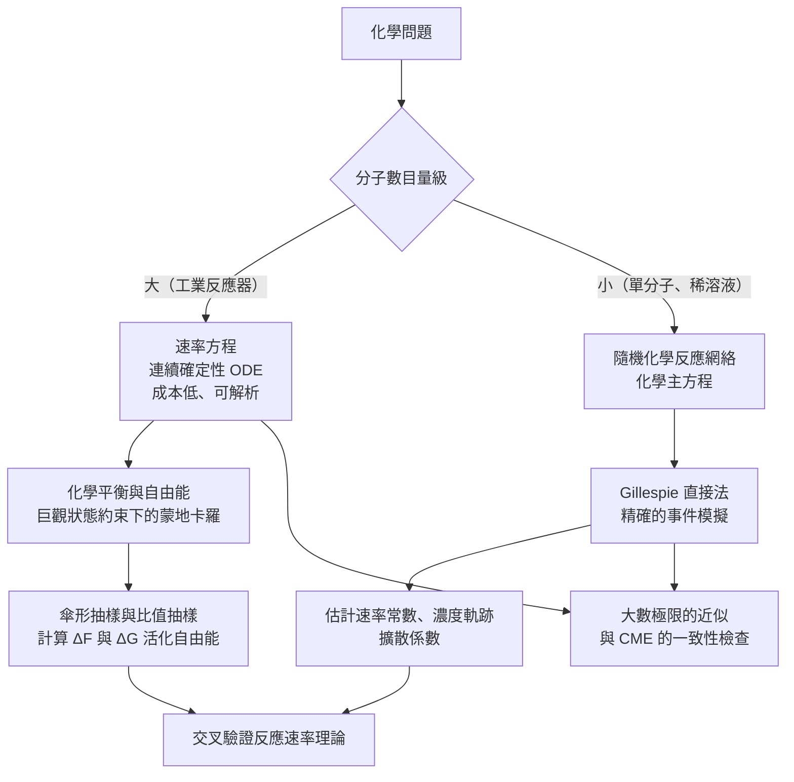

## 15.2 化學反應動力學中的模擬

[上一章：第15.1節：生物學與流行病學中的蒙地卡羅法](15.1-生物學與流行病學中的蒙地卡羅法.md) | [下一章：第15.3節：大數據與蒙地卡羅方法](15.3-大數據與蒙地卡羅方法.md)

化學是蒙地卡羅法的「原生領域」之一——統計力學的 Metropolis 抽樣（第8章）就是為了解決化學問題而生的。本節要處理的則是更「動態」的一面：**化學反應動力學**——分子如何碰撞、反應、濃度如何隨時間演化。

這裡出現一個在其他領域少見的張力：化學同時有巨觀的確定性描述（速率方程）與微觀的隨機描述（化學主方程）。蒙地卡羅法在其中的角色，是**用微觀的隨機事件序列重建巨觀的確定性行為**，並在巨觀近似失效時提供精確答案。本節因此有兩條並行的主線：**反應事件模擬**（Gillespie）與**平衡與自由能計算**（蒙地卡羅積分）。

## 學習目標

完成本節後，你應該能夠：

1. 說明化學反應網絡、質量作用定律與速率方程的關係，並理解速率方程是「平均場近似」。
2. 描述 Gillespie 直接法的三個步驟，並解釋為什麼它能給出化學主方程的精確解。
3. 說明化學主方程（chemical master equation, CME）與速率方程的關係，以及在什麼條件下兩者近似一致。
4. 理解「分子數很少時確定性近似失效」的原因，並說明隨機波動的相對大小如何隨濃度變化。
5. 說明化學平衡的蒙地卡羅方法：如何在巨觀狀態約束下抽樣，並計算自由能與平衡常數。
6. 描述擴散係數估算的蒙地卡羅方法（Brownian 動力學、隨機漫步位移平方）與其統計誤差來源。
7. 說明蒙地卡羅與反應速率理論的關係，以及為何模擬能提供速率常數的統計不確定性。

## 15.2.1 速率方程與平均場近似

考慮反應 $`A + B \to C`$ 。巨觀速率方程為

$$
\frac{d[A]}{dt} = -k[A][B], \qquad \frac{d[C]}{dt} = k[A][B]
$$


其中 $`k`$ 是速率常數。注意這裡的 $`[A][B]`$ 乘積形式，它來自**質量作用定律**：反應速率正比於反應物濃度的乘積。

**前因**：化學工程與生物化學需要能描述濃度隨時間變化的簡單、可解ODE模型，用於反應器設計與藥物代謝預測。

**後果**：速率方程給出平滑的濃度曲線，可用解析或數值ODE求解，成本極低。

**新問題（隨機效應）**：速率方程假設了「在任一瞬間，系統狀態等於它的平均值」，這在分子數目極大時成立，但當分子數目很小時，系統的實際狀態會**隨機跳動**。例如在 $`10^{-15}`$ M 濃度下，整個樣品管中可能只有幾個分子，此時「濃度」的連續概念本身就失去意義。

**相對波動的量綱分析**：對化學計量數 $`\nu_{ij}`$ 對應的第 $`j`$ 種物種，

$$
\frac{\text{相對波動}}{\text{確定性值}} \propto \frac{1}{\sqrt{N}}
$$


其中 $`N`$ 是該物種的分子數目。所以**只要 $`N \gtrsim 10^4`$ ，隨機效應在相對意義上就可忽略**；這就是為何工業反應器（濃度以 mol/L 計）用速率方程毫無問題，而單分子實驗（單分子生物學）必須用隨機模型。

## 15.2.2 Gillespie 直接法

**Gillespie 直接法**（Gillespie, 1977）是把隨機化學反應網絡（stochastic chemical reaction network, CRN）精確模擬的演算法。演算法如下：

1. **計算總反應率**：給定當前狀態 $`\mathbf{x} = (x_1, \dots, x_M)`$ ，對每個反應 $`j = 1, \dots, J`$ 計算速率 $`a_j(\mathbf{x}) = c_j \prod_k x_k^{\nu_{jk}}`$ ，總率 $`a_0 = \sum_j a_j`$ 。
2. **抽等待時間**：抽 $`\Delta t \sim \mathrm{Exponential}(\text{rate} = a_0)`$ ，即

   $$
   \Delta t = -\frac{\ln u}{a_0}, \qquad u \sim U(0,1)
   $$

3. **抽發生哪個反應**：以機率 $`a_j / a_0`$ 選取反應 $`j`$ 。
4. **更新狀態**： $`\mathbf{x} \leftarrow \mathbf{x} + \nu_j`$ ，時間 $`t \leftarrow t + \Delta t`$ 。
5. 重複直到指定時間或反應次數。

```python
import numpy as np

def gillespie_direct(x0, reactions, stoich, t_end, rng=None):
    """Gillespie 直接法：精確模擬隨機化學反應網絡。
    對應理論：反應事件的等待時間為指數分佈（無記憶性），
    事件類型依總率的比例抽樣。"""
    rng = rng or np.random.default_rng(0)
    x = np.array(x0, dtype=float)
    t = 0.0
    traj_t, traj_x = [t], [x.copy()]

    while t < t_end:
        # 1. 各反應速率（質量作用定律）
        rates = []
        for reactants, rate_const in reactions:
            a = rate_const
            for k, n in reactants:            # 反應物濃度
                a *= x[k] ** n
            rates.append(a)
        rates = np.array(rates)
        a0 = rates.sum()
        if a0 <= 0:
            break
        # 2. 指數等待時間
        dt = rng.exponential(1.0 / a0)
        # 3. 以 a_j / a_0 選反應
        j = rng.choice(len(rates), p=rates / a0)
        # 4. 更新化學計量
        x = x + stoich[j]
        t += dt
        traj_t.append(t)
        traj_x.append(x.copy())
    return np.array(traj_t), np.array(traj_x)

# 範例：A <-> B（可逆一階反應），以及 A + B -> C
reactions = [([(0, 1)], 0.10), ([(1, 1)], 0.25), ([(0, 1), (1, 1)], 1.0)]
stoich = np.array([[+1.0], [-1.0], [-1.0, +1.0, +1.0]])   # A, B, C
t, x = gillespie_direct([100.0, 0.0, 0.0], reactions, stoich, t_end=10.0)
print("末端濃度 A, B, C =", x[-1])
```

程式碼中的 `rng.exponential(1.0 / a0)` 對應等待時間的指數分佈；`rng.choice(..., p=rates / a0)` 對應事件類型的比例抽樣。整個演算法**沒有任何近似**——它給出的是化學主方程的精確解的樣本路徑。

## 15.2.3 化學主方程與速率方程

**化學主方程（CME）** 描述的是分子數 $`\mathbf{x}`$ 的機率分佈隨時間的演化：

$$
\frac{d p(\mathbf{x}, t)}{dt} = \sum_{j=1}^{J} \left[ a_j(\mathbf{x} - \nu_j)\,p(\mathbf{x} - \nu_j, t)
- a_j(\mathbf{x})\,p(\mathbf{x}, t) \right]
$$


**Gillespie 直接法正是這個方程的精確隨機模擬**。這是一個非常漂亮的對應：**蒙地卡羅方法在這裡不是近似，而是方程本身的另一種表述。**

而速率方程則是 CME 在「分子數極大、巨觀量近似確定」極限下的**確定性平均場近似**：

$$
\frac{d\langle \mathbf{x}\rangle}{dt} = \sum_j \nu_j\, a_j(\langle \mathbf{x}\rangle)
$$


**因此有清晰的層次關係**：

```
Gillespie 模擬（精確）
        │ 大數極限 / 平均場近似
        ▼
化學主方程 → 速率方程（連續、確定）
```

這是本節最值得體會的結構：**蒙地卡羅模擬不是與速率方程競爭的對手，而是它的更一般、更精確的版本**。工程上仍然使用速率方程（便宜），但當分子數少、或需要完整的機率分佈（而非只有均值）時，就必須回到 Gillespie。

**實務要點**：Gillespie 的事件數可能極大（反應速率高時），導致「事件驅動」模擬比 ODE 求解還慢。改進方向包括 tau-leaping（以固定時間步長近似處理多個事件）、連續時間近似、以及利用第6章的 GPU 與並行（但注意：同一條鏈有相依性，須用分支並行或鏈並行來保持效率）。

## 15.2.4 化學平衡的蒙地卡羅

化學平衡的另一個面是**統計力學式的計算**：給定溫度 $`T`$ 與體積 $`V`$ ，求反應 $`A \rightleftharpoons B`$ 的平衡常數

$$
K = \frac{[B]}{[A]}
$$


微觀上，平衡常數由配分函數之比給出：

$$
\frac{K_{eq}}{K_{eq}^\circ} = \exp\!\left(-\frac{\Delta G^\circ}{RT}\right)
$$


而在**巨觀狀態約束**（例如固定分子總數 $`N_A + N_B = N`$ ）下的蒙特地卡羅，可以直接模擬平衡分布。對理想氣體，巨觀狀態的比例約化配分函數為

$$
Q(N_A, N_B) = \frac{N!}{N_A!\,N_B!}\frac{V^{N_A+N_B}}{(N_A+N_B)!}\,
\left(\frac{2\pi m k_B T}{h^2}\right)^{3(N_A+N_B)/2} e^{-\Delta E N_A/(k_B T)}
$$


**由於 $`N_A + N_B`$ 固定，只有 $`N_A`$ 一個自由度**，因此可以用一維蒙地卡羅抽樣（或直接用二項分布，其實這正是巨觀狀態約束下的精確結果）。這個例子說明一件重要的事：**蒙地卡羅在很多化學問題上並非必要**，因為狀態空間已經被約束得很小——用對工具比用熟悉的工具更重要（第12章的主旨）。

在更一般的蛋白質摺疊、溶液性質等問題中，狀態空間是巨大的，此時蒙地卡羅才是唯一可行的路徑，而自由能計算（free energy calculation）就成為核心任務：以比值抽樣

$$
\Delta F = -k_B T \ln \left\langle \exp\left(-\frac{\Delta U}{k_B T}\right) \right\rangle_{B}
$$


其中 $`\langle \cdot \rangle_B`$ 是在狀態 $`B`$ 下的期望。注意：**自由能計算正是第5章重要性抽樣的典型應用**——用狀態 $`A`$ 的樣本估計狀態 $`B`$ 的加權期望，再藉由傘形抽樣（umbrella sampling）、Metropolis 哈密頓動力學（第14.2節）等方法構造有效的過渡。

## 15.2.5 擴散係數的蒙地卡羅估算

擴散係數 $`D`$ 描述粒子的隨機游走：對三維布朗運動，

$$
\left\langle \left|\mathbf{r}(t) - \mathbf{r}(0)\right|^2 \right\rangle = 6 D t
$$


因此

$$
D = \frac{\left\langle \left|\mathbf{r}(t) - \mathbf{r}(0)\right|^2 \right\rangle}{6 t}
$$


**蒙地卡羅估算就是模擬粒子的隨機游走並計算平均位移平方。** 這與第7章的隨機過程完全一致。

```python
import numpy as np

def diffusion_coefficient_mc(n_particles=2000, dt=1e-3, n_steps=2000, seed=1):
    """以蒙地卡羅隨機游走估算三維擴散係數（無邊界、標量化設定）。
    對應理論：<|r(t)-r(0)|^2> = 2 d D t，d 為維度。"""
    rng = np.random.default_rng(seed)
    d = 3
    # 每步位移：各方向變數為方差 2*D*dt 的常態變數（D 先以真值 0.5 設定）
    D_true = 0.5
    steps = rng.normal(scale=np.sqrt(2 * D_true * dt), size=(n_particles, n_steps, d))
    r = steps.cumsum(axis=1)                       # 各粒子的軌跡
    disp2 = np.sum(r[:, -1, :] ** 2, axis=1)       # 總位移平方
    D_hat = disp2.mean() / (2 * d * n_steps * dt)
    # 抽樣誤差：變數間變異 / sqrt(N)
    se = disp2.std(ddof=1) / (2 * d * n_steps * dt) / np.sqrt(n_particles)
    return D_hat, se, D_true

D_hat, se, D_true = diffusion_coefficient_mc()
print(f"D ≈ {D_hat:.4f} ± {se:.4f}（真值 {D_true}）")
```

**這個方法的統計學教訓**：位移平方 $`\left|\Delta \mathbf{r}\right|^2`$ 的樣本變異相對很大（因為它是平方量），所以估計 $`D`$ 的相對誤差遠大於樣本平均的相對誤差——這就是 $`O(N^{-1/2})`$ 收斂在「估計高階量」時特別吃虧的具體表現。改進方式包括：多次獨立的短軌跡取代單次長軌跡（減少時間自相關）、以及使用控制變數法。

**邊界與相互作用**：真實擴散需要處理容器壁反射與粒子間相互作用（這時擴散係數不再是常數，且不能用單粒子的位移平方公式）。這些都超出簡化模型的範圍，說明「公式簡潔」不等於「結論通用」。

## 15.2.6 蒙地卡羅與反應速率理論

**碰撞理論（collision theory）** 與**過渡狀態理論（transition state theory, TST）** 是兩套反應速率的理論框架。TST 給出

$$
k = \frac{k_B T}{h}\, \exp\!\left(-\frac{\Delta G^\ddagger}{RT}\right) \frac{1}{1 + e^{\Delta G^\ddagger / RT}}
$$


其中 $`\Delta G^\ddagger`$ 是活化自由能。當 $`\Delta G^\ddagger`$ 很大時，後項趨近於 1，得到阿瑞尼斯形式。

**蒙地卡羅的角色**在於： $`\Delta G^\ddagger`$ 通常需要自由能計算，而自由能計算正是蒙地卡羅的強項（前述比值抽樣）。因此完整的因果鏈是：

```
需要速率常數 → 需要活化自由能 → 需要自由能差 → 需要蒙地卡羅積分（重要性抽樣 + 傘形抽樣）
```

同時，蒙地卡羅也能直接從微觀軌跡估計速率常數（例如透過反應速率理論中「穿越分隔面的次數」的估計），這提供了與 TST 的**獨立交叉驗證**——若兩條途徑給出不同的 $`k`$ ，往往意味著模型設定（例如是否允許隧穿效應）有問題。

## 15.2.7 化學模擬的實務注意事項

1. **隨機種子與重現性**：Gillespie 的事件序列完全由種子決定，記錄種子是文獻可重現性的基本要求。
2. **時間步長與事件數的取捨**：tau-leaping 類近似以固定步長處理多個事件，會引入可控制偏差；步長越小越準但越慢。
3. **化學計量守恆的檢查**：模擬結果應滿足守恆律（元素守恆），這是廉價而有力的正確性檢查。
4. **與實驗比對**：與速率方程比較時，注意比較的是「平均值」而非單條軌跡；直接拿單次 Gillespie 軌跡與 ODE 曲線比較，會誤判模型。
5. **稀有反應**：若某反應速率極低，直接 Gillespie 會長期無事發生，此時可用重要性抽樣加速（見第15.3節）。



上圖是本節的結構圖：核心是把化學問題依「分子數目量級」分成兩條路徑——這正是第15.0節「抽樣物件」的分野在化學中的樣貌。右側的交叉驗證迴路（自由能計算 vs. 軌跡直接估計）體現了蒙地卡羅在科學研究中的特殊角色：**它不只給出答案，還提供彼此獨立的第二條路徑來檢驗同一個物理量**。這種「雙路徑」能力，是蒙地卡羅在物理與化學中享有崇高地位的重要原因。

## 本章要點

- 速率方程是化學主方程的平均場近似；Gillespie 直接法是主方程的**精確**隨機模擬，而非近似。
- 相對隨機波動量級為 $`1/\sqrt{N}`$ （ $`N`$ 為分子數），這解釋了何時可以用連續模型、何時必須用隨機模型。
- Gillespie 演算法：算各反應率 → 抽指數等待時間 → 依比例抽反應類型 → 更新化學計量，全程無近似。
- 化學平衡的蒙地卡羅：巨觀狀態約束下的抽樣可直接給出平衡常數；但當狀態空間已被約束得很小時，解析解（如二項分布）反而更合適。
- 擴散係數可由隨機游走的平均位移平方估計，但因被估計量是平方量，相對抽樣誤差偏大，需靠多次獨立短軌跡或控制變數改善。
- 蒙地卡羅計算自由能（ΔG‡、ΔF）→ 支援過渡狀態理論 → 給出速率常數，並可與軌跡直接估計互相交叉驗證。

## 延伸閱讀

- Gillespie, D. T. (1977). "Exact Stochastic Simulation of Coupled Chemical Reactions." *J. Phys. Chem.* 81(25), 2340–2361.——直接法原論文。
- Atkins, P. de Paula & Keeler, J. (2018). *Physical Chemistry*, 11th ed., Oxford University Press.——統計力學與化學平衡。
- Frenkel, D. & Smit, B. (2001). *Understanding Molecular Simulation*. Academic Press.——自由能計算與傘形抽樣的實作標準。
- Allen, M. P. & Tildesley, D. J. (2017). *Computer Simulation of Liquids*. 2nd ed., Oxford University Press.——擴散係數與統計誤差的處理。
- Bortz, A. B. et al. (2009). "Simulation of Stochastic Biochemical Networks." *Comput. Mol. Biol.*——隨機化學反應網絡與 Gillespie 家族的完整回顧。
- [第15.1節：生物學與流行病學中的蒙地卡羅法](15.1-生物學與流行病學中的蒙地卡羅法.md)、[第7章：隨機過程與模擬](07.0-隨機過程與模擬.md)、[第8.2節：1953年Metropolis抽樣與粒子模擬](08.2-1953年Metropolis抽樣與粒子模擬.md)
