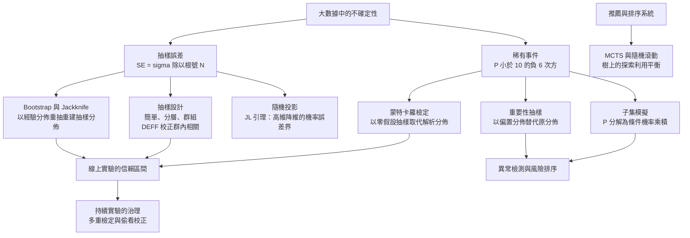

## 15.3 大數據與蒙地卡羅方法

[上一章：第15.2節：化學反應動力學中的模擬](15.2-化學反應動力學中的模擬.md) | [下一章：第16章　蒙地卡羅法的未來發展](16.0-蒙地卡羅法的未來發展.md)

前兩節的蒙地卡羅應用中，抽樣物件是「物理或生物機制的隨機行為」。本節不同：這裡抽樣的是**資料本身**。這是蒙地卡羅法在大數據時代最基本、也最容易被忽略的用法——**幾乎所有我們熟悉的統計推論（標準誤、信賴區間、p 值），其背後的抽樣理論都是蒙地卡羅法。**

本節的主線是：先說明統計推論的抽樣基礎（為什麼標準誤長成 $`1/\sqrt{N}`$ ），再說明當資料量太大時（ $`N`$ 大到無法窮舉重抽樣）如何用蒙地卡羅思想發展出替代方法（bootstrap、隨機投影、子集模擬），最後談蒙地卡羅在線上系統與推薦系統中的角色。

## 學習目標

完成本節後，你應該能夠：

1. 說明為什麼標準誤是 $`1/\sqrt{N}`$ 量級，以及抽樣誤差的絕對尺度與相對尺度為何必須分開考慮。
2. 解釋簡單隨機抽樣（等權重）與分層抽樣、群組抽樣的差異，以及後者如何處理相關性。
3. 描述 bootstrap 的統計基礎（把經驗分佈當作母體分佈），並說明它在什麼條件下會失效。
4. 說明 jackknife 的線性化（jackknife）估計量與其適用條件。
5. 說明隨機投影（random projection）在高維資料降維與近似距離計算中的角色及其誤差界。
6. 描述重要性抽樣在稀有事件偵測（如罕見疾病、極端天氣、網路異常）中的應用。
7. 解釋 Au & Beck (2001) 的子集模擬（subset simulation）如何以「條件機率乘積」估計極小機率，並說明它相較重要性抽樣的優勢。
8. 說明 Monte Carlo Tree Search 在推薦系統與線上實驗中的應用，以及分散式 A/B 測試與蒙地卡羅檢定的關係。

## 15.3.1 統計推論的抽樣基礎

考慮從總體抽樣 $`n`$ 個觀測值，估計總體平均 $`\mu`$ 。樣本均值 $`\bar{X}`$ 是 $`\mu`$ 的無偏估計，其方差為

$$
\mathrm{Var}(\bar{X}) = \frac{\sigma^2}{n}
$$


其中 $`\sigma^2`$ 是總體變異數。標準誤因此是

$$
\mathrm{SE} = \frac{\sigma}{\sqrt{n}}
$$


**這個 $`1/\sqrt{n}`$ 就是蒙地卡羅誤差公式的統計學版本**，兩者是同一件事：前者是「對有限母體抽樣」，後者是「對已知分佈抽樣」。

**但更重要的是看清它的含義**：

- 誤差是**相對**的： $`n`$ 增加 100 倍，標準誤只減半。要把相對精度從 10% 提升到 1%，樣本數要乘上 100。
- 誤差是**絕對**的：若估計的是機率 $`p = 10^{-6}`$ ，即使相對誤差是 1%，絕對誤差仍有 $`10^{-8}`$ ——但若要宣稱「此事件每千萬次才發生一次」， $`10^{-8}`$ 的絕對誤差就是 1% 的機率被誤判。

**這就是本章第一個要點：抽樣誤差的討論必須同時給出絕對與相對尺度，否則會造成嚴重的量級誤解。**

### 抽樣設計：簡單、分層、群組

真實世界的資料並非 i.i.d.：

- **分層抽樣（stratified sampling）**：先分成同質層（如年齡層、地區），各層獨立抽樣再合併。估計量為

  $$
  \hat{\mu} = \sum_{h} \frac{N_h}{N}\,\bar{X}_h
  $$

  變異數為 $`\mathrm{Var}(\hat{\mu}) = \sum_h \left(\frac{N_h}{N}\right)^2 \frac{\sigma_h^2}{n_h}`$ 。只要層內同質，分層抽樣的方差**小於**簡單隨機抽樣。
- **群組抽樣（cluster sampling）**：把個體分群，整群抽取。方差取決於群內相關性 $`\rho`$ ：

  $$
  \mathrm{DEFF} = 1 + (m - 1)\rho
  $$

  其中 $`m`$ 是平均群大小， $`\rho`$ 是群內相關係數。這個**設計效應（DEFF）**是流行病學與大數據調查的核心校正因子——忽略它會嚴重低估抽樣誤差。

**跨學科教訓**：這正是第15.0節「把相關當獨立」誤用的精確表述。同一篇資料，若以「每列一筆觀測」處理，會低估誤差；以「每個病人一筆」處理，則是正確的抽樣單位。

## 15.3.2 Bootstrap 與 Jackknife：統計推論的蒙地卡羅化

**Bootstrap**（Efron, 1979）的想法是：既然無法重複抽樣整個母體，就**把觀察到的樣本當作母體的分佈**，從中反覆重抽。

對一個統計量 $`T`$ ：

$$
T^{*(b)} = T(X_1^{*(b)}, \dots, X_n^{*(b)}), \qquad X^{*(b)} \sim \text{經驗分佈}
$$


其中每個 $`X_i^{*}`$ 是從 $`\{X_1, \dots, X_n\}`$ 中以置換（放回）方式抽取。以 $`B`$ 次重抽的統計量分佈估計 $`T`$ 的抽樣分佈，進而得到信賴區間。

```python
import numpy as np

def bootstrap_ci(data, statistic=np.mean, n_boot=2000, alpha=0.05, seed=0):
    """百分位 bootstrap 信賴區間。
    對應理論：以經驗分佈作為母體分佈的反覆重抽，重建統計量的抽樣分佈。"""
    rng = np.random.default_rng(seed)
    data = np.asarray(data, dtype=float)
    n = len(data)
    stats = np.empty(n_boot)
    for b in range(n_boot):
        idx = rng.integers(0, n, size=n)          # 置換重抽（放回）
        stats[b] = statistic(data[idx])
    lo, hi = np.quantile(stats, [alpha / 2, 1 - alpha / 2])
    return {"點估計": float(statistic(data)), "CI_low": float(lo),
            "CI_high": float(hi), "bootstrap標準誤": float(stats.std(ddof=1))}
```

**Bootstrap 的統計基礎與失效條件**：

- **基礎**：它依賴「抽樣分佈可以用經驗分佈近似」這個置換原理。在 $`n`$ 較大且資料來自平滑分佈時，誤差可忽略。
- **失效一：對稱性破壞。** 當統計量的抽樣分佈明顯偏斜（如中位數、比率、極值），百分位法會有偏差，此時應改用 BCa（bias-corrected and accelerated）方法。
- **失效二：相依資料。** 對時間序列或群組資料，標準 bootstrap 會低估誤差；此時應使用 **block bootstrap**（以區塊為重抽單位）或移動區塊 bootstrap。
- **失效三：重抽複雜度。** 若每個 bootstrap 重複都需要重新訓練模型（例如深度模型的評估）， $`B`$ 必須很大，成本高昂——這時可以用**研究中的 bootstrap 與 subsampling**。

**Jackknife** 是更簡單的替代：每次「抽樣」是「去掉第 $`i`$ 個觀測」

$$
T_{(i)} = T(X_1, \dots, X_{i-1}, X_{i+1}, \dots, X_n)
$$


以 $`T_{(i)}`$ 的分佈估計 $`T`$ 的偏差與方差。它的優點是**只需 $`n`$ 次重算**（而 bootstrap 需 $`B`$ 次，通常上千），且對離群值比 bootstrap 更穩健（因為不重複放大離群值）；缺點是**需要線性化假設**（統計量對資料的偏導近似為常數），在小樣本或強非線性時會失效。

**Bootstrap vs. Jackknife 的取捨**：

| 面向 | Bootstrap | Jackknife |
| --- | --- | --- |
| 重算次數 | $`B`$ （通常 $`10^3`$ – $`10^4`$ ） | $`n`$ |
| 理論基礎 | 置換原理（無需線性化） | 線性化 |
| 偏斜分佈 | 需 BCa 修正 | 較穩健 |
| 離群值 | 敏感（會被重複抽到） | 較不敏感 |
| 相依資料 | 需 block 版本 | 亦需修正 |

## 15.3.3 大規模資料的隨機投影

當資料維度 $`d`$ 極高（例如 $`10^6`$ 維的稀疏特徵），很多計算（距離、相似度、內積）都不可行。**隨機投影（random projection）** 用一個隨機矩陣 $`R \in \mathbb{R}^{k \times d}`$ （ $`k \ll d`$ ）把資料投影到低維：

$$
y = R^\top x
$$


JL 引理（Jianglin & Micchelli, 1981）保證對固定的 $`x \in \mathbb{R}^d`$ 與 $`y \in \mathbb{R}^d`$ ：

$$
\mathbb{E}\left[\left\| R^\top(x - y) \right\|^2\right] = k \|x - y\|^2
$$


也就是說內積的**期望**保持不變，誤差隨維度有界的機率隨 $`k`$ 增長而衰減。實務上常取 $`k = O(\log d / \varepsilon^2)`$ 。

**這是蒙地卡羅方法在大數據中的另一個身姿**：用隨機投影把高維距離問題轉化為可抽樣估計的問題，而誤差界是**機率性的**（高機率保證），不是確定性的。Johnson–Lindenstrauss 引理正是這個方向的理論基礎，也支撐了近似最近鄰搜尋（ANN）演算法。

**對照維度災難**：第4章說蒙地卡羅「對維度免疫」，這裡出現了一個有趣的例外——隨機投影本身是一種**抽樣式的降維**，它以「可控的幾何誤差」換取「可計算性」，與蒙地卡羅積分是同一個交易的不同形態。

## 15.3.4 稀有事件偵測與重要性抽樣

大數據中的許多任務本質上是稀有事件偵測：欺诈交易、網路異常、罕見疾病、極端氣候。事件的機率可能是 $`10^{-6}`$ 或更低。

**直接抽樣的困難**：要觀察到 $`k`$ 個事件以估計機率 $`p`$ ，需要約 $`k/p`$ 次抽樣。若 $`p = 10^{-6}`$ 且要 $`k = 100`$ ，就是 $`10^8`$ 次——對串流資料不可行。

**重要性抽樣的策略**：從一個刻意偏向異常區域的分佈 $`q`$ 抽樣，再以權重 $`\pi/q`$ 修正。實務上常見的作法是**先建立一個快速篩選器**（如簡單的規則或輕量模型），從中挑出高於隨機基準的分佈，再對候選集做重要性加權。

**更穩健的替代：檢定並控制偽陽性率。** 當「事件數」比「機率估計」更重要時，直接做**假設檢定**（例如在虛無假設下用蒙特卡羅 方法計算 p 值）往往比估計機率更有用，也更誠實——因為機率估計的相對誤差在極稀有情形下無法接受。

**排序與閾值化的視角**：很多實務任務只需要「把最可疑的排前面」，而不是「算出精確機率」。這時可以採用**直接重要性抽樣（direct density estimation）**與**對數似然比排序**：對每個候選事件計算 $`\log \frac{\pi(x)}{q(x)}`$ ，用排序取代絕對值估計——在 $`q`$ 已知且計算便宜時，排序的抽樣誤差影響遠小於量值估計。

## 15.3.5 子集模擬（Subset Simulation）

**子集模擬**（Au & Beck, 2001）是估計極小機率事件的系統性方法，解決的是第13.1節提出的稀有事件牆面：估計 $`P(F)`$ ，其中 $`F`$ 是失效事件且 $`P(F)`$ 極小。

**核心想法**：把「一個極小機率事件」分解成「多個中等機率事件的交集」。

$$
P(F) = P(F_1)\,P(F_2 \mid F_1)\,P(F_3 \mid F_2)\cdots P(F_m \mid F_{m-1})
$$


其中 $`F_1 \supset F_2 \supset \cdots \supset F_m = F`$ ，每一層的條件機率都保持在（例如）0.1–0.5 的可估計範圍。

**演算法**：
1. 從原分佈抽樣，找出中位數（或其他目標分位數） $`p_1`$ ，把事件分成 $`\{F \mid p \le p_1\}`$ 與其補集。
2. 從第一層的樣本中重抽並依模擬結果更新分位數 $`p_2`$ （這一步是「自適應」的關鍵）。
3. 重複直到分位數降到失效事件的臨界值。
4. 乘積各層機率即得估計。

**相較重要性抽樣的優勢**：

- 不需要**預先猜測**替代分佈 $`q`$ 的形式；分位數由資料自適應決定。
- 條件機率的估計來自實際樣本比例（計數型估計），方差容易控制。
- 各層的樣本透過「重抽 + 局部均勻化」傳遞，維持了相依性的正確處理。

**代價與注意事項**：

- 對 $`p`$ 的估計有**有限樣本偏差**：第 $`i`$ 層的條件機率估計是隨機的，其乘積的期望不等於真實機率。Au & Beck 給出了偏差的修正因子，但修正依賴分層數 $`m`$ 與每層樣本數。
- 必須檢查樣本在層間傳遞的**混合性**；若問題空間病態，會出現聚類而使估計失真。
- 分層數的選擇是精度與計算的取捨：層數越多，每層條件機率越小、估計方差越大。

```python
import numpy as np

def subset_simulation(n_samples=1000, n_levels=8, beta=0.1, seed=0):
    """以子集模擬估計稀有事件機率（示範結構）。
    對應理論：P(F) = Prod_i P(F_i | F_{i-1})，各層以樣本比例估計條件機率。"""
    rng = np.random.default_rng(seed)
    # 以標準常態為原始分佈，失效事件為 ||x|| 超過門檻（此處門檻由外部設定）
    def sample_from(idx):
        return rng.normal(size=(len(idx), 2))
    x = sample_from(np.arange(n_samples))
    levels, conds = [], []
    for lv in range(n_levels):
        # 以當前層樣本的樣本中位數作為下一層門檻（自適應分位數）
        threshold = np.median(np.linalg.norm(x, axis=1))
        hit = np.linalg.norm(x, axis=1) <= threshold
        conds.append(hit.mean())                      # 條件機率估計（計數型）
        idx = np.flatnonzero(hit)
        if len(idx) == 0:
            break
        # 從存活樣本重抽，維持樣本數（並可加輕微局部均勻化）
        x = sample_from(idx)
        levels.append(threshold)
    p_hat = float(np.prod(conds))
    return {"稀有事件機率估計": p_hat, "各層條件機率": conds}
```

程式碼示範了子集模擬的核心迴圈：逐層以樣本中位數設定門檻、計算該層的條件機率、從存活樣本重抽。**注意最後要誠實說明**：真實的失效門檻必須在模擬之前就固定（因為它代表真實的物理臨界面），而上面的示範為了保持結構簡潔把門檻設為資料驅動的；實際實作中，門檻通常是已知的（例如某應力超過材料強度），只在**條件抽樣**的部分使用自適應分位數。

## 15.3.6 線上實驗、推薦系統與 MCTS

**線上 A/B 測試**本質上是一個大型的隨機實驗：把使用者隨機分組、比較兩種處理的指標。統計推論的問題是「在有限樣本下，觀察到的差異是真實差異還是抽樣誤差」。

**蒙地卡羅檢定（Monte Carlo hypothesis testing）** 提供了一個優雅的替代：若零假設 $`H_0`$ 明確指定了資料生成分佈 $`P_0`$ ，則可以**從 $`H_0`$ 直接抽樣**生成參考資料集，算出檢定統計量在 $`H_0`$ 下的分佈，再比較觀察值。這對無法用解析分佈處理的指標（如推薦系統的長期留存）特別有用。

**多重比較與持續實驗**：線上實驗通常是持續的、多指標的，這帶來兩個問題：一是**多重檢定**（多個指標、多個實驗同時進行會膨脹偽陽性率，需要校正，如 Benjamini–Hochberg 控制 FDR）；二是**偷看（peeking）**——反覆查看結果並在顯著時停止，會大幅膨脹偽陽性率。正確做法是預先設定樣本量或使用 Alpha spending 函數。

**推薦系統與 MCTS**：推薦問題本質上是序貫決策問題（展示什麼影響後續互動），因此 MCTS 與蒙地卡羅樹搜尋（第10章、第14.3節）被用於：

- 在**樹狀的決策結構**上做探索／利用平衡（UCB 公式）。
- 以**隨機滾動（rollout）**評估節點的長期價值。
- 在**離線模擬器**中評估新推薦策略，避免直接上線冒險。

這裡的蒙地卡羅元件是明確的：每個節點的價值估計來自隨機模擬的回傳值，而 UCB 準則控制探索的機率分配。



上圖呈現本節的雙軌結構：左側是「**統計推論的蒙地卡羅化**」——連信賴區間與 p 值都可以用抽樣重建；右側是「**決策系統的蒙地卡羅化**」——線上實驗與推薦系統都在線進行探索與利用的取捨。兩軌的共同哲學是：**在資料無法完全重複抽樣的世界裡，用可重現的隨機機制重建不確定性，並把它顯式地放進決策。**

## 15.3.7 實務注意事項

1. **抽樣單位要先定義清楚**：一列資料是否等於一個獨立觀察？在者資料下，列級的 bootstrap 會低估誤差。
2. **相異性要顯式建模**：叢聚（cluster）在同一使用者、同一裝置、同一時間窗內的觀測不是獨立的；忽略群內相關會讓信賴區間過窄。
3. **不要用 bootstrap 掩蓋模型問題**：若資料生成過程有相依或非平穩，bootstrap 只會把這個問題傳播進 CI，不會修正它。
4. **實驗要有分流的隨機性與穩定的指標定義**：否則線上實驗的抽樣誤差會被演算法更新（interference）汙染。
5. **報告抽樣誤差的絕對與相對尺度**，並說明是哪一種抽樣設計。

## 本章要點

- 統計推論的標準誤 $`\sigma/\sqrt{n}`$ 與蒙地卡羅積分誤差是同一件事；討論抽樣誤差必須同時給出絕對與相對尺度。
- 分層抽樣在層內同質時優於簡單抽樣；群組抽樣的設計效應 $`\mathrm{DEFF}=1+(m-1)\rho`$ 是相關性的量化校正。
- bootstrap 以經驗分佈為母體分佈，對偏斜分佈、相依資料與高成本統計量各有失效條件；jackknife 只需 $`n`$ 次重算但依賴線性化。
- 隨機投影以 JL 引理給出高維降維的機率誤差界，是「抽樣式降維」的代表。
- 子集模擬以 $`P(F)=\prod_i P(F_i \mid F_{i-1})`$ 分解稀有事件機率，自適應決定分位數，且不需預先猜測替代分佈；其估計有有限樣本偏差，須校正。
- 線上實驗與推薦系統是「決策系統的蒙地卡羅化」：隨機分流、隨機滾動與探索利用平衡，同時需要多重檢定與偷看校正的治理。

## 延伸閱讀

- Efron, B. & Tibshirani, R. J. (1993). *An Introduction to the Bootstrap*. Chapman & Hall.——bootstrap 的經典教科書。
- Efron, B. & Tibshirani, R. J. (1994). *Introduction to the Jackknife*.——jackknife 的完整處理。
- Jianglin, P. & Micchelli, C. (1981). "On the Average Case Worst Case Analysis of Random Projections."——JL 引理。
- Au, S.-K. & Beck, J. L. (2001). *Subset Simulation for Reliability in Engineering*. Springer.——子集模擬的權威專著。
- Rubin, D. B. (1987). *Statistical Analysis with Missing Data*.——缺失資料與多重插補中的抽樣設計。
- Kohavi, R., Tang, D. & Xu, Y. (2020). *Trustworthy Online Controlled Experiments*. Cambridge University Press.——線上實驗的實務與治理。
- [第15.0節：跨學科應用案例](15.0-跨學科應用案例.md)、[第13.1節：系統可靠性分析](13.1-系統可靠性分析.md)、[第10.3節：粒子群算法與蒙地卡羅方法的結合](10.3-粒子群算法與蒙地卡羅方法的結合.md)
