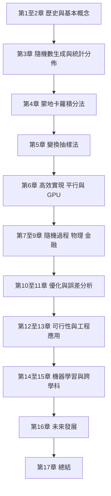
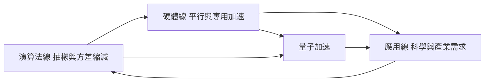

# 第16章　蒙地卡羅法的未來發展

[上一章：第15章　跨學科應用案例](15.0-跨學科應用案例.md) | [下一章：16.1　跨領域的應用展望](16.1-跨領域的應用展望.md)

## 學習目標

1. 理解蒙地卡羅法自 1946 年誕生以來不斷被重新發現的歷史節奏，說明為什麼「同一套數學骨架」能在不同時代催生不同的應用。
2. 掌握第 1 至 15 章所建立的完整脈絡：從隨機數生成、積分、變換抽樣，到平行加速、隨機過程、金融定價、誤差分析，再到機器學習與跨學科應用。
3. 建立「三條主線」的架構：演算法線（抽樣與方差縮減）、硬體線（平行與加速）、應用線（科學與產業），並理解三線交互作用的機制。
4. 辨識當前蒙地卡羅法面臨的核心瓶頸： $`O(N^{-1/2})`$ 的收斂速率、隨機數品質與可重現性、高精度需求、以及驗證困難。
5. 理解為什麼蒙地卡羅法在未來二十年不會被淘汰，反而會與量子計算、機器學習、數位孿生等技術深度交織。

### 歷史的節奏：同一骨架的不斷重演

蒙地卡羅法的歷史是一部「反覆被重新發明」的歷史。1946 年，Ulam 與 von Neumann 在 Los Alamos 為中子擴散問題尋找計算方法時，重新發現了早期物理學家使用過的「隨機抽樣求平均」的直覺，把計算負擔從解析求解轉移到了抽樣上（見[第1章](01.0-引言：蒙地卡羅法的歷史與背景.md)）。1953 年，Metropolis 等人發表的抽樣法，把「隨機性」從積分工具升級為狀態探索機制（見[第8章](08.0-蒙地卡羅方法在物理中的應用.md)）。1983 年 Kirkpatrick、Gelatt 與 Vecchi 把 Metropolis 抽樣套用到組合最佳化上，開啟了模擬退火（simulated annealing）的研究群（見[第10章](10.0-變數選擇與蒙地卡羅優化.md)）。

每一輪「重新發現」背後都有相同的驅動邏輯：**當問題的維度、耦合程度或不確定性描述超出確定性方法的處理能力時，隨機性成為最後的通用武器。** 這個邏輯在今天依然成立，只是「超出能力」的門檻從「解析解不存在」轉移成「維度爆炸、資料量過大、或模型本身是隨機的」。

以下是全書脈絡的回顧，並以圖示整理章節之間的依賴關係；它呼應本章的核心論點：**蒙地卡羅法的每一項改進，都是在「用隨機性換取通用性」的前提下，試圖降低這個交換的代價。**

### 依賴關係的三層結構

全書的內容可以分為三層：

**第一層是「隨機性的數學基礎」**，涵蓋第 2 至 4 章。第 2 章建立了隨機變數、隨機過程、期望與積分的等價關係；第 3 章解決了「如何產生可信的隨機性」這個工程問題；第 4 章則把前兩章組裝成一個可操作的積分工具。這一層的關鍵是：蒙地卡羅法把一個高維定積分

$$
\int_{\Omega} f(x)\,dx = \mathbb{E}[f(X)],\qquad X \sim p
$$

轉換為抽樣平均的期望問題，於是決定了收斂速率的上限。

**第二層是「效率與精度」**，涵蓋第 5、6、10、11 章。第 5 章的變換抽樣改變了被積函數的表現形式，用重要性權重把方差壓低；第 6 章不改變數學結構，而是用硬體把同一份工作做快；第 10、11 章則把焦點放在優化與誤差控制上。三者的共同前提是：統計誤差的量級約為 $`\sigma/\sqrt{N}`$ ，因此要提升精度就必須付出樣本數或降低 $`\sigma`$ 的代價。

**第三層是「應用與場景」**，涵蓋第 7、8、9、12、13、14、15 章。這一層考驗的是「領域知識能否轉化為正確的抽樣問題」。金融定價要求對尾部風險特別敏感，工程可靠性要求對失效事件正確計數，貝葉斯推斷要求在多峰後驗上混合——這些都要求把隨機性放進正確的位置。

### 三條主線的交織

未來的發展可以用三條主線來組織。這三條線不是彼此獨立的：演算法線的進步往往由硬體線催生，硬體線的價值由應用線的需求兌現，而應用線提出的新問題又回過頭來推動演算法線。

**演算法線**處理的是「怎麼抽」。核心問題是如何在固定計算預算下降低估計量的方差：從重要性抽樣（[第5章](05.0-變換抽樣法.md)）到控制變數（[第11章](11.0-蒙地卡羅方法的誤差分析與改進.md)），再到準蒙地卡羅（quasi-Monte Carlo）、多層蒙地卡羅（multilevel Monte Carlo）與機器學習協助的抽樣（learned proposals）。演算法線的方向是「用更多的結構換更少的樣本」，代價是實作複雜度上升。

**硬體線**處理的是「在哪裡抽」。從 CPU 多執行緒（第 6 章）、到 GPU 的大量並行吞吐、再到 TPU 與分散式集群，硬體線決定了同樣的演算法在一個小時內能抽多少樣本。硬體線也帶來新的隨機數問題：GPU 上的亂數序列品質、可重現性、以及如何避免多執行緒共用同一序列造成相關性。

**應用線**處理的是「為誰而抽」。氣候科學、藥物開發、數位孪生、金融科技、醫療個人化等領域，構成了蒙地卡羅法最直接的市場需求。應用線的特殊性在於：它們通常要求「不確定性量化」，而不僅僅是一個點估計。

三線交織的一個典型例子是**氣候模式的集合模擬**：應用線要求評估初始條件與參數不確定性對百年氣候投影的影響，這需要數千次完整模式積分；硬體線提供了大型集群，但單次模擬成本仍高；於是演算法線的「多層蒙地卡羅」提供了用粗網格模型估算細網格模型期望的數學工具——這在本書[第16.1節](16.1-跨領域的應用展望.md)會詳細說明。

### 三個尚未解決的瓶頸

在展望之前，必須誠實地指出當前的三個根本限制，因為它們正是所有後續章節的討論起點。

**瓶頸一是收斂速率的天花板。** 對具有有限方差的積分，蒙地卡羅標準誤的理論上限是 $`\sigma/\sqrt{N}`$ ，要把精度提高一個數量級需要多一百倍的樣本。這是統計上的定律，任何抽樣技巧都無法根本性地超越它——準蒙地卡羅在特定結構下可以突破，但代價是失去漸近無偏性；多層蒙地卡羅可以做到 $`N^{-1}`$ 級的均方誤差，但需要精心設計的層結構。

**瓶頸二是「隨機性的可信度」。** 蒙地卡羅法的結果是隨機的，這使得回歸除錯、版本比對、審計與監管都變得困難。在金融監管或藥物申報場合，「結果有統計誤差」本身就是需要交代的事實，而不是可以忽略的浮點數尾差。

**瓶頸三是驗證。** 當被估計的量本身沒有解析解時，如何確認蒙地卡羅估計是對的？答案是多重證據鏈：不同抽樣器的一致性、收斂診斷（ESS、R-hat）、與可行的話，跟另一種方法（如確定性數值解）的交叉比對。這套方法論本身就是本章的重要內容。

### 本章結構

本章及其後三節的分工如下：

- [16.1 跨領域的應用展望](16.1-跨領域的應用展望.md)：沿著應用線，檢視氣候科學、藥物開發、數位孿生與金融科技、醫療個人化、AI for science 等領域中蒙地卡羅法的新位置，以及它們各自帶來的新技術需求。
- [16.2 演算法的創新與改進方向](16.2-算法的創新與改進方向.md)：沿著演算法線，檢視準蒙地卡羅、多層蒙地卡羅、機器學習協助抽樣、可微分蒙地卡羅、變分蒙地卡羅等方向。
- [16.3 蒙地卡羅法在量子計算中的應用前景](16.3-蒙地卡羅法在量子計算中的應用前景.md)：探討量子蒙地卡羅與蒙地卡羅式方法的量子加速，這是硬體線與演算法線交會最劇烈的區域。

這三節之間存在大量交疊，因為真實的技術發展從不沿著單一維度前進。準蒙地卡羅需要硬體提供低分歧（low-discrepancy）序列的大規模並行生成；機器學習協助的抽樣需要 GPU 訓練神經網路；變分蒙地卡羅的效率提升又回到貝葉斯推論的應用需求。理解這些交疊，比記住任何單一技巧都更重要。

## 本章要點

1. 蒙地卡羅法的歷史是「因能力不足而反覆被重新發明」的歷史；當問題超出確定性方法的處理能力時，隨機性是最後的通用武器。
2. 全書可分三層：隨機性數學基礎（第 2 至 4 章）、效率與精度（第 5、6、10、11 章）、應用與場景（第 7 至 9、12 至 15 章）。
3. 未來的發展沿三條主線展開：演算法線（降低方差）、硬體線（提高吞吐）、應用線（擴展需求），三線互相驅動而非平行推進。
4. 三個根本瓶頸是： $`O(N^{-1/2})`$ 的收斂速率上限、隨機性帶來的可重現性與審計難題、以及缺乏解析解時的驗證困難。
5. 蒙地卡羅法不會被淘汰；它的角色會從「孤立的計算技巧」轉變為「不確定性量化的基礎設施」，並與機器學習、GPU 與量子計算深度交織。

## 延伸閱讀

- [第12章：蒙地卡羅法可行性分析](12.0-蒙地卡羅法可行性分析.md)：建立「什麼時候該用蒙地卡羅」的判準，是判斷本章各種展望是否適用的前提。
- [第11章：蒙地卡羅方法的誤差分析與改進](11.0-蒙地卡羅方法的誤差分析與改進.md)：誤差來源的完整分類，是[16.2](16.2-算法的創新與改進方向.md)節中所有改進技術的出發點。
- [第15章：跨學科應用案例](15.0-跨學科應用案例.md)：本章展望的應用線，其技術細節在該章已有初步說明。
- Robert, C. P. and Casella, G. (2004) *Monte Carlo Statistical Methods*, 2nd ed., Springer — 全書最系統的蒙地卡羅方法論參考。
