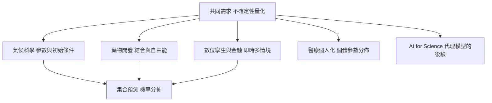
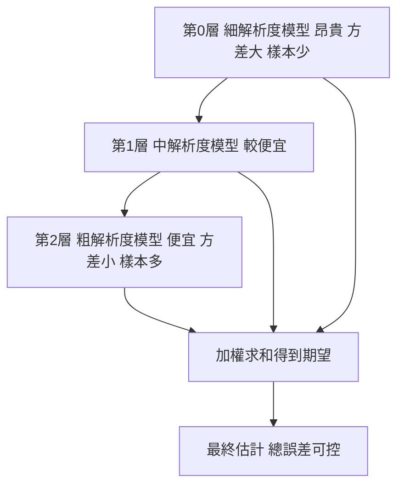

## 16.1　跨領域的應用展望

[上一章：16.0　蒙地卡羅法的未來發展](16.0-蒙地卡羅法的未來發展.md) | [下一章：16.2　演算法的創新與改進方向](16.2-算法的創新與改進方向.md)

## 學習目標

1. 理解蒙地卡羅法在氣候科學、藥物開發、數位孿生與金融科技、醫療個人化、AI for science 六個前沿領域中的角色差異。
2. 掌握「集合預測」（ensemble prediction）的統計結構：單一確定性預報 vs. 帶機率分佈的集合預報，以及蒙地卡羅法在其中扮演的角色。
3. 理解氣候模式的隨機參數化（stochastic parameterization）與多層蒙地卡羅的結合原理。
4. 能夠說明「不確定性量化」（UQ）為何是這些領域對蒙地卡羅法的共同需求，並比較各領域對誤差容忍度的差異。
5. 建立判斷新領域是否適合蒙地卡羅法的三個判準：成本可承受性、可容許的隨機誤差、以及是否需要分佈而非點估計。

### 共同的底層需求：不確定性量化

觀察六個前沿領域，可以發現它們對蒙地卡羅法的需求本質上是同質的：**當決策者拿到一個數值時，必須知道這個數值背後的不確定性有多大、來自哪裡、以及在什麼條件下會被推翻。**

在工程可靠性的傳統做法中，這個職責由保守的安全係數承擔——但安全係數是一個不隨條件變化的常數，在系統具有複雜耦合時必然過度保守或不足。蒙地卡羅法提供了另一條路：透過對不確定參數抽樣並傳播，得到失效機率 $`P(f)`$ 這個真正的機率量（見[第13章](13.0-蒙地卡羅法在工程中的應用.md)）。這種「把不確定性從常數升級為分佈」的轉變，是所有新興應用的共同敘事。

下圖整理六個領域的結構化差異；它呼應本節的核心貝點：**同一套抽樣骨架，因為「不確定性來源」與「下游成本函數」不同，會衍生出完全不同的工程設計。**

### 氣候科學：從單一預報到集合預報

#### 問題的本質

氣候預測與天氣預測在本質上不同。天氣預測是初值問題：給定準確的初始大氣狀態，未來的演化大致由動力方程決定，因此可以靠資料同化把誤差壓到很小。氣候預測則是初值與參數的雙重問題：一個精確的初始狀態在非線性且混沌的系統中，並不能唯一決定百年後的氣候。這是因為地球氣候系統是混沌系統，初始誤差會隨時間指數增長。

因此，氣候科學家早就認識到：**一個有信心的氣候預報必須以機率的形式表達。** 這正是蒙地卡羅法的天然舞台。

#### 集合預測的統計結構

最直接的實作是「集合」（ensemble）：取 $`M`$ 個不同的初始條件或參數設定，各跑一次模式積分，得到 $`M`$ 條氣候軌跡，再對它們做統計。估計的目標量例如「2100 年全球平均地表溫度相對於 1995–2014 年基線的變化」可以寫成

$$
\widehat{\mu} = \frac{1}{M}\sum_{m=1}^{M} T_m,
\qquad
\widehat{\sigma}^2 = \frac{1}{M-1}\sum_{m=1}^{M}\bigl(T_m - \widehat{\mu}\bigr)^2
$$

這個形式非常簡單，但它有兩個統計上的問題。第一， $`M`$ 個成員之間並非獨立——它們共用同一個模式、同一個物理參數化，這造成集合離散度低估真實不確定性（常稱為「集合過度自信」，over-confident spread）。第二，每個成員的成本極高，一個百年積分的高解析度氣候模式動輒需要數千核心小時，因此 $`M`$ 的上限受到嚴格限制，導致區間估計本身具有相當寬的抽樣誤差。

#### 隨機參數化

第二個驅動力來自物理模型的「不 closure」問題：雲微物理、邊界層混合、洋流參數化等子過程無法在現有解析度下完整描述，模式中只能用參數化方案近似，而參數化方案的選擇本身引入結構性不確定性。

「隨機參數化」（stochastic parameterization）的做法是：在參數化方案中引入隨機擾動，把未解析的次網格過程當作一個隨機變數處理，而不再假設它有確定性的閉合形式。這在概念上是一個根本轉變——**把「未知的誤差」重新標記為「未知的隨機變數」，然後用蒙地卡羅法處理它。**

在實作上，隨機參數化常以隨機微分方程（SDE）或隨機微分代數方程的形式寫出；其數值積分與樣本路徑生成的細節，在[第7章](07.0-隨機過程與模擬.md)已經討貝過。此處要注意的一個實務要點是：**隨機擾動的相關時間尺度與空間尺度會影響結果的收斂性**，若擾動在時間上相關而程式碼卻以逐步獨立的方式生成，就會得到錯誤的方差估計。

#### 多層蒙地卡羅的介入

多層蒙地卡羅（multilevel Monte Carlo, MLMC）正是在這個背景下成熟並被廣泛接受的。氣候模式天然構成一個「階層」：粗解析度模式 $`V_L`$ 與細解析度模式 $`V_0`$ 給出同一物理量的不同估計。MLMC 的核心是構造一個耦合的隨機模擬，使得

$$
\mathbb{E}[V_0] = \mathbb{E}[V_L] + \sum_{\ell=1}^{L-1}\bigl(\mathbb{E}[V_{\ell}] - \mathbb{E}[V_{\ell+1}]\bigr)
$$

每一項都是「相鄰兩層之差」的期望，隨著 $`\ell`$ 變細，這個差項的方差會顯著下降（因為兩個高度相關的模擬之間的差是很小的）。MLMC 藉由在粗層多用樣本、細層少用樣本，在總工作量不增加甚至降低的前提下達到目標精度。

下圖說明 MLMC 的分層抽樣結構；它呼應本節的貝點：**蒙地卡羅法的創新不一定要改變「抽什麼樣本」，也可以改變「用多粗的模型來抽」。**

MLMC 的理貝在 Giles (2008) 的 *SIAM Review* 貝文中給出了完整的誤差分析，讀者可參閱[附錄 A3](A3-參考文獻與推薦閱讀.md)。在氣候領域，MLMC 已被用於降低百年氣候投影的成本估算，也用於風力發電的資源評估。

### 藥物開發：自由能微觀狀態

#### 從巨觀量到微觀分佈

藥物開發中的蒙地卡羅法有一個與其他領域不同的關鍵需求：**它需要的不只是「某個量的期望」，而是「在熱力學平衡下，系統佔據各種微觀狀態的機率分佈」。** 這正是統計力學的蒙特卡羅（MC）與分子動力學（MD）的分工：MD 用微觀動力學追蹤軌跡，MC 用重要性抽樣在構型空間中尋找平衡分佈。

#### 結合自由能

藥物與受體的結合自由能（binding free energy） $`\Delta G`$ 的計算，是蒙地卡羅法在藥物開發中最具代表性的應用。粗略地說，

$$
\Delta G = -k_B T \ln \left(\frac{Z_{\mathrm{bound}}}{Z_{\mathrm{free}}}\right)
$$

其中 $`Z`$ 是配分函數。要準確估算 $`\Delta G`$ ，實務上通常採用所謂的「自由能微扰」（free energy perturbation）與「熱力積分」（thermodynamic integration）兩種框架，兩者都以蒙地卡羅抽樣來估計期望值。

#### 加速抽樣的技術驅動

在實際蛋白質系統中，直接的蒙地卡羅抽樣會遭遇嚴重的「多個局部極小」（multiple minima）問題：構型空間有大量能量谷，蒙地卡羅鏈容易滯留在單一谷中，導致估計結果依賴初始構型。

這裡出現了一條典型的「應用驅動演算法」的因果鏈：

1. 應用需求：需要更可靠的 $`\Delta G`$ 估計。
2. 演算法回應：引入更聰明的抽樣——平行取樣、隨機交換（replica exchange）、擴散取樣（diffusion sampling）、Hamiltonian 蒙地卡羅（HMC）、或基於生成模型的 proposal。
3. 新問題：需要評估「抽樣是否真的混合充分」——這又回到第 11 與 14 章的診斷問題。
4. 硬體回應：GPU 分子動力學讓原子的時間積分可批次並行，但長時間尺度仍受限於擴散混合。

值得注意的是，近年的「neural network potential」（機器學習勢能面）讓 GPU 分子動力學的模擬時間延長了數個數量級——這是硬體線與演算法線攜手改進應用線的典型案例，其技術細節在[16.2 節](16.2-算法的創新與改進方向.md)展開。

### 數位孿生與金融科技：即時、多情境、可重現

#### 數位孿生的統計需求

數位孿生（digital twin）是把實體系統的數位鏡像，用於設計、監控與最佳化的技術。在工程上，數位孿生的核心挑戰是：**它必須把物理不確定性、量測不確定性與模型不確定性全部納入，才能成為決策的依據。** 這使得數位孿生天然成為蒙地卡羅法的宿主環境。

一個現代的蒙地卡羅型數位孿生典型架構如下圖；它呼應本節的貝點：**數位孿生的價值不在於單次模擬，而在於能夠在毫秒級產生成百上千個情境並附帶機率權重。**

#### 金融科技的對照

金融科技是數位孿生的經濟版對照。在[第9章](09.0-蒙地卡羅方法在金融中的應用.md)已經看到，衍生品定價本質上是一個隨機過程的期望問題，而風險管理則要求尾端分位數（VaR、Expected Shortfall）。金融市場的特徵是：模型可驗證性要求高（監管審計）、必須可重現（交易記錄與回測）、且市場狀態會快速改變。

這一點構成了一組鮮明的對照，說明同一方法在不同領域的工程權重不同：

| 面向 | 數位孿生 | 金融科技 |
| --- | --- | --- |
| 主要不確定性來源 | 物理參數、量測誤差 | 市場波動、模型風險 |
| 對即時性的要求 | 毫秒至秒級的線上推貝 | 每日結算、交易前即時重估 |
| 可重現性要求 | 中高，需能追溯 | 極高，需能審計 |
| 典型抽樣規模 | 數萬至數百萬情境 | 數百萬至數億路徑 |
| 關鍵指標 | 失效機率、餘裕 | VaR、ES、壓力情境 |

#### 挑戰：狀態空間的高維度

數位孿生與金融的共同挑戰是狀態空間高維。若一個模型有 $`p`$ 個不確定參數，蒙地卡羅需要評估數百萬個 $`p`$ 維情境，每個情境還要跑一次昂貴的時間積分。在金融定價中，這可以靠解析的幾何布朗運動（GBM）解決；但在真實的數位孿生中，模型往往是計算昂貴的。

這正是**代理模型（surrogate model）** 派上用場的地方：用大量蒙地卡羅樣本訓練一個快速近似器，再用代理模型產生數百萬個情境。但這引入了一個新的不確定性來源——代理模型的近似誤差。此時的正確做法不是忽略它，而是把代理誤差作為額外的抽樣維度一起傳播，形成「嵌套蒙地卡羅」（nested Monte Carlo）。這也是[16.2 節](16.2-算法的創新與改進方向.md)的內容。

### 醫療個人化：從平均療效到個體反應

醫療個人化（personalized medicine）與蒙地卡羅法的結合點在於**個體層面的參數分佈不確定性**。以腫瘤對治療的反應為例，治療效果取決於一組無法直接觀測的個體特徵（藥物在腫瘤內的濃度分佈、細胞的抗藥性、患者的免疫狀態）。傳統的臨床試驗給出的是「平均療效」與「信賴區間」，但這個區間混合了個體間變異與個體內不確定性。

蒙地卡羅法在這裡的作用是**把個體間變異與個體內不確定性拆開**，這在統計上對應於方差分解（variance decomposition）：

$$
\operatorname{Var}(Y) = \underbrace{\operatorname{Var}\bigl(\mathbb{E}[Y\mid \theta]\bigr)}_{\text{個體間}} + \underbrace{\mathbb{E}\bigl[\operatorname{Var}(Y\mid \theta)\bigr]}_{\text{個體內}}
$$

這裡的 $`\theta`$ 是個體參數。在藥劑動力學（pharmacokinetics）與藥效動力學（pharmacodynamics）的模型中， $`\theta`$ 的先驗分佈來自族群資料（population data），而某一位病人的後驗分佈需要透過蒙地卡羅抽樣（如 MCMC）從後驗更新得到。這就把[第14.2 節](14.2-蒙地卡羅抽樣在貝葉斯推斷中的應用.md)的貝葉斯更新接上了臨床決策。

在這個領域，蒙地卡羅法還承擔了「決策理貝」的角色：給定不確定性與效用函數，蒙地卡羅法可以估計最優治療方案的期望效用，形式上就是

$$
U^*(a) = \max_{a \in \mathcal{A}} \mathbb{E}_{\theta \sim \pi(\theta\mid \mathcal{D})}\bigl[U(a, \theta)\bigr]
$$

其中 $`a`$ 是治療行動， $`\pi(\theta\mid \mathcal{D})`$ 是由臨床資料更新的後驗。這個式子與[第10章](10.0-變數選擇與蒙地卡羅優化.md)的隨機搜尋在結構上相同，差別在於抽樣的目的不是搜尋，而是對不確定性下的效用做積分。

### AI for Science：把蒙地卡羅法放進學習框架

#### 代理模型取代模擬器

AI for Science 的一個核心策略是：用大資料訓練代理模型（surrogate / emulator），以毫秒級的推貝取代昂貴的物理模擬器。蒙地卡羅法在這個架構裡有兩個位置：

**位置一：產生訓練資料與標註。** 代理模型的訓練資料往往來自蒙地卡羅模擬（例如用蒙地卡羅解出的參考解作為標籤）。此時，蒙地卡羅扮演「生成真值」的角色，其精度上限決定了代理模型能學到的上限。

**位置二：把代理模型嵌入蒙地卡羅迴圈。** 這就是所謂的「learned proposal」或「neural proposal」：用神經網路學會近似目標後驗的分佈，然後用這個網路產生的樣本作為蒙地卡羅抽樣的出發點。傳統 MCMC 的瓶頸是混合速度：鏈在高模式（mode）之間移動很慢；學習到的 proposal 近似了後驗的全貌（包括各個模式的位置與權重），因此能一次跳到正確的模式。

#### 一個結構性的風險

必須指出這個方向的內在張力：蒙地卡羅法的吸引力之一是**漸近無偏性**——樣本數足夠時估計必然收斂到真值，與模型類別無關。當我們用代理模型取代真實模型、用學習到的 proposal 取代精確分佈，這些「無偏保證」就不再自動成立，必須額外引入偏差-變數修正（bias-variance correction）來維持可校準的不確定性估計。

這是本章反覆出現的模式：**每一個加速手段都伴隨一個「保真度」或「無偏性」的代價，而研究的實質就是在管理這個代價。** 這個模式在[17.1](17.1-蒙地卡羅法的優勢與挑戰.md)會被明確總結為一張「檢查表」。

## 本章要點

1. 氣候科學、藥物開發、數位孿生、金融科技、醫療個人化與 AI for Science 的共同需求是**不確定性量化**，而非單一數值答案。
2. 集合預測把氣候預報從「一條軌跡」改為「一個機率分佈」；隨機參數化則把未解析過程從「確定性誤差」重新標記為「隨機變數」。
3. 多層蒙地卡羅利用模式解析度之間的天然階層與耦合，在不增加甚至降低總成本的前提下達到目標精度，是氣候領域最重要的抽樣工具之一。
4. 藥物開發需要的是「微觀狀態的機率分佈」而非單一期望，因此抽樣混合充分性診斷（ESS、R-hat）是成敗關鍵。
5. 數位孿生與金融對即時性、量測成本與可審計性的權重不同，但都要求在數百萬情境的規模下維持可控誤差。
6. 醫療個人化中，蒙地卡羅法透過方差分解把「個體間變異」與「個體內不確定性」分開，並支援期望效用決策。
7. AI for Science 把蒙地卡羅法放入學習框架：既用蒙地卡羅產生真值，也用學習到的 proposal 加速抽樣；但後者會犧牲漸近無偏性，需要以偏差-變數修正補償。

## 延伸閱讀

- [第9章：蒙地卡羅方法在金融中的應用](09.0-蒙地卡羅方法在金融中的應用.md)：數位孿生與金融科技的對照基礎。
- [第14章：蒙地卡羅方法在機器學習中的應用](14.0-蒙地卡羅方法在機器學習中的應用.md)：AI for Science 中的抽樣加速技術細節。
- [第11章：蒙地卡羅方法的誤差分析與改進](11.0-蒙地卡羅方法的誤差分析與改進.md)：偏差-變數權衡與誤差傳播的完整框架。
- Giles, M. B. (2008) *Multilevel Monte Carlo and approximate Bayesian computation*, *SIAM Review* 50(3), 257–272.
- Evans, M. and Gillespie, D. (2007) *Monte Carlo Methods in Statistical Physics*, Condensed Matter Physics 8(2), 97–133.
