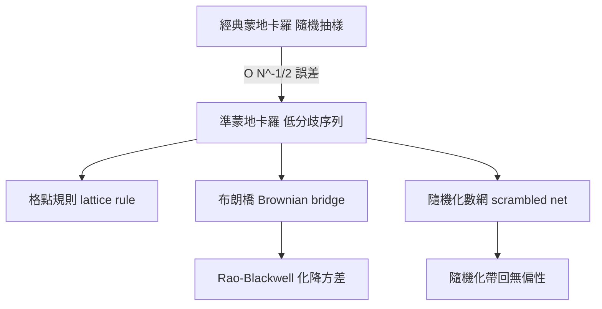
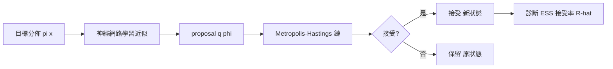

## 16.2　演算法的創新與改進方向

[上一章：16.1　跨領域的應用展望](16.1-跨領域的應用展望.md) | [下一章：16.3　蒙地卡羅法在量子計算中的應用前景](16.3-蒙地卡羅法在量子計算中的應用前景.md)

## 學習目標

1. 理解準蒙地卡羅（quasi-Monte Carlo, QMC）低分歧序列的誤差結構，並掌握格點規則（lattice rule）、布朗橋（Brownian bridge）與隨機化數網（scrambled net）三種建構方式的思想。
2. 掌握多層蒙地卡羅（multilevel Monte Carlo, MLMC）的組合估計量、複雜度 $`O(N^{-2})`$ 與其成立條件。
3. 理解機器學習協助抽樣的三種型態：學習型 proposal、正規化流（normalizing flow）作為 proposal、神經網路近似結合 Rao-Blackwellization。
4. 說明可微分蒙地卡羅（differentiable Monte Carlo, diffMCMC）與重參數化技巧如何把蒙地卡羅嵌入自動微分框架。
5. 比較變分蒙地卡羅（Stein variational）與 MCMC 的差異，並掌握評估蒙地卡羅估計品質的四項診斷指標。

### 準蒙地卡羅：把「隨機」換成「低分歧」

#### 為什麼需要它

經典蒙地卡羅法的誤差來自隨機抽樣的統計波動。若樣本點在積分區域中「擠在一起」，那麼這批樣本對整體平均的代表性就差。準蒙地卡羅的想法是：**放棄隨機性，改用刻意設計的低分歧（low-discrepancy）點集**，讓任何子區域中的點數與該區域體積成比例。這樣的點集是確定性的，因此嚴格而言不再是蒙地卡羅法（它是「準」蒙地卡羅），但在使用者眼中卻更像是「免費的精度提升」。

關鍵的定量結果是：對具有充分光滑性的積分函數， $`d`$ 維的 scrambled net 給出的誤差是

$$
\left| \int f - \frac{1}{N}\sum_{i=1}^{N} f(\mathbf{x}_i) \right| = O\bigl(N^{-1}(\log N)^{(d-1)/2}\bigr)
$$

相較於經典蒙地卡羅的 $`O(N^{-1/2})`$ ，這是數量級的改善——把十萬個樣本的精度提升到一千個樣本的程度。

#### 三種建構方式

第一種是**格點規則（lattice rule）**：取 $`\mathbf{x}_i = \{\mathbf{z} + \mathbf{g}\,i/N\}`$ （ $`\{\cdot\}`$ 表示取小數部分）， $`\mathbf{g}`$ 是整數生成向量， $`\mathbf{z}`$ 是隨機平移。Sobol 序列與「隨機化 QMC」（randomized QMC）屬於這類。

第二種是**布朗橋（Brownian bridge）**：這是針對金融與 PDE 領域的特定優化。對於以布朗運動驅動的隨機過程 $`W(t)`$ ，原本的抽樣是獨立地取 $`W(t_j)`$ 的增量；布朗橋構造則先抽樣橋的端點 $`W(1)`$ ，再在條件分佈下遞迴抽樣中間點。這個做法把「方差最大的那個分量」（端點）與其他分量在數學上解耦，使得整個路徑的積分量可以用布朗橋的解析條件期望做 Rao-Blackwell 化，方差大幅下降。讀者可回想[第7章](07.0-隨機過程與模擬.md)與[第9章](09.0-蒙地卡羅方法在金融中的應用.md)中布朗運動的模擬方式。

第三種是**隨機化數網（scrambled net）**：用隨機置換或隨機線性映射作用於數網的座標，取得「隨機化的低分歧序列」。這裡出現了一個漂亮的折衷——透過隨機化，**估計量重新獲得漸近無偏性**，同時保留了低分歧帶來的收斂加速。代價是需要用重抽樣（replication）來估計誤差，而不是單一確定性序列。

上圖說明三種 QMC 建構方式與兩個精度增益機制的關係；它呼應本節的論點：**低分歧只是起點，隨機化與 Rao-Blackwell 化才是把「確定性優勢」轉化為「可用的統計估計」的關鍵。**

### 多層蒙地卡羅：把「模型成本」也當成隨機性來源

#### 問題的重新表述

在很多應用中，我們有同一個量的多個模型層級：粗的數值解、較精確的近似、或解析解的極限。傳統做法是全部用最貴的那一層，或粗略假設各層之間的偏差可以直接加總。多層蒙地卡羅的做法是：**把「層的選擇」本身也做成隨機的，並以耦合的方式構造各層的模擬，讓相鄰層之間的差項方差可控。**

#### 組合估計量

MLMC 的估計量可以寫成

$$
\widehat{\mathbb{E}} = \sum_{\ell=0}^{L-1} \frac{1}{N_\ell}\sum_{i=1}^{N_\ell} Y^{(\ell)}_i,
\qquad
Y^{(\ell)} = P^{(\ell)} - P^{(\ell+1)}
$$

其中 $`P^{(\ell)}`$ 是第 $`\ell`$ 層的價格（或解）， $`Y^{(\ell)}`$ 是相鄰層之差。關鍵是透過**共同隨機數**（common random numbers）讓上下層的模擬相關：若兩層解非常接近， $`Y^{(\ell)}`$ 就非常小，其方差也很小。

若各層的方差滿足 $`\operatorname{Var}(Y^{(\ell)}) = O(2^{-\alpha\ell})`$ ，單位成本 $`C^{(\ell)} = O(2^{\beta\ell})`$ ，則最佳樣本配置給出的總成本為 $`O(N^{-2})`$ ，相較於單層的 $`O(N^{-1})`$ 是平方級的改進。

#### 成立條件與失效條件

MLMC 的理論要求能建立**跨層的耦合機制**，使得相鄰層的解之間的差具有適當的收斂率。在金融定價中這很自然（不同網格數的有限差分或蒙地卡羅定價器可以共用隨機數）；在 PDE 中則常用多重網格方法提供粗略解；在氣候中則依靠不同解析度的模式。**如果某個領域沒有天然的耦合機制，MLMC 就退化成需要人工設計的技巧**，這是它的主要實作障礙。

### 機器學習協助的抽樣

#### 動機

MCMC 的核心難題是混合（mixing）：鏈在多峰後驗上跳躍很慢，而鏈的混合速度決定了有效樣本數（ESS）。傳統解法是物理靈感的 proposal（隨機遊走、Metropolis、HMC），它們的 proposal 不依賴當前位置的外觀以外的信息。

學習型抽樣的想法是：**用機器學習先學出目標分佈的「樣子」，再讓蒙地卡羅鏈沿著這個學到的分佈移動。** 這是一個典型的「機器學習做大部分苦力、蒙地卡羅做保證」的分工。

#### 三種典型實作

**（一）學習型 proposal 網路。** 訓練一個網路 $`q_\phi(\mathbf{x}\mid \mathbf{x}_{\text{cur}})`$ ，模擬目標分佈的局部移動行為；鏈用 Metropolis-Hastings 接受/拒絕機制保證無偏性。這個設計把「效率」交給網路、把「正確性」交給 MH 接受率，因此不破壞漸近無偏性。代價是接受率可能偏低（因為 proposal 與目標的差距會造成大量拒絕），且網路訓練本身有偏誤風險。

**（二）正規化流（normalizing flow）作為 proposal。** 正規化流 $`\mathbf{x} = \mathbf{g}_\phi(\mathbf{z})`$ 是一個可逆、可微分的變換，把簡單分佈（如標準常態）拉成複雜分佈。它的優勢是**可以精確計算密度** $`q_\phi(\mathbf{x})`$ ，因此 MH 接受率可以精確評估；而且流結構保證了支撐集的一致性。現代的連續正規化流（continuous normalizing flow, CNF）更透過 ODE 求解連接兩個分佈，提供了「連續時間」的抽樣觀點。

**（三）神經網路近似 + Rao-Blackwellization。** 這是混合兩種想法的策略：用一個神經網路 $`q_\theta(y \mid \mathbf{x}, \mathbf{z})`$ 近似某個條件期望 $`\mathbb{E}[f\mid \mathbf{x}, \mathbf{z}]`$ ，然後在抽樣的同時把 $`f`$ 換成 $`f - f_{\text{approx}} + \mathbb{E}[f_{\text{approx}}]`$ 。這種結構既保留了網路能帶來的效率，又維持了無偏性（因為替換項的期望被解析地加回）。

上圖說明「學習型 proposal + MH 校正」的迴路；它呼應本節的核心論點：**機器學習只被允許改變「提問效率」，不能被允許改變「答案的定義」，否則無偏性與可校準性就失去了保證。**

### 可微分蒙地卡羅與重參數化

#### 為什麼需要可微分

在機器學習中，許多元件都是「可微分的蒙地卡羅估計量」的函數，例如：

$$
\nabla_\theta \mathbb{E}_{p_\theta}\bigl[f_\theta(\mathbf{x})\bigr]
$$

若用 score function（REINFORCE）估計梯度，會引入高方差；若用重參數化技巧（reparameterization trick），則把隨機性移到樣本生成過程中，使整個估計量對 $`\theta`$ 可微：

$$
\mathbf{x} = \mathbf{g}_\theta(\boldsymbol{\varepsilon}),\quad \boldsymbol{\varepsilon}\sim\mathcal{N}(0,I)
\quad\Longrightarrow\quad
\nabla_\theta \mathbb{E}[f_\theta(\mathbf{g}_\theta(\boldsymbol{\varepsilon}))] = \mathbb{E}\bigl[\nabla_\theta f_\theta(\mathbf{g}_\theta(\boldsymbol{\varepsilon}))\bigr]
$$

這個技巧的後果是深遠的：它讓蒙地卡羅估計可以被**反向傳播**從頭到尾優化，同時允許研究者學習 $`\mathbf{g}_\theta`$ （變分推論中的生成網路，見[第14章](14.0-蒙地卡羅方法在機器學習中的應用.md)）。

#### diffMCMC 的方向

「可微分蒙地卡羅」（differentiable Monte Carlo）則更進一步：把抽樣的**離散決策**（例如接受/拒絕）也用一個可微分的鬆弛（relaxation）取代，把整條鏈變成可微分的圖，並用「跳躍」或「梯度估計」等技術回傳訊號。典型應用包含：用可微分的粒子群或蒙地卡羅樹搜尋來優化不可微的目標；把蒙地卡羅抽樣嵌入神經網路架構做端到端訓練；以及學習變分分佈的參數。

需要留意的是：鬆弛引入的是**有偏估計**，因此必須明確標示，並常用「退火」或「逐步逼近鬆弛」的方式控制偏差。

### 變分蒙地卡羅（Stein Variational）

Stein 變分蒙地卡羅（SVMC）是一個跳出 MCMC 框架的替代方案。它不构造馬可夫鏈，而是維護一群粒子 $`\{z_k\}`$ ，並用粒子間的交互作用把整群粒子推向目標分佈。核心更新式為

$$
z_k \leftarrow z_k + \epsilon \nabla_z \log p(z_k) + \epsilon\sum_{j\neq k}\nabla_z k(z_k, z_j)
$$

第一項是傳統的 Langevin 漂移（指向高密度區域），第二項是粒子間的吸引/排斥項（Stein 核 $`k`$ 的梯度），其作用是把粒子的集散度維持在目標的高密度區域上，避免全部塌縮到單一模態。

相較 MCMC，SVMC 的優點是**完全並行**（所有粒子同時更新，適合 GPU），且沒有「燃燒期」問題；缺點是**每一步都用了全體粒子**，成本為 $`O(K^2)`$ （ $`K`$ 為粒子數），且缺乏 MCMC 那樣成熟的「漸近無偏」保證與詳細平衡的理論基礎。它的實踐更接近變分推論而非抽樣。

### 收斂加速與可解釋性

#### 收斂加速的通用工具箱

把前面各項技術整理成一個「工具箱」，可以依問題的特徵選擇：

| 問題特徵 | 首選技術 | 機制 |
| --- | --- | --- |
| 積分函數光滑、維度不高 | 準蒙地卡羅（scrambled net） | 低分歧結構 + 隨機化 |
| 隨機過程的終點主導方差 | 布朗橋 | 條件期望 Rao-Blackwell 化 |
| 模型有成本階層、需跨層耦合 | 多層蒙地卡羅 | 差項方差隨層指數下降 |
| 後驗多峰、MCMC 混合慢 | 學習型 proposal / normalizing flow | 學到跨模態移動方向 |
| 目標函數可微且需要端到端最佳化 | 重參數化 / diffMCMC | 估計量可微分 |
| 需要即時平行推論 | Stein 變分蒙地卡羅 | 全粒子並行更新 |

#### 可解釋性與不確定性校準

這一節處理一個容易被忽略但極重要的問題：**當我們用機器學習加速抽樣時，如何說明結果仍然是可信的？**

具體的做法分為四個層次：

1. **混合診斷**：R-hat（Gelman-Rubin 統計量）檢測多條鏈是否已達到共同分佈；ESS 檢測有效樣本數。讀者可在[第11章](11.0-蒙地卡羅方法的誤差分析與改進.md)與[附錄 A2](A2-常見數學公式與定理.md)查到這些量的定義。
2. **跨抽樣器一致性**：用兩種不同的抽樣器（例：HMC 與 SMC）對同一目標分佈抽樣，比較統計量。這是把 MCMC 的結果當作「可交叉驗證的證據」而非唯一真相。
3. **後驗預測校準（posterior predictive check）**：把後驗樣本丟回資料生成過程，比較模擬資料與真實資料的統計量（例如 $`p`$ 值或分位數）。這是貝葉斯工作流中檢驗模型與抽樣是否都正確的標準做法。
4. **覆蓋率檢驗**：在已知答案的合成問題上，檢查信賴區間的實際覆蓋率是否接近標稱值（例如 95%）。這一步直接檢驗「校準」，而不只是檢驗平均值。

## 本章要點

1. 準蒙地卡羅以低分歧序列取代隨機抽樣，光滑積分的誤差可達 $`O(N^{-1}(\log N)^{(d-1)/2})`$ ；格點規則、布朗橋、隨機化數網是三種主要建構方式。
2. 隨機化是 QMC 保留漸近無偏性的關鍵；布朗橋則透過 Rao-Blackwell 化降低隨機過程的方差。
3. 多層蒙地卡羅把「模型層級」也當成隨機性來源，配合共同隨機數與跨層耦合，在合適條件下把成本從 $`O(N^{-1})`$ 降到 $`O(N^{-2})`$ 。
4. 機器學習協助抽樣的三種型態是：學習型 proposal、正規化流 proposal、神經網路近似結合 Rao-Blackwell 化；共同原則是「機器學習改善效率，但不得犧牲正確性」。
5. 重參數化技巧使蒙地卡羅估計量可微分，是深度生成模型與變分推論的技術基礎；diffMCMC 進一步把抽樣決策本身也放進可微分框架，但引入偏差。
6. Stein 變分蒙地卡羅以粒子群取代馬可夫鏈，完全並行但缺乏詳細平衡的理論基礎。
7. 可解釋性與校準需靠四層證據鏈：混合診斷、跨抽樣器一致性、後驗預測校準、覆蓋率檢驗。

## 延伸閱讀

- [第11章：蒙地卡羅方法的誤差分析與改進](11.0-蒙地卡羅方法的誤差分析與改進.md)：ESS、R-hat、方差縮減技術的完整說明。
- [第14章：蒙地卡羅方法在機器學習中的應用](14.0-蒙地卡羅方法在機器學習中的應用.md)：變分推論、HMC、SMC 的實作脈絡。
- [第6章：蒙地卡羅積分的高效實現](06.0-蒙地卡羅積分的高效實現.md)：GPU 與分散式執行是上述所有技術落地的前提。
- Owen, C. M. and Zhou, Y. (2000) *Antithetic variates for Monte Carlo integration*, *Biometrika* 87(3), 687–706.
- Giles, M. B. (2008) *Multilevel Monte Carlo and approximate Bayesian computation*, *SIAM Review* 50(3), 257–272.
- Liu, W. (2001) *Monte Carlo Strategies in Scientific Computing*, SIAM.
