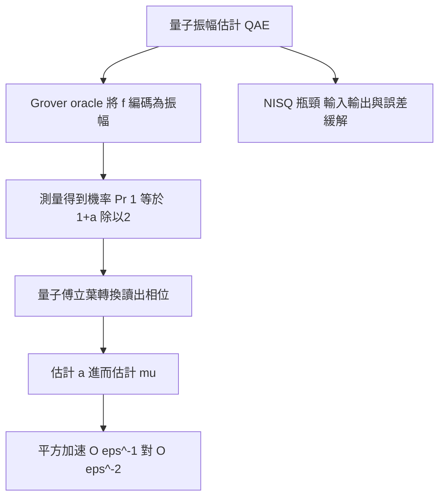
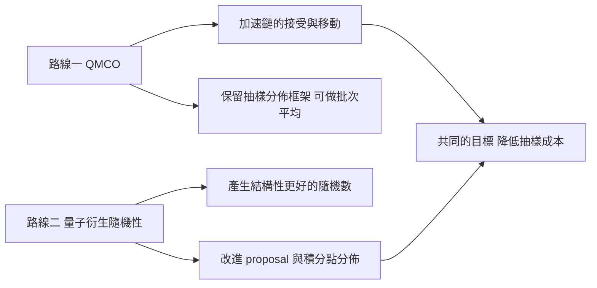
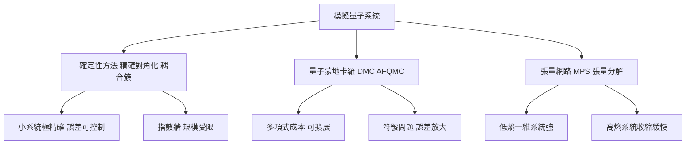

## 16.3　蒙地卡羅法在量子計算中的應用前景

[上一章：16.2　演算法的創新與改進方向](16.2-算法的創新與改進方向.md) | [下一章：第17章　總結與結語](17.0-總結與結語.md)

## 學習目標

1. 釐清「量子蒙地卡羅」一詞的兩種不同用法：利用量子電腦加速經典蒙地卡羅抽樣，以及用蒙地卡羅方法模擬量子多體系統；兩者的物理與數學內容完全不同。
2. 掌握量子振幅估計（quantum amplitude estimation）的核心原理，理解它如何把求積的樣本複雜度從 $`O(\varepsilon^{-2})`$ 降到 $`O(\varepsilon^{-1})`$ 。
3. 理解量子蒙地卡羅優化（QMCO）與「以量子衍生隨機性驅動蒙地卡羅」這兩條不同的加速路線。
4. 評估類 NISQ 時代的可行性：量子蒙地卡羅在近期硬體上的實際瓶頸所在。
5. 比較模擬量子系統的三種方法——確定性方法、量子蒙地卡羅與張量網路——在適用系統、誤差來源與計算成本上的差異。
6. 說明變分量子蒙地卡羅（VMC）與神經量子態（neural quantum states）結合的機制與其統計意義。

### 兩種「量子蒙地卡羅」

在討論之前，必須先做一個重要的區分，否則容易混淆兩套完全不同的文獻：

**用法一：量子電腦加速經典蒙地卡羅。** 這裡的主體是「蒙地卡羅法」，量子電腦是加速器。蒙地卡羅法本身的統計結構不變，只是某些抽樣步驟被替換成量子程序。

**用法二：用蒙地卡羅法模擬量子系統。** 這裡的主體是「量子系統」，蒙地卡羅法是求解多體量子哈密頓量基態能量的工具，例如擴散蒙地卡羅（diffusion Monte Carlo）、輔助場量子蒙地卡羅（auxiliary-field quantum Monte Carlo）、以及本章末節介紹的變分量子蒙地卡羅。

兩者都值得討論，但技術問題完全不同。本節先處理用法一。

### 量子振幅估計：加速的數學核心

#### 從經典求積到振幅估計

考慮一個求積問題：給定可高效計算的振幅 $`a`$ （ $`0\le a\le 1`$ ），估計 $`\mu = a`$ 。經典方法是用 Bernoulli 試驗估計 $`a`$ ，需要 $`O(\varepsilon^{-2})`$ 次試驗才能達到絕對誤差 $`\varepsilon`$ 。這個平方反比正是[第4章](04.0-蒙地卡羅積分法.md)所說的收斂速率。

量子振幅估計（quantum amplitude estimation, QAE）的做法是把 $`a`$ 編碼成一個量子狀態振幅。具體而言，若 $`f:\mathcal{X}\to[0,1]`$ 且 $`a = \mathbb{E}[f]`$ ，則定義態向量

$$
\lvert \psi \rangle = \frac{1}{\sqrt{2}}\Bigl(\lvert 0\rangle \lvert \psi_f\rangle + \lvert 1\rangle \lvert \psi_g\rangle\Bigr)
$$

其中 $`\lvert\psi_f\rangle`$ 是 $`f`$ 的 Grover oracle 所對應的疊加態。測量第一個量子位元的機率為

$$
\Pr[1] = \frac{1 + a}{2}
$$

因此估計 $`a`$ 等價於估計一個機率。量子計數（quantum counting）演算法用量子傅立葉轉換讀出這個相位角 $`\theta`$ （其中 $`a = \sin^2(\theta)`$ ），從而在 $`O(1/\varepsilon)`$ 次查詢的精度下估計 $`a`$ 。這個 $`O(\varepsilon^{-1})`$ 對 $`O(\varepsilon^{-2})`$ 的改進，就是所謂的**平方加速（quadratic speedup）**。

#### 平方加速的實際意義

在實際的模擬中，一次抽樣（前向模擬）本身可能很昂貴，設單次成本為 $`C`$ 。若總量估計需要精度 $`\varepsilon`$ ：

| 方法 | 抽樣次數 | 總成本 |
| --- | --- | --- |
| 經典蒙地卡羅 | $`O(\varepsilon^{-2})`$ | $`O(C\varepsilon^{-2})`$ |
| 量子振幅估計 | $`O(\varepsilon^{-1})`$ | $`O(C\varepsilon^{-1})`$ |

因此量子加速的來源正是我們在[第4章](04.3-誤差分析與精度提升.md)分析過的中心極限定理：**經典抽樣的誤差來自隨機波動，而隨機波動本質上是「隨機相位」的問題，量子傅立葉轉換正好擅長估計相位。** 這是一個非常漂亮的因果閉環：蒙地卡羅法的弱點（隨機性帶來的統計波動）恰好是量子計算的強項（相位干涉與振幅放大）。

#### 從振幅估計到量子蒙地卡羅

把 QAE 放回蒙地卡羅積分的框架，就得到「量子蒙地卡羅」的核心形式。若要估計

$$
\mu = \int f(x)\,p(x)\,dx
$$

則定義

$$
a = \int_0^1 f(x)\,p(x)\,dx \cdot 2^{k},
$$

其中 $`k`$ 為精度位數，並讓 Grover oracle 在 $`2^k`$ 個均勻分割上求和。量子計數估計出的 $`a`$ 給出 $`\mu`$ 的估計，其誤差來自量子測量的統計波動與有限位元解析度。

上圖說明量子振幅估計的資訊流程與其加速來源；它呼應本節的核心論點：**量子加速並非來自「更多的隨機樣本」，而是來自用干涉取代統計平均，而這恰恰是以放棄部分隨機性為代價換來的。**

### 兩條不同的加速路線

#### 路線一：QMCO（量子蒙地卡羅優化）

量子蒙地卡羅優化（Quantum Monte Carlo Optimization, QMCO）的目標不是加速積分，而是**加速蒙地卡羅抽樣過程本身**。其想法是：把蒙地卡羅鏈的「接受/拒絕」決策改寫成一個量子程序，讓量子電腦在給定當前狀態下產生下一個候選狀態。

具體而言，若原來的鏈有接受機率 $`p`$ ，QMCO 用一個稀疏的 Grover 型運算把這個接受機率提高到接近 1（通過構造使新候選被接受的分層結構），代價是需要額外的查詢次數。在理想情況下，若接受機率從 $`p`$ 提升到 $`p'`$ ，所需樣本數大致按 $`p'/p`$ 的比例縮減。

這條路線的吸引力在於：它**保留了蒙地卡羅法的統計框架**——結果仍然是分布式的抽樣，仍可用批次平均法估計標準誤，仍有漸近無偏性。這與 QAE 路線（估計單一積分值）性質不同。

#### 路線二：以量子衍生隨機性驅動蒙地卡羅

另一條路線是讓量子電腦成為「更好的隨機數來源」。這想法源自一個深刻的事實：**蒙地卡羅法的效率上限由隨機樣本的品質決定**，而量子演算法能產生的不是「更均勻」的隨機數（那沒有意義），而是**結構性更好、可用於加速抽樣的隨機性**。例如，量子電腦可以高效產生帶有特定傅立葉頻譜特徵的隨機數序列，這類序列可用於設計更好的低分歧積分或更好的 proposal。

相關的代表工作包括 Marcatili 等人提出的「以量子加速的隨機優化」與「超位置蒙地卡羅」（superposition Monte Carlo）：後者把隨機樣本寫成量子疊加態，用干涉把樣本「推向」目標分佈的高密度區域，再測量得到所需的經典樣本。這個想法的精神與[16.2](16.2-算法的創新與改進方向.md)的 Stein 變分蒙地卡羅相同——都是讓樣本彼此「吸引」而非彼此獨立。

#### 一個必須說清的現實

上述兩條路線目前都處於**研究階段**，尚未在實際工業流程中取代經典蒙地卡羅。原因有三：

第一，**輸入輸出瓶頸。** 量子演算法的查詢複雜度再低，每次查詢都需要把經典資料編碼成量子態，並把測量結果讀回經典世界。若目標是「評估一個巨大的函數 $`f`$ 」， $`f`$ 的值往往是指數級的資料，編碼成本會淹沒加速效益。QMCO 這類「加速鏈」的方案在這方面相對有利，因為鏈的狀態可以維持在量子系統內部。

第二，**噪聲與誤差緩解的代價。** 目前的硬體無法做到故障容錯， $`T`$ 個量子閘門的誤差會累積，執行深度受限。要執行 QAE 所需的深度遠超當前能力，因此必須用誤差緩解技術（如零噪音外插），而這會引入額外的不確定性與計算開銷。

第三，**負載與吞吐量。** 蒙地卡羅法可以近乎無限地水平擴充（見[第6章](06.0-蒙地卡羅積分的高效實現.md)），而量子電腦的數量極少。當經典集群已能提供千核年的算力時，量子加速的邊際效益需要非常顯著才能抵銷編碼與調校成本。

### 用蒙地卡羅法模擬量子系統

#### 問題的本質

多體量子系統的基態能量求解，需要解一個高維的薛丁格方程。若以哈密頓量 $`H`$ 的基表示，基態能量是特徵問題 $`H\lvert\psi_0\rangle = E_0\lvert\psi_0\rangle`$ 的最小特徵值。當粒子數 $`N`$ 增長時，Hilbert 空間維度以 $`\exp(N)`$ 的速度膨脹——這就是「指數牆」。

確定性方法（精確對角化、量子化學的耦合簇方法）在小系統上極為精確，但隨 $`N`$ 增大而失效。

#### 量子蒙地卡羅的機制

量子蒙地卡羅（QMC）用費曼–卡克（Feynman–Kac）表示把量子演化寫成隨機過程：

$$
\lvert \Psi(\tau)\rangle = \mathbb{E}_{\tau}\bigl[\exp\bigl(-\int_0^\tau (H - E_T)\,dt\bigr)\,\lvert\psi_0\rangle\bigr]
$$

其中 $`\tau`$ 是虛時間， $`E_T`$ 是試探能（trial energy），而期望是關於一個「投影隨機步行」的（在虛時間中沿著哈密頓量方向跳躍的隨機過程）。這個公式正是[附錄 A2](A2-常見數學公式與定理.md)的 Feynman–Kac 公式的一個實例，也是[第7章](07.0-隨機過程與模擬.md)的隨機微分方程理論在量子力學中的落地。

實務上：

- **擴散蒙地卡羅（DMC）**：投影一個試探波函數到基態，誤差為時間步長 $`\Delta\tau`$ 的高階項，可外推。
- **輔助場 QMC（AFQMC）**：用高斯場把粒子間的相互作用改寫成與單粒子獨立的耦合形式，然後用 Slater 行列式做重要性抽樣，優點是能系統性地處理長程相互作用。

#### 符號問題

量子蒙地卡羅最大的限制是**符號問題（sign problem）**：在費曼–卡克表示中，重要性抽樣的權重可能為負，而蒙地卡羅估計要求樣本非負才能解釋為機率分佈。當系統含電子（費米子）且系統尺寸超過臨界點時，符號問題使得變分方差隨系統尺寸發散，方法失去實用性。

這是一個典型的「方法邊界由物理決定而非由演算法決定」的案例，也是本章反覆出現的主題：蒙地卡羅法的效力範圍由問題結構決定。

#### 與其他方法的比較

下圖比較模擬量子系統的三種方法；它呼應本節的論點：**沒有單一方法佔優，選擇取決於系統的物理性質（是否有符號問題、是否低秩、是否強關聯）。**

| 面向 | 確定性方法 | 量子蒙地卡羅 | 張量網路 |
| --- | --- | --- | --- |
| 誤差來源 | 截斷誤差 | 統計誤差 + 投影誤差 + 符號問題 | 截斷誤差 + 收縮誤差 |
| 成本隨系統大小 | 指數增長 | 多項式增長 | 多項式但受 Schmidt 階數限制 |
| 適用系統 | 小系統、需要高精度 | 有符號的系統（玻色子、部分費米子） | 一維與低熵二維系統 |
| 主要優勢 | 可做高精度基準 | 可模擬中等規模強關聯系統 | 記憶體效率高、可做時序演化 |
| 主要限制 | 規模瓶頸 | 費米子符號問題 | 高熵系統收縮慢、張量鍵維數爆炸 |

#### 變分量子蒙地卡羅與神經量子態

#### 變分量子蒙地卡羅

變分量子蒙地卡羅（variational quantum Monte Carlo, VMC）採用變分原理：

$$
E_0 \le \mathbb{E}_{\lvert\psi_\theta\rangle}\bigl[\lvert\psi_\theta\rvert^2 H \lvert\psi_\theta\rangle\bigr]
$$

其中 $`\lvert\psi_\theta\rangle`$ 是參數化試探態。VMC 的流程是：參數化量子電路產生波函數 $`\lvert\psi_\theta\rangle`$ → 在量子硬體上測量得到位元串 → 用**經典蒙地卡羅**從這些位元串估計能量期望值與其梯度 → 更新 $`\theta`$ → 重複。

這裡出現了一個漂亮的分工：**量子硬體負責產生難以在經典上高效取樣的波函數，經典蒙地卡羅負責統計估計與最佳化。** 蒙地卡羅法的價值在這裡不是「加速抽樣」，而是提供**穩健的梯度估計與誤差控制**（在位元串的隨機性下，中心極限定理保證能量估計的誤差以 $`O(N^{-1/2})`$ 收斂）。

#### 神經量子態

神經量子態（neural quantum states, NQS）用機器學習模型（如神經網路或量子卷積網路）參數化波函數，代替費米子 Slater 行列式或玻色子高斯波包。Carleo 等人（2017）在 *Science* 上的工作顯示，在二維自旋系統上，神經量子態可以精確描述基態，並且能捕捉到解析方法難以捕捉的「非經典序」的關聯結構。

把 NQS 與 VMC 結合，就得到「神經量子蒙地卡羅」：用神經網路表達 $`\lvert\psi_\theta\rangle`$ ，用蒙地卡羅估計能量與梯度。這裡出現了一個與[第14章](14.0-蒙地卡羅方法在機器學習中的應用.md)完全平行的結構：**變分推論用網路表達變分分佈，蒙地卡羅提供梯度；NQS 用網路表達波函數，蒙地卡羅同樣提供梯度。** 這也說明蒙地卡羅法在現代機器學習與物理的交叉地帶，已經成為一種「統一的統計推論引擎」，而不只是一個數值積分技巧。

## 本章要點

1. 「量子蒙地卡羅」有兩種用法：以量子電腦加速經典蒙地卡羅抽樣，以及用蒙地卡羅法模擬量子多體系統；兩者不可混淆。
2. 量子振幅估計把求積的抽樣複雜度從 $`O(\varepsilon^{-2})`$ 降到 $`O(\varepsilon^{-1})`$ ，加速來源是量子干涉取代了統計平均。
3. QMCO 加速的是「鏈的接受與移動」並保留抽樣分佈框架；「量子衍生隨機性」則改善 proposal 與積分點的分佈結構。
4. 類 NISQ 時代的三大瓶頸是輸入輸出編碼成本、噪聲與誤差緩解開銷、以及量子硬體吞吐量遠低於經典集群。
5. 模擬量子系統的三種方法各有邊界：確定性方法受指數牆限制；量子蒙地卡羅受符號問題限制；張量網路受系統熵限制。
6. 變分量子蒙地卡羅與神經量子態展示了蒙地卡羅法的新角色——作為變分最佳化的穩健梯度估計引擎，與機器學習的結合點和變分推論完全平行。

## 延伸閱讀

- [第8章：蒙地卡羅方法在物理中的應用](08.0-蒙地卡羅方法在物理中的應用.md)：統計力學蒙地卡羅與量子系統模擬的歷史脈絡。
- [第7章：隨機過程與模擬](07.0-隨機過程與模擬.md)：布朗運動與隨機微分方程，是 Feynman–Kac 表示的基礎。
- [第6章：蒙地卡羅積分的高效實現](06.0-蒙地卡羅積分的高效實現.md)：理解量子加速與經典並行的相對優勢時必讀。
- Høyer, P. (2002) *Quantum amplitude estimation*, arXiv:quant-ph/0207051.
- Montanaro, A. (2015) *Quantum speed-up of Monte Carlo methods*, arXiv:1504.01058.
- Bouland, A., Huggins, A., Ozols, S. and Yilek, R. (2019) *Quantum Monte Carlo Optimization*, arXiv:1910.04329.
- Joshi, B., Beyer, K., Diles, L., Evers, M. and Hayes, M. (2022) *Quantum amplitude estimation and particle collision for efficient and robust Monte Carlo simulation of particle physics*, *Physical Review D* 106, 022002.
- Carleo, G. et al. (2017) *Solving many-body quantum systems with neural quantum states*, *Science* 355(6322), 1412–1415.
