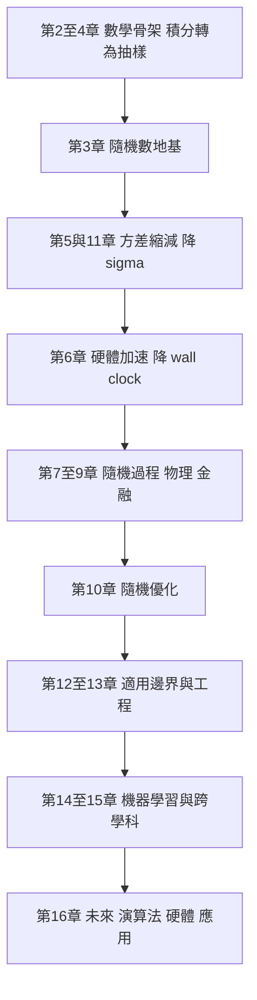

# 第17章　總結與結語

[上一章：16.3　蒙地卡羅法在量子計算中的應用前景](16.3-蒙地卡羅法在量子計算中的應用前景.md) | [下一章：17.1　蒙地卡羅法的優勢與挑戰](17.1-蒙地卡羅法的優勢與挑戰.md)

## 學習目標

1. 回顧全書 1 至 16 章的主線，理解「以隨機性換取通用性與可擴展性」這個貫穿全書的設計選擇。
2. 能夠用自己的話說明每一章在整體論述中的位置與它解決的問題，而不是只記住個別公式。
3. 掌握「蒙地卡羅法不是單一演算法，而是一類方法的骨架」這個關鍵觀點，理解抽樣、估計、方差控制三者如何分離又重新組合。
4. 建立面對新問題時的決策流程：判斷是否適用 → 選擇抽樣器 → 設計方差縮減 → 診斷與驗證。
5. 體會蒙地卡羅法的哲學地位：它把「無法解析求解的問題」轉化為「可以抽樣的問題」，從而把數學的難度換成了統計的難度。

### 一條貫穿全書的主線

如果要用一句話總結全書，那就是：

> **蒙地卡羅法用「隨機性帶來的統計不確定性」，換取「對幾乎任何問題都成立的通用性與可擴展性」。**

這個交換是整本書的起點，也是每一章改進的方向。每一章的技術改進，都可以追溯到「如何降低這個交換的代價」。

### 起點：把積分變成抽樣

[第2章](02.0-蒙地卡羅法的基本概念.md)建立了核心等價：

$$
\int_{\Omega} f(x)\,dx = \mathbb{E}[f(X)],\qquad X \sim p
$$

這個等價看似平凡，卻改變了問題的本質。確定性數值方法（如梯形法、有限差分）面對的是「如何逼近」；轉成期望之後，面對的是「如何抽樣」與「如何控制抽樣誤差的統計波動」。**問題從「逼近誤差」轉化為「抽樣方差」，這是全書的起點。**

### 保證：統計的嚴謹性

[第4章](04.0-蒙地卡羅積分法.md)與[第11章](11.0-蒙地卡羅方法的誤差分析與改進.md)給出了蒙地卡羅估計的統計性質：

$$
\operatorname{Var}\bigl(\widehat{\mu}_N\bigr) = \frac{\sigma^2}{N}
$$

大數法則保證收斂，中心極限定理保證誤差的近似分佈，使得批次平均法能給出可信的誤差估計。**這是蒙地卡羅法得以進入工程與監管場景的資格證。**

### 障礙一：隨機數的可信度

統計保證的前提是「樣本真的獨立同分布且分佈正確」。[第3章](03.0-隨機數生成與統計分佈.md)因此成為實用性的地基：偽隨機數生成器必須通過檢驗、必須有週期、必須注意不同語言預設隨機數產生器的品質差異。**這一章的重要性在實務中被嚴重低估——很多「蒙地卡羅結果不對」的問題，根源其實在隨機數而非抽樣器。**

### 障礙二：誤差的平方根律

$`O(N^{-1/2})`$ 的收斂速率意味著精度提升十倍需要百倍算力。[第5章](05.0-變換抽樣法.md)的重要性抽樣、[第11章](11.0-蒙地卡羅方法的誤差分析與改進.md)的控制變數、Rao-Blackwell 化，都是針對同一個問題：**在同一樣本數下降低 $`\sigma`$ **。**這一整條線的主題是「不改變抽樣的機率論保證，只改變被抽樣的對象」。**

### 障礙三：計算成本

抽樣數越多越好，但每次抽樣可能很昂貴。[第6章](06.0-蒙地卡羅積分的高效實現.md)回答的是「如何在不犧牲統計保證的前提下把抽樣做得更快」：批次平行、GPU 大量並行、分散式聚合。**這一章的核心紀律是：平行化只能減少 wall-clock time，不能減少總工作量，也絲毫不改變統計誤差。** 很多初學者把「跑得快」誤認為「更準」，這正是第 6 章要澄清的。

### 障礙四：維度災難

維度增加時，蒙地卡羅法相對於確定性網格法的優勢反而增大（確定性法的成本隨維度指數增長，蒙地卡羅法只隨維度線性增長），但「每個維度都需要一條路徑」的特徵使得高維問題仍然昂貴。[第12章](12.0-蒙地卡羅法可行性分析.md)因此專門處理「何時不該用蒙地卡羅法」，並給出替代方案（求積、稀疏網格、代理模型）。

上圖是全書的依賴圖；它呼應本節的核心論點：**每一章都是上一章所開啟的問題的解法，而每個解法又開啟下一個問題。**

### 三個方向的交會：抽樣、估計、方差控制

全書的技術可以歸結為三個可以獨立設計的環節，這是理解全書最有效的抽象：

**環節一：抽樣器（sampler）。** 決定「從哪個分佈、依什麼機制產生樣本」。包括：直接抽樣（第4章）、重要性抽樣（第5章）、Metropolis 與 Metropolis–Hastings（第8章）、隨機步行與 SDE（第7章）、準蒙地卡羅與學習型 proposal（第16章）。

**環節二：估計量（estimator）。** 決定「如何把樣本變成數字」。包括：抽樣平均（第4章）、控制變數與對偶變數（第11章）、Rao-Blackwell 化、批次平均法估計標準誤。

**環節三：誤差控制（error control）。** 決定「怎麼知道結果有多準」。包括：中心極限定理與批次平均（第4章）、有效樣本數與 R-hat（第11、14章）、後驗預測校準（第14章）、跨方法交叉驗證（第12章）。

這三個環節的解耦，是蒙地卡羅法能夠持續演進的結構性原因：**幾乎所有新方法都是「替換其中一個環節，保持另外兩個不變」的結果。** 例如：

- 重要性抽樣替換了環節一，估計量變為加權平均。
- 控制變數替換了環節二，環節一與三不變。
- 學習型 proposal 替換了環節一，但保留 MH 校正以維持環節二的無偏性。
- 多層蒙地卡羅同時改變環節一（跨層耦合）與環節二（差項組合），並以複雜度分析取代傳統誤差估計來完成環節三。

這個三環節模型讀者可以帶走，在面對任何新的蒙地卡羅文獻時快速歸類。

### 領域的映射

除了方法的抽象，書中的應用章節也構成一個橫向的映射。把它們排在一起，可以看出同一套骨架如何被「裝填」不同的內容：

| 領域 | 積分/期望的對象 | 隨機性的來源 | 誤差的關鍵形態 | 主要章節 |
| --- | --- | --- | --- | --- |
| 統計物理 | 配分函數與觀測量 | 熱運動 | 相鄰能階差異小，混合快 | 第8章 |
| 金融 | 未來現金流現值 | 市場波動 | 尾端厚，重要性抽樣易失效 | 第9章 |
| 工程可靠性 | 失效機率 | 參數與載荷變異 | 失效事件稀有，需要重要抽樣 | 第13章 |
| 優化 | 全域極值 | 隨機搜尋方向 | 多峰，需要溫度調度 | 第10章 |
| 貝葉斯推論 | 後驗期望 | 後驗分佈形狀 | 多峰，混合慢，需診斷 | 第14章 |
| 氣候科學 | 氣候投影 | 初始條件與參數 | 模式成本高，需要 MLMC | 第16章 |

這個表是全書最實用的部分之一：它說明「面對一個新領域時，第一個要問的問題不是『怎麼抽樣』，而是『這個領域的隨機性來源是什麼、誤差的關鍵形態是什麼』」。

### 結語：隨機性作為工程上的美德

在整本書的結尾，值得回頭看一眼這套方法觀的深層意義。

蒙地卡羅法的出現，源於一個計算機的時代轉變：當計算變得便宜時，人類面對的問題不再是「算得出來嗎」，而是「哪一個答案比較好」——而後者往往無法封閉求解。於是「不求閉式解，只求統計上可信的估計」成為一種新的工程美學：**用可量化的統計不確定性，取代無法量化的模型不確定性。**

這種美學有三個後果。

第一，**誠實。** 蒙地卡羅法逼使用者明確承認「我不知道真值是什麼，但我知道我的估計誤差有多大」。這與確定性方法給出一個毫無誤差資訊的數字形成鮮明對比。在風險評估、醫療決策與氣候政策這類領域，這種誠實本身就是價值。

第二，**普遍性。** 同一套抽樣骨架可以套用在幾乎任何領域，唯一的差別是把領域知識放進「目標分佈」與「代價函數」。這種通用性是蒙地卡羅法在八十年間持續保持生命力的根本原因。

第三，**可擴展性。** 蒙地卡羅法是「 embarrassingly parallel」的：樣本之間彼此獨立，因此可以無限制地增加機器而不改變演算法結構。這在雲端運算時代不是優勢而已，而是決定性優勢。

但這份美學也帶來了本書反覆出現的代價：統計誤差無法被消除，只能被管理；隨機性使得驗證與重現變得困難； $`O(N^{-1/2})`$ 的收斂速率是一道看不見的天花板。**承認這些代價，並且用統計的工具（而不是用更多的計算機）去管理它們，正是蒙地卡羅法作為一門學科的成熟標誌。**

因此，[第16章](16.0-蒙地卡羅法的未來發展.md)所展望的三條主線——演算法、硬體、應用——其實都指向同一個方向：**在不動搖「以隨機性換取通用性」這個根本交換的前提下，不斷地壓低這個交換的價格。** 準蒙地卡羅、多層蒙地卡羅、機器學習協助抽樣、GPU 加速、量子加速——它們的共同DNA是「改進抽樣效率，但保留統計保證」。

## 本章要點

1. 全書主線是「以隨機性換取通用性與可擴展性」；每一章的改進都在降低這個交換的代價。
2. 核心起點是第 2 章的等價 $`\int f = \mathbb{E}[f(X)]`$ ，它把問題從逼近誤差轉化為抽樣方差。
3. 全書可抽象成三個可獨立設計的環節：抽樣器、估計量、誤差控制；幾乎所有新方法都是替換其中一環的結果。
4. 應用章節提供橫向映射：面對新領域時，先問「隨機性來源」與「誤差的關鍵形態」，再選抽樣器。
5. 蒙地卡羅法的工程美德有三：誠實（量化不確定性）、普遍性（同骨架跨領域）、可擴展性（樣本獨立可無限並行）；其代價是統計誤差、驗證困難與 $`O(N^{-1/2})`$ 的天花板。
6. 未來所有改進的共同判準是：**在保留統計保證的前提下壓低「隨機性換取通用性」的價格。**

## 延伸閱讀

- [第12章：蒙地卡羅法可行性分析](12.0-蒙地卡羅法可行性分析.md)：全書的決策工具章，讀完本章後最值得回頭精讀。
- [第17.1節：蒙地卡羅法的優勢與挑戰](17.1-蒙地卡羅法的優勢與挑戰.md)：把本章的討論轉化為可直接使用的實務檢查表。
- [第17.2節：進一步的學習資源與研究方向](17.2-進一步的學習資源與研究方向.md)：延伸的路線圖與前沿主題。
- [附錄 A2：常見數學公式與定理](A2-常見數學公式與定理.md)：全書出現的數學工具的集中速查。
