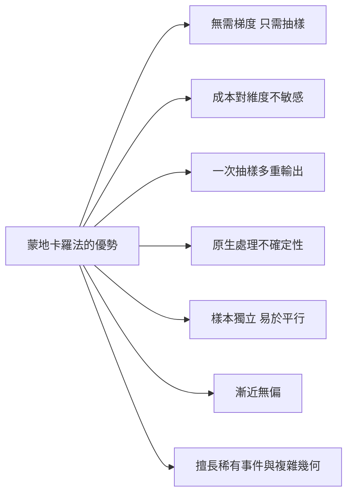
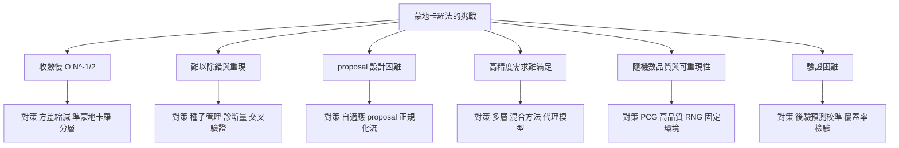

## 17.1　蒙地卡羅法的優勢與挑戰

[上一章：17.0　總結與結語](17.0-總結與結語.md) | [下一章：17.2　進一步的學習資源與研究方向](17.2-進一步的學習資源與研究方向.md)

## 學習目標

1. 能夠系統列出蒙地卡羅法在七個面向上的優勢：無需梯度、維度代價、多重輸出、不確定性處理、易於平行、漸近無偏、以及在複雜幾何與事件層級的適用性。
2. 能夠說出蒙地卡羅法在七個面向上的挑戰： $`O(N^{-1/2})`$ 的慢收斂、難以除錯、抽樣分佈設計困難、高精度需求難以滿足、可重現性與隨機數品質、以及驗證困難。
3. 理解每一項優勢與挑戰背後的「前因後果」關係：它們通常是同一枚硬幣的兩面。
4. 掌握一份可直接用於實務工作的檢查表，能在專案啟動前辨識風險並選擇對策。
5. 建立面對「蒙地卡羅結果不可信」事件時的排查順序。

### 優勢的七個面向

#### 優勢一：不需要梯度，也不要求被積函數有特定結構

確定性求積方法（如高斯求積、 Romberg 外推）要求被積函數具備解析性、光滑性，或至少能夠被多項式逼近。蒙地卡羅法只要求：**能夠從某個分佈抽樣，並且能夠計算 $`f(x)`$ 的值。** 這個要求極其微弱，涵蓋了絕大多數實際問題。

這個優勢的後果是深遠的：它意味著蒙地卡羅法可以處理沒有導數、甚至不連續、甚至只有在離散網格上才有定義的目標函數。**這正是第10章的隨機搜索與粒子群演算法能夠存在的原因，也是第14章中變分推論能夠採用重參數化技巧的前提。**

#### 優勢二：複雜度對維度不敏感

若要計算 $`d`$ 維的積分，確定性網格法需要 $`O(M^d)`$ 個求值點（ $`M`$ 為每維的節點數）；而蒙地卡羅法只需要 $`O(N)`$ 個求值點，**成本與維度無關（線性）**。雖然常數因子較大，但隨維度增加，確定性法迅速失去可行性，而蒙地卡羅法幾乎不受影響。

這是蒙地卡羅法在物理（粒子物理的相空間維度極高）與金融（多因子模型的維度）領域佔據主導地位的根本原因。

#### 優勢三：一次抽樣，多重輸出

蒙地卡羅抽樣的樣本可以同時用來估計多種量：期望、變異數、分位數、尾端機率、甚至整個經驗累積分佈函數。因為這些量都是同一批樣本的函數，**增加一個輸出量的邊際成本趨近於零**。

這與確定性方法形成鮮明對比：後者的每一個輸出通常需要一次獨立的求解。

#### 優勢四：直接處理不確定性

蒙地卡羅法對不確定性的處理是「原生」的：不確定參數就是抽樣變數，不確定模型就是混合分佈，不確定場景就是集合。估計出來的區間不是事後附上的誤差棒，而是方法的自然輸出。這在可靠性工程、風險管理與氣候科學中是決定性優勢（見[第13章](13.0-蒙地卡羅法在工程中的應用.md)與[第16.1節](16.1-跨領域的應用展望.md)）。

#### 優勢五：易於平行

樣本之間彼此獨立，因此計算可以無限制地分配到多核、叢集或 GPU 上。這是蒙地卡羅法在現代算力時代最重要的工程性質。

必須強調的是：**平行化縮短的是 wall-clock time，不是統計誤差。** 十倍的機器只讓同樣的樣本數更快算完；若要同樣的誤差，統計誤差不會改變。

#### 優勢六：漸近無偏

在標準條件下（可積函數、樣本獨立同分布），蒙地卡羅估計是無偏的，且由大數法則保證依機率收斂：

$$
\mathbb{E}\bigl[\widehat{\mu}_N\bigr] = \mu,\qquad \widehat{\mu}_N \xrightarrow{P} \mu
$$

這意味著**增加樣本數一定會改善結果，不會讓結果「飄走」**——這是重要性抽樣、控制變數等變換抽樣法在實務中受歡迎的根本保證。

#### 優勢七：能處理複雜幾何與事件

當積分區域形狀複雜（例如多面體、多重連通區域）、或者目標是「稀有事件機率」（例如失效機率 $`10^{-9}`$ ）時，蒙地卡羅法可以結合重要性抽樣把稀有事件「拉近」。而稀有事件的概率估計正是確定性數值方法最無力的地方。

上圖整理七項優勢；它呼應本節的論點：**這些優勢並非彼此獨立，而是同源——都來自「把問題化為抽樣」這個單一轉換。**

### 挑戰的六個面向

#### 挑戰一： $`O(N^{-1/2})`$ 的慢收斂

這是最根本的限制。誤差 $`\varepsilon`$ 需要 $`N = O(\varepsilon^{-2})`$ 個樣本；精度提高一個數量級，成本增加一百倍。相較之下，確定性求積方法（如高階高斯求積）在光滑函數上可達指數收斂。

**這項挑戰的後果**是：在需要 6 位數以上精度的場合（例如高精度數值積分、精密金融定價基準），蒙地卡羅法單獨使用往往不可行，必須靠準蒙地卡羅（見[16.2](16.2-算法的創新與改進方向.md)）或與確定性方法混合。

#### 挑戰二：難以除錯與難以重現

結果是隨機的，這造成三個實際困擾：

- **除錯**：當估計值「看起來不對」時，難以判斷是程式錯誤、抽樣器設計問題，還是單純的統計波動。
- **重現**：相同的程式碼與相同的種子應給出相同結果，這要求隨機數生成器、抽樣順序、並行分解方式、硬體型號等全部固定——實務上相當脆弱。
- **比對**：兩個版本的程式結果差異多少才算「真的改變了」？這需要統計檢定而不是簡單比較。

#### 挑戰三：抽樣分佈的設計困難

變換抽樣的效率完全取決於 proposal 的選擇（見[第5章](05.0-變換抽樣法.md)）。但選擇好的 proposal 需要對目標分佈的形狀有先驗了解——而實務上我們通常正是因為不知道目標分佈才要用蒙地卡羅法。**這是一個先有雞還是先有蛋的問題。**

更糟的是，proposal 選得不當時，重要性抽樣的方差會**爆炸式**增加，甚至在有重疊支撐集時產生無限大的估計值。

#### 挑戰四：高精度需求難以滿足

某些領域（參數估計、模型校準、監管申報）要求相對誤差在 $`10^{-4}`$ 或更小，此時需要的樣本數可能超出可負擔範圍。此外，蒙地卡羅估計的誤差估計本身也是隨機的，在少樣本時置信區間的覆蓋率並不準確。

#### 挑戰五：可重現性與隨機數品質

這是一個被低估的實務風險。不同語言與函式庫的預設隨機數生成器品質差異極大：某些實作使用的是簡單的線性同餘產生器（LCG），其低維度結構會導致在高維積分中產生「隱性相關」，估計結果看起來合理但系統性有偏。**在科學計算中，隨機數品質必須是顯性管理的事項。**

#### 挑戰六：驗證困難

當沒有解析解可以對照時，如何確認蒙地卡羅估計是對的？可能的證據包括：與另一種方法交叉比對、多條鏈的 R-hat 與 ESS 診斷、後驗預測校準、以及已知的合成基準測試。**但這些都不是「證明」，而是「證據」——這是蒙地卡羅法在監管場合最需要被說明的性質。**

上圖把六項挑戰與其對策配對；它呼應本節的核心論點：**每一項挑戰都有對應的統計或工程對策，但每一項對策都要付出代價，因此沒有一個「免費」的解法。**

### 優勢與挑戰的同源性

值得強調的是：許多挑戰其實是相應優勢的鏡像。

| 優勢 | 對應的挑戰 |
| --- | --- |
| 不需要梯度，因此適用範圍廣 | 適用範圍廣意味著可能不適合抽樣，也就難以設計 proposal |
| 隨機性帶來通用性 | 隨機性帶來方差、除錯困難與重現問題 |
| 樣本獨立，故易並行 | 樣本獨立，故無法用「共享中間結果」來省成本 |
| 原生產出分佈與區間 | 區間覆蓋率在有限樣本時不準確，需要校準 |
| 漸近無偏 | 漸近意味著「樣本夠多才行」，小樣本時品質不可靠 |

理解這種同源性，有助於避免「以為找到某個技巧就能同時解決所有問題」的幻覺。

### 實務檢查表

以下檢查表可直接用於專案啟動與成果審查階段。左欄是問題，右欄是建議對策。

### 適用性檢查

| 檢查問題 | 若答案為「是」 | 若答案為「否」 |
| --- | --- | --- |
| 被積函數只有數值值、沒有解析式或梯度？ | 蒙地卡羅是合適的 | 可先考慮確定性求積 |
| 維度超過 10 以上？ | 蒙地卡羅相對更有利 | 確定性網格法可能仍可行 |
| 目標是機率、分位數或整個分佈？ | 蒙地卡羅是合適的 | 單一數值可能用其他方法更省 |
| 稀有事件的機率很小？ | 考慮重要性抽樣 | 直接抽樣可能失效 |
| 需要嚴格的信賴區間與審計？ | 可行，但須做校準 | 需與其他方法交叉驗證 |

### 實作檢查

| 檢查項目 | 建議做法 |
| --- | --- |
| 隨機數品質 | 使用 PCG64 或 xoshiro 等高品質產生器；不要依賴語言預設值 |
| 種子與重現 | 固定種子並記錄；保存 RNG 狀態；記錄硬體、函式庫版本與並行分解方式 |
| 批次平均 | 用批次平均法估計標準誤，而不是假設樣本獨立 |
| 混合診斷 | MCMC 必須報 R-hat 與 ESS；接受率也應記錄 |
| 方差縮減 | 至少檢查一次：重要性抽樣、控制變數、對偶變數 |
| 樣本數決定 | 先跑小樣本估計方差，再依 $`N = O(\varepsilon^{-2})`$ 外推所需樣本數 |
| 平行策略 | 批次間用不同種子或獨立 RNG 串流；不要共用同一 RNG 串流 |
| 交叉驗證 | 至少用第二種方法（不同抽樣器或確定性解）驗證關鍵結果 |
| 產出記錄 | 同時輸出點估計、標準誤、信賴區間、ESS 與診斷量 |

### 疑難排解的排查順序

當結果可疑時，建議依下列順序排查（這個順序反映「由廉價到昂貴、由常見到罕見」）：

1. **隨機數**：是否使用了品質良好的產生器？不同批次是否用了不同子流以避免相關？
2. **抽樣器實作**：接受率或重要權重是否劇烈變動？是否出現數值下溢導致權重退化？
3. **樣本量**：是否足以察覺所關心的效應？用小樣本估計的方差外推看看需要多少樣本。
4. **模型設定**：估計的量是否本身就是你要的量？單位與符號是否一致？
5. **混合充分性**：多條鏈是否都收斂到同一分佈（R-hat ≈ 1）？
6. **獨立驗證**：能否用一個人工構造的、有解析解的簡化問題驗證整條流程？

## 本章要點

1. 蒙地卡羅法的七項優勢：無需梯度、維度代價不敏感、一次抽樣多重輸出、原生處理不確定性、易於平行、漸近無偏、擅長稀有事件與複雜幾何。
2. 六項挑戰： $`O(N^{-1/2})`$ 的慢收斂、難以除錯與重現、proposal 設計困難、高精度需求難以滿足、隨機數品質與可重現性、驗證困難。
3. 多數挑戰是相應優勢的鏡像，因此不可能有單一技巧同時解決所有問題。
4. 實務檢查表分為適用性、實作與排障三塊；排障順序為：隨機數 → 抽樣器 → 樣本量 → 模型設定 → 混合診斷 → 獨立驗證。
5. 最重要的兩條紀律：**樣本數必須依估計的方差反推，而不是憑感覺；**任何對外發布的蒙地卡羅結果都必須附帶誤差與診斷資訊。

## 延伸閱讀

- [第4.3節：誤差分析與精度提升](04.3-誤差分析與精度提升.md)： $`O(N^{-1/2})`$ 收斂與批次平均法的推導。
- [第11章：蒙地卡羅方法的誤差分析與改進](11.0-蒙地卡羅方法的誤差分析與改進.md)：控制變數、對偶變數與 Rao-Blackwell 化的完整說明。
- [第12章：蒙地卡羅法可行性分析](12.0-蒙地卡羅法可行性分析.md)：適用性判準的系統化討論。
- [附錄 A1：蒙地卡羅算法程式範例](A1-蒙地卡羅算法程式範例.md)：示範輸出中包含批次平均法、接受率診斷等實作細節。
