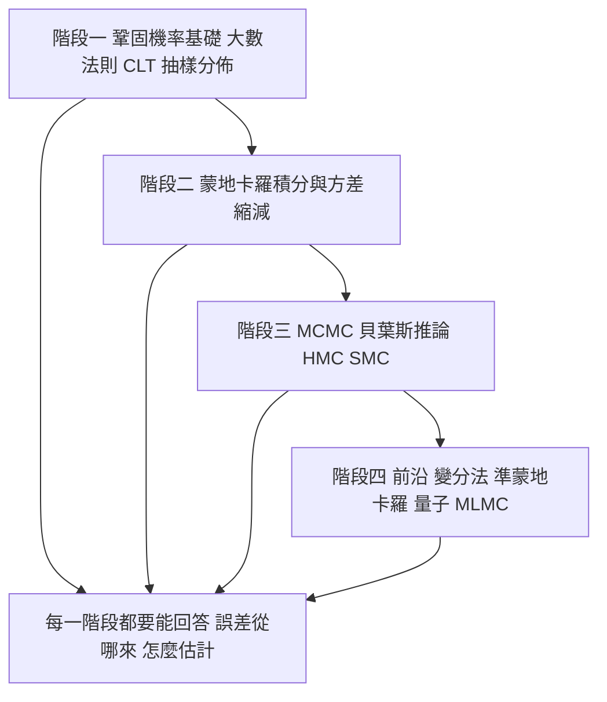
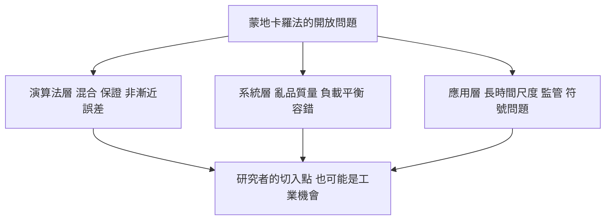

## 17.2　進一步的學習資源與研究方向

[上一章：17.1　蒙地卡羅法的優勢與挑戰](17.1-蒙地卡羅法的優勢與挑戰.md) | [下一章：附錄A1　蒙地卡羅算法程式範例](A1-蒙地卡羅算法程式範例.md)

## 學習目標

1. 掌握由淺入深的學習路線：從機率與大數法則的鞏固，到蒙地卡羅積分的實作，再到 MCMC、變分推論與前沿主題。
2. 熟悉目前主流的蒙地卡羅軟體工具鏈，知道每個工具解決什麼問題、什麼時候該用哪一個。
3. 建立對開放問題的認識：哪些是蒙地卡羅法在數學上尚未解決的問題，哪些是工程上尚未成熟的問題。
4. 能夠辨識當前的研究前沿方向，並判斷哪些方向適合投入博士研究、哪些適合工業界的應用開發。
5. 掌握評讀蒙地卡羅文獻的方法：知道一篇論文的核心貢獻通常落在抽樣器、估計量、誤差控制三個環節的哪一個。

## 學習路線：一個四階段的階梯

蒙地卡羅法橫跨多個學科，學習順序的設計本身就是一個策略問題。下圖給出建議的四階段路線；它呼應本節的論點：**每一階段都以「上一階段能做的事還不夠用」作為推進的理由。**



### 階段一：機率與數值分析的基礎

在讀任何蒙地卡羅專著之前，必須先能夠流暢地操作以下概念：隨機變數與其分佈、期望與變異數、大數法則（弱與強）、中心極限定理、條件期望與全期望公式、抽樣分佈的變換、累積分佈函數與分位數函數。

若這一環節不牢，之後在讀到「有效樣本數」、「批次平均估計標準誤」、「R-hat」時會只知其然而不知其所以然，反而增加了負擔。

**推薦的教材順序**：先讀機率論的標準教材（如 Ross 的 *A First Course in Probability* 或 Sheldon Ross 的 *Introduction to Probability Models*），再讀數值分析中隨機模擬的部分（如 Burden & Faires 的 *Numerical Analysis* 中的蒙地卡羅章節，或 Robert & Casella 專書的第二章）。

### 階段二：蒙地卡羅積分與方差縮減

核心目標是掌握四件事：抽樣平均的無偏性與方差、中心極限定理導出的正態近似區間、重要性抽樣的權重與其失效條件、控制變數與對偶變數的推導。

Robert & Casella 的 *Monte Carlo Statistical Methods*（第 2 版，2004）是這一層最權威的參考；Rubinstein & Kroese 的 *Simulation and Monte Carlo Methods*（第 4 版，2016）在應用與演算法覆蓋面更廣，是很好的第二本。Fishman 的 *Monte Carlo*（2001）則在工程應用與實作細節上非常完整。

### 階段三：MCMC 與貝葉斯推論

這一階段的主題是：Metropolis 與 Metropolis–Hastings 演算法的詳細平衡條件、Metropolis–Hastings 的接受率、Gibbs 取樣、診斷量（R-hat、ESS、軌跡圖）、Hamiltonian 蒙地卡羅與其梯度計算、序貫蒙地卡羅（SMC）與粒子濾波。

最好的起點是 Robert & Casella 專書的第 6 章（Metropolis–Hastings 演算法）與第 10–11 章（MCMC 的理論與實務）。若偏好以「為什麼會長成這樣」的敘事方式學習，可以先讀原論文：Metropolis et al.（1953）與 Hastings（1970）。

**實作面**建議選一個生態系深入：Stan（透過 CmdStanPy）、PyMC，或直接使用 NumPyro。這些工具會強制你理解「模型 → 抽樣 → 診斷」的完整流程。

### 階段四：前沿方法

在掌握前三階段後，可依興趣選擇方向：

- **變分方法**：變分推論、VAE、Stein 變分蒙地卡羅。
- **準蒙地卡羅**：低分歧序列、Sobol 數網、隨機化 QMC。
- **多層蒙地卡羅**：Giles 的 MLMC 理論。
- **計算物理**：量子蒙地卡羅、輔助場 QMC、張量網路。
- **金融**：Lévy 過程的模擬、蒙地卡羅方差縮減在衍生品定價中的應用。
- **量子機器學習與 AI for Science**：可微分蒙地卡羅、神經量子態。

## 線上資源與課程

| 資源類型 | 推薦 | 說明 |
| --- | --- | --- |
| 線上講義 | 各大學課程公開筆記、Monte Carlo Statistical Methods 的作者講義 | 適合快速回顧特定章節 |
| 線上課程 | Coursera / edX 上的隨機模擬、機率與隨機過程課程 | 適合非正規課程的補充 |
| 文件與教學 | NumPy、SciPy、Stan、PyMC、JAX、TFP、QUADPY 的官方文件與 notebook | 最好的「邊做邊學」材料 |
| 期刊 | *Monte Carlo Methods and Applications*、*SIAM Journal on Scientific Computing*、*Journal of Computational Physics*、*Statistics and Computing* | 前沿論文的來源 |
| 程式庫原始碼 | QUADPY、NumPyro、BlackJAX 的原始碼與測試 | 學習高品質實作的最好方式 |
| 社群 | 統計與機率學術社群、Reproducibility 社群 | 實務經驗與疑難雜症的交換 |

**一個重要建議**：閱讀原始論文。蒙地卡羅法的許多核心概念（Metropolis 抽樣、Hastings 接受率、Antithetic variates、Storn–Price 差分演化）都來自可讀且不長的原始論文。Metropolis et al.（1953）全文僅數頁，是性價比極高的一篇。

## 軟體工具鏈

### 通用數值與硬體加速

| 套件 | 定位 | 關鍵功能 |
| --- | --- | --- |
| NumPy `numpy.random` | 基礎隨機數 | `Generator` API、PCG64、Philox、隨機矩陣、正態/伽瑪/beta 等分佈 |
| SciPy `scipy.stats` | 統計推論 | 分佈物件、抽樣、統計量、假設檢定、統計過程控制圖 |
| Numba | JIT 編譯 | 把 Python 迴圈編譯成機器碼，加速自訂抽樣迴圈 |
| CuPy | GPU 運算 | 與 NumPy 幾乎同介面，可直接把蒙地卡羅迴圈搬到 GPU |
| JAX | 陣列 + 自動微分 | `jax.random` 具可重現的隨機鍵設計；`jax.vmap` 批次化抽樣 |
| QUADPY | 數值積分 | 內建準蒙地卡羅（Sobol、Halton）、多項式混沌等求積法 |

Numba 與 CuPy 的组合是自訂抽樣器的最佳搭檔：CuPy 負責在 GPU 上產生大量樣本，Numba 編譯核心迴圈以消除 Python 迴圈開銷。

### 貝葉斯推論與 MCMC

| 套件 | 定位 | 說明 |
| --- | --- | --- |
| Stan / CmdStanPy | 機率語言的 MCMC | 以語法撰寫模型，自動使用 NUTS/HMC；診斷工具完善 |
| PyMC | Python 生態的 MCMC | 建模靈活，支援多種抽樣器，含變分推論 |
| NumPyro | JAX 後端的 MCMC | 以 JAX 為基礎，可用 GPU 加速；適合研究新型抽樣器 |
| TensorFlow Probability | TF 生態的機率 | 提供分佈、抽樣器、變分推論與解碼器 |

**選型建議**：若要做研究（改進抽樣器），選 NumPyro 或直接以 JAX/Numba 實作；若要做應用交付，選 Stan（診斷完善、文件成熟）或 PyMC（Python 整合度高）。

### 專用與其他

- **QUADPY**：把準蒙地卡羅與其他求積法整合在統一介面下，是學習 QMC 的最佳工具。
- **TensorFlow Probability**：適合與深度學習管線整合。
- **Financial simulator**：例如 QuantLib 處理某些金融合約的蒙地卡羅定價。
- **CUDA 亂數庫**：如 cuRAND，提供 GPU 原生的偽隨機數與 quasi-random 序列。

### 一段可運行的示範

下面這段程式展示了 NumPy 新版 `Generator` API 的正確用法，特別注意**每個並列的抽樣工作流使用獨立的子流（spawn）**，這是[第17.1節](17.1-蒙地卡羅法的優勢與挑戰.md)所強調的隨機數管理紀律。

```python
import numpy as np

# 建立一個可重現的亂數產生器；PCG64 是品質良好的演算法
rng = np.random.default_rng(20261118)

# 主串流用於決定工作分派，子串流各自獨立，避免批次間相關
children = rng.spawn(4)

# 每個工作各自抽樣 250000 個標準常態樣本
results = []
for child in children:
    z = child.standard_normal(250_000)
    results.append(z.mean())

print("各批次均值：", np.round(results, 4))
print("合併後整體均值：", round(float(np.mean(results)), 4))
```

示範輸出（數值會因版本略有差異）：

```
各批次均值： [-0.     -0.0011 -0.0017 -0.0019]
合併後整體均值： -0.0012
```

四個批次的均值彼此接近且都在零附近，這正是中心極限定理的預期：每個批次的均值本身是一個近似常態變數，其標準差為 $`1/\sqrt{250000}\approx 0.002`$ ，觀察到的偏差量級完全符合預期。

## 前沿研究方向與開放問題

以下是蒙地卡羅法領域中仍具實質挑戰性的問題。這份清單同時也是研究題目的來源。

### 演算法層面的開放問題

**（一）高維與多峰後驗下的混合。** 即使是 HMC 與 SMC，在數百維且高度多峰（多個局部模式彼此分隔）的後驗上仍可能混合不足。目前沒有普適的準則能事先判斷「這個後驗我的抽樣器能不能處理」。

**（二）自適應抽樣器的理論保證。** 學習型 proposal、自動化溫度調度、自適應步長等技術在實務中非常有效，但很多缺乏漸近無偏性或收斂速率的嚴格證明。**「在實務中有效」與「有理論保證」之間的縫隙，是這個領域最持久的張力之一。**

**（三）非漸近的誤差估計。** 傳統的批次平均法與 CLT 依賴大樣本。當我們只跑得起幾百個樣本時，如何給出可靠的信賴區間？這涉及貝葉斯自舉、漸近正則性等工具。

**（四）變分方法的過度confidence。** 變分推論的後驗近似會系統性地低估變異（overconfidence），這在決策支援中是實質的風險。校準方法（如混合網路估計、temperature scaling 的機率版本）仍在發展。

**（五）多層蒙地卡羅的自動設計。** MLMC 的層數、耦合機制與樣本配置原則上需要領域知識來手工設計。能否讓演算法自動選擇層結構並給出誤差保證，是一個活躍的開放問題。

### 硬體與系統層面的開放問題

**（六）隨機數的硬體品質與可重現性的張力。** GPU 的並行亂數產生器必須保證不同執行緒拿到的是互不重疊且品質良好的子序列，同時又要在跨版本、跨硬體的情況下維持重現性。

**（七）異質硬體的負載平衡。** 在 GPU、CPU、分散式叢集混用的環境中，不同節點的抽樣速度差異很大，靜態分解會造成嚴重空轉。

**（八）容錯。** 長時間的蒙地卡羅作業（例如百萬次金融路徑模擬）在叢集上是常態，如何讓程式在節點故障時不丟失已完成的工作，是實務上很重要但常被忽略的問題。

### 應用層面的開放問題

**（九）氣候與地質時間尺度的模擬。** 需要跨越數十萬年的積分，目前只能靠粗略近似，統計不確定性與模型不確定性的分離仍不成熟。

**（十）醫療領域的監管接受度。** 個人化醫療需要隨機化的臨床決策支援，但監管框架對這類工具的驗證要求與藥品不同。

**（十一）符號問題的普遍性。** 費米子量子蒙地卡羅的符號問題在本質上是負定問題的 NP 困難性所導致，目前沒有通用解。**這是一個把物理問題與計算複雜性理論直接連結的深刻例子。**



### 如何評讀論文

在閱讀任何蒙地卡羅相關論文時，建議用[第17.0節](17.0-總結與結語.md)的「抽樣器—估計量—誤差控制」三環節模型來拆解貢獻：

- **抽樣器貢獻**：新 proposal、新鏈、新混合機制。要問：接受率多少？ESS 提升多少倍？最壞情況如何？
- **估計量貢獻**：新的加權、新的控制變數、新的組合方式。要問：無偏性保持嗎？估計的方差改善比是多少？
- **誤差控制貢獻**：新的理論或新的診斷量。要問：假設是什麼？在什麼條件下失效？
- **三者皆改**：通常是應用導向的工程改進。要問：有與最簡基線做公平對比嗎？基線用了同樣的計算預算嗎？

這個拆解框架能幫助讀者判斷一篇論文的貢獻是「深」還是「廣」，也能幫助自己找出尚未被解決的空白。

## 本章要點

1. 學習路線分四階段：機率基礎 → 蒙地卡羅積分與方差縮減 → MCMC 與貝葉斯推論 → 前沿方法；每一階段都由前一階段的不足推動。
2. 工具鏈可分三類：通用數值與硬體加速（NumPy、SciPy、Numba、CuPy、JAX、QUADPY）、貝葉斯推論（MCMC：Stan、PyMC、NumPyro、TFP）、以及專用整合套件。
3. NumPy 的 `Generator` API 與 `spawn` 子流是管理並行隨機數的基本紀律：不同批次必須使用互不重疊的亂數子流。
4. 開放問題橫跨三層：演算法（混合、非漸近誤差、自適應的理論保證）、系統（硬體亂數品質、負載平衡、容錯）、應用（長時間尺度、監管、符號問題）。
5. 評讀論文可用「抽樣器—估計量—誤差控制」三環節模型拆解，判斷貢獻的深度與位置。
6. 研究前沿中最實質的張力是「實務有效」與「理論保證」之間的落差，以及機器學習加速所帶來的無偏性損失與校準需求。

## 延伸閱讀

- Robert, C. P. and Casella, G. (2004) *Monte Carlo Statistical Methods*, 2nd ed., Springer.
- Rubinstein, R. and Kroese, D. P. (2016) *Simulation and Monte Carlo Methods*, 4th ed., Wiley.
- Fishman, G. S. (2001) *Monte Carlo: Theory and Applications*, McGraw-Hill.
- Liu, W. (2001) *Monte Carlo Strategies in Scientific Computing*, SIAM.
- Veach, L. E. (1994) *Importance sampling in Monte Carlo simulation*, *Communications in Statistics — Simulation and Computation* 23(1), 87–113.
- [附錄 A3：參考文獻與推薦閱讀](A3-參考文獻與推薦閱讀.md)：更完整的書目與按主題分類的閱讀順序。
