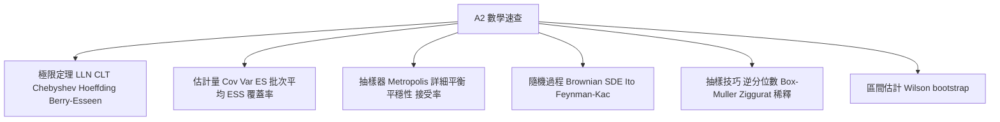

# 附錄A2　常見數學公式與定理

[上一章：附錄A1　蒙地卡羅算法程式範例](A1-蒙地卡羅算法程式範例.md) | [下一章：附錄A3　參考文獻與推薦閱讀](A3-參考文獻與推薦閱讀.md)

## 本附錄的用途

本附錄是全書數學工具的集中速查表，依「機率與極限定理 → 抽樣與估計 → 抽樣器與鏈 → 隨機過程與微分方程 → 抽樣方法 → 區間估計」的順序編排。每一節都給出公式、符號說明與直覺解釋，並標註對應的章節。

使用時請注意：

1. 公式中的假設條件往往比公式本身更重要；特別是中心極限定理需要有限方差，而依賴極限定理需要單調性。
2. 附錄中的公式多為可計算的形式，但「能否計算」與「算出來是否可信」是兩回事；後者仍需要[第11章](11.0-蒙地卡羅方法的誤差分析與改進.md)的診斷工具。

下圖說明本附錄的組織方式；它呼應本附錄的目的：**把散落在各章的數學工具集中起來，讓讀者在實作時能快速回查。**

## A2.1　大數法則與中心極限定理

### 弱大數法則（Khinchin）

若 $`X_1, X_2, \dots`$ 獨立同分布且 $`\mathbb{E}[|X_1|] < \infty`$ ，令 $`\bar{X}_N = \frac{1}{N}\sum_{i=1}^N X_i`$ ，則

$$
\bar{X}_N \xrightarrow{P} \mathbb{E}[X_1] = \mu
$$

這是蒙地卡羅法「抽樣愈多愈準」的理論依據（對應第 4 章）。直覺：大量獨立抽樣的平均值會集中在真值附近。

### 強大數法則（Kolmogorov）

在相同條件下， $`\bar{X}_N`$ 幾乎必然收斂到 $`\mu`$ 。強大數法則比弱大數法則給出更強的結論，但在實務中兩者通常等價使用。

### 中心極限定理（CLT）

若 $`X_i`$ 獨立同分布， $`\mathbb{E}[X_i]=\mu`$ ， $`\operatorname{Var}(X_i)=\sigma^2 < \infty`$ ，則

$$
\sqrt{N}\bigl(\bar{X}_N - \mu\bigr) \xrightarrow{d} N(0, \sigma^2)
$$

也就是說

$$
\frac{\bar{X}_N - \mu}{\sigma/\sqrt{N}} \approx N(0,1)
$$

這個式子是全書出現頻率最高的公式：它給出了蒙地卡羅估計的標準誤 $`\sigma/\sqrt{N}`$ ，以及批次平均法（[第4.3節](04.3-誤差分析與精度提升.md)）的理論基礎。

### 有限樣本的 CLT 修正

在實務上常使用「連續性修正」與 t 修正：

$$
P\left(\bar{X}_N - \mu \le -t\frac{\sigma}{\sqrt{N}}\right) \approx \Phi(-t) - \frac{1}{2N}f_t\left(\frac{t\sigma}{\sqrt{N}}\right)
$$

其中 $`f_t`$ 是 $`t`$ 標準常態的密度函數。當抽樣的是離散變數（例如成功/失敗次數）時，這個修正尤其重要。

### Berry–Esseen 定理

CLT 的收斂速率估計。若 $`X_i`$ 獨立同分布， $`\mathbb{E}[X_i]=\mu`$ ， $`\operatorname{Var}(X_i)=\sigma^2`$ ，且第三絕對中心矩 $`\rho = \mathbb{E}[|X_i - \mu|^3] < \infty`$ ，則

$$
\sup_{z \in \mathbb{R}} \left| P\left(\frac{\sqrt{N}(\bar{X}_N-\mu)}{\sigma} \le z\right) - \Phi(z) \right| \le \frac{C\rho}{\sigma^3\sqrt{N}}
$$

其中 $`C`$ 是一個絕對常數（最佳已知值約 0.4748）。這說明：**當分佈有厚尾或偏態時，CLT 的近似需要 $`O(N^{-1/2})`$ 個樣本才達到固定精度**，這是尾端事件估計不可靠的根源，也是為什麼金融風險度量需要特別設計的抽樣策略（[第9章](09.0-蒙地卡羅方法在金融中的應用.md)）。

### 切比雪夫不等式

不假設任何分佈形狀的界。若 $`X`$ 的期望為 $`\mu`$ 、變異數為 $`\sigma^2`$ ，則對任意 $`\varepsilon>0`$ ：

$$
P\bigl(|X-\mu| \ge \varepsilon\bigr) \le \frac{\sigma^2}{\varepsilon^2}
$$

### Hoeffding 不等式

若 $`X_i \in [a_i, b_i]`$ 獨立，則

$$
P\left(\bar{X}_N - \mathbb{E}[\bar{X}_N] \ge t\right) \le \exp\left(-\frac{2N^2 t^2}{\sum_{i=1}^N (b_i-a_i)^2}\right)
$$

若所有 $`X_i \in [a,b]`$ ，則上式簡化為 $`\exp(-2Nt^2/(b-a)^2)`$ 。這是**分布無關（distribution-free）**的集中不等式，在保證型蒙地卡羅（probabilistic numerical methods）中特別有用：用它可以把「蒙地卡羅解的誤差界」變成一個可保證的數字，而不必假設樣本服從某個特定分佈。

## A2.2　估計量、變異數與有效樣本數

### 期望與變異數的基本式

$$
\operatorname{Var}(X) = \mathbb{E}\bigl[(X-\mathbb{E}[X])^2\bigr] = \mathbb{E}[X^2] - \bigl(\mathbb{E}[X]\bigr)^2
$$

獨立變數的可加性：若 $`X_1,\dots,X_n`$ 獨立且有有限變異數，則

$$
\operatorname{Var}\left(\sum_{i=1}^n X_i\right) = \sum_{i=1}^n \operatorname{Var}(X_i)
$$

這是抽樣平均方差 $`\sigma^2/N`$ 的來源。

### 協變數

$$
\operatorname{Cov}(X,Y) = \mathbb{E}\bigl[(X-\mathbb{E}[X])(Y-\mathbb{E}[Y])\bigr]
$$

並有 $`|\operatorname{Cov}(X,Y)| \le \sqrt{\operatorname{Var}(X)\operatorname{Var}(Y)}`$ ，等號成立當且僅當 $`X`$ 與 $`Y`$ 幾乎必然成線性關係。

### 誤差平方（error square, ES）與 ESS

在蒙地卡羅文獻中，特別是粒子濾波與序貫蒙地卡羅，「誤差平方」（squared error）常寫作

$$
\operatorname{ES} = \mathbb{E}\bigl[(\widehat{\theta}_N - \theta)^2\bigr]
= \operatorname{Var}(\widehat{\theta}_N) + \bigl(\operatorname{bias}(\widehat{\theta}_N)\bigr)^2
$$

這把誤差分解為**變異項**與**偏差項**兩部分，是所有方差縮減與偏差修正技術比較的共同基準。

### 有效樣本數（ESS）

定義為「若樣本完全獨立，達到同等誤差所需的樣本數」。常用的兩種版本：

**基本版（由自相關估計）**

$$
\mathrm{ESS} = \frac{N}{1 + 2\sum_{k=1}^{\infty}\rho_k}
$$

其中 $`\rho_k`$ 是自相關函數。實作上通常截斷求和，並以初始正序列（initial positive sequence）方法處理噪聲。

**Geyer 的穩定版（成對截斷）**

令 $`\Gamma_k = \rho_{2k} + \rho_{2k+1}`$ ，取最大的 $`K`$ 使得 $`\Gamma_{2k} > 0`$ ，則

$$
\mathrm{ESS} = \frac{N}{1 + 2\sum_{k=0}^{K}\Gamma_k}
$$

這是目前 Stan 等主流工具採用的方法（對應第 14 章）。

### 批次平均法估計標準誤

把長度 $`N`$ 的鏈切成 $`b`$ 個長度為 $`k`$ 的批次（ $`N = bk`$ ），令 $`\bar{Y}_j`$ 為第 $`j`$ 批次的均值，則

$$
\widehat{\operatorname{Var}}(\bar{Y}) \approx \frac{k}{b-1}\sum_{j=1}^{b}\bigl(\bar{Y}_j - \bar{Y}\bigr)^2,
\qquad
\widehat{\operatorname{SE}} = \sqrt{\frac{1}{b-1}\sum_{j=1}^{b}\bigl(\bar{Y}_j - \bar{Y}\bigr)^2}
$$

其中 $`\bar{Y} = \frac{1}{b}\sum_j \bar{Y}_j`$ 。此法是 MCMC 報告標準誤的標準方法（對應第 4.3 與 11 章；示範見[附錄 A1](A1-蒙地卡羅算法程式範例.md)）。

### 控制變數的最優權重

給定控制變數 $`Z`$ （已知期望 $`\mu_Z`$ ）與目標 $`f`$ ，最優線性控制變數估計量為

$$
\widehat{\mu}_{\text{CV}} = \bar{f} - \widehat{\beta}\bigl(\bar{Z}-\mu_Z\bigr),
\qquad
\widehat{\beta} = \frac{\widehat{\operatorname{Cov}}(f, Z)}{\widehat{\operatorname{Var}}(Z)}
$$

方差縮減因子為

$$
V_{\text{CV}} = \frac{1-\rho_{fZ}^2}{1-\widehat{\beta}^2\rho_{fZ}^2}
\approx \frac{1-\rho_{fZ}^2}{1-\rho_{fZ}^2} = 1
\quad\text{（若 } \beta \text{ 估得準確）}
$$

其中 $`\rho_{fZ}`$ 是 $`f`$ 與 $`Z`$ 的相關係數。相關性越強，縮減越大（對應第 11 章）。

### 對偶變數

對偶變數法是控制變數的特例，取控制變數 $`Z = \mu - f(X)`$ （其期望為 0），此時估計量形式上與原始抽樣平均相同，但隨機性被重新表達為「相反方向的偏差」。實務上常與分位數法結合使用（對應第 11 章）。

## A2.3　馬可夫鏈與 Metropolis 抽樣

### 馬可夫鏈的定義與平穩性

一個離散時間馬可夫鏈 $`\{X_t\}`$ 由轉移矩陣 $`P = (p_{ij})`$ 定義，其中 $`p_{ij} = P(X_{t+1}=j \mid X_t = i)`$ 。

**平穩分佈（stationary distribution）** $`\pi`$ 滿足

$$
\pi_j = \sum_i \pi_i p_{ij}
$$

**不可約（irreducible）**：任意兩狀態互相可達。**非週期（aperiodic）**：不存在 $`k>0`$ 使得 $`p^{(k)}_{ii}=1`$ 。

**平穩性定理**：對不可約、非週期的鏈，平穩分佈存在且唯一，且

$$
P\left(\lim_{t\to\infty} X_t = j \mid X_0 = i\right) = \pi_j
$$

這保證了不論從哪裡出發，蒙地卡羅鏈最終都會收斂到目標分佈（對應第 8 章）。

### 詳細平衡（detailed balance）

若轉移機制滿足

$$
\pi_i p_{ij} = \pi_j p_{ji},\qquad \text{對所有 } i, j
$$

則稱為可逆（reversible）。詳細平衡是**充分**條件（不是必要），它是 Metropolis 類演算法正確性的標準證明工具：把細節平衡對所有 $`(i,j)`$ 相加即得平穩性。

### Metropolis 接受率

對稱 proposal（ $`q(x|y)=q(y|x)`$ ）：

$$
\alpha(x,y) = \min\left(1, \frac{\pi(y)}{\pi(x)}\right)
$$

平穩分佈就是目標 $`\pi`$ 。

### Metropolis–Hastings 接受率

一般情形（proposal 不對稱）：

$$
\alpha(x,y) = \min\left(1, \frac{\pi(y)q(x\mid y)}{\pi(x)q(y\mid x)}\right)
$$

其推導核心是「用接受機制補償 proposal 的不對稱」，這正是 Hastings（1970）的貢獻。

### 對數接受率的實作

實務上應比較對數以避免數值下溢：

$$
\log \alpha(x,y) = \min\left(0, \log\pi(y) + \log q(x\mid y) - \log\pi(x) - \log q(y\mid x)\right)
$$

接受與否等價於抽 $`u \sim U(0,1)`$ 並檢查 $`\log u < \log\alpha`$ 。

### R-hat（Gelman–Rubin 潛在尺度收斂診斷）

把 $`m`$ 條鏈各分成兩半，得到 $`2m`$ 條鏈，令 $`W`$ 為鏈內變異數的平均， $`B`$ 為鏈均值之間的變異數：

$$
\widehat{\operatorname{Var}}(\theta) = \frac{N-1}{N}W + \frac{B}{N}
$$

$$
\hat{R} = \sqrt{\frac{\widehat{\operatorname{Var}}(\theta)}{W}}
$$

$`\hat{R} \to 1`$ 表示各鏈已收斂到同一分佈。現代版本（rank-normalized R-hat）先對樣本做秩變換再計算，以降低對偏態的敏感度。

## A2.4　隨機過程與隨機微分方程

### 布朗運動的性質

布朗運動 $`W(t)`$ （ $`W(0)=0`$ ）滿足：

1. 獨立增量： $`W(t)-W(s)`$ 與 $`W(u)-W(v)`$ 獨立（若 $`[s,t]`$ 與 $`[v,u]`$ 不交）。
2. 正態增量： $`W(t)-W(s) \sim N(0, t-s)`$ 。
3. 連續路徑。
4. 幾乎所有路徑無處可微。

二維布朗運動的協變數結構： $`\operatorname{Cov}(W_1(t), W_2(t)) = \min(t_1,t_2)`$ 。

### 隨機微分方程

$$
dX_t = \mu(X_t, t)\,dt + \sigma(X_t, t)\,dW_t
$$

**Euler–Maruyama 格式**：

$$
X_{n+1} = X_n + \mu(X_n, t_n)\Delta t + \sigma(X_n, t_n)\sqrt{\Delta t}\,Z_n
$$

其中 $`Z_n \sim N(0,1)`$ 獨立。強收敛階為 $`O(\sqrt{\Delta t})`$ （整體而言），弱收敛階為 $`O(\Delta t)`$ 。

**Milstein 格式**（在某些條件下提升強收敛階）：

$$
X_{n+1} = X_n + \mu\Delta t + \sigma\sqrt{\Delta t}Z_n
+ \tfrac{1}{2}\sigma\sigma'\Delta t\bigl(Z_n^2 - 1\bigr)
$$

### Itô 引理

若 $`X_t`$ 滿足上述 SDE， $`f`$ 為 $`C^{1,2}`$ 函數，則

$$
df(X_t) = \left(\frac{\partial f}{\partial t} + \mu\frac{\partial f}{\partial x} + \frac{1}{2}\sigma^2\frac{\partial^2 f}{\partial x^2}\right)dt
+ \sigma\frac{\partial f}{\partial x}dW_t
$$

這是隨機分析的基本工具，也是金融領域複製性衍生品定價的理論基礎（對應第 7 章）。

### Feynman–Kac 公式

給定偏微分方程

$$
\frac{\partial u}{\partial t} + \mathcal{L}u + Vu = 0,\qquad u(T,x) = g(x)
$$

其解可表示為

$$
u(t,x) = \mathbb{E}\left[g(X_T)\,\exp\left(-\int_t^T V(X_s, s)\,ds\right)\;\middle|\;X_t = x\right]
$$

其中 $`X`$ 滿足 SDE $`dX_s = \mathcal{L}u(X_s)ds + \sigma dW_s`$ 。**這是隨機過程與蒙地卡羅法最重要的橋樑**：它把偏微分方程的解化為一個隨機過程的期望，因而可以用蒙地卡羅法求解。它也是量子蒙地卡羅（[第16.3節](16.3-蒙地卡羅法在量子計算中的應用前景.md)）的數學基礎。

## A2.5　抽樣技巧

### 逆分位數法（inverse transform sampling）

若 $`F`$ 是累積分佈函數且 $`U \sim U(0,1)`$ ，則 $`X = F^{-1}(U)`$ 服從分佈 $`F`$ 。這是最基本的抽樣方法，也是一般變換抽樣的核心。

**特例：均勻分佈** $`U \sim U(a,b)`$ ： $`X = a + (b-a)U`$ 。

**特例：指數分佈** $`X \sim \text{Exp}(\lambda)`$ ： $`X = -\frac{1}{\lambda}\log(1-U)`$ 。

### Box–Muller 轉換

由兩個獨立的 $`U_1, U_2 \sim U(0,1)`$ 生成兩個獨立的標準常態：

$$
Z_1 = \sqrt{-2\ln U_1}\cos(2\pi U_2), \qquad
Z_2 = \sqrt{-2\ln U_1}\sin(2\pi U_2)
$$

原理：二維標準常態的密度是 $`(2\pi)^{-1}e^{-(z_1^2+z_2^2)/2}`$ ，在極座標下改寫，套用極座標的面積元素 $`r\,dr\,d\theta`$ 後可分離成兩個獨立的指數與均勻變數。

**加速技巧**：若只需要一個常態變數，可取

$$
Z = \sqrt{-2\ln U_1}\cos(2\pi U_2)
$$

並捨棄第二個（但這樣會浪費一半的隨機性）。

### Ziggurat 演算法

用一層層的「階梯」區域取代尾端的反函數計算。核心想法是：直接從分佈抽樣的瓶頸通常在**尾部**（因為需要反解 CDF 或拒絕率極高）；Ziggurat 用一組預先計算的分層概率，把大部分抽樣變成「查表 + 一次乘法 + 一次比較」，只有約 1% 的樣本需要走慢速路徑。它是產生高品質常態與指數隨機數的現代標準，許多語言的亂數函式庫底層都採用類似設計。

### 稀釋作用（thinning）

若目標是抽樣自密度為 $`f`$ 的分佈，但手中只有密度為 $`g`$ 的樣本，則對每個 $`X_i`$ 以機率 $`f(X_i)/g(X_i)`$ 接受，否則丟棄。這就是 Metropolis 的「無移動」版本。

**缺點**：接受率隨樣本數線性下降（因為要保持總接受數固定），效率很差——這是 MCMC 取代簡單稀釋的主要動因。

### 反變數（antithetic variates）

用 $`U`$ 與 $`1-U`$ 成對抽樣。由於 $`\operatorname{Cov}(U, 1-U) = -1/12`$ ，當 $`f`$ 單調時可顯著降低估計量的方差。Owen & Zhou（2000）給出了更一般的理論。

**直覺**：當估計值偏高的樣本出現時，配對的樣本必然偏低，兩者的偏差互相抵銷。

## A2.6　區間估計與校準

### 蒙地卡羅的正規近似區間

由 CLT：

$$
\widehat{\mu} \pm z_{1-\alpha/2}\frac{\widehat{\sigma}}{\sqrt{N}}
$$

其中 $`z_{1-\alpha/2}`$ 為標準常態分位數（95% 區間取 1.96）。

### Wilson 區間（比例的區間估計）

當估計的是比例 $`\hat{p} = x/n`$ 且 $`n\hat{p}`$ 較小時，正規近似會失效。Wilson（1927）給出的區間為

$$
\frac{\hat{p} + \frac{z^2}{2n} \pm z\sqrt{\frac{\hat{p}(1-\hat{p})}{n} + \frac{z^2}{4n^2}}}{1 + \frac{z^2}{n}}
$$

其覆蓋率在 $`n\hat{p}`$ 很小時仍接近標稱值，是現代軟體的預設選擇。

### Bootstrap（自舉）

把樣本視為母體分佈的抽樣，重抽樣（with replacement） $`B`$ 次，對每個重抽樣樣本計算統計量：

$$
\widehat{\theta}^{*(b)} = T(X^{*(1)}, \dots, X^{*(B)})
$$

再以 $`\{\widehat{\theta}^{*(b)}\}`$ 的經驗分佈作為 $`\widehat{\theta}`$ 的抽樣分佈。區間可取分位數法（ $`[\hat{q}_{\alpha/2}, \hat{q}_{1-\alpha/2}]`$ ）或偏差修正的百分位法。

**注意**：bootstrap 假設樣本是從母體分佈獨立抽樣而來，因此**對有自相關的 MCMC 鏈不能直接使用**；此時必須使用「block bootstrap」或以批次平均估計的變異數為基礎。

### 覆蓋率與校準

一個信賴區間的覆蓋率定義為

$$
\text{Coverage} = P\bigl(\theta \in C(X)\bigr)
$$

其中 $`C(X)`$ 是由資料決定的區間。區間「校準」指覆蓋率等於標稱水準（例如 95%）。由於蒙地卡羅估計的隨機性，有限樣本時實際覆蓋率會偏離標稱值——這是[第11章](11.0-蒙地卡羅方法的誤差分析與改進.md)與[第17.1節](17.1-蒙地卡羅法的優勢與挑戰.md)強調的實務要點。

## A2.7　公式速查表

| 公式 | 用途 | 章節 |
| --- | --- | --- |
| $`\int f = \mathbb{E}[f(X)]`$ | 積分轉抽樣 | 第 2、4 章 |
| $`\operatorname{Var}(\bar{X}_N)=\sigma^2/N`$ | 抽樣平均方差 | 第 4 章 |
| $`\bar{X}_N \xrightarrow{d} N(\mu,\sigma^2/N)`$ | CLT | 第 4 章 |
| $`\beta^* = \operatorname{Cov}(f,Z)/\operatorname{Var}(Z)`$ | 控制變數最優權重 | 第 11 章 |
| $`\mathrm{ESS} = N/(1+2\sum\rho_k)`$ | 有效樣本數 | 第 11、14 章 |
| $`\alpha = \min(1, \pi(y)q(x|y)/(\pi(x)q(y|x)))`$ | MH 接受率 | 第 8 章 |
| $`\pi_i p_{ij} = \pi_j p_{ji}`$ | 詳細平衡 | 第 8 章 |
| $`dX = \mu dt + \sigma dW`$ | 隨機微分方程 | 第 7 章 |
| `Itô 引理` | 隨機微分計算 | 第 7 章 |
| `Feynman–Kac` | PDE 轉隨機過程期望 | 第 7、16.3 節 |
| $`X=F^{-1}(U)`$ | 逆分位數法 | 第 3 章 |
| `Box–Muller` | 常態生成 | 第 3 章 |
| `Wilson 區間` | 比例的區間 | 第 11 章 |
| `Bootstrap` | 抽樣分佈近似 | 第 11 章 |

## 小結

1. 極限定理是蒙地卡羅法的理論地基：LLN 保證收斂，CLT 給出誤差量級與標準誤估計，Berry–Esseen 量化 CLT 的逼近誤差。
2. Chebyshev 與 Hoeffding 提供分布無關的界，後者是保證型數值方法的基礎。
3. 估計量部分的核心是誤差平方分解（變異 + 偏差）、有效樣本數與批次平均法；三者構成 MCMC 的診斷基礎。
4. 抽樣器部分的核心是詳細平衡與平穩性定理；Metropolis–Hastings 接受率是兩者的橋樑。
5. 隨機過程部分的 Feynman–Kac 公式是全書最重要的橋樑：它把 PDE 與量子問題都化為隨機過程的期望。
6. 抽樣技巧部分給出從逆分位數法到 Ziggurat 的實作工具箱。
7. 區間估計部分提醒：蒙地卡羅的信賴區間在有限樣本時需要校準，bootstrap 不可直接套用於有自相關的鏈。

## 延伸閱讀

- [附錄 A1：蒙地卡羅算法程式範例](A1-蒙地卡羅算法程式範例.md)：本附錄多數公式的可執行示範。
- [第11章：蒙地卡羅方法的誤差分析與改進](11.0-蒙地卡羅方法的誤差分析與改進.md)：ESS、控制變數、批次平均的完整推導。
- [第7章：隨機過程與模擬](07.0-隨機過程與模擬.md)：Itô 引理與 Feynman–Kac 的應用脈絡。
- [附錄 A3：參考文獻與推薦閱讀](A3-參考文獻與推薦閱讀.md)：各公式的權威出處。
