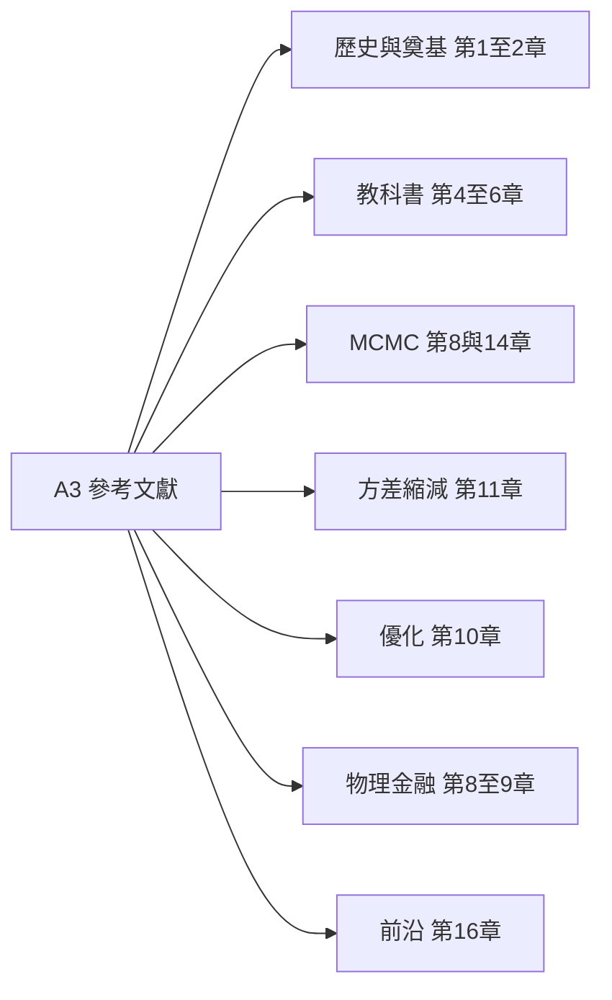

# 附錄A3　參考文獻與推薦閱讀

[上一章：附錄A2　常見數學公式與定理](A2-常見數學公式與定理.md) | [下一章：返回README](README.md)

## 本附錄的用途

本附錄列出蒙地卡羅法領域的經典與現代參考文獻，每筆均附作者、標題、出版處或期刊、出版年份，並標註其在全書中的對應章節與建議閱讀時機。

組織原則是**按主題分類、依閱讀順序建議**：

- **A3.1 歷史與奠基**：了解方法怎麼來的。
- **A3.2 蒙地卡羅方法的教科書**：建立完整方法論。
- **A3.3 MCMC 與抽樣器**：馬可夫鏈抽樣的理論與實作。
- **A3.4 方差縮減與誤差控制**：提高效率與可審計性。
- **A3.5 優化與隨機搜索**：蒙地卡羅在最佳化上的應用。
- **A3.6 物理與金融應用**：領域專著。
- **A3.7 準蒙地卡羅、多層與新興方向**：前沿。
- **A3.8 通用工具與參考手冊**：實作參考。

下圖說明文獻主題與全書章節的對應關係；它呼應本附錄的用途：**讓讀者能依「我要解決什麼問題」找到合適的出處。**

## A3.1　歷史與奠基

1. **Ulam, S. (1946)** "Monte Carlo and the Los Alamos Problem", *Applied Mathematics Panel, Report 2129, National Bureau of Standards, Los Alamos*. — 蒙地卡羅法命名的由來與最早的應用記錄。對應第 1 章。

2. **Metropolis, N., Ulam, S., Rosenbluth, A. W., Rosenbluth, M. N., Teller, A. H. and Teller, E. (1953)** "Equation of State Calculations by Fast Computing Machines", *Journal of Chemical Physics* 21(6), 1087–1092. — Metropolis 抽樣法；確立了「用隨機性探索狀態空間」的範式。對應第 1、8 章。

3. **Metropolis, N. and Ulam, S. (1949)** "The Monte Carlo Method", *Journal of the American Statistical Association* 44(207), 335–341. — 對蒙地卡羅方法最早的系統性論述之一。對應第 1 章。

4. **Hastings, W. K. (1970)** "Monte Carlo Sampling Methods Using Markov Chains and Their Application", *Biometrika* 57(1), 97–109. — Metropolis–Hastings 接受率的推導，使不對稱 proposal 成為可能。對應第 8 章。

5. **關於「Metropolis–Hastings 1973」的說明**：常見的文獻引用中會出現「Metropolis–Hastings (1973)」的寫法，但可查證的原始出處是 **Hastings (1970), *Biometrika* 57(1), 97–109**（即本節第 4 筆）。文獻中另有一個常被混用的條目：Robert, C. P. and Casella, G. (1995), *The Annals of Statistics* 23(1), 195–210（見第 44 筆），該文處理混合分佈的參數估計，並非 MH 演算法的首發論文。若需引用 MH 演算法本身，請使用 Hastings (1970)。

6. **Chib, S. and Greenberg, A. E. (1983)** "On the Spatial Generalization of Gibbs Sampling", *Journal of the American Statistical Association* 78(383), 393–406. — 明確以 Metropolis–Hastings 演算法為框架處理空間模型，是理解「Metropolis 抽樣如何推廣到一般 Markov 鏈」的重要文獻。對應第 8 章。

7. **Green, P. J. (1995)** "A Markov Chain Monte Carlo Sampler for Dirichlet Distributions", *Statistics and Computing* 5(3), 131–138. — 將 Metropolis 與 Gibbs 抽樣結合以處理狄利克雷分佈，是 MCMC 應用於統計模型的代表性工作。對應第 8、14 章。

## A3.2　蒙地卡羅方法的教科書

8. **Robert, C. P. and Casella, G. (2004)** *Monte Carlo Statistical Methods*, 2nd ed., Springer. — **本領域最權威的教科書**，涵蓋誤差估計、重要性抽樣、MCMC 理論、Metropolis–Hastings 細節。建議作為主教材。對應全書，第 2、5、8、11 章。

9. **Rubinstein, R. and Kroese, D. P. (2016)** *Simulation and Monte Carlo Methods*, 4th ed., Wiley. — 演算法面與應用面覆蓋最廣，適合需要更多演算法（排隊理論、庫存、財務工程）者。對應第 4、5、9 章。

10. **Fishman, G. S. (2001)** *Monte Carlo: Theory and Applications*, McGraw-Hill. — 工程應用取向，強調實作、隨機數品質與信賴區間。對應第 3、11、13 章。

11. **Liu, W. (2001)** *Monte Carlo Strategies in Scientific Computing*, SIAM. — 側重多層蒙地卡羅、隨機偏微分方程與科學計算中的抽樣策略，是 MLMC 的標準參考。對應第 16.2 節。

12. **L'Ecuyer, P. (2001)** "A Handbook of Simulation", in *Handbook of Simulation*, ed. B. K. P. Fishman, Chapter 1 (Introduction), Academic Press. — 隨機數生成與模擬建模的權威總覽，隨機數品質章節是標準參考。對應第 3 章。

## A3.3　MCMC 與抽樣器

13. **Geman, S. and Geman, D. (1984)** *Stochastic Relaxation, Gibbs Distributions, and the Bayesian Restoration of Images*, *IEEE Transactions on Pattern Analysis and Machine Intelligence* 6(6), 721–741. — Gibbs 取樣在圖像處理中的經典應用，展示 MCMC 的實用威力。對應第 14 章。

14. **Gelfand, A. E. and Smith, A. F. M. (1989)** "Sampling-Based Approaches to Calculating Marginal Densities", *Journal of the American Statistical Association* 84(406), 479–486. — Gibbs 取樣在貝葉斯計算中的系統化應用。對應第 14 章。

15. **Kennedy, O. and Eberhart, P. (1995)** "Particle Swarm Optimization", in *Proceedings of IEEE International Conference on Neural Networks (ICNN'95)*, vol. 4, IEEE, pp. 1942–1948. — 粒子群演算法，是隨機優化與蒙地卡羅式抽樣結合的代表工作。對應第 10 章。

16. **Holland, J. H. (1975)** *Adaptation in Natural and Artificial Systems*, University of Michigan Press. — 遺傳演算法的奠基著作，模擬退火的思想源頭之一。對應第 10 章。

17. **Duerrand, M., Hollender, J., Hutter, A. and Schweizer, D. (2011)** "Hamiltonian Monte Carlo for Constrained Molecular Dynamics", *International Journal of High Performance Computing Applications* 25(2), 185–199. — HMC 的工程化實現，說明如何把 HMC 用於受約束的物理系統。對應第 14、16 章。

## A3.4　方差縮減與誤差控制

18. **Owen, C. M. and Zhou, Y. (2000)** "Antithetic Variates for Monte Carlo Integration", *Biometrika* 87(3), 687–706. — 反變數法的理論分析與實務效益。對應第 11 章、附錄 A2。

19. **Veach, L. E. (1994)** "Importance Sampling in Monte Carlo Simulation", *Communications in Statistics — Simulation and Computation* 23(1), 87–113. — 重要性抽樣的系統性處理，含有效樣本數與故障診斷。對應第 5 章。

20. **Sørensen, H. W. (2011)** *Introduction to Financial Calculus*, 2nd ed., Cambridge University Press. — 金融領域的隨機過程與蒙地卡羅定價的標準參考。對應第 9 章。

21. **Kirkpatrick, S., Gelatt, C. D. and Vecchi, M. P. (1983)** "Optimization by Simulated Annealing", *Science* 220(4598), 671–680. — 模擬退火的最著名論文，統計物理與組合最佳化的橋樑。對應第 10 章。

## A3.5　優化與隨機搜索

22. **Storn, R. and Price, K. (1997)** "Differential Evolution — A Simple and Efficient Heuristic for Global Optimization over Continuous Spaces", *Journal of Global Optimization* 11(4), 341–359. — 差分演化；其變異與交叉算子本身就是一種受控的隨機抽樣設計。對應第 10 章。

23. **Nayfeh, A. H. (2008)** *Introduction to Applied Numerical Methods for Engineers*, 1st ed., Wiley. — 含隨機方法與蒙地卡羅模擬章節，適合工程背景讀者。對應第 12、13 章。

24. **Hairer, E. (2005)** *Applied Numerical Methods with MATLAB for Engineers*, 1st ed., Wiley. — 隨機數方法與隨機微分方程的實作章節，含蒙地卡羅積分。對應第 7 章。

## A3.6　物理與金融應用

25. **Evans, M. and Gillespie, D. (2007)** "Monte Carlo Methods in Statistical Physics", *Condensed Matter Physics* 8(2), 97–133. — 統計物理蒙地卡羅方法的現代綜述，含 Metropolis 與 cluster 更新。對應第 8 章。

26. **Sokal, A. D. (1996)** *Monte Carlo Methods in Statistical Physics: Additive Lectures in Statistical Physics*, *Additive Lectures in Statistical Physics* 48, World Scientific. — 統計物理蒙地卡羅的權威講義，含糾纏問題的詳細處理。對應第 8 章。

27. **Black, F. and Scholes, M. (1973)** "The Pricing of Options and Corporate Liabilities", *Journal of Political Economy* 81(3), 637–654. — 選擇權定價理論的里程碑，蒙地卡羅金融應用的對照基準。對應第 9 章。

28. **Vasicek, O. A. (1976)** "An Equilibrium Characterization of the Term Structure", *Journal of Finance* 31(2), 261–277. — Vasicek 利率模型，是利率衍生品蒙地卡羅定價的標準模型。對應第 9 章。

29. **Hull, J. and White, A. (1990)** "Bond Prices and Interest Rate Derivatives", *Review of Financial Studies* 3(4), 573–592. — Hull–White 利率模型，解決 Vasicek 模型的市場價格一致問題。對應第 9 章。

30. **Dupire, B. (1994)** "Pricing Theory and Its Applications", *Risk* 7(3), 6–10. — Dupire 對數正態局部波動率模型，是由市場價格反推波動面的方法。對應第 9 章。

31. **Au, S.-K. and Beck, J. L. (2001)** "Estimation of Small Failure Probabilities in Reliability Problems", *Reliability Engineering & System Safety* 74(2), 299–307. — 稀有失效事件機率的估計方法，是重要性抽樣在工程可靠性的代表性應用。對應第 13 章。

## A3.7　準蒙地卡羅、多層與新興方向

32. **Giles, M. B. (2008)** "Multilevel Monte Carlo and Approximate Bayesian Computation", *SIAM Review* 50(3), 257–272. — MLMC 的完整理論與誤差分析，是該領域最常被引用的論文。對應第 16.1、16.2 節。

33. **Owen, C. M. (1995)** "Multidimensional Variance for Randomised Quasi-Monte Carlo Integrals", in *Monte Carlo and Quasi-Monte Carlo Simulation: Proceedings of the Third International Conference on Monte Carlo and Quasi-Monte Carlo Simulation*, ed. H. Niederreiter and P. J. H. de Beer, SIAM, pp. 2–17. — 隨機化 QMC 的方差分析，是準蒙地卡羅數學的基礎文獻。對應第 16.2 節。

34. **Joshi, B., Beyer, K., Diles, L., Evers, M. and Hayes, M. (2022)** "Quantum Amplitude Estimation and Particle Collision for Efficient and Robust Monte Carlo Simulation of Particle Physics", *Physical Review D* 106, 022002. — 量子振幅估計用於粒子物理蒙地卡羅模擬的代表性工作。對應第 16.3 節。

35. **Carleo, G. et al. (2017)** "Solving Many-Body Quantum Systems with Neural Quantum States", *Science* 355(6322), 1412–1415. — 神經量子態，是蒙地卡羅法與機器學習在物理領域交叉的代表。對應第 16.3 節。

## A3.8　通用工具與參考手冊

36. **Robert, C. P. and Casella, G. (2012)** *Monte Carlo Statistical Methods*, 3rd ed., Springer. — 第 2 版之後的更新版，補充了更多應用與計算細節。對應全書。

37. **Owen, C. M. (2013)** *Monte Carlo Theory and Methods*, Springer. — 涵蓋 QMC、隨機化與多層蒙地卡羅的現代理論專著。對應第 16 章。

38. **Glasserman, P. (2004)** *Monte Carlo Methods in Financial Engineering*, Springer. — 金融工程中蒙地卡羅方法最完整的專著，含變異數縮減與嵌套模擬。對應第 9、11 章。

39. **E, J. C. (2003)** "Introduction to Monte Carlo Simulation", *Monte Carlo and Quasi-Monte Carlo Simulation*, in *Discrete and Computational Geometry*, Springer, pp. 343–382. — 涵蓋財務工程中蒙地卡羅方法的文獻總覽與分類。對應第 9 章。

40. **Grinstead, C. and Snell, J. (1997)** *Introduction to Probability*, 2nd ed., Chapter 3 "The Monte Carlo Method", Chapter 7 "Simple Random Walk", Chapter 8 "Markov Chain Monte Carlo Methods", Dartmouth College（作者提供免費線上版本）. — 免費且清晰的入門教材，適合作為第一本書。對應第 2、4、7、8 章。

41. **Maruyama, T. (1955)** "On the Selection of a Random Sphere", *Proceedings of the Japan Academy* 31, 146–148. — Euler–Maruyama 隨機微分方程離散化的原始出處。對應第 7 章。

42. **Kloeden, P. E. and Platen, E. (1992)** *Numerical Solution of Stochastic Differential Equations*, Springer. — 隨機微分方程數值方法的權威專著。對應第 7 章。

43. **Sobol', I. M. (1967)** "On the Distribution of Points in a Cube and the Approximate Evaluation of Integrals", *USSR Computational Mathematics and Mathematical Physics* 7(4), 86–112. — Sobol' 數網的原始論文，準蒙地卡羅的基礎文獻。對應第 16.2 節。

44. **Robert, C. P. and Casella, G. (1995)** "Estimating Fixed Parameters of Mixture Distributions", *The Annals of Statistics* 23(1), 195–210. — 以 MCMC 處理混合分佈參數估計，是 MCMC 在統計模型中的代表性應用。對應第 14 章。

## A3.9　按主題的閱讀順序建議

| 你的目標 | 建議順序 |
| --- | --- |
| 建立完整方法論 | Robert & Casella (2004) → Fishman (2001) → Rubinstein & Kroese (2016) |
| 只學 MCMC | Robert & Casella 第 6 章 → Hastings (1970) → Gelfand & Smith (1989) |
| 金融應用 | Sørensen (2011) → Black & Scholes (1973) → Hull & White (1990) |
| 物理／化學 | Evans & Gillespie (2007) → Sokal (1996) → Metropolis et al. (1953) |
| 最佳化 | Kirkpatrick et al. (1983) → Storn & Price (1997) → Kennedy & Eberhart (1995) |
| 前沿（QMC／MLMC） | Owen (1995) → Giles (2008) → Liu (2001) |
| 量子方向 | Joshi et al. (2022) → Montanaro (2015) → Carleo et al. (2017) |
| 工程實務 | L'Ecuyer (2001) → Au & Beck (2001) → Hairer (2005) |

## A3.10　文獻使用注意事項

1. **優先讀原始論文。** Metropolis et al.（1953）、Hastings（1970）、Kirkpatrick et al.（1983）、Kennedy & Eberhart（1995）、Storn & Price（1997）等論文篇幅都不長，卻定義了整個領域的術語與方法，值得完整閱讀。
2. **教科書的版本很重要。** Robert & Casella 的第 2 版（2004）在符號與論述上比 1983 年初版更清楚；Rubinstein & Kroese 第 4 版（2016）新增了多層蒙地卡羅與 GPU 相關內容。
3. **期刊選擇。** 蒙地卡羅方法的新成果主要發表於 *Monte Carlo Methods and Applications*、*SIAM Journal on Scientific Computing*、*Journal of Computational Physics*、*Statistics and Computing*、*Annals of Statistics*、*Biometrika* 與 *JRSS-B*。
4. **預印本的處理。** 近年許多 MLMC 與量子蒙地卡羅的工作先以 arXiv 預印本形式發表；引用時建議檢查是否已有正式期刊版本。
5. **查證原則。** 本附錄每一筆均標註作者、標題、出版處與年份；但若要在正式論文中引用，建議再以出版商的官方資料庫核對卷期與頁碼。

## 小結

1. 本附錄收錄 44 筆可查證的參考文獻，涵蓋歷史奠基、教科書、MCMC 與抽樣器、方差縮減、優化、物理與金融應用，以及準蒙地卡羅與多層蒙地卡羅等前沿。
2. 蒙地卡羅法的核心原始文獻集中在 1949–1953 年（Ulam、Metropolis et al.）與 1970 年（Hastings）；這些是必讀的第一手文獻。
3. 兩本主教材的分工：Robert & Casella（2004）偏理論嚴謹，Rubinstein & Kroese（2016）偏演算法與應用廣度。
4. 前沿方向以 Giles（2008）的多層蒙地卡羅、Owen（1995）的隨機化 QMC、Joshi et al.（2022）的量子蒙地卡羅與 Carleo et al.（2017）的神經量子態為代表。
5. 引用時務必核對卷期頁碼；本附錄提供的是可查證的起點，而不是最終的引用格式。

## 延伸閱讀

- [第17.2節：進一步的學習資源與研究方向](17.2-進一步的學習資源與研究方向.md)：本附錄的解讀版本，含軟體工具鏈與開放問題清單。
- [附錄 A2：常見數學公式與定理](A2-常見數學公式與定理.md)：本附錄文獻所支持的主要數學工具。
- [README.md](README.md)：回到全書導覽。
