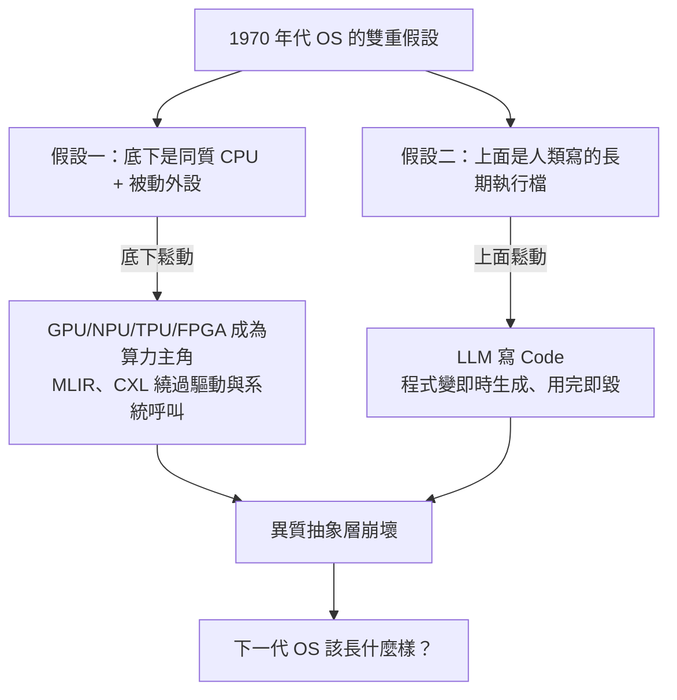

# 序章 0.1　從 1970 年代到 AI 時代的雙重假設

> 本節導論：現代作業系統的骨架，是在 1970 年代兩個假設之上凝固的。理解這兩個假設，才能理解為什麼它們在今天同時鬆動。

## 0.1.1 一個「凍結的設計」

今天我們打開任何一台電腦或雲端伺服器，最底層跑的東西，其結構幾乎與 1970 年代的 UNIX 沒有本質差別：一個特權內核（kernel）、一組以行程（process）為單位的位址空間、一棵檔案系統樹、一套以檔案描述子（file descriptor）為中心的資源管理模型，以及一個區分「使用者態（user mode）」與「內核態（kernel mode）」的權限邊界。

這套結構的歷史起點非常具體：

* **1969 年**，Ken Thompson 與 Dennis Ritchie 在貝爾實驗室開始開發 UNIX，最初是為了讓 Ken Thompson 能在 PDP-7 上玩一款太空遊戲。
* **1973 年**，UNIX 以 C 語言重寫，取得了可移植性，開始在學術界擴散。
* **1988 年**，IEEE 發表 POSIX（IEEE 1003.1）標準，把 UNIX 的系統呼叫介面固定下來。
* **1991 年**，Linus Torvalds 發布 Linux，把這套介面帶到 PC 上。
* **2001 年**，Linux 2.6 前後奠定現代 Linux 的排程與驅動架構。

換句話說，**今天我們所稱的「作業系統」，本質上是一份 1970 年代設計的穩定化與工業化**。這不是批評——半個世紀的穩定，正是它最大的成就。但它也意味著，這套設計內部藏著兩個從未被質疑的假設。

## 0.1.2 假設一：底下是同質的 CPU 與被動外設

第一個假設是 **「運算就是 CPU 在跑指令，其他東西都是配角」**。

在 1970 年代，一台機器的計算能力幾乎全部集中在單一（或少數幾個同質）的 CPU 上。其他硬體——磁碟、終端機、印表機、網路卡——都被視為「外部裝置（peripheral）」，它們的工作是把資料搬進搬出記憶體，計算本身仍由 CPU 完成。這個世界觀深刻地形塑了作業系統的結構：

* **驅動程式模型（driver model）**：每一種外部裝置都由一個驅動程式管理，裝置被抽象成 `/dev` 下的一個檔案（字元裝置或區塊裝置），透過 `open` / `read` / `write` / `ioctl` 存取。
* **中斷（interrupt）**：裝置用中斷通知 CPU「我準備好了」，CPU 放下手邊的事去處理。整個 I/O 模型是「CPU 主動、裝置被動」。
* **DMA（直接記憶體存取）**：裝置可以自己搬資料到記憶體，但搬完之後仍要由 CPU 決定下一步。

在這個世界觀裡，「計算在哪裡發生」這個問題只有一個答案：**在 CPU 裡**。其他地方只是資料的搬運工。

到了 2000 年代之後，這個假設開始崩解。GPU 從「繪圖加速卡」變成「通用並行計算引擎」（NVIDIA CUDA 於 2007 年發布），Google 在 2015–2016 年公開 TPU，NPU 被整合進手機 SoC（如 Apple Neural Engine），FPGA 被放進雲端資料中心做可重構加速。這些裝置不再是「被動外設」，而是 **能獨立執行大規模計算的算力主角**。

但作業系統對它們的對待方式，仍然停留在 1970 年代：把它們當成 `/dev` 下的字元裝置，用 `ioctl` 下命令。這就是本書第一部要拆解的第一個矛盾——**驅動程式模型與一等算力之間的錯配**。

## 0.1.3 假設二：上面是人類編寫的長期執行檔

第二個假設是 **「程式是人寫的，而且要長期存活」**。

1970 年代的軟體生產方式是：人類用高階語言（C、Pascal）寫出原始碼，編譯成執行檔，這個執行檔會被安裝、被反覆執行、被維護數年甚至數十年。這個假設形塑了作業系統的另外半邊：

* **可執行檔格式（ELF、Mach-O、PE）**：一個程式被編譯成靜態或動態連結的機器碼檔案。
* **動態連結（dynamic linking）**：為了節省記憶體與方便更新，多個程式共用同一份函式庫（`.so` / `.dll`），這催生了「依賴地獄（dependency hell）」與版本管理問題。
* **行程生命週期**：程式啟動時透過 `fork()` / `exec()` 建立行程，載入映像、配置位址空間、執行 `main()`，結束時回收資源。
* **檔案系統與 Shell**：人類透過目錄樹、環境變數、Shell 腳本與系統互動，這些是「給人用的介面」。

這個假設在 2020 年代遭遇了史上最強的衝擊：**大型語言模型（LLM）開始能寫出可用的程式碼**。

當「寫程式的邊際成本」趨近於零，軟體的生產方式就從「人類長期維護少數通用程式」轉向「機器針對單次任務即時生成專用邏輯」。在極端情況下，程式變成 **用完即丟的一次性邏輯（ephemeral software）**：生成、驗證、執行、銷毀，全程可能只有幾毫秒，而且從不進入長期維護。

在這樣的生產方式下，POSIX 的行程模型、動態連結、檔案系統樹、環境變數……全部變成了沉重的包袱：它們是為「人類會反覆執行、需要除錯、需要版本管理」的世界設計的。當程式是即時生成、無狀態、用完即毀時，這些抽象不再是便利，而是純粹的**隱性狀態噪音（implicit state noise）**與效能稅。

## 0.1.4 兩個假設的交會：一道「上下夾殺」

把兩個假設放在一起，就會看到本書命名的由來：

**來自底層的消融**：GPU、NPU、TPU、FPGA 成為算力主角，而 MLIR 這類多層編譯器基礎設施讓計算可以直接對接物理硬體，CXL 讓記憶體可以跨裝置共享。兩者合起來，使得傳統的「驅動程式 + 系統呼叫」路徑變得不再必要，甚至成為瓶頸。

**來自頂層的顛覆**：AI 寫 Code 讓程式變成即時生成、用完即毀的一次性邏輯。POSIX、行程、檔案系統這些為「人類長期維護」設計的抽象，成了沉重包袱。

底下在消融、上面在顛覆，中間那層 1970 年代設計的作業系統抽象，就被 **上下夾殺**。

## 0.1.5 為什麼是「現在」？

值得追問的是：異質算力不是今天才有的（GPU 通用計算從 2007 年就開始），AI 寫 Code 也不是一夜之間成熟的。為什麼「重構作業系統」這個命題，偏偏在 2020 年代中期才變得迫切？

三個條件同時到位：

1. **異質算力的異質化程度**：過去的加速器是「同一種計算的放大」（例如 GPU 是大量同質 ALU）。今天的異質算力是「不同計算模型的並存」——GPU 的 SIMT、NPU 的脈動陣列、FPGA 的空間資料流、CPU 的亂序執行，每一種都有完全不同的記憶體層級與執行模型。單一的驅動模型無法同時善待它們。

2. **編譯器基礎設施的成熟**：MLIR（2019 年開源）讓「一份高階表示降階到多種硬體」第一次有了統一的、可組合的基礎設施。沒有 MLIR 這類工具，「編譯器接管 OS 職責」只是紙上談兵。

3. **AI 生成程式碼的可用性**：LLM 能穩定生成可驗證的程式碼或 IR，讓「一次性軟體」從科幻變成工程現實。同時，eBPF Verifier、CompCert、seL4 這些「載入前驗證」的技術也已經成熟到可以作為安全模型的地基。

這三者的交會，才使得「下一代作業系統」從一個學術問題，變成一個有工程路徑的現實問題。

## 0.1.6 本節小結

* 現代作業系統的骨架凍結於 1970 年代，建立在兩個從未被質疑的假設之上。
* 假設一（同質 CPU + 被動外設）被異質算力與 MLIR/CXL 消融。
* 假設二（人類寫的長期執行檔）被 LLM 生成的一次性軟體顛覆。
* 兩個假設的交會，就是「上下夾殺」。

接下來兩節，我們分別從底層與頂層，把這兩股力量的技術細節攤開來看。下一節先談底層：**為什麼「把加速器當成 `/dev` 下的一個字元裝置」會成為系統瓶頸**。
