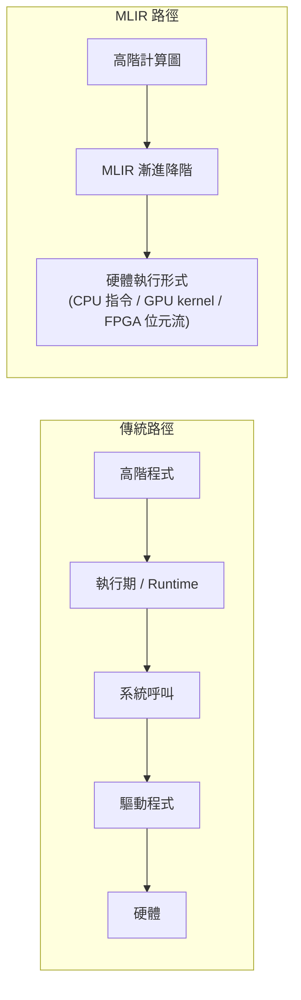

# 序章 0.2　來自底層的消融

> 本節導論：異質算力不是「更多 CPU」，而是「不同種類的計算」。當計算模型改變，1970 年代的驅動與系統呼叫路徑就從「抽象」變成「障礙」。

## 0.2.1 從「更多的算力」到「不同的算力」

1965 年，Gordon Moore 提出後來被稱為摩爾定律的觀察：積體電路上可容納的電晶體數目，大約每兩年翻一倍。在接下來四十年，這條曲線主要表現為「單核時脈越來越快」——也就是 **同樣的計算模型，只是更快**。

但 2005 年前後，時脈提升遇到功耗牆（power wall）與散熱極限，單核效能停滯。業界的回應是 **多核（multicore）**：把多個同質核心放進一顆晶片。這是第一次「計算單元變多」，但計算模型沒有變——每個核心還是同一套 x86/ARM 指令集。

真正的轉折發生在「計算模型開始不同」：

* **GPU**：NVIDIA 在 2007 年發布 CUDA，把 GPU 從圖形處理器變成通用並行計算引擎。GPU 的模型是 SIMT（Single Instruction, Multiple Threads）——數千個執行緒以 warp（32 執行緒）為單位同步執行同一條指令，靠大量執行緒隱藏記憶體延遲。
* **TPU**：Google 在 2015 年開始部署、2016 年公開 TPU（Tensor Processing Unit），針對神經網路的矩陣乘加設計了 **脈動陣列（systolic array）**——資料像心跳一樣在處理單元（PE）陣列中流動，每個 PE 只做「乘加後傳給鄰居」這一件事。
* **NPU**：手機 SoC 整合神經網路處理單元（如 Apple Neural Engine），以低功耗做推論。
* **FPGA**：現場可程式化閘陣列，可以被「重新接線」成任何電路，適合低延遲、可重構的加速。

這些裝置的共同點是：**它們的計算模型與 CPU 根本不同**。GPU 的執行單位是 warp 而非行程，NPU 的資料流是被硬體電路決定的，FPGA 的「程式」其實是一份電路接線圖。它們不是「更快的 CPU」，而是「不同種類的計算」。

## 0.2.2 驅動模型為什麼會變成瓶頸

面對這些裝置，作業系統的第一反應是：沿用既有的外部裝置模型。也就是說，把 NPU 或加速器包裝成 `/dev/npuX` 這樣一個字元裝置，由驅動程式管理，使用者程式透過 `open` / `ioctl` / `mmap` / `read` / `write` 與它互動。

這個做法在「裝置只是搬資料的配角」時是合理的。但當裝置成為算力主角，這條路徑的每一個環節都開始收費：

**（1）系統呼叫（system call）的固定成本。**
每一次 `ioctl` 都是一次從使用者態切入內核態的邊界跨越，涉及暫存器儲存、權限檢查、核心堆疊切換。單次成本約數百奈秒到微秒級。對於「提交一個大型計算圖」這種操作，這成本可以忽略；但對於「高頻、細粒度地驅動加速器」的場景（例如每個小算子都要一次 `ioctl`），它會累積成主要開銷。

**（2）驅動程式的複雜度與不可信。**
加速器的驅動往往由廠商提供、閉源、數萬行，跑在核心態（Ring 0）。一個驅動的記憶體錯誤，就是整個系統的核心恐慌（kernel panic）。而加速器更新迭代極快，驅動成為「必須頻繁修改、卻又最危險」的程式碼。

**（3）資料路徑的多餘拷貝。**
`read` / `write` 的語意是「把資料從裝置複製到使用者緩衝區」。但對加速器而言，資料通常早已在裝置可見的記憶體（例如 GPU 的 HBM）裡，真正需要的是「讓裝置直接讀寫這塊記憶體」，而不是經過核心中轉。傳統的資料路徑被迫做了多餘的拷貝（`memcpy`），這在頻寬是瓶頸的 AI 計算裡是致命的。

**（4）主從（master-slave）的語意錯配。**
在驅動模型裡，CPU 是主人，裝置是僕人：CPU 下命令、裝置執行、裝置回報。但異質計算的真正形態是「CPU 把一段計算圖丟給裝置，裝置自己跑很久，CPU 同時去做別的事」。這種「長時間、自治、非同步」的執行，用 `ioctl` 的同步語意來表達，非常彆扭。

## 0.2.3 MLIR：讓計算直接對接硬體

如果說驅動模型的問題是「多了一層不必要的中介」，那麼 MLIR 提供的正是「繞過這層中介」的技術路徑。

MLIR（Multi-Level Intermediate Representation，多層中間表示法）是 2019 年由 Chris Lattner 等人開源的編譯器基礎設施。它的核心想法是：**讓同一份高階計算，經由一系列「方言（dialect）」的漸進降階，最後直接變成目標硬體的執行形式——而這個目標可以是 CPU 指令、GPU kernel，甚至是 FPGA 的電路。**

關鍵在於 **降階（lowering）** 這個動作。傳統上，「把高階計算變成 GPU 能跑的程式」這件事，是由執行期（runtime）與驅動在「執行時」動態完成的。MLIR 把它前移到「編譯時」：在程式還沒開始跑之前，編譯器就已經決定好「這段矩陣乘要怎麼切成 tile、要放進哪個記憶體層級、要用哪種指令」。

這意味著：**計算與硬體之間，不再需要經過「系統呼叫 → 驅動 → 裝置命令」這條漫長的路徑，而是由編譯器直接產生針對硬體的執行形式。**

這不是說「驅動從此消失」——硬體總要有人初始化、總要有人管理電源與中斷。但它意味著 **「計算的路徑」與「管理的路徑」可以分離**：計算走編譯器生成的高速通道，管理才走傳統的驅動與系統呼叫。這個分離，正是本書第 3 章與第 9 章的核心。

## 0.2.4 CXL：讓記憶體跨越裝置邊界

驅動模型的另一個根本問題，是 **記憶體是「屬於某個裝置」的**。GPU 有 GPU 的記憶體（HBM），CPU 有 CPU 的記憶體（DRAM），兩者之間要靠 PCIe 匯流排做 explicit 的拷貝（`cudaMemcpy`）。這個「雙軌制」的記憶體模型，是異質計算效能的頭號殺手。

CXL（Compute Express Link）是 2019 年由 Intel 主導、多家廠商參與的開放互連標準，建立在 PCIe 實體層之上。它的關鍵特性是 **記憶體一致性（cache coherence）與記憶體共享**：透過 CXL，不同裝置可以共享同一個記憶體池，甚至讓裝置直接存取 CPU 的記憶體而不需要 explicit 拷貝。

CXL 的意義在於：它讓「統一記憶體（unified memory）」從一個軟體願景變成硬體現實。當 CPU、GPU、NPU 都能看到同一塊位址空間時，「把資料搬到裝置」這個動作就消失了——裝置直接讀寫同一塊記憶體即可。

這正是本書第 7 章「全域統一記憶體」的硬體基礎。驅動模型之所以需要 `memcpy`，是因為記憶體不共享；CXL 讓記憶體共享，於是 `memcpy` 這條路徑的必要性就消失了。

## 0.2.5 三股力量的合流

把底層的三股力量放在一起：

| 力量 | 技術代表 | 對 OS 的衝擊 |
| --- | --- | --- |
| 計算模型異質化 | GPU SIMT、NPU 脈動陣列、FPGA 空間資料流 | 單一驅動模型無法善待多種執行模型 |
| 編譯器前移 | MLIR 漸進降階 | 計算路徑繞過執行期與系統呼叫 |
| 記憶體共享 | CXL 一致性互連 | 「拷貝到裝置」的雙軌記憶體模型失效 |

三者的合流，使得 **1970 年代的「CPU 為主、外設為輔」主從架構徹底失效**。這不是「把驅動寫得更好」能解決的問題，而是抽象層本身的錯配。

## 0.2.6 本節小結

* 異質算力的本質是「不同種類的計算」，而非「更多的同質計算」。
* 驅動模型在系統呼叫成本、驅動危險性、多餘拷貝、主從語意四方面成為瓶頸。
* MLIR 把計算與硬體的對接從執行期前移到編譯期。
* CXL 讓記憶體共享成為硬體現實，動搖了雙軌記憶體模型。
* 三股力量合流，使「CPU 為主、外設為輔」的主從架構失效。

下一節，我們轉向頂層：**當 LLM 能寫程式，為什麼「人類寫的長期執行檔」這個假設會崩解**，以及本書的核心命題。
