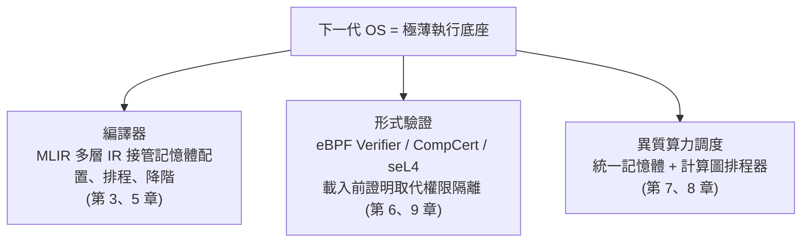

# 序章 0.3　來自頂層的顛覆與全書命題

> 本節導論：當「寫程式」的邊際成本趨近於零，軟體從「長期維護的資產」變成「即時生成的消耗品」。這對作業系統的衝擊，與底層的異質化同樣深。

## 0.3.1 軟體生產方式的歷史階段

要理解 LLM 寫 Code 的衝擊，得先把它放進「軟體生產方式」的歷史脈絡裡。大致可以分成四個階段：

**第一階段：手工編碼（1940s–1950s）。**
程式設計師直接寫機器碼或用組合語言，程式與硬體強綁定，重用性極低。

**第二階段：高階語言與編譯器（1950s–1980s）。**
FORTRAN（1957）、C（1972）等語言的出現，讓程式可以用接近人類思考的方式撰寫，再由編譯器翻譯成機器碼。這階段的關鍵躍遷是 **「抽象」**：程式不再綁定特定硬體。

**第三階段：函式庫與套件生態（1980s–2010s）。**
軟體從「單一程式」變成「組裝現成元件」：動態連結函式庫（`.so` / `.dll`）、套件管理員（APT、npm、pip）、版本語意（semver）。這階段的關鍵躍遷是 **「重用」**：不重寫輪子，而是組合生態。

**第四階段：AI 生成程式（2020s–）。**
LLM 能根據自然語言意圖，即時生成可執行的程式碼或中間表示。這階段的關鍵躍遷是 **「生成的邊際成本趨近於零」**。

前三個階段有一個共同的隱含前提：**程式是稀缺的、需要被珍惜的資產**。因此我們需要版本控制、需要依賴管理、需要向後相容、需要長期維護。第四階段把這個前提抽掉了——當生成一段專用程式的成本低到可以忽略，程式就從「資產」變成「消耗品」。

## 0.3.2 一次性軟體的三個特徵

所謂 **一次性軟體（ephemeral software）**，不是指「用完就丟的程式碼」這種粗糙說法，而是有三個精確的技術特徵：

**（1）單次任務導向（task-specific）。**
程式不是為了「通用」而寫，而是為了「這一次的輸入、這一次的目標」而生成。例如「把這批資料轉成這個 schema、算出這個指標」——生成一段只做這件事的邏輯，做完就丟，不需要處理「未來可能出現的其他輸入」。

**（2）無狀態（stateless）。**
程式不依賴、也不產生持久的全域狀態。它不讀寫檔案系統、不維護資料庫連線池、不依賴環境變數。輸入從計算圖的入口進來，輸出從出口出去，中間的狀態都在記憶體裡，程式結束即消失。這讓它天然適合平行、可重排、可重試。

**（3）即時生成、即時驗證、即時執行（just-in-time lifecycle）。**
從「意圖」到「執行」的時間尺度，從傳統的「開發數週、部署數月」，壓縮到「數毫秒到數秒」。這要求整條鏈路——生成、驗證、載入、執行——都必須是自動化、低延遲的。

這三個特徵加起來，對作業系統提出了完全不同的要求。傳統 OS 假設程式會長期存在，因此願意在「啟動」與「保護」上付出高昂成本；一次性軟體假設程式轉瞬即逝，因此 **啟動成本必須趨近於零、保護機制必須是輕量的**。

## 0.3.3 為什麼 POSIX 成了包袱

POSIX 的每個核心抽象，都對應著「程式是長期資產」這個假設。當假設翻轉，這些抽象就從「便利」變成「包袱」：

| POSIX 抽象 | 原始目的 | 在一次性軟體下的問題 |
| --- | --- | --- |
| 行程（process）與 `fork()` | 隔離長期執行的程式 | `fork()` 複製整個位址空間，成本與程式大小成正比；而一次性軟體本來就沒有「要複製的歷史狀態」 |
| 檔案系統樹 | 人類用目錄組織持久資料 | 一次性軟體不讀寫持久檔案，目錄樹只是無謂的命名空間負擔 |
| 動態連結（`.so`） | 多程式共用函式庫、方便更新 | 一次性軟體不需要「共用」，版本依賴地獄在此毫無意義 |
| 環境變數、Shell | 人類設定與操作 | 機器生成的程式不需要人類可讀的設定介面 |
| 系統呼叫的 C ABI | 穩定的二進位介面 | 生成端與執行端可能用完全不同的 IR，硬套 C ABI 反而丟失高階語意 |
| 權限邊界（UID/GID、capabilities） | 隔離「不確定的人類程式」 | 成本高；且 AI 生成的程式可用「載入前驗證」取代「執行時隔離」 |

注意這裡的邏輯不是「POSIX 不好」，而是 **「POSIX 是為一個已經不再成立的世界最佳化的」**。在人類寫程式、程式長期存活的世界裡，POSIX 幾乎是完美設計。但在機器生成程式、程式轉瞬即逝的世界裡，它的每一個設計決策都在收「不必要的稅」。

## 0.3.4 兩種回應：馴化與重寫

面對「上下夾殺」，業界有兩種截然不同的回應，這也構成本書第四部的兩條路線：

**演化派（馴化）**：不推翻 Linux，而是在 Linux 內部「長出新器官」，讓舊的 POSIX 路徑逐漸被架空、只留下資源初始化與控制面的功能。代表技術是 eBPF（內核可程式化驗證）、io_uring（零系統呼叫非同步 I/O）、VFIO / Kernel-bypass（使用者態硬體直通）、Unikernel（把 OS 與應用編譯成一體）。

**革命派（重寫）**：承認舊抽象層已經是負債，白紙重構一個 **AI 原生的異質作業系統**。它不再相容 POSIX、沒有檔案系統樹、沒有 `fork()`，系統唯一接受的「執行檔」是經過驗證的計算圖 IR，硬體與記憶體被扁平化為對等節點。

這兩條路線不是互斥的——歷史上，革命性的設計（如 UNIX 對 Multics）往往先以「演化」的形式在舊系統裡萌芽。本書會把兩條路線都講清楚，並在第 12 章討論它們的交匯。

## 0.3.5 全書核心命題

把底層與頂層的兩股力量合起來，本書提出一個核心命題：

> **下一代作業系統不是「對 AI 友好的 Linux」，而是融合編譯器、形式驗證與異質算力調度的極薄執行底座。**

這個命題有三個關鍵詞，對應本書的三個技術支柱：

* **編譯器**：過去靠 OS 執行期動態處理的記憶體配置、平行排程、快取管理，被前移到編譯期靜態規劃。OS 與編譯器的邊界被重新劃定。
* **形式驗證**：傳統的 Ring 0 / Ring 3 硬隔離成本太高，且是為「不確定的人類程式」設計的。當程式是 AI 生成、可以用數學證明其安全性時，「載入前驗證」取代了「執行時隔離」。
* **異質算力調度**：打破檔案讀寫與記憶體拷貝的雙軌制，用單一位址空間管理帶生命週期的張量物件；用計算圖排程器取代時間片排程。

## 0.3.6 「極薄」是什麼意思

「極薄（ultra-thin）」這個詞需要解釋，因為它容易被誤解成「功能很少」。

極薄不是「功能少」，而是 **「不變的、必須由特權層保證的東西才留在內核，其餘全部上移到編譯器或下放到硬體」**。傳統 OS 內核之所以臃腫，是因為它承擔了大量「其實可以由編譯器靜態決定」與「其實可以由硬體驗證」的職責：

* 記憶體配置 → 可以由編譯器靜態規劃（第 3 章）。
* 排程 → 可以由計算圖排程器在編譯期與執行期協同決定（第 8 章）。
* 隔離 → 可以由載入前驗證取代（第 6 章）。
* I/O → 可以由統一記憶體與 fabric 取代（第 7 章）。

把這些都移走之後，內核剩下的是「硬體拓撲抽象、載入前驗證器、零拷貝算力交換網」三大原語（第 9 章）。這才是「極薄」的真正含義——**薄，是因為把不該它做的事都交出去了，而不是因為它偷懶**。

## 0.3.7 本節小結與全書導覽

* 軟體生產方式進入第四階段：生成邊際成本趨近於零，程式從資產變成消耗品。
* 一次性軟體的三特徵：單次任務導向、無狀態、即時生命週期。
* POSIX 的每個抽象都對應「程式是長期資產」的假設，該假設翻轉後它們成為包袱。
* 回應有兩條：演化（馴化 Linux）與革命（白紙重寫）。
* 核心命題：下一代 OS 是「編譯器 + 形式驗證 + 異質算力調度」的極薄執行底座。

接下來，第一部將逐章拆解舊世界抽象層的崩壞。第 1 章先從驅動程式模型談起——**為什麼「把加速器當成 `/dev` 下的一個字元裝置」會成為系統瓶頸**。
