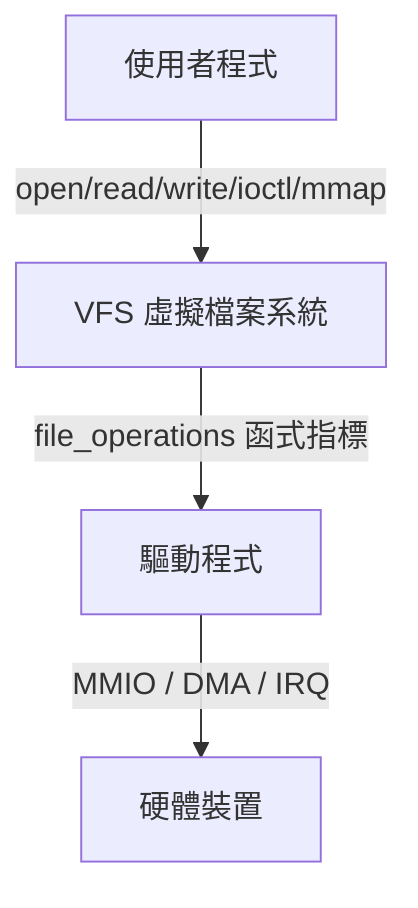

# 1.1　Linux 字元裝置與 ioctl 模型的誕生

> 本節導論：要理解驅動模型為什麼成為異質計算的瓶頸，得先回到它的原點——「一切皆檔案」這個漂亮但有其界線的抽象。

## 1.1.1 「一切皆檔案」的由來

UNIX 最著名、也最深遠的設計原則是 **「一切皆檔案（everything is a file）」**。它的具體含義是：把裝置、檔案、管道、終端機等資源，都抽象成「可以被 `open` / `read` / `write` / `close` 操作的位元組流」，並用一個統一的整數 **檔案描述子（file descriptor, fd）** 來指涉。

這個設計的優雅之處在於：

* **統一介面**：程式不需要為每種資源學一套 API，只要會 `read` / `write`，就能操作檔案、網路、裝置。
* **組合性**：因為都是 fd，所以可以 `dup`、可以重導向（`>`、`<`、`|`）、可以繼承給子行程。
* **權限模型統一**：用檔案的 owner / group / mode 統一管理資源存取權限。

這個設計在 1970 年代是革命性的。它讓 UNIX 從「一組雜亂的裝置驅動」變成「一個一致的同構世界」。但它內部藏著一個關鍵的張力：**位元組流（byte stream）能表達的語意非常有限**。

`read` / `write` 只會說「給我一串位元組」或「我給你一串位元組」。它無法表達「設定這個裝置的時脈頻率」「把這塊記憶體映射進來」「提交一個非同步計算」這類 **有結構的操作**。於是 UNIX 需要一個逃生口。

## 1.1.2 逃生口：ioctl

1971 年，UNIX 加入了 `ioctl`（input/output control）系統呼叫。它讓使用者程式可以對裝置下「裝置專屬」的命令：

```c
int ioctl(int fd, unsigned long request, ...);
```

其中 `request` 是一個裝置自訂的命令編號，後面可以接任意型別的參數。以一個假想的加速器驅動為例：

```c
// 對 /dev/accel0 下命令：提交一個計算描述子
struct accel_job job = {
    .src = gpu_src_addr,
    .dst = gpu_dst_addr,
    .size = 4096,
};
ioctl(fd, ACCEL_SUBMIT, &job);

// 等待完成
ioctl(fd, ACCEL_WAIT, 0);
```

`ioctl` 的設計本質是 **「把檔案的抽象撐開一個洞，讓裝置專屬的語意從這個洞鑽出去」**。它是一個務實的、極具彈性的逃生口——任何裝置都能定義自己的 `ioctl` 命令，而不需要修改核心的檔案抽象。

但這個逃生口也埋下了後來的問題：

* **每個裝置都重新發明自己的命令語言**：`ioctl` 的 `request` 編號與參數結構，完全由各驅動自訂，毫無標準可言。使用者得為每個裝置讀一份不同的驅動文件。
* **語意不可組合**：一個 `ioctl` 命令就是一次「黑箱操作」，核心無法理解它的語意，因此無法對它做最佳化、排程或驗證。
* **型別不安全**：`ioctl` 的參數是 `void *`，全靠驅動與使用者程式的默契，一個結構定義不一致就是記憶體錯誤。

## 1.1.3 驅動模型的核心結構：file_operations

在 Linux 裡，一個字元裝置的核心，是 `struct file_operations`——一張「函式指標表」，把使用者的系統呼叫映射到驅動的實作：

```c
struct file_operations accel_fops = {
    .owner          = THIS_MODULE,
    .open           = accel_open,
    .release        = accel_release,
    .read           = accel_read,
    .write          = accel_write,
    .unlocked_ioctl = accel_ioctl,
    .mmap           = accel_mmap,
};
```



這張表就是「驅動模型」的縮影：**硬體被包裝成一組符合檔案語意的回呼函式**。`open` 負責初始化，`read` / `write` 負責搬資料，`ioctl` 負責其他一切，`mmap` 負責把裝置記憶體映射到使用者空間。

這個結構的關鍵特徵是：**驅動跑在核心態（Ring 0）**。它有完全的記憶體存取權、可以碰觸任何硬體暫存器。這帶來兩個後果：

1. **效能**：核心態可以繞過權限檢查直接操作硬體，速度快。
2. **危險**：驅動的任何 bug（空指標、越界寫、競態）都直接威脅整個核心。一個廠商寫壞的驅動，可以讓整台機器核心恐慌。

## 1.1.4 為什麼這種模型在 1970 年代是合理的

要公平評價這個設計，得回到它的時代背景：

* **裝置數量少、種類少**：一台機器可能只有磁碟、終端機、印表機幾種裝置。
* **裝置是「被動」的**：裝置只會搬資料，不會自己跑長時間的計算。
* **驅動由核心開發者撰寫**：早期的驅動多半由作業系統團隊自己寫，品質可控。
* **沒有「異質計算」的概念**：計算就是 CPU 的事，裝置只是 I/O。

在這些條件下，「把裝置當成 fd + ioctl」幾乎是最佳解：統一、簡潔、夠用。

## 1.1.5 當條件反轉

但今天這四個條件全部反轉：

* **裝置多、種類極多**：一台 AI 伺服器可能同時有 CPU、多張 GPU、NPU、FPGA、DPU，每種的程式模型都不同。
* **裝置是「主動」的**：GPU 與 NPU 能獨立執行長時間的大規模計算，不是被動搬資料。
* **驅動由廠商撰寫、閉源**：驅動成了「最危險又最常改」的程式碼。
* **異質計算是常態**：計算散落在多種裝置上。

在這些條件下，同一個 `ioctl` 模型就開始收費了。它是為「數量少、被動、可控的被動外設」設計的，而現在的裝置是「數量多、主動、不可控的算力主角」。

## 1.1.6 一個具體的對比：從 read/write 到 submit/wait

讓我們用一個具體的場景，看這個模型如何錯配。假設我們要在一張 GPU 上跑一個矩陣乘。

**用檔案模型表達（偽代碼）：**

```c
int fd = open("/dev/gpu0", O_RDWR);
write(fd, &matmul_desc, sizeof(matmul_desc));  // 提交
read(fd, result_buffer, result_size);          // 取回（同步阻塞）
close(fd);
```

問題在哪？

* `write` 的語意是「把位元組寫進去」，它暗示這是個同步、有界的操作。但矩陣乘可能跑好幾毫秒，而且是非同步的。
* `read` 會阻塞直到結果出來，這讓 CPU 在等待期間無事可做，除非用額外的執行緒去等。
* 每一次 `write` / `read` 都是一次系統呼叫，都在核心態與使用者態之間來回切換。
* 資料如果本來就在 GPU 記憶體裡，`read` 還要把它複製回使用者緩衝區，多了一次拷貝。

**用理想的計算圖模型表達：**

```text
%job = gpu.submit %graph, %inputs   // 非同步提交，回傳 handle
%done = gpu.await %job              // 需要時才等待
```

差別在於：後者把「計算」當成 **計算圖（computation graph）** 來提交，有明確的資料流語意，可以被編譯器最佳化、被排程器調度。前者把一切壓扁成「位元組流」，所有的語意都丟失了。

## 1.1.7 本節小結

* 「一切皆檔案」是 UNIX 的優雅抽象，但它只能表達位元組流，無法表達有結構的裝置操作。
* `ioctl` 是這個抽象的逃生口，讓裝置能自訂命令，但代價是語意不可組合、型別不安全、毫無標準。
* 驅動模型（`file_operations`）把硬體包裝成檔案回呼，跑在核心態，效能好但危險。
* 這套模型在「裝置少、被動、可控」的 1970 年代是最佳解。
* 但當裝置變成「多、主動、不可控的算力主角」，它就開始收費。

下一節，我們把這個錯配講得更具體：**為什麼「CPU 為主、加速器為輔」的主從架構，在異質計算面前徹底失效**。
