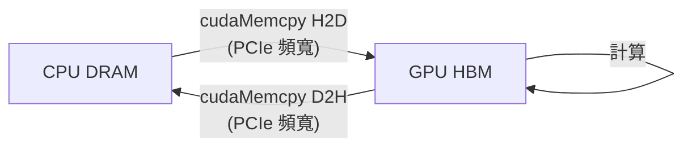
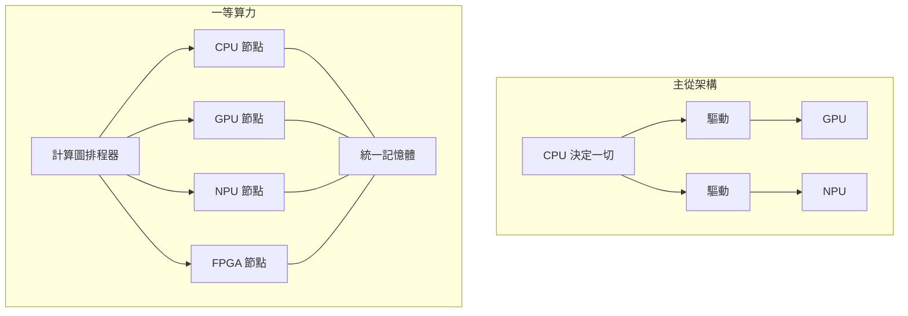

# 1.2　加速器主從架構的失效

> 本節導論：驅動模型不只是「介面不好用」，它背後是一個更深的世界觀——CPU 是主人，加速器是僕人。當加速器成為算力中心，這個主從關係就翻轉了。

## 1.2.1 主從架構的技術輪廓

「CPU 為主、加速器為輔」不是一句口號，它是一組具體的技術安排：

* **控制流在 CPU**：程式的 `main()` 在 CPU 上跑，由 CPU 決定「何時、把什麼工作、交給哪個加速器」。
* **加速器被「呼叫」**：CPU 透過驅動下命令（`ioctl`），加速器執行，執行完發中斷通知 CPU。
* **記憶體由 CPU 管理**：加速器的記憶體（例如 GPU 的 HBM）被視為「另一個位址空間」，需要 explicit 的拷貝（`cudaMemcpy`）來回搬資料。
* **同步是常態**：CPU 送出工作後，通常要等待加速器完成（或在完成時被中斷打斷），才能繼續。

這套安排的核心假設是：**CPU 是唯一能「做決定」的單元，加速器只是「執行指令」的單元**。用一個比喻：CPU 是老闆，加速器是員工；老闆下指令，員工做事，員工做完回報。

在早期的加速器（例如 1990 年代的圖形卡、早期的加密卡）身上，這個假設是對的：加速器做的就是「一小段固定的計算」，CPU 下個命令、等結果，天經地義。

## 1.2.2 為什麼「主」與「從」翻轉了

轉折點在於：加速器不再只是「執行一小段計算」，而是 **「承載整個計算的主體」**。

以現代的大型語言模型推論為例：一次推論可能要跑數百層神經網路，涉及數十億次矩陣乘加。這個計算的 **主體在 GPU/NPU 上**，CPU 的角色反而退化成「把輸入準備好、把工作丟出去、把結果收回來」。CPU 不再是「做計算的人」，而是「協調者」。

更極端的情況是 **模型訓練**：一次訓練可能要在數千張 GPU 上跑好幾週。整個過程幾乎不需要 CPU 介入，CPU 只在開始時啟動、結束時收尾。在這種場景下，說「CPU 是主、GPU 是從」已經完全顛倒了——**GPU 叢集才是計算的主體，CPU 只是控制面的腳手架**。

這個翻轉帶來一連串的技術後果。

## 1.2.3 後果一：同步等待的浪費

在主從架構下，CPU 送出工作後要「等」。傳統的做法有兩種：

* **阻塞等待**：CPU 呼叫 `read` 或 `ioctl(WAIT)`，進入睡眠，直到加速器完成。這期間 CPU 什麼都不能做。
* **中斷驅動**：加速器完成後發中斷，CPU 切換到中斷處理常式。這有上下文切換成本，而且中斷風暴會拖垮系統。

問題是：現代 AI 計算的工作是 **長時間、大量、可並行** 的。如果每個工作都要 CPU 同步等待，CPU 就成了瓶頸；如果用中斷，中斷風暴又會淹沒 CPU。

理想的做法是 **非同步提交 + 事件驅動完成**：CPU 把一大批工作非同步丟給加速器（像是把整個計算圖提交上去），然後立刻回去做別的事，等工作完成時再透過事件（event）統一處理。這正是 CUDA Stream、以及後來 `io_uring` 背後的思想。但傳統的 `ioctl` 模型沒有優雅地表達「非同步提交一大批工作」的方式。

## 1.2.4 後果二：記憶體雙軌制的拷貝稅

主從架構的另一個技術安排是 **「記憶體分屬不同裝置」**：

* CPU 的記憶體是 DRAM，透過記憶體匯流排存取。
* GPU 的記憶體是 HBM，透過 PCIe（或 NVLink）與 CPU 相連。
* 兩者之間沒有共享位址空間，資料必須 explicit 拷貝。

於是每一次「CPU 準備資料給 GPU」都要一次 `cudaMemcpy`（或驅動層的 `copy_from_user`），每一次「GPU 算完給 CPU 看結果」又要一次拷貝。這些拷貝在頻寬上非常昂貴：

在 AI 計算裡，**頻寬往往比算力更稀缺**。一次矩陣乘的算力可能遠大於其資料搬運，但如果每次都要來回拷貝，拷貝就吃掉了大半時間。這就是為什麼 CXL（第 0.2 節提過）與統一記憶體（第 7 章）如此重要——它們要消滅的正是這條拷貝路徑。

## 1.2.5 後果三：控制面與資料面的糾纏

主從架構把「控制」與「資料」綁在同一條路徑上：CPU 透過同一組系統呼叫（`ioctl`）既下命令又傳資料。這在簡單裝置上沒問題，但在異質計算裡，**控制面（誰該跑什麼）與資料面（資料在哪）應該是分離的**。

設想一個跨裝置的計算：輸入在 CPU 記憶體，第一層在 GPU 算，第二層在 NPU 算，結果要寫回 CPU。在理想的世界裡，排程器只要說「這層去 GPU、那層去 NPU」，資料透過共享記憶體流動，控制與資料各走各的路。但在主從架構下，每一步都要 CPU 介入：啟動 GPU 驅動、拷貝、等待、啟動 NPU 驅動、拷貝……控制面被資料面拖累，無法獨立最佳化。

## 1.2.6 「一等算力」的含義

要修補這些問題，不能只改介面，而要改變 **世界觀**：把加速器從「外部裝置」提升為「一等算力節點（first-class compute node）」。

「一等（first-class）」這個詞借用自程式語言理論：一個東西是「一等公民」，意味著它可以被當成值自由傳遞、組合、抽象，不受特殊限制。把這個概念套到算力上：

* **一等算力節點**：CPU、GPU、NPU、FPGA 都是「對等的計算節點」，都能被排程器直接調度，沒有誰是「主」、誰是「從」。
* **計算圖可跨節點**：一段計算圖可以被切成子圖，分派到不同節點，節點之間透過共享記憶體傳遞張量。
* **排程與驅動解耦**：排程器決定「誰跑什麼」，驅動只負責「把節點初始化好」。計算的路徑不再經過驅動。

## 1.2.7 從「裝置」到「節點」的抽象躍遷

這個躍遷在歷史上有先例。網路裝置的演化就是一個好例子：

* 早期：網路卡是一個「裝置」，CPU 透過驅動一個封包一個封包地收發。
* 後來：出現了 **DPDK（Data Plane Development Kit）**、**RDMA**、**SmartNIC/DPU** 等技術，讓網路封包的處理可以繞過核心、甚至下放到網卡上的處理器。

DPU（Data Processing Unit）的出現尤其說明問題：它把「網路、儲存、安全」這些原本由 CPU 做的控制面工作，下放到一顆專門的處理器上。這本質上就是「把某類計算從 CPU 主從架構裡拿出來，變成一個對等的節點」。

GPU/NPU 面對的是同一種躍遷：**從「CPU 呼叫的裝置」變成「與 CPU 對等的算力節點」**。

## 1.2.8 本節小結

* 主從架構的技術安排：控制流在 CPU、加速器被呼叫、記憶體分屬不同裝置、同步是常態。
* 當加速器成為計算主體（大型模型推論、訓練），主從關係翻轉。
* 三個後果：同步等待的浪費、記憶體雙軌制的拷貝稅、控制面與資料面的糾纏。
* 修補的方向是把加速器提升為「一等算力節點」：對等調度、跨節點計算圖、排程與驅動解耦。
* 歷史上 DPU/SmartNIC 的演化是同一種「從裝置到節點」的躍遷。

下一節，我們把「一等算力節點」這個抽象講得更精確：**它到底需要什麼樣的新介面，才能取代 `ioctl` 與 `file_operations`**。
