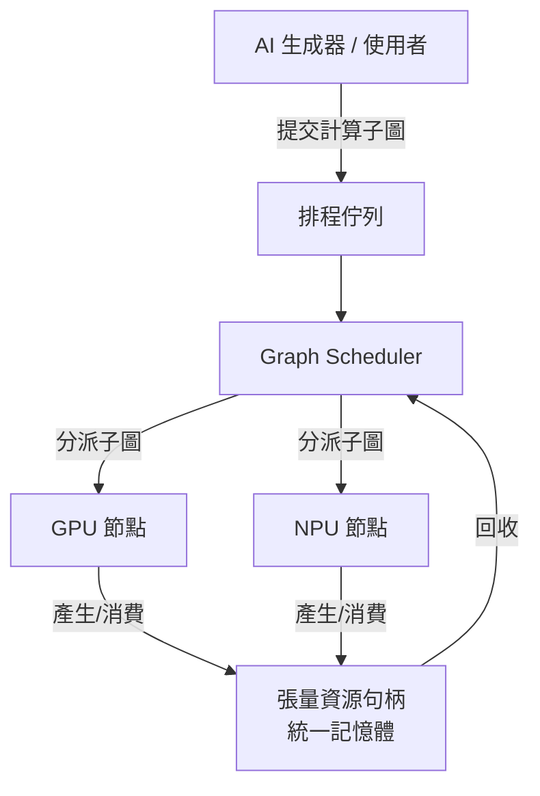

# 1.3　一等算力節點的新抽象

> 本節導論：拆掉了驅動模型之後，我們需要一套新的介面，讓「算力節點」可以被宣告、被組合、被調度。本節提出這套介面的骨架。

## 1.3.1 抽象的三個必要元素

一個「一等算力節點」的抽象，至少需要回答三個問題：

1. **它是什麼（What）**：這個節點的能力、限制、記憶體層級、支援的計算原語。
2. **它怎麼被使用（How）**：如何把一段計算圖分派給它，如何把資料送進去、把結果取出來。
3. **它如何被調度（When/Where）**：排程器如何決定「這段計算應該落在這個節點上」。

傳統的驅動模型把這三件事混在一起，全塞進 `ioctl` 的黑箱。新的抽象必須把它們分開，才能讓編譯器與排程器插手。

## 1.3.2 元素一：節點的描述（Capability Descriptor）

要讓排程器做決定，它必須先「知道」每個節點能做什麼。這需要一份 **能力描述（capability descriptor）**，用結構化資料描述節點：

```text
node {
  kind = "gpu"                      // 節點類型
  compute = ["fma", "dot4", "mma"]  // 支援的計算原語
  memory = [
    { level = "hbm", size = "80GiB", bw = "3TB/s" },
    { level = "l2",  size = "50MiB", bw = "10TB/s" }
  ]
  interconnect = ["pcie5", "nvlink"] // 互連能力
  precision = ["fp32", "bf16", "fp8", "int8"]
  topology = { cluster = 0, distance = { cpu: 1, gpu: 0 } }
}
```

這份描述與驅動程式的關係，類似「裝置樹（device tree）」與驅動的關係——但目的不同。裝置樹是「告訴核心怎麼初始化硬體」，能力描述是「告訴排程器怎麼使用硬體」。前者是控制面，後者是決策面。

有了這份描述，排程器就可以做「適合性判斷」：這段計算需要 `mma` 指令與大量 HBM 頻寬，那就優先考慮 GPU；另一端需要低延遲的固定電路，那就考慮 FPGA。

## 1.3.3 元素二：計算的分派（Graph Submission）

新的分派介面，核心概念是 **「計算圖」而非「命令」**。使用者（或 AI 生成器）提交的不是「一個 ioctl 命令」，而是一個 **有資料流語意的計算子圖**：

```text
%0 = tensor.load %input
%1 = matmul %0, %w1
%2 = relu %1
%3 = matmul %2, %w2
%4 = tensor.store %3
```

這個子圖可以被：

* **編譯器最佳化**：融合算子、調整 tiling、選擇精度。
* **排程器切分**：把 `%1` 放 GPU、`%3` 放 NPU，中間透過共享記憶體傳遞 `%2`。
* **驗證器檢查**：在載入前確認記憶體邊界、資源預算（第 6 章）。

這與 `ioctl(SUBMIT, &job)` 的差別是根本性的：前者保留了 **結構（structure）**，後者把一切壓成位元組。結構是讓編譯器與排程器能夠「理解並重寫」計算的前提。

## 1.3.4 元素三：資源的抽象（Resource Handle）

新抽象需要一個 **資源句柄（resource handle）** 的概念，代表「一段被節點管理的資源」——可以是一塊裝置記憶體、一個佇列、一個執行緒池。這個句柄要能：

* **跨節點流動**：同一個張量句柄，可以在 GPU 與 NPU 之間傳遞，而不需要顯式拷貝（靠共享記憶體，第 7 章）。
* **帶生命週期**：句柄知道自己是何時建立、何時該釋放。這比裸指標安全，也比「檔案描述子」更適合記憶體物件。
* **可被驗證**：句柄的所有存取都在編譯期可追蹤，驗證器可以確認「每次存取都在邊界內」。



## 1.3.5 與傳統驅動的分工

這個新抽象**不是要消滅驅動**，而是重新劃分職責：

| 職責 | 傳統驅動模型 | 一等算力節點模型 |
| --- | --- | --- |
| 硬體初始化 | 驅動 `probe()` | 仍然由驅動負責（不變） |
| 電源/時脈管理 | 驅動 | 仍然由驅動負責（不變） |
| 能力描述 | 隱含在驅動裡 | 明確宣告（capability descriptor） |
| 計算分派 | `ioctl` 黑箱 | 計算圖提交（結構化） |
| 排程決策 | CPU 硬編碼 | Graph Scheduler（可插拔） |
| 資料搬運 | `memcpy` 雙軌 | 共享記憶體（單一位址空間） |
| 安全隔離 | 權限檢查 | 載入前驗證 |

換句話說：**驅動退回到它真正擅長的領域（初始化、電源、時脈），而「計算」與「調度」交給編譯器與排程器**。這正是本書核心命題的第一次具體展現。

## 1.3.6 一個對照：CUDA 已經走了半步

值得指出的是，NVIDIA 的 CUDA 其實已經不自覺地走了這條路的一半：

* **能力描述**：CUDA 的 device query（`cudaGetDeviceProperties`）就是某種能力描述。
* **計算圖**：CUDA Graph（2019 年隨 CUDA 10 推出）讓使用者可以提交一整張計算圖，而非一個個 kernel launch。
* **資源句柄**：CUDA 的 stream、event、memory pool 就是資源句柄。

但 CUDA 仍囿於「GPU 是 CPU 呼叫的裝置」的主從架構：它不支援跨異質節點（NPU/FPGA）的統一調度，記憶體仍是雙軌制。它是「主從架構下的最佳化」，而不是「一等算力節點」的完整實現。

真正的一等算力抽象，需要 **跨廠商、跨裝置** 的統一介面，這正是 MLIR 與本書第 8 章排程器要解決的問題。

## 1.3.7 抽象的成本與權衡

誠實地說，新抽象不是免費的：

* **相容性斷裂**：現有的大量軟體都建立在 POSIX 驅動模型上，新抽象意味著這些軟體要重寫或轉譯。
* **標準化困難**：跨廠商的「能力描述」與「計算圖介面」需要產業共識，這在歷史上一向緩慢（例如 Vulkan、OpenCL 的推行都花了多年）。
* **驗證成本**：越結構化的介面，驗證器要檢查的不變式越多，載入前驗證的複雜度上升。

這些成本，正是第 10 章「演化派」存在的理由——不是所有人都有勇氣與資源走完整革命。但無論走哪條路，**「從命令轉向計算圖、從裝置轉向節點」這個方向是不可逆的**。

## 1.3.8 本節小結

* 一等算力節點抽象需要三個元素：能力描述（What）、計算圖分派（How）、資源句柄（Where）。
* 能力描述讓排程器能做適合性判斷。
* 計算圖（而非 ioctl 命令）保留了結構，讓編譯器與排程器能介入。
* 資源句柄帶生命週期、可跨節點流動、可被驗證。
* 新抽象不消滅驅動，而是重新劃分職責：驅動管初始化，編譯器/排程器管計算。
* CUDA 已走了半步，但缺跨異質節點的統一介面。

第 1 章到此，我們拆掉了「驅動模型」這個舊抽象。下一章，我們轉向另一個更根本的包袱：**POSIX、行程與檔案系統**——為什麼它們是為人類設計的，而這在 AI 時代成了隱性狀態噪音。
