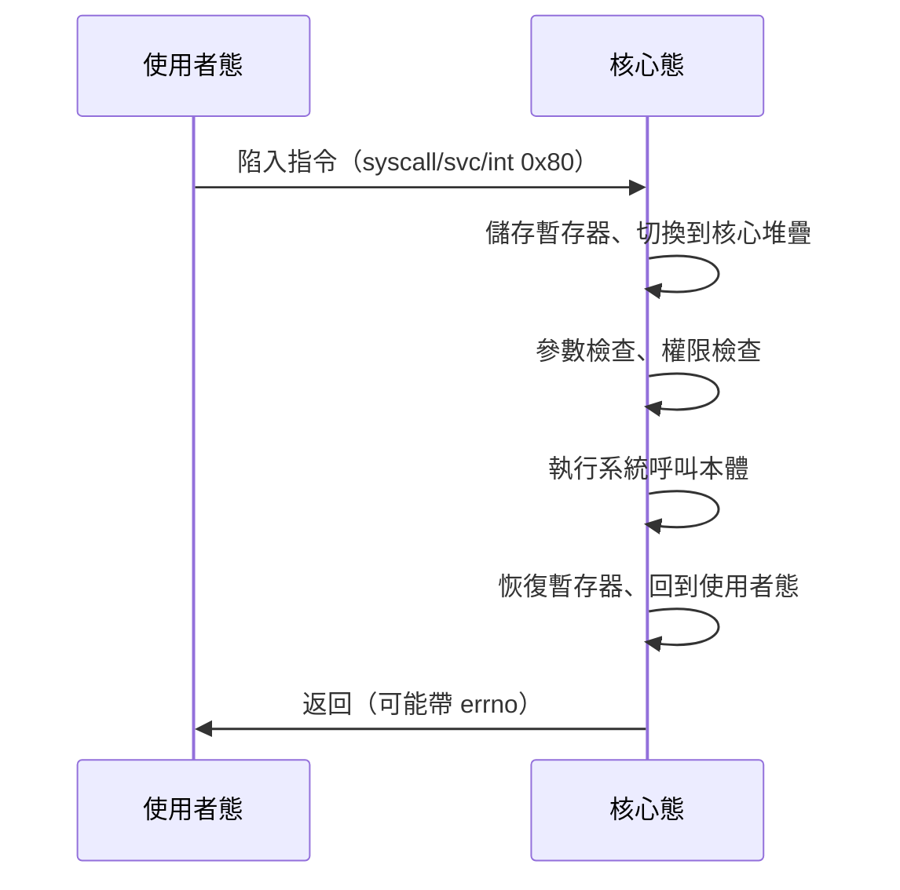
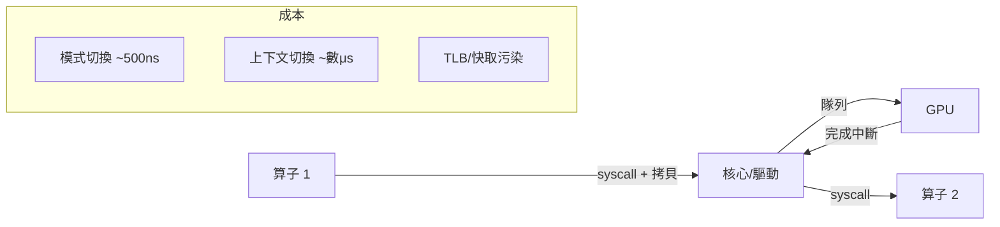

# 2.2　上下文切換與邊界跨越的成本

> 本節導論：抽象層的代價，最終都要用「時間」來結算。本節把上下文切換、分頁、系統呼叫這三筆帳算清楚。

## 2.2.1 三種「切換」

在現代系統裡，「切換」不是單一事件，而是至少三種不同層次的動作，各有不同成本：

1. **模式切換（mode switch）**：在同一個執行緒上，從使用者態切入核心態（或反之）。這發生在每次系統呼叫、每次中斷。
2. **上下文切換（context switch）**：把 CPU 從一個執行實體（執行緒或行程）換到另一個。這涉及儲存/恢復暫存器、切換堆疊、可能切換頁表。
3. **位址空間切換（address-space switch）**：切換到不同行程時，需要換頁表基底暫存器（x86 的 `CR3`、ARM 的 `TTBR`），並使 TLB 失效（或使用位址空間標籤 ASID 避免全域失效）。

這三者的成本量級完全不同，必須分開討論。

## 2.2.2 系統呼叫的成本

一次系統呼叫，大致是這樣的流程：

單次系統呼叫的成本，在現代硬體上大約是 **數百奈秒**（若含 Spectre/Meltdown 緩解措施，如 KPTI 核心頁表隔離，會更高，達微秒級）。

聽起來很快，但關鍵在於 **次數**。如果一段計算需要頻繁與核心互動（例如每個小算子一次系統呼叫），成本就會累積。更嚴重的是 **快取與 TLB 的污染**：每次進出核心都會擾動 L1/L2 快取與 TLB，讓後續的使用者態程式變慢。

## 2.2.3 上下文切換的成本

上下文切換比系統呼叫更貴，因為它要做的事更多：

* 儲存當前執行實體的所有暫存器（通用暫存器、浮點/SIMD 暫存器、程式計數器、堆疊指標）。
* 選擇下一個執行實體（排程器決策）。
* 恢復下一個執行實體的暫存器。
* 如果跨行程，還要切換頁表、處理 TLB。

典型的上下文切換成本，在 Linux 上大約是 **數微秒**（視 CPU 與是否跨核而異）。跨核切換更貴，因為要處理快取一致性（cache coherence）與 TLB shootdown。

在高頻切換的場景（例如大量短任務、頻繁的 I/O 等待），上下文切換會成為主要開銷。這正是為什麼 **協程（coroutine）**、**使用者態執行緒（如 goroutine、綠色執行緒）** 會流行——它們把「切換」從核心態搬到使用者態，省去模式切換與頁表切換。

## 2.2.4 虛擬記憶體分頁的成本

虛擬記憶體是 POSIX 的另一個核心機制：每個行程有獨立的虛擬位址空間，核心透過頁表把虛擬位址映射到實體位址。這帶來幾個成本：

**（1）位址轉換（address translation）。**
每次記憶體存取都要做虛擬位址到實體位址的轉換。硬體用 **TLB（Translation Lookaside Buffer）** 快取最近的轉換，命中則快，未命中則要走 **頁表走訪（page table walk）**，可能要存取 2–4 層記憶體。

**（2）分頁錯誤（page fault）。**
當程式存取一個尚未映射或不在記憶體的頁面，會觸發分頁錯誤，核心介入處理：可能是配置新頁、可能是從磁碟換入（swap）、可能是 COW 複製。這是 **微秒到毫秒級** 的事件，遠比一般記憶體存取貴。

**（3）TLB 失效（TLB flush）。**
跨行程切換時，若無 ASID，整個 TLB 要失效。失效後，後續的記憶體存取全部 TLB miss，效能崩塌。這就是著名的 **TLB shootdown** 問題，在多核系統上尤其嚴重。

在 AI 計算這種 **大量、連續、可預測的記憶體存取** 場景，虛擬記憶體的分頁機制反而成了負擔：資料的存取模式是已知的（張量是密集、連續的），不需要「按需分頁」的彈性，卻要承擔 TLB miss 與分頁錯誤的成本。

## 2.2.5 邊界跨越如何吞噬異質計算

把上述成本放進異質計算的脈絡，問題就清楚了：

**（1）每個算子都可能觸發邊界跨越。**
如果一個計算圖有 N 個算子，而每個算子都透過 `ioctl` 提交給加速器，那就是 N 次系統呼叫。若 N 很大（現代模型動輒數百層），成本可觀。

**（2）資料在邊界上來回搬。**
每次系統呼叫都要傳參數、可能拷貝資料。在雙軌記憶體下，還要 `cudaMemcpy`。這些都是「跨越邊界」的成本。

**（3）快取被反覆擾動。**
每次進出核心，L1/L2 快取被擾動；每次跨裝置，資料要從一個快取層級搬到另一個。在高頻互動下，快取幾乎無法有效利用。

理想的情況是 **「一次提交整張計算圖」**：把 N 個算子打包成一個計算圖，一次性提交給加速器，中間不做任何邊界跨越。這正是 CUDA Graph 與本書第 8 章「計算圖排程器」的核心思想——**用批次化（batching）攤平邊界跨越的成本**。

## 2.2.6 用數字說話：一個粗略的估算

假設一段計算需要在 GPU 上跑 200 個算子，每個算子：

* 計算時間：10 微秒（GPU 上）
* 系統呼叫開銷：0.5 微秒
* 資料拷貝開銷：若雙軌記憶體，每次 5 微秒

**逐算子提交（傳統）：**
每個算子成本 ≈ 10（計算）+ 0.5（syscall）+ 5（拷貝）= 15.5 微秒。
200 個算子 ≈ 3.1 毫秒。其中真正的計算只佔 2 毫秒，**其餘 1.1 毫秒（35%）是抽象層的稅**。

**整圖提交（理想）：**
一次 syscall（0.5 微秒）+ 一次拷貝（5 微秒）+ 200 個算子計算（2 毫秒）= 約 2.005 毫秒。
**抽象層的稅降到 0.25%**。

這個估算當然是簡化的（實際有重疊、非同步、管線化等因素），但它清楚顯示了 **「批次化」對攤平邊界跨越成本的威力**。而批次化的前提，是系統能把「計算」當成 **結構化的圖** 來接受，而非「一個個命令」——這又回到了第 1 章「計算圖分派」的結論。

## 2.2.7 分頁與異質記憶體的另一個衝突

除了邊界跨越，虛擬記憶體還與異質記憶體有更深的衝突。GPU、NPU 往往有 **自己的位址空間與自己的 MMU**。當 CPU 想讓 GPU 直接存取某塊 CPU 記憶體時，需要：

* 把該記憶體「釘住（pin）」在實體記憶體，避免被換出。
* 建立 GPU 頁表項，讓 GPU 的 MMU 能映射到該實體頁。
* 維持 CPU 與 GPU 頁表的一致性。

這些動作都很昂貴，而且與「按需分頁」的虛擬記憶體哲學矛盾（按需分頁假設記憶體可以隨時換出，但 pin 住的記憶體不能換）。這就是為什麼統一記憶體（第 7 章）需要硬體支援（如 CXL 的一致性），而不能只靠軟體。

## 2.2.8 本節小結

* 三種切換：模式切換、上下文切換、位址空間切換，成本量級遞增。
* 系統呼叫約數百奈秒，上下文切換約數微秒，分頁錯誤可達毫秒。
* 在異質計算裡，頻繁的邊界跨越會累積成主要開銷，並污染快取與 TLB。
* 批次化（整圖提交）能把邊界跨越成本攤平，其前提是系統接受結構化計算圖。
* 虛擬記憶體的分頁機制與異質記憶體的 pin/映射需求存在深層衝突，需硬體支援統一記憶體。

下一節，我們把鏡頭拉遠：這些成本之外，POSIX 還帶來一類更難量化的負擔——**為人類設計的隱性狀態噪音**。
