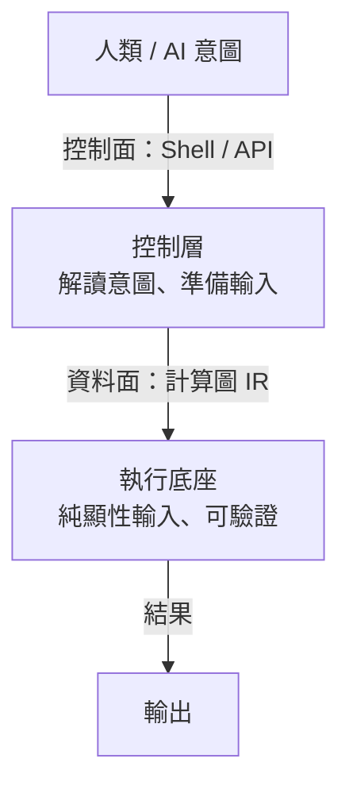

# 2.3　為人類設計的隱性狀態噪音

> 本節導論：比「效能成本」更難處理的，是「可推理性的成本」。POSIX 的許多設計，讓系統行為變得難以預測、難以驗證——這在 AI 生成的程式面前是致命的。

## 2.3.1 什麼是「隱性狀態噪音」

在軟體工程裡，**顯性狀態（explicit state）** 是指「明確傳遞、可被追蹤、可被推理」的狀態；**隱性狀態（implicit state）** 是指「隱藏在環境中、不透過介面傳遞、會悄悄影響行為」的狀態。

一個簡單的例子：一個函式 `f(x)` 如果只依賴參數 `x`，它是「純（pure）」的，行為可預測。但如果 `f` 還會讀取全域變數、環境變數、當前時間、當前目錄，那它的行為就依賴一堆「看不見的輸入」，難以推理、難以測試、難以驗證。

**隱性狀態噪音（implicit state noise）** 就是這些「不必要、卻又無所不在」的隱性狀態。POSIX 系統充滿了這種噪音，因為它的設計原點是「給人類操作」——而人類需要這些狀態來組織工作，機器卻不需要。

## 2.3.2 噪音清單：POSIX 的隱性狀態

讓我們盤點 POSIX 系統裡幾個典型的隱性狀態：

**（1）環境變數。**
程式行為深受 `PATH`、`HOME`、`LANG`、`LD_PRELOAD`、`TZ` 等環境變數影響。同一個執行檔，在不同的環境變數下，行為可能完全不同。`LD_PRELOAD` 甚至能劫持任意函式呼叫——這是強大的機制，也是巨大的隱性狀態來源。

**（2）當前工作目錄（CWD）。**
相對路徑的解析依賴 CWD。一個程式用相對路徑開啟檔案，行為取決於「從哪裡啟動」。這是每個系統管理員都踩過的坑。

**（3）umask、ulimit、rlimit。**
這些繼承自父行程的設定，會影響子行程的資源上限與檔案權限。它們是隱性的、繼承的、難以追蹤的。

**（4）訊號（signals）與訊號處理常式。**
一個程式在任意時刻都可能被訊號打斷，訊號處理常式的行為又依賴全域狀態。這讓程式的控制流變得極難推理（著名的「async-signal-safe」問題）。

**（5）檔案描述子的繼承。**
子行程繼承父行程的 fd 表。一個程式可能意外地繼承了一堆不該有的 fd，造成資源洩漏或安全問題。

**（6）全域的檔案系統命名空間。**
所有程式共享同一棵目錄樹，程式的行為依賴「這棵樹當前的狀態」。這讓程式難以在隔離環境中重現（這也是容器技術要解決的問題）。

## 2.3.3 為什麼這些噪音對 AI 生成程式是致命的

對人類寫的程式，這些隱性狀態雖然討厭，但人類可以透過經驗、文件、測試來處理。但對 **AI 生成的程式**，它們是致命的：

**（1）生成的程式沒有「經驗」。**
AI 生成程式時，不可能知道執行環境的 `PATH`、`CWD`、環境變數、檔案系統狀態。它生成的程式碼只能假設某些條件，而這些假設很容易在真實環境中失效。

**（2）驗證變得不可能。**
要「載入前驗證」一個程式是否安全（第 6 章），驗證器必須能靜態推理程式的行為。但如果程式行為依賴大量隱性狀態（環境變數、CWD、fd 表），驗證器就無法靜態確定它的行為——驗證的前提是「行為只依賴顯性輸入」。

**（3）可重現性（reproducibility）被破壞。**
AI 生成的程式如果因為隱性狀態而在不同環境下行為不同，就無法保證「同樣的意圖產生同樣的結果」。這對需要可靠性的系統是災難。

**（4）狀態空間爆炸。**
隱性狀態的組合（環境變數 × CWD × fd × 訊號 × …）讓程式的可能行為空間爆炸，這讓測試、驗證、除錯都變得極其困難。

## 2.3.4 一次具體的失敗場景

設想一個 AI 生成的資料處理程式，意圖是「讀取 `/data` 下的 CSV、算出統計、寫到 `/out`」。它生成的程式碼可能是這樣：

```python
import os
import csv

# AI 生成的「一次性」資料處理邏輯
path = os.environ.get("DATA_DIR", "./data")  # 依賴環境變數
with open(os.path.join(path, "input.csv")) as f:
    rows = list(csv.reader(f))
print(sum(int(r[1]) for r in rows[1:]))
```

這段程式碼看起來沒問題，但它依賴了：

* `DATA_DIR` 環境變數（沒設就用 `./data`，而 `./data` 又依賴 CWD）。
* `/data` 目錄是否存在。
* CSV 的格式（欄位順序、有無表頭）。
* 第二欄是否為整數。

在人類維護的世界裡，這些假設會被文件化、被測試、被處理。但在「AI 即時生成、即時執行」的世界裡，**這些假設無從得知，也無從驗證**。更糟的是，如果要在載入前驗證「這個程式不會越界存取」，驗證器根本無法確定 `path` 會是什麼——因為它依賴環境變數。

## 2.3.5 理想的對照：純粹的顯性輸入

一個「對 AI 與驗證友好」的程式，應該只依賴 **顯性輸入**——也就是計算圖的入口參數：

```text
graph @process(%input: tensor<...>) -> tensor<...> {
  %rows = csv.parse %input
  %col  = tensor.extract_column %rows, 1
  %sum  = tensor.reduce_sum %col
  return %sum
}
```

差別在哪？

* 輸入只有 `%input` 這個張量，沒有環境變數、沒有 CWD。
* 程式的行為完全由 IR 的語意決定，可被靜態分析。
* 驗證器可以確認「`%col` 的長度不超過 `%input` 的邊界」這類性質。
* 同樣的輸入，必然產生同樣的輸出（純函式語意）。

這正是第 5 章「IR 成為系統介面」的核心動機：**用結構化的、顯性的計算圖，取代充滿隱性狀態的 POSIX 程式模型**。

## 2.3.6 「給機器用」與「給人用」的分離

這裡有一個重要的設計洞察：**不需要消滅「給人用」的介面，只需要把它與「給機器用」的介面分離**。

人類還是需要 Shell、需要目錄樹、需要環境變數來操作系統。但這些應該是 **控制面（control plane）** 的工具，而不是 **資料面（data plane）** 的執行模型。也就是說：

* 人類用 Shell 下命令「請執行這個任務」——這是控制面，給人用。
* 系統收到意圖後，生成/選擇一個計算圖 IR，在純粹的顯性狀態下執行——這是資料面，給機器用。



傳統 POSIX 把這兩面混在一起：Shell 腳本既是「人給的命令」，又是「機器執行的程式」，於是隱性狀態滲透進執行模型。分離之後，資料面的執行模型可以做到「零隱性狀態」，而控制面仍保留人類熟悉的介面。

## 2.3.7 隱性狀態與「可驗證性」的根本關聯

把這個問題推到本體論層次：**可驗證性（verifiability）與顯性狀態（explicitness）是同一件事的兩面**。

一個東西之所以能被「載入前驗證」，是因為它的行為完全由「可見的輸入與程式碼」決定。任何隱性狀態都是驗證的漏洞：

* 隱性狀態讓「靜態分析」無法窮盡行為。
* 隱性狀態讓「形式化證明」失去前提（證明的是「在這個假設下」的性質，而假設可能不成立）。
* 隱性狀態讓「沙箱隔離」變得必要（因為無法證明安全，只能隔離）。

所以，**消除隱性狀態不只是「乾淨」，而是「讓驗證成為可能」的前提**。這是本書第 6 章「載入前驗證」與第 2 章「隱性狀態噪音」之間的深層連結。

## 2.3.8 本節小結

* 隱性狀態噪音是指「隱藏在環境中、會悄悄影響行為」的狀態。
* POSIX 充滿隱性狀態：環境變數、CWD、umask、訊號、fd 繼承、全域命名空間。
* 對人類程式，這些可用經驗與測試處理；對 AI 生成程式，它們致命：無從得知、無法驗證、不可重現、狀態空間爆炸。
* 理想的對照是「只依賴顯性輸入的計算圖」：純函式語意、可靜態分析、可驗證。
* 解法不是消滅「給人用」的介面，而是把控制面（給人）與資料面（給機器）分離。
* 隱性狀態與可驗證性是同一件事的兩面：要能驗證，就必須消除隱性狀態。

第 2 章到此，我們拆掉了 POSIX、行程、檔案系統這組包袱。下一章我們轉向本書第一個「正面」的技術支柱：**編譯器如何吞噬作業系統的職責**。
