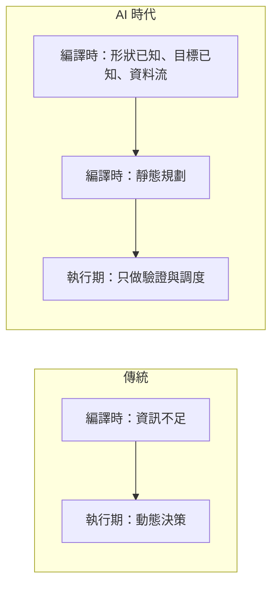

# 3.1　執行期職責的前移

> 本節導論：作業系統執行期（runtime）一直在做很多「其實可以提早決定」的事。編譯器的成熟，讓這些決定可以從「執行時」搬到「編譯時」。這是一場靜態化（staticization）的革命。

## 3.1.1 執行期到底在做什麼

先盤點傳統 OS 執行期（runtime）在背後偷偷做的事。當一個程式在跑，核心與執行期一直在做這些決策：

* **記憶體配置**：`malloc` 該給多大？從哪裡拿？何時釋放？
* **頁面映射**：哪些虛擬頁映射到哪些實體頁？何時換出？
* **排程**：哪個執行緒該跑？跑多久？在哪個核心跑？
* **快取管理**：哪些資料該放進快取？何時失效？
* **平行化**：哪些迴圈可以平行？怎麼切分工作？
* **I/O 排程**：讀寫請求該怎麼排序、合併？

這些決策的共同點是：**它們都發生在「程式已經開始跑、但資訊還不完整」的時刻**。執行期只能根據「當下的狀態」做「盡力而為」的決定——它不知道程式的完整結構，只能見招拆招。

## 3.1.2 為什麼這些決策是「動態」的

在傳統模型裡，執行期做動態決策的理由很充分：

* **輸入未知**：程式要處理的資料大小、形狀，在編譯時不知道。所以記憶體要動態配置。
* **環境未知**：程式跑在哪台機器、有多少核心、多少記憶體，在編譯時不知道。所以要動態排程。
* **行為未知**：程式的控制流可能依賴輸入（例如 `if (user_input) ...`），在編譯時不知道會走哪條路。

這三個「未知」，是動態決策的正當理由。在 1970–2000 年代，編譯器不夠聰明，無法做複雜的靜態分析，於是「把決策推遲到執行期」是唯一的選擇。

## 3.1.3 三個「未知」正在消失

但這三個「未知」，在 AI 與異質計算的脈絡下，正在快速消失：

**（1）輸入形狀變得可預測。**
AI 計算的輸入是張量（tensor），形狀（shape）在模型編譯時通常是已知的，或至少是有限集合（例如 batch size 可能是 1、8、32）。這讓記憶體配置、tiling、向量化都可以在編譯時靜態規劃。即使形狀是動態的，也可以用「符號形狀（symbolic shape）」在編譯期做部分推理。

**（2）環境變得可宣告。**
在雲端與邊緣部署中，「目標硬體」往往是已知的：你要部署到 A100、H100、某型 NPU，這些資訊在編譯時就確定。MLIR 的設計正是假設「目標已知」，可以在編譯時就對特定硬體做最佳化。

**（3）行為變得可分析。**
AI 生成的計算圖，通常是 **資料流圖（dataflow graph）**——沒有複雜的控制流，只有「張量從這到那」的資料依賴。這種結構比任意控制流容易靜態分析得多。

## 3.1.4 「前移」的四個具體例子

**（1）記憶體配置前移。**
傳統：`malloc` 在執行時向核心要記憶體。
前移：編譯器分析整個計算圖的記憶體需求，靜態計算出「峰值記憶體用量」，並規劃「哪塊緩衝區可以重用」。這叫 **記憶體規劃（memory planning）**，TensorFlow、TVM 等框架都在做。MLIR 的 `memref` 方言讓這件事可以在 IR 層完成。

**（2）平行排程前移。**
傳統：執行期用執行緒池動態分配工作。
前移：編譯器分析資料依賴，靜態決定「哪些運算可以平行、怎麼切分、怎麼映射到執行緒/核心」。這叫 **靜態排程（static scheduling）**，在 GPU 的 kernel 生成中尤其重要。

**（3）快取管理前移。**
傳統：硬體快取靠 LRU 等策略動態替換。
前移：編譯器知道資料的存取模式，可以主動做 **tiling（分塊）**，讓資料塊符合快取大小，避免快取抖動。這就是為什麼 matrix multiply 要切成 tile——讓工作集（working set）符合快取容量。

**（4）平行化前移。**
傳統：程式設計師手寫 `pthread` 或 OpenMP。
前移：編譯器自動偵測可平行的迴圈，生成平行程式碼。MLIR 的 `scf.parallel`、`linalg` 方言就是為此設計。

## 3.1.5 為什麼 MLIR 是關鍵

這些「前移」不是新想法——幾十年來編譯器一直在嘗試靜態最佳化。但 MLIR 讓它變成 **系統性的、可組合的** 工程實踐，原因是：

* **多層抽象**：MLIR 允許在同一份程式的不同抽象層級做不同決策。高階做算子融合，中階做 tiling，低階做向量化。每個層級都保留足夠的結構資訊。
* **可組合的 pass**：每個最佳化是一個 pass，可以自由組合、重複套用。
* **統一的 IR**：同一份 IR 可以降階到 CPU、GPU、NPU、FPGA。這讓「為異質硬體做靜態規劃」成為可能。

換句話說，**MLIR 是「執行期職責前移」的基礎設施**。沒有它，前移只能靠各框架自己手刻；有了它，前移變成一個通用的、可重用的方法。

## 3.1.6 前移的邊界：什麼不能前移

誠實地說，不是所有職責都能前移。有些事必須在執行期做：

* **真正的動態資料**：使用者輸入、網路封包、感測器資料——這些在編譯時不可能知道內容，只能知道「形狀」與「型別」。
* **動態資源競爭**：多個工作同時要同一塊記憶體或同一個加速器，這需要執行期的仲裁。
* **故障處理**：硬體錯誤、超時、斷線——這些是執行期事件。
* **安全驗證的最終確認**：即使編譯期做了驗證，執行期仍可能需要「最後一道防線」（例如硬體層的記憶體保護）。

所以「前移」不是「全部搬到編譯期」，而是 **「把能靜態決定的都靜態決定，只把真正動態的留給執行期」**。執行期的角色，因此從「做決策」變成「驗證與調度」——這正是「極薄內核」的雛形。

## 3.1.7 本節小結

* 執行期一直在做記憶體配置、頁面映射、排程、快取管理、平行化、I/O 排程等決策。
* 這些決策之所以動態，是因為「輸入、環境、行為」三個未知。
* 在 AI 與異質計算下，這三個未知正在消失（形狀可預測、目標可宣告、行為可分析）。
* 於是職責可以前移到編譯期：記憶體規劃、靜態排程、tiling、自動平行化。
* MLIR 提供了多層抽象、可組合 pass、統一 IR，是前移的基礎設施。
* 前移的邊界：真正的動態資料、資源競爭、故障處理、最終安全確認仍需執行期。

下一節，我們把「前移」推到極致：**當 MLIR 能同時降階為 CPU 指令、GPU kernel 與 FPGA 位元流，OS 與編譯器的邊界還剩下什麼**。
