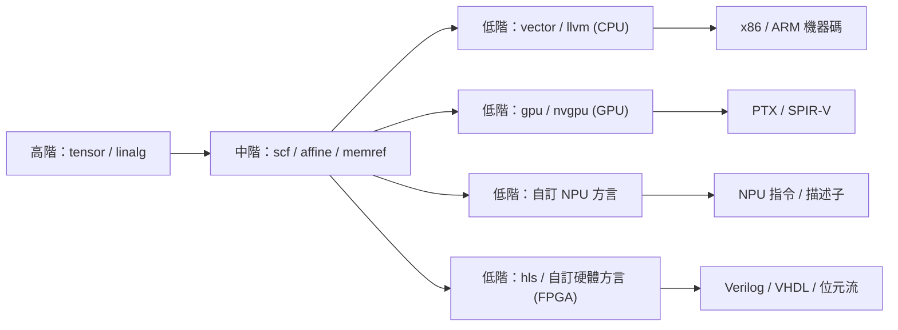
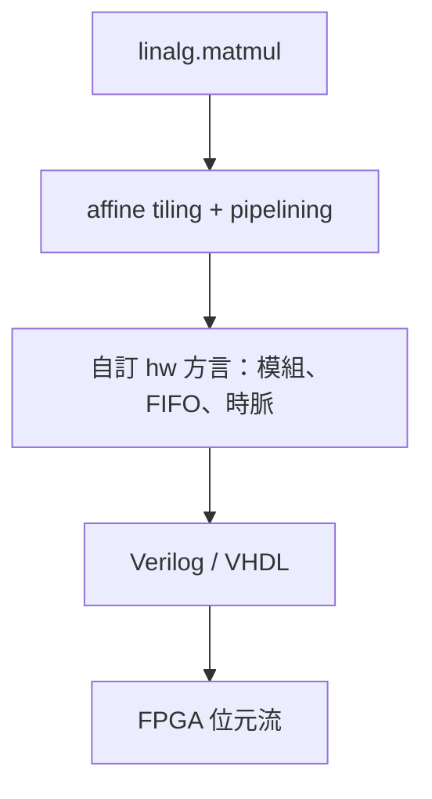

# 3.2　從機器碼到硬體電路的統一降階

> 本節導論：MLIR 最激進的承諾，是「同一份高階計算，可以降階成 CPU 指令、GPU kernel，甚至 FPGA 的電路」。本節拆解這個承諾的技術內涵與界線。

## 3.2.1 降階（Lowering）是什麼

在編譯器術語裡，**降階（lowering）** 是指「把高階抽象轉換成低階表示的過程」。例如把 `matmul` 這個高階算子，變成「三層巢狀迴圈」，再變成「向量指令」，再變成「機器碼」。

MLIR 的獨特之處，在於它把降階組織成 **一系列「方言（dialect）」之間的轉換**：

每一條邊，都是一個「降階 pass」。同一份高階計算，可以走不同的降階路徑，抵達不同的目標。

## 3.2.2 路徑一：降階到 CPU

這是編譯器最熟悉的路径。`linalg.matmul` 經過 tiling、向量化，變成 `vector` 方言的向量運算，再降階成 `llvm` 方言，最後由 LLVM 後端生成 x86 或 ARM 機器碼。

關鍵的靜態決策包括：

* **tiling**：把大矩陣切成符合快取的小塊。
* **向量化**：把純量迴圈變成 SIMD 指令。
* **迴圈展開**：把迴圈展開成指令序列，減少分支開銷。
* **暫存器分配**：把值放進暫存器。

這些決策全部在編譯時做完，執行期只是「照著跑」。

## 3.2.3 路徑二：降階到 GPU

GPU 的降階多了一層 **執行模型** 的映射：

* **執行緒映射**：把迴圈的迭代空間映射到 GPU 的 thread / block / grid。
* **記憶體層級**：決定資料放進 global memory、shared memory、還是 register。shared memory 是 GPU 的關鍵——它是 block 內共享的低延遲記憶體，需要手動管理（不像 CPU 快取是硬體自動管理）。
* **同步**：在適當的地方插入 `__syncthreads()`。

MLIR 的 `gpu` 方言把這些抽象成 `gpu.launch`、`gpu.block_id`、`gpu.thread_id` 等 op，再降階到 `nvgpu`（NVIDIA）或 `rocdl`（AMD）方言。

## 3.2.4 路徑三：降階到 NPU

NPU 的降階更為特化。以脈動陣列（systolic array）為例，計算模型是「資料流經 PE 陣列」，與 CPU/GPU 的「指令流」根本不同。降階要處理：

* **資料流排程**：決定資料如何在 PE 陣列中流動（weight stationary、output stationary、row stationary 等）。
* **片上緩衝**：NPU 的 SRAM 很小，需要精確的 tiling 與 double buffering。
* **DMA 生成**：生成把資料從 DRAM 搬到 SRAM 的 DMA 指令。
* **精度映射**：把 fp32 計算映射到 int8 或 fp16 的硬體單元。

這些決策需要 **硬體特定的知識**（PE 陣列大小、SRAM 容量、DMA 通道數），所以 NPU 的降階往往需要自訂方言（本書 MLIR 那本書的第 11 章有完整範例）。

## 3.2.5 路徑四：降階到 FPGA（HLS/HDL）

最激進的路徑，是把計算降階成 **硬體電路**。這條路叫 **高階合成（High-Level Synthesis, HLS）**：把高階語言或 IR，自動合成為暫存器轉移層（RTL）的硬體描述（Verilog/VHDL），最終燒進 FPGA 或做成 ASIC。

HLS 的核心挑戰是 **時空轉換（time-space transformation）**：

* **時序（timing）**：硬體是時脈驅動的，每個運算要在一個時脈週期內完成（或管線化）。
* **資源（resource）**：硬體資源有限（DSP、BRAM、LUT），需要決定「用多少資源換多少平行度」。
* **管線化（pipelining）**：把迴圈展開成管線，讓每個時脈都有一個結果輸出（initiation interval, II）。
* **資料流（dataflow）**：決定模組之間如何用 FIFO 連接。

MLIR 在這條路的角色，是提供「從高階計算到硬體結構」的中間表示。例如 `affine` 方言的多面體分析可以用來做迴圈排程，`scf` 可以表達管線，自訂的硬體方言則對接 HLS 工具（如 Xilinx Vitis HLS、Intel HLS）。

## 3.2.6 「統一降階」的真正含義

「同一份高階計算，可以降階到多種目標」——這句話的技術含義，比字面上更深刻：

**（1）一份意圖，多種實現。**
開發者（或 AI）只需要描述「我要做一個矩陣乘」，不需要指定「用 CPU 還是 GPU」。降階路徑由編譯器根據目標硬體選擇。這實現了 **「意圖與實現的分離」**。

**（2）最佳化知識的累積。**
每一條降階路徑的最佳化技巧（tiling 策略、向量化、管線化）都被封裝成 pass，可以重用、可以組合。這是 MLIR 相對傳統編譯器的巨大優勢。

**（3）跨目標的一致性。**
同一份 IR，在 CPU 與 GPU 上執行的語意是一致的。這讓「驗證一次、多處執行」成為可能——這對第 6 章的「載入前驗證」至關重要。

## 3.2.7 統一降階的界線與誠實的困難

但這個願景有真實的界線，不能過度美化：

* **不是所有計算都適合所有目標**：脈動陣列適合密集矩陣運算，但不適合稀疏、分支密集的計算。統一降階是「提供選項」，不是「萬能」。
* **效能調校仍需硬體知識**：自動降階生成的程式碼，往往不如手寫的極致最佳化。HLS 生成的硬體，也常需要手動調校時序。
* **方言生態碎片化**：每個硬體廠商都想有自己的方言，導致「統一」變成「各自為政」。這是 MLIR 生態的真實挑戰（也是 MLIR 那本書第 12 章討論的問題）。
* **驗證的複雜度**：降階路徑越多，每條路徑都要被驗證「語意保持（semantics-preserving）」，這是一項巨大的工程。

「統一降階」是一個 **方向**，而不是一個已經完成的事實。它讓我們能想像「一份 IR 跑遍異質硬體」，但距離「完全自動、完全最佳」還有很長的路。

## 3.2.8 本節小結

* 降階是「高階抽象到低階表示」的轉換，MLIR 把它組織成方言之間的 pass 鏈。
* 四條主要路徑：CPU（tiling/向量化）、GPU（thread 映射/記憶體層級）、NPU（資料流/片上緩衝）、FPGA（HLS/時空轉換）。
* 統一降階的真正含義：一份意圖多種實現、最佳化知識可累積、跨目標語意一致。
* 界線：不是所有計算適合所有目標、效能調校仍需硬體知識、方言碎片化、驗證成本高。
* 統一降階是方向，不是既成事實。

下一節，我們追問最根本的問題：**當編譯器能做到這一切，OS 與編譯器的邊界還剩下什麼**。
